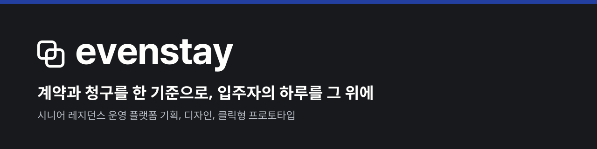
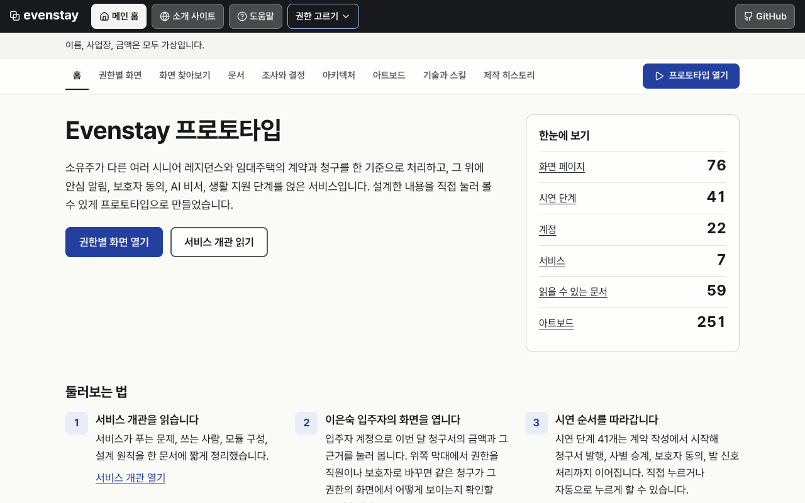
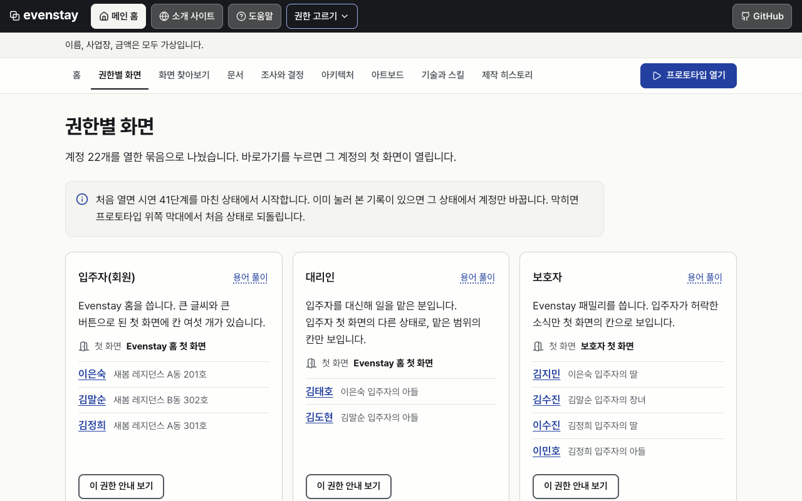
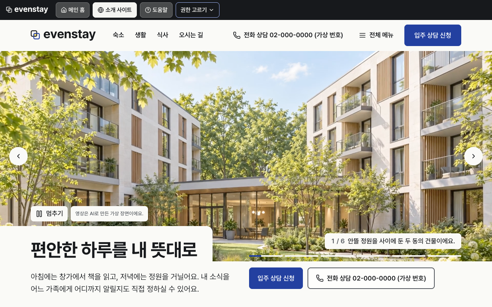
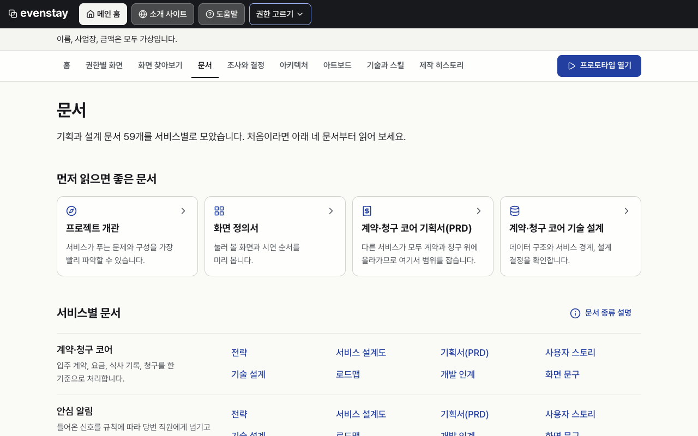
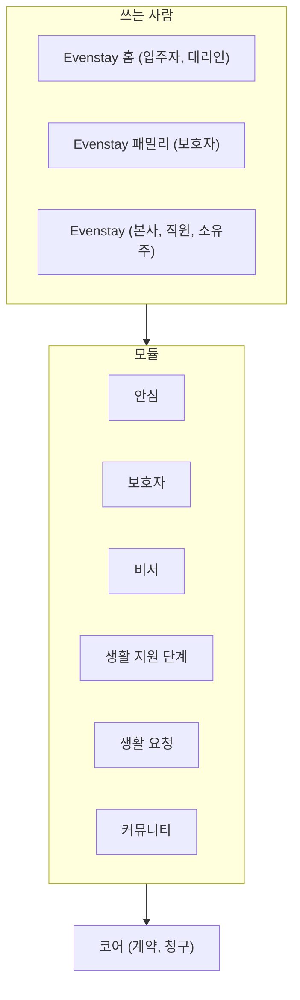
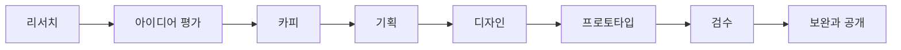

<p align="center">
  <a href="https://roadkwonai.github.io/evenstay-web/"></a>
</p>

<p align="center"><a href="https://github.com/roadkwonai/evenstay-web/releases/tag/v0.1.3"></a></p>

<a id="evenstay"></a>
<h1 align="center">Evenstay</h1>

<p align="center"><strong>소유주가 다른 여러 시니어 레지던스의 계약과 청구를 한 기준으로 처리하는 운영 플랫폼을 설계했습니다.</strong></p>
<p align="center">기획서 · PRD · 화면 정의서 · 아키텍처 · 클릭형 프로토타입 · 소개 사이트 · 제작 이력</p>

<p align="center">
  <a href="https://roadkwonai.github.io/evenstay-web/"></a>
  <a href="https://roadkwonai.github.io/evenstay-web/home/screens.html"></a>
  <a href="https://roadkwonai.github.io/evenstay-web/home/roles.html"></a>
  <a href="#modules"></a>
  <a href="docs/README.md"></a>
  <a href="docs/history/README.md"></a>
</p>

<p align="center">
  <a href="https://roadkwonai.github.io/evenstay-web/">통합 웹</a> · <a href="https://roadkwonai.github.io/evenstay-web/app.html">프로토타입</a> · <a href="https://roadkwonai.github.io/evenstay-web/site/index.html">소개 사이트</a> · <a href="docs/README.md">문서 지도</a> · <a href="docs/history/README.md">제작 이력</a>
</p>

> [!IMPORTANT]
> 실제로 운영하는 서비스가 아닙니다. 이름, 사업장, 금액은 모두 가상이고 실제 고객, 매출, 효과 수치는 없습니다. MVP는 만들지 않았습니다. 결과물은 문서와 클릭형 프로토타입이며, 결제와 문자는 시연 기록만 남기고 실제로 일어나지 않습니다.

<details>
<summary><strong>목차 펼치기</strong></summary>

## 목차

- [바로 보기](#toc-1)
- [어떤 문제를 푸는가](#toc-2)
- [서비스 구성](#modules)
- [문서](#toc-4)
- [제작 이력](#toc-5)
- [아키텍처 제안](#toc-6)
- [저장소 구조](#toc-7)

</details>

---

<a id="toc-1"></a>

## 바로 보기

| 보고 싶은 것 | 열 곳 |
| --- | --- |
| 전체를 한곳에서 | [통합 웹](https://roadkwonai.github.io/evenstay-web/) |
| 입주자 화면 | [이은숙 입주자로 열기](https://roadkwonai.github.io/evenstay-web/app.html?as=m.eunsook&go=COM-07) |
| 권한마다 달라지는 화면 | [권한별 화면](https://roadkwonai.github.io/evenstay-web/home/roles.html) |
| 화면 76개 찾아보기 | [화면 찾아보기](https://roadkwonai.github.io/evenstay-web/home/screens.html) |
| 가상 시설 소개 | [소개 사이트](https://roadkwonai.github.io/evenstay-web/site/index.html) |
| 구조와 흐름 도식 | [아키텍처](https://roadkwonai.github.io/evenstay-web/home/architecture.html) |
| 프롬프트와 스킬 기록 | [제작 히스토리](https://roadkwonai.github.io/evenstay-web/home/history.html) |

<table>
  <tr>
    <td width="50%"><a href="https://roadkwonai.github.io/evenstay-web/"></a></td>
    <td width="50%"><a href="https://roadkwonai.github.io/evenstay-web/home/roles.html"></a></td>
  </tr>
  <tr>
    <td align="center">통합 웹</td>
    <td align="center">권한별 화면</td>
  </tr>
  <tr>
    <td width="50%"><a href="https://roadkwonai.github.io/evenstay-web/site/index.html"></a></td>
    <td width="50%"><a href="https://roadkwonai.github.io/evenstay-web/home/docs.html"></a></td>
  </tr>
  <tr>
    <td align="center">소개 사이트</td>
    <td align="center">문서</td>
  </tr>
</table>

> [!TIP]
> 처음이라면 [서비스 개관](docs/overview/project.md)을 읽고 이은숙 입주자의 이번 달 청구서를 눌러 보세요. 위쪽 막대에서 권한을 바꾸면 같은 청구가 직원이나 보호자에게 어떻게 보이는지 확인할 수 있습니다.

<a id="toc-2"></a>

## 어떤 문제를 푸는가

시니어 레지던스와 임대주택을 소유주 대신 운영하는 회사는 사업장마다 요금, 식사 감면, 계약 승계 규칙이 달라 같은 방식으로 일하기 어렵습니다. 입주자와 보호자는 이번 달 금액이 왜 이만큼인지 확인하기 어렵습니다.

| 설계 원칙 | 내용 |
| --- | --- |
| 근거 있는 숫자 | 청구 항목마다 금액이 나온 이유를 쉬운 말로 보여 줍니다 |
| 바뀐 것은 모두 남기기 | 지난 기록은 고치지 않고 덧붙입니다 |
| 보이는 범위는 입주자가 결정 | 보호자가 보는 소식은 항목마다 입주자가 허락해야 열립니다 |
| 사람이 판단 | 시스템은 사실과 근거만 보여 주고 의료, 금전, 계약의 판단은 사람이 합니다 |
| 여러 사업장을 같은 방식으로 | 요금과 감면 규칙을 코드가 아니라 사업장 설정으로 둡니다 |

<a id="modules"></a>

## 서비스 구성



| 모듈 | PRD | 기술 설계 | 사용자 스토리 |
| --- | --- | --- | --- |
| 코어(계약, 청구) | [PRD](docs/planning/core/prd.md) | [설계](docs/planning/core/tech-design.md) | [스토리](docs/planning/core/user-stories.md) |
| 안심 | [PRD](docs/planning/safety/prd.md) | [설계](docs/planning/safety/tech-design.md) | [스토리](docs/planning/safety/user-stories.md) |
| 보호자 | [PRD](docs/planning/family/prd.md) | [설계](docs/planning/family/tech-design.md) | [스토리](docs/planning/family/user-stories.md) |
| 비서 | [PRD](docs/planning/assistant/prd.md) | [설계](docs/planning/assistant/tech-design.md) | [스토리](docs/planning/assistant/user-stories.md) |
| 생활 지원 단계 | [PRD](docs/planning/transitions/prd.md) | [설계](docs/planning/transitions/tech-design.md) | [스토리](docs/planning/transitions/user-stories.md) |
| 생활 요청 | [PRD](docs/planning/requests/prd.md) | [설계](docs/planning/requests/tech-design.md) | [스토리](docs/planning/requests/user-stories.md) |
| 커뮤니티 | [PRD](docs/planning/community/prd.md) | [설계](docs/planning/community/tech-design.md) | [스토리](docs/planning/community/user-stories.md) |

<a id="toc-4"></a>

## 문서

[전체 문서 지도 →](docs/README.md) · [웹에서 읽기 →](https://roadkwonai.github.io/evenstay-web/home/research.html)

| 목적 | 바로가기 |
| --- | --- |
| 전체 그림 | [서비스 개관](docs/overview/project.md) · [용어집](docs/overview/glossary.md) |
| 기획서 | [코어 전략](docs/planning/core/strategy.md) · [서비스 블루프린트](docs/planning/core/service-blueprint.md) · [로드맵](docs/planning/core/roadmap.md) · [개발 인계](docs/planning/core/handoff.md) |
| 화면 정의서 | [서비스 화면 정의서](docs/screens/mvp-screens.md) · [소개 사이트 화면 정의서](docs/planning/landing/screen-spec.md) · [화면 필요성 검토](docs/screens/screen-necessity-review.md) |
| 소개 사이트 기획 | [PRD](docs/planning/landing/prd.md) · [이미지 계획](docs/planning/landing/asset-plan.md) · [문구](docs/planning/landing/copy/copy.md) · [개발 인계](docs/planning/landing/handoff.md) |
| 디자인 | [디자인 시스템](docs/design/DESIGN.md) · [브랜드 가이드라인](https://roadkwonai.github.io/evenstay-web/design/brand/guidelines.html) · [프로토타입 안내](docs/design/prototype/README.md) · [검수 보고](docs/design/prototype/REPORT.md) |
| 아키텍처 | [구성안 비교](docs/architecture/architecture-options.md) · [기술 지형](docs/architecture/architecture-landscape.md) · [단계별 확장](docs/architecture/architecture-staged.md) · [사전 부검](docs/architecture/reviews/pre-mortem.md) |
| 조사 | [경쟁 지형](docs/research/competitive-landscape.md) · [PMS 지형](docs/research/pms-landscape.md) · [페르소나](docs/research/personas.md) · [JTBD](docs/research/jtbd.md) · [문제 은행](docs/research/problem-bank.md) |
| 아이디어 평가 | [숏리스트](docs/research/ideation/shortlist.md) · [평가표](docs/research/ideation/scorecard.md) |
| 결정 기록 | [결정 기록](docs/decisions/decisions.md) |
| 지원 준비 | [지원 회사 조사](docs/application/target-companies.md) · [레드팀](docs/application/red-team.md) · [코어 사전 부검](docs/application/pre-mortem-core.md) · [MVP 사전 부검](docs/application/pre-mortem-mvp.md) |
| 진행 기록 | [아이디어 보드](docs/process/idea-board.md) · [평가 기준](docs/process/evaluation-rubric.md) · [전체 목록](docs/README.md#진행-기록) |
| 작업 규칙 | [기획 규칙](docs/rules/senior-lab/CLAUDE.md) · [프로젝트 규칙](docs/rules/evenstay/CLAUDE.md) · [검토 안내](docs/rules/senior-lab/AGENTS.md) |

<a id="toc-5"></a>

## 제작 이력

기획부터 프로토타입까지 Claude Code로 진행했습니다. 프롬프트 원문, 스킬 호출, 설치한 도구, 이미지 생성 기록을 공개합니다. 2026-11-02 21:39부터 2026-11-05 13:39까지(KST)의 세션 기록입니다.

| 기록 | 규모 | 문서 | 웹 |
| --- | --- | --- | --- |
| 프롬프트 | 945건(사용자 314, 허브 지시 405, 에이전트 지시 226) | [단계별 기록](docs/history/README.md) | [보기](https://roadkwonai.github.io/evenstay-web/home/history-prompts.html) |
| 스킬 | 호출 841회, 54종 | [사용 이력](docs/history/skills.md) | [보기](https://roadkwonai.github.io/evenstay-web/home/history-skills.html) |
| 설치와 도구 | 스킬 저장소 12곳 | [설치한 것](docs/history/tools.md) | [보기](https://roadkwonai.github.io/evenstay-web/home/history-installed.html) |
| 이미지와 영상 | 81개 | [생성 기록](docs/history/media.md) | [보기](https://roadkwonai.github.io/evenstay-web/home/history-media.html) |

<details>
<summary><strong>진행 단계 펼치기</strong></summary>



</details>

<a id="toc-6"></a>

## 아키텍처 제안

구현하지 않은 설계안입니다. 최신 기준은 [아키텍처 설계안](docs/architecture/senior-housing-architecture-design.md)이며, [재검토와 보완 기록](docs/architecture/reviews/architecture-codex-rereview-2026-11-05.md)을 함께 공개합니다.

| 단계 | 구성 |
| --- | --- |
| 0단계 | HTML·JS 클릭형 프로토타입(현재 결과물) |
| 1단계 | Next.js 화면, Spring Boot 모듈형 코어, PostgreSQL, AWS 서울(기준안) |
| 2단계 | 실제 데이터 전환을 위한 가용성·권한·복구·연동 조건 |
| 3단계 | 문서 추출·근거 검색·평가, 필요할 때 Python 작업자 |
| 4단계 | 승인 대기·재검증·DB 상태기계, 실행기는 조건부 |
| 5단계 | 측정된 병목만 분리, Kubernetes와 전용 검색은 조건부 |

프로토타입은 빌드 없는 HTML, CSS, JavaScript(ES 모듈)이고 상태는 브라우저에만 저장합니다. 서버와 데이터베이스는 없습니다.

<a id="toc-7"></a>

## 릴리즈

현재 버전은 **0.1.3**입니다. [날짜·시각별 릴리즈 기록](release/README.md), [변경 이력](CHANGELOG.md), [GitHub Releases](https://github.com/roadkwonai/evenstay-web/releases)를 함께 관리합니다. `0.1.0`은 보완 전 기준본이고 `0.1.1`은 아키텍처 처리 규칙을 보완한 버전이며, `0.1.2`는 도식 도구·글꼴 검증, `0.1.3`은 공통 CSS 경고와 상단 영역을 보완한 버전입니다.

## 저장소 구조

```text
evenstay-web/
├── VERSION               # 현재 버전
├── CHANGELOG.md          # 변경 이력
├── release/              # 한국 시간 YYYYMMDDHHMM-title별 릴리즈 기록
├── docs/                 # 문서
│   ├── overview/         # 서비스 개관, 용어집
│   ├── planning/         # 모듈 7개와 소개 사이트의 기획, 문구
│   ├── screens/          # 화면 정의서
│   ├── design/           # 디자인 시스템
│   ├── architecture/     # 구성안, 확장 단계, 검토
│   ├── research/         # 조사, 아이디어 평가
│   ├── decisions/        # 결정 기록
│   ├── application/      # 지원 회사 조사, 레드팀, 사전 부검
│   ├── process/          # 재승인 묶음, 보드, 검토 기록
│   ├── rules/            # 에이전트 작업 규칙
│   └── history/          # 프롬프트, 스킬, 도구, 생성물 기록
├── web/                  # GitHub Pages로 배포하는 정적 사이트
│   ├── index.html        # 통합 웹
│   ├── app.html          # 프로토타입
│   ├── home/             # 문서, 아키텍처, 아트보드, 제작 히스토리
│   ├── site/             # 소개 사이트
│   └── design/           # 브랜드 가이드라인, 디자인 시스템
└── .github/workflows/    # Pages 배포
```

로컬에서 보려면 정적 서버로 `web`을 엽니다.

```bash
python3 -m http.server 4173 --directory web
```
