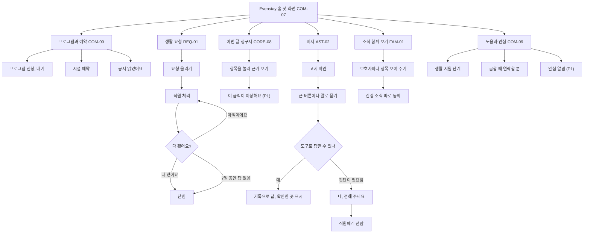
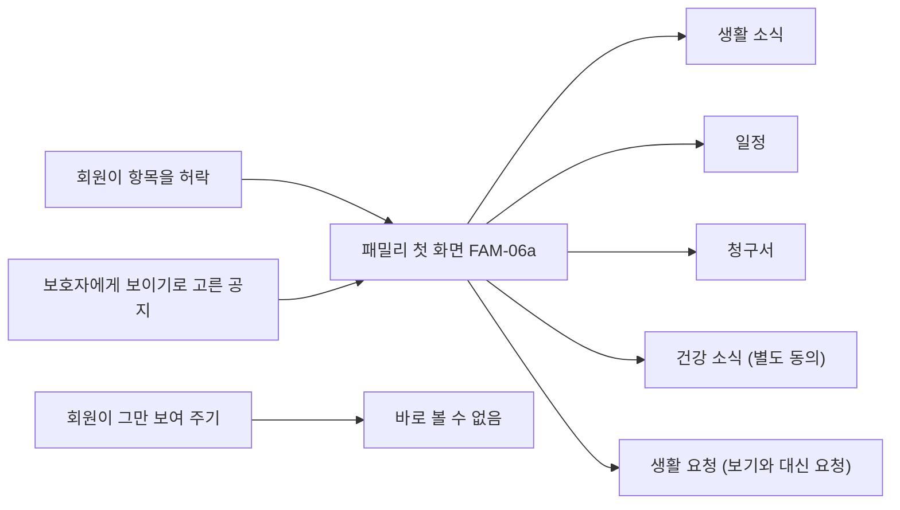
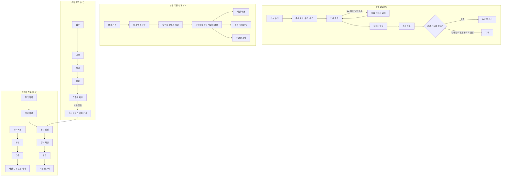

# Evenstay 프로젝트 개관

작성: 2026-11-04 · 상태: 초안 · 기준: 루트 `CLAUDE.md`, `docs/*/prd.md`, `docs/*/tech-design.md`, `design/mvp-screens.md`, senior-lab `shared/decisions.md`

전체 그림을 긴 문서 없이 잡으려고 만든 요약이다. 용어와 화면 말은 `docs/glossary.md`에 있다. 이 파일과 원본이 다르면 원본이 맞다. 절 끝의 출처가 자세한 내용을 볼 곳이다.

## 1. 서비스 한 줄 요약

소유주가 다른 여러 시니어 레지던스와 임대주택의 계약과 청구를 한 기준으로 처리하고, 그 위에 안심 알림, 보호자 동의, AI 비서, 생활 지원 단계, 생활 요청, 프로그램을 모듈로 얹는 시니어 레지던스 PMS다.

[지원 회사] Tech Lead / Senior Backend 지원용 포트폴리오다. 실제 고객, 매출, 효과 수치는 없고 데모 데이터는 모두 가상이다.

**결과물 범위**: 아트보드와 클릭형 프로토타입까지다. MVP는 만들지 않는다(사용자 확정). 기획 문서와 `design/mvp-screens.md`에 적힌 "MVP"는 구현 계획이 아니라 설계 범위로 읽는다. 백엔드 깊이는 기술 설계, ADR, ERD 문서로 보인다.

## 2. 타겟 사용자

| 앱 | 이용자 | 쓰는 까닭 | 화면 원칙 |
|---|---|---|---|
| Evenstay 홈 | 입주 회원(70~80대), 대리인 | 내실 돈의 이유를 알고, 요청하고, 소식을 누구에게 보일지 정한다 | 본문 20px, 버튼 56px, 해요체, "회원님", 하단 탭 없음 |
| Evenstay 패밀리 | 보호자(자녀) | 회원이 허락한 소식, 일정, 청구서를 한곳에서 본다 | 본문 17px, 해요체, "○○○ 회원님" |
| Evenstay(운영) | 본사, 경리, 프런트, 생활 지원·간호, 사업장 책임자, 소유주 | 사업장이 늘어도 같은 방식으로 일한다 | 본문 15px, 합쇼체와 명사형 라벨, "입주자" |

첫 세그먼트는 소유주가 다른 시니어하우징과 임대 사업장을 함께 위탁 운영하는 운영사의 운영 매니저와 경리다. 다음은 청구서를 받는 회원과 보호자, 그다음은 소유주다.

출처: `design/mvp-screens.md` 1절, `docs/core/strategy.md` 2절.

## 3. 핵심 가치

- **근거 있는 숫자**: 청구 항목마다 이유를 쉬운 말로 보인다.
- **바뀐 것은 모두 남긴다**: 원장은 추가만 하고, 변경 이력은 하나다.
- **사람이 판단한다**: 시스템은 관찰된 사실과 근거만 보인다. 의료, 응급, 금전, 계약 판단은 사람이 한다.
- **보이는 범위는 회원이 정한다**: 보호자가 보는 소식은 항목마다 회원의 허락으로 열린다.
- **앱 밖 대안 경로**: 모든 Evenstay 홈 화면에 "프런트로 전화하기"가 있다.
- **여러 사업장, 여러 자산 유형**: 규칙을 코드가 아니라 사업장 설정으로 둔다.

출처: `docs/core/strategy.md` 1·4절, 루트 `CLAUDE.md`.

## 4. 사용자 흐름

회원은 첫 화면 타일 6개로 들어간다. 타일 순서는 `[가설]`이다.

보호자는 허락받은 항목만 타일로 본다.

대리인은 Evenstay 홈 첫 화면의 다른 상태로, 맡은 범위의 타일만 본다. 출처: `design/mvp-screens.md` 1-1·1-2절.

## 5. 직원·관리자 흐름

역할마다 첫 화면이 다르다.

| 역할 | 첫 화면 | 보이는 묶음 |
|---|---|---|
| 야간 직원 | SAF-01 지금 처리할 신호 | 안전 |
| 프런트 | REQ-12 생활 요청 | 입주자, 돈(식사 기록), 안전(일부), 요청·프로그램 |
| 경리 | CORE-01 확인할 일 | 오늘, 입주자(계약), 돈 |
| 생활 지원·간호 | SAF-12 호실 현황 | 안전, 입주자(일부), 요청·프로그램 |
| 사업장 책임자 | CORE-01 오늘의 운영 | 6묶음 모두 |
| 본사 | CORE-01(사업장 선택) | 6묶음 모두 |
| 소유주 | CORE-09 소유주 현황 | CORE-09와 월 리포트 |

사이드바 6묶음은 오늘, 입주자, 돈, 안전, 요청·프로그램, 설정이다.

프로그램(N2)은 회차 → 신청·대기 → 마감 전 취소면 자동 승급 → 출석 체크(온 분만)이고, 공지는 게시 → [읽었어요] → 확인 현황 → 직접 전함이다. 비서 넘김(G)은 넘겨받은 요청에서 처리한다. 건강, 금전, 계약 판단은 G 화면에 남고, 도구 밖 질문과 직접 요청은 생활 요청으로 보낸다.

출처: `design/mvp-screens.md` 1-3절, 각 모듈 `prd.md` 6절.

## 6. 통합 데모 흐름 요약

주인공은 A동 201호 이은숙이다. 사별 승계 뒤 1인 거주이고, 딸 김지민은 보호자이자 비상 연락처 1순위, 아들 김태호는 대리인(위임장, 청구서 확인·결제)이자 비상 연락처 2순위다. 사업장은 새봄 레지던스(12호실, 소유주 온누리 시니어펀드 1호)와 다온하우스(8호실, 소유주 다온 임대리츠), 운영사는 새봄라이프운영이다. 모두 가상이다.

41단계를 시드 초기화 없이 멈춘 시계만 옮겨 잇는다.

| 단계 | 기준 시각 | 모듈 | 내용 |
|---|---|---|---|
| 1~5 | 2026-10-01~11-10 | 코어 | 부부 계약, 보증금, 10월 청구서 4,947,000원, 사별 승계, 소유주 격리 |
| 6~7 | 11-11 | D | 보호자 허락 대신 입력, 회원 확인, 건강 소식 따로 동의 |
| 8~12 | 11-12 | B, 코어, D | 밤 신호 세 건, 넘김, 조치 기록, 보호자 건강 소식, 운영 현황, 안부 방문 |
| 13~18 | 11-17 | N1, D, 코어 | 정기 청소, 고장 수리, [아직이에요], 보호자 요청, 외출 차량, 유료 요청의 사용 기록 |
| 19~23 | 11-18~19 | N2, D | 공지, 프로그램 신청과 대기, 승급, 시설 예약, 보호자 일정, 출석 |
| 24~25 | 11-23 | D | 생활 소식 초안과 발송, 그만 보여 주기, 열람 기록 |
| 26~27 | 11-30~12-01 | 코어 | 11월 청구서 4,893,000원, 월 리포트 |
| 28~30 | 12-02~07 | B, 코어, D | 병원 동행, 장기 부재 시작과 복귀, 보호자 소식 |
| 31~35 | 12-08~10 | C, 코어, D | 평가, 제안, 설명 전 결정 거부, 결정, 회원 화면 |
| 36 | 12-31 | 코어 | 12월 청구서 2,910,000원 |
| 37~40 | 2027-01-05 | G | 고지 확인, 날짜와 청구 답, 금전 질문 넘김, 도구 호출 기록, LLM 연결 끊김 |
| 41 | 2027-01-08 | C | 외부 돌봄 겹침 처리 |

출처: `design/mvp-screens.md` 5절, `docs/core/prd.md` 9절.

## 7. 기술 스택 (설계 기준)

구현을 확정한 표가 아니라 설계의 기준이다. 이번에 실제로 만드는 것은 아트보드와 클릭형 프로토타입뿐이다.

| 층 | 설계 기준 | 설계안 |
|---|---|---|
| 프로토타입(이번 결과물) | HTML·JS 클릭형 프로토타입, 아트보드 | — |
| 화면 | Next.js(`app/`, `ui/`에만 들어온다), shadcn/ui, Tailwind CSS, Lucide, Pretendard | Next.js 16 컨테이너 1개 |
| 코어 백엔드 | Spring 계열: Java 25, Spring Boot 4.1, Spring Modulith 2.1 | 같은 이미지로 API와 작업자를 띄움 |
| 구조 | 모듈형 모놀리스, 모듈별 스키마, 한 번에 배포 | 컨테이너 3개(화면, API, 작업자)와 DB 하나 |
| DB | PostgreSQL | RDS PostgreSQL 18, Single-AZ, 가상 데이터 |
| 금액 | 원 단위 정수 | DB 64비트 정수를 읽는 방식은 `[미정]` |
| 작업·이벤트 | 아직 고르지 않음. 비교 전까지 JobRunr 안을 기본으로 본다 | 코어 아웃박스 유지, JobRunr(PostgreSQL), Modulith 이벤트 기록 |
| AI | LLM은 질문의 뜻을 고르는 데만 쓴다(ADR-G1) | 1단계는 Python 없이 API가 어댑터로 Bedrock 서울 호출(Sonnet 5). 데모 기본은 녹화 응답. 2단계 FastAPI, Pydantic v2, PydanticAI, Taskiq |
| 검색 | — | PostgreSQL 전문 검색 또는 없음. 2단계 pgvector |
| 클라우드·실행 | — | AWS 서울, ECS Express Mode(화면, API), 작업자는 일반 ECS. Kubernetes는 3단계 |
| 관측 | — | 구조화 로그, CloudWatch, 평가 JSON |
| 월 고정비 | — | 1단계 약 $261, 2단계 약 $546, 3단계 약 $567(계산값, 설계안 단계 기준) |
| ORM, 인증 | `[미정]` | — |

- 설계안 칸의 출처는 senior-lab `00-hub/reviews/architecture-staged-2026-11-04.md`다. 구현 계획이 아니라 설계안이고, 그 문서의 "1단계 MVP"도 설계 단계 이름으로 읽는다.
- 건물 층(호출벨 연동)은 호출벨 동작을 확인한 뒤 정한다.
- 구성안 3개와 0~5단계 확장 계획은 senior-lab `01-research/outputs/senior-housing-architecture-design.md`에 있고, 웹에서는 `home/architecture.html`로 본다. 위 표의 "1단계"는 그 문서의 1단계, "2단계"는 2·3단계, "3단계"는 4·5단계에 해당한다. A안이 위 표의 설계안이고, 어느 구성안으로 갈지는 `[미정]`이다.
- 월 고정비는 NAT와 퍼블릭 IPv4를 더한 값이다. 단계별 제안의 약 $207, 약 $439는 네트워크가 빠진 값이다. "Modulith 이벤트 기록"은 설계안에서 쓰지 않기로 바꿨고, Next.js는 16.4.1 이상으로 고정한다(2026-11-05 재검토).
- Bedrock 서울에서 리전 안 처리가 되는 모델은 Opus 5와 Sonnet 5다. 5.5 모델은 서울에서 global 추론만 된다(2026-11-05 조회).
- 설계 기준 칸의 출처는 senior-lab `shared/decisions.md` 2026-11-04 마지막 행과 루트 `CLAUDE.md`다. `docs/core/tech-design.md` 12절과 루트 `CLAUDE.md` 기술 방향은 아직 이 결정을 반영하지 않았다.

## 8. 앱 URL 구조

브라우저 페이지 URL은 원본 문서에 없다 `[미정]`. 화면은 화면 ID로, 서버 경로는 아래 REST 접두어로 정해져 있다.

| 화면 ID 접두어 | 모듈 | 화면 수 |
|---|---|---|
| `COM` | 공통(데모 막대, 권한 없음, 오류, 빈 상태, 첫 화면, 앱 틀, 묶음 화면) | 9 |
| `CORE` | 코어 | 15 |
| `SAF` | 안심 알림 | 17 |
| `FAM` | 보호자 포털·동의 | 24 |
| `AST` | AI 생활 비서 | 13 |
| `TRN` | 생활 지원 단계 | 12 |
| `REQ` | 생활 요청 | 21 |
| `CMN` | 프로그램·시설·공지 | 23 |

모두 134행이고, 합친 뒤 따로 만들 페이지는 75개다(홈 27, 패밀리 8, 운영 40).

| REST 접두어 | 쓰는 쪽 | 모듈과 경로 |
|---|---|---|
| `/me/*` | 회원, 대리인 | 코어 `/me/invoices`, `/me/representation` · D `/me/family/*`, `/me/ai-notice`, `/me/ai-preference` · C `/me/care-stage` · N1 `/me/requests`, `/me/recurring` · N2 `/me/programs`, `/me/sessions`, `/me/enrollments`, `/me/places`, `/me/reservations`, `/me/notices` |
| `/assistant/*` | 회원, 대리인 | G `/assistant/me`, `/assistant/notice/acknowledge`, `/assistant/conversations`, `/assistant/confirmations/{id}/accept` |
| `/family/*` | 보호자 | D `/family/residents/{id}/overview`, `invoices`, `health-events`, `life-reports`, `absences`, `schedule` · N1 `/family/residents/{id}/requests` · `/family/invitations/{token}/accept` |
| `/sites`, `/owners`, `/residents`, `/contracts`, `/invoices`, `/charges`, `/representatives`, `/emergency-contacts`, `/absences`, `/inquiries`, `/management-contracts`, `/audit-logs` | 운영 직원 | 코어 |
| `/sites/{id}/operations-board` | 책임자, 본사 | `app/` 조립 라우트 |
| `/owner/summary`, `/owner/reports/{yyyy-mm}` | 소유주 | 코어(리포트는 `app/` 조립) |
| `/safety/*` | 운영 직원 | B `/safety/sites/{id}/board`, `/safety/alerts/{id}/...`. 회원 상태는 `/safety/me/calls`(P1) |
| `/safety/webhooks/{source}` | 업체 | B 신호 수신, HMAC 서명 |
| `/admin/family/*` | 운영 직원 | D 보호자 연결, 대신 입력, 리포트, 열람 기록 |
| `/assistant/admin/*` | 운영 직원 | G 넘겨받은 요청, 대화, 도구 호출 |
| `/transitions/*` | 운영 직원 | C 단계 정의, 평가, 제안, 결정, 외부 돌봄 |
| `/staff/*` | 운영 직원 | N1 `/staff/sites/{id}/requests`, `/staff/requests/{id}/...` · N2 `/staff/sites/{id}/programs`, `/staff/sessions/{id}/...`, `/staff/notices/{id}/...` |
| `/webhooks/payments/{provider}` | 결제 업체 | 코어(P1) |
| `/demo/*` | 데모 진행자 | `/demo/actor`, `/demo/clock`, `/demo/reset`, `/demo/safety/simulate`, `/demo/family/seed-health-event`, `/demo/assistant/tool-calls` |

모든 쓰기는 `Idempotency-Key`를 받는다. 전체 표는 각 `tech-design.md` 8-1절이다.

## 9. 데이터 모델 요약

모든 테이블은 `id`, `operator_id`, `created_at`, `created_by`를 갖고, 사업장에 속한 테이블은 `site_id`로 RLS를 건다. 스키마 사이에 외래 키가 없고 ID만 보관한다. 실제 테이블 이름은 아직 없다.

| 스키마 | 핵심 엔티티 |
|---|---|
| `core` | 조직: Operator, Owner, SiteOwnership, Site, Building, Unit, ManagementContract · 사람: Person, Resident, GuardianLink, EmergencyContact, Representative, UserAccount, RoleAssignment · 계약: Contract, ContractParty, ContractSignature, EvidenceCheck, ResidentAbsence · 청구: PricingVersion, BillingSchedule, MealSkip, MealPeriodClose, BillingRun, Invoice, Charge, ServiceUsage, Payment, DepositEntry, Settlement, Inquiry · 공통: AuditLog, OutboxEvent |
| `safety` | Device, ResidentLink, RawSignal, SignalEvent, DuplicateReceipt, Rule, OnCallShift, OnCallSlot, Alert, StaffNotification, AlertEvent, ActionRecord, EmergencyCallLog, GuardianOutcome · P1: VisitPlan, VisitRecord, HospitalEscort, IncidentReport, EvacuationAssist, EvacuationRoll, EvacuationCheck |
| `family` | GuardianAccess, Consent, ConsentChange, PendingBatch, SensitiveConsent, HealthEvent, HealthEventWithhold, WeeklyReport, ReportFeedback, AiNoticeVersion, AiNoticeAck, AiPreference, ScopeNoticeAck, AccessLog, Invitation, NoticeQueue, MoneyRequest |
| `assistant` | Conversation, Turn, ToolCall, Confirmation, Handoff. 최소 버전은 아웃박스를 두지 않는다 |
| `transitions` | StageDefinitionVersion, StageDefinition, StageService, StageServiceTime, Assessment, AssessmentItem, StageChangeProposal, ProposalEvidence, Explanation, StageDecision, StageAssignment, ServiceSlot, AmendmentRequest, ExternalCareSchedule, ExternalCareSlot, ScheduleOverlap, ReviewRequest, OutboxEvent |
| `requests` | ServiceRequest, EscortDestination, RequestTransition, RequestTypeSetting, TeamMembership, RecurringTask, RecurringOccurrence, RecurringSkipRequest, ChargeHandoff, OutboxEvent |
| `community` | Place, Program, ProgramRevision, ProgramSession, PlaceBooking, ReservationChange, Enrollment, Attendance, Notice, NoticeRecipient, NoticeAck, DeliveryNote, OutboxEvent |
| `leasing` | 기획 전. 예상은 리드, 투어, 대기 명단 |

핵심 관계: 사업장 → 동 → 호실 → 계약 → 청구서 → 청구 항목 → 수납. 계약은 `succeeded_from_id`로 이어진다. 입주자는 사업장마다 한 행이고 사람(Person)을 가리킨다. D는 코어 `guardian_link_id`에 동의를 붙인다. 안심 알림은 신호 1건에서 알림이 최대 1건 생긴다.

출처: 각 `tech-design.md` 2-2·2-3절.

## 10. 모듈 요약

| 모듈 | 폴더·약칭 | 직원 화면 이름 / 회원·보호자 화면 이름 | 하는 일 | 갖지 않는 것 | 인계 |
|---|---|---|---|---|---|
| 계약·청구 코어 | `core` | Evenstay Core / 이번 달 청구서 | 조직, 사람, 계약, 요금, 식사, 청구 원장, 역할, 변경 이력 | 건강·돌봄 정보, 동의 정책, 대화, 회계 분개 | 2026-11-03 |
| 안심 알림 | `safety`, B | 안심 알림 / 안심 알림(회원만) | 신호 수신 → 규칙 → 당번 넘김 → 조치 기록 → 보호자용 결과 | 상태 판단, 119 자동 신고, 보호자 화면과 문자, 전화번호 | 2026-11-03 |
| 보호자 포털·동의 | `family`, D | 보호자 포털·동의 / Evenstay 패밀리 | 항목별 허락, 건강 소식, 주간 생활 리포트, AI 고지, 열람 기록, 금전 부탁 | 보호자 관계와 대리권(코어), 금융 정보 | 2026-11-03 |
| AI 생활 비서 | `assistant`, G | AI 생활 비서 / Evenstay 홈 비서 | 날짜와 청구를 기록으로 답하고, 판단은 회원 확인 뒤 직원에게 넘김 | 계약·청구 데이터, 음성 원본, 도구 결과 사본 | 2026-11-03 |
| 생활 지원 단계 | `transitions`, C | 생활 지원 단계 / 생활 지원 단계 | 평가 → 제안 → 설명 → 결정, 외부 돌봄 겹침 | 단계 판정·추천, 요금 변경, 진단·점수 | 2026-11-03 |
| 생활 요청 | `requests`, N1 | 생활 요청 / 생활 요청 | 요청 접수 → 배정 → 처리 → 입주자 확인, 정기 작업, 유료 요청 넘김 | 금액 계산, 안전 신호, 보호자 문자 | 2026-11-03, 기획 초안 |
| 프로그램·시설·공지 | `community`, N2 | 프로그램·시설·공지 / 프로그램, 시설 예약, 공지 | 회차, 신청과 대기, 출석, 시설 예약, 공지 확인 | 청구(이번 버전은 무료만), 보호자 허락 | 2026-11-04, 기획 초안 |
| 입주 상담 | `leasing`, E | Evenstay Leasing / 입주 상담 | 기획 전. 예상은 공실·견적 조회, DRAFT 계약 생성 | — | 기획 전 |

다른 폴더: `platform`(Clock, Notifier, 아웃박스), `app`(라우트, 대시보드 조립, 데모 라우트), `ui`, `seed`, `docs`.

## 11. 설계 원칙

**모듈 경계(ADR-2)**
1. 모듈마다 DB 스키마를 두고 다른 스키마에 쓰지 않는다.
2. 구현은 `core/api`와 다른 모듈 `api/`만 import한다. `api/`끼리는 의존하지 않고 순환이 없다. 코어는 어떤 모듈도 모른다.
3. 다른 모듈 테이블을 조인하지 않고 외래 키를 두지 않는다. ID만 보관한다.
4. 모듈 사이 변화는 도메인 이벤트(아웃박스)로 전하고, 소비자는 이벤트 ID로 멱등 처리한다.
5. 권한 검사는 코어 `authorize()` 하나다. 모듈은 자기 행동에만 허용 정책을 등록하고 코어의 범위 거부를 뒤집지 못한다. 예외는 보호자 동의 하나다.
6. 변경 이력은 코어 AuditLog 하나에 `AuditWriter`로 쓴다.
7. CI의 import 경계 검사와 DB 스키마 권한으로 1~3을 확인한다.
8. 다른 모듈 데이터를 복사하지 않고 매 요청 `api/`로 읽는다. 대시보드 "확인할 일"은 `app/`이 조립한다.
9. 데모 초기화는 `app/`이 core → safety → family → assistant → transitions → requests → community 순서로 부른다.

**돈과 기록**
- 원장은 불변이다(ADR-4). 발행이 확정 시점이고, 발행 뒤 정정은 다음 청구서의 조정 전표로만 한다. 환불은 음수 수납, 보증금은 별도 원장이다.
- 사별 승계는 새 계약이다(ADR-5). 당사자가 바뀌면 새 계약, 조건만 바뀌면 계약 변경이다.
- 청구 규칙은 3개(정기 요금, 식비, 결식 감면)이고 일할 계산이 없다. 요금표는 체결 때 버전으로 고정한다.
- 바꾸는 설정은 새 버전으로 쌓는다(요금표, 규칙, 단계 정의, 요청 종류 설정).

**사람이 판단한다**
- 의료, 응급, 금전, 계약 판단은 사람이 한다. 화면에 판단 단어를 쓰지 않는다.
- 시스템은 119에 신고하지 않는다(안심 알림).
- AI는 질문의 뜻을 고르는 데만 쓰고, 회원에게 보이는 답은 기록을 틀에 채워 만든다(ADR-G1). 쓰기는 회원 확인 토큰으로만 한다(ADR-G3).
- 생활 지원 단계는 사람이 정한다. 판정, 추천, 점수, 단계 번호가 없고 제안한 사람은 결정하지 못한다(ADR-T1·T2).
- 생활 요청은 안전 신호가 아니다. 안심 알림으로 옮길지는 직원이 판단한다.
- 주간 생활 리포트는 직원이 확인한 뒤에만 나간다.

**민감정보**
- 건강·돌봄 정보는 별도 동의 없이 저장하거나 보이지 않는다. 건강 소식이 보호자에게 가는 길은 D 하나다.
- 진단명, 진료 결과, 처방 칸을 어느 모듈에도 두지 않는다. 주민번호를 받지 않는다.
- 동의는 스위치나 미리 체크된 칸으로 받지 않는다.

**화면**: 큰 글씨와 터치 영역, 한 화면에 하나의 행동, 쉬운 말, 되돌리기, 앱 밖 대안 경로. 이모지를 쓰지 않는다. 디자인 값의 원본은 루트 `DESIGN.md`다.

## 12. 이번 결과물 범위 밖

Next.js 화면, Spring 백엔드, 실제 DB, 배포는 만들지 않는다. 아래는 설계 범위에서도 뺀 것이다.

| 모듈 | 하지 않는 것 |
|---|---|
| 공통 | 실제 결제, ERP, 은행, 기기, 문자, 본인 확인 연동(어댑터와 목업까지). 효과 수치 주장. 실제 사람, 시설 데이터 |
| 코어 | 장기요양 급여 청구, 회계 장부, 법적 판단, 입주자 자산 조회와 이체 대행, 미납 판정과 연체 처리. 다음 버전: 공과금, 선납, 몰취, 보증금-월비 교환, 일할 계산, 계약 변경 API |
| 안심 알림 | 상태 판단, 119 자동 신고, 감지 알고리즘, 영상·소리, 간호·요양 기록 |
| 보호자 | 진단·처방 공유, 보호자의 범위 요청, 센서의 실시간 보호자 보기, 금전 대행, 보호자 대신 결제, 면회 예약(Next) |
| 비서 | 건강·금전·계약 판단, 투자 추천과 주문, 금액 계산, 말벗, 보호자용 비서, 음성 원본 저장. 다음 버전: D 금전 부탁 직접 연결, 자연 문장 답, 읽어 주기, B·D·C 도구 |
| 생활 지원 단계 | 장기요양 등급 판정, 요양 급여 청구, 의료 판단, 퇴거 결정, 요금 자동 반영, 외부 기관 연동 |
| 생활 요청 | 자동 분류, 처리 시간 약속, 진료 예약, 시설 관리 전체, 요금 계산, 만족도 점수와 직원 평가 |
| 프로그램·시설·공지 | 프로그램 효과 주장, 추천, 출석으로 입주자 평가, 유료 프로그램, 강사 관리, 보호자 신청, 공지 열람 추적 |
| 입주 상담 | 기획 전 |

출처: 각 `strategy.md` 5절, 모듈 `CLAUDE.md`, `handoff.md`, `prd.md` 6·14절.

## 13. 문구 관리 규칙

| 무엇 | 기준 파일 |
|---|---|
| 용어, 화면 말, 공용 문구, 쓰지 않는 말 | `docs/glossary.md` |
| 프로토타입 화면 문장 | `design/prototype/strings/<모듈>.json`, 모듈 공통은 `common.json` |
| 아키텍처 페이지와 도식의 모든 문장 | 이 파일 15절 문장 보정표 |
| 아키텍처 용어와 쓰지 않는 말 | `docs/glossary.md` "아키텍처 용어", "쓰지 않는 말" |

문구를 고칠 때는 이 파일들만 읽는다.

**아키텍처 페이지 문장을 고치는 순서**
1. 말 하나를 전체에서 바꾸려면 `docs/glossary.md`의 "쓰지 않는 말" 표에 행을 더한다. 범위는 `아키텍처 페이지와 도식`이다. 용어 설명은 "아키텍처 용어" 표에서 고친다.
2. 문장 하나를 고치려면 이 파일 15절 표의 "고칠 문장" 칸에 새 문장을 적는다.
3. 저장소 루트에서 `node design/home/architecture/sync-text.mjs`를 돌린다. 1과 2를 원본에 반영하고, 바뀐 도식과 페이지를 다시 만들고, 15절 표를 새로 쓴다.
4. 설계안 문서는 senior-lab에서 직접 고친다. `node design/home/architecture/check-terms.mjs`가 쓰지 않는 말이 남은 줄을 알려 준다.

## 14. 더 볼 곳

| 알고 싶은 것 | 문서 |
|---|---|
| 프로토타입 화면 문장 | `design/prototype/strings/<모듈>.json` |
| 문구를 쓸 때의 기획 기록 | `docs/<모듈>/copy/copy.md` |
| 라벨과 고른 이유 | `docs/<모듈>/copy/names.md` |
| 상태 전이, ADR, API | `docs/<모듈>/tech-design.md` |
| 인수 조건 | `docs/<모듈>/user-stories.md` |
| 시드와 모듈별 데모 | `docs/<모듈>/prd.md` 9절 |
| 화면 목록과 통합 흐름 | `design/mvp-screens.md` |
| 디자인 값 | `DESIGN.md` |
| 아키텍처 구성안과 단계 | senior-lab `01-research/outputs/senior-housing-architecture-design.md`, 웹 `home/architecture.html` |
| 결정 기록 | senior-lab `shared/decisions.md` |
| 다른 AI의 진행 확인과 검토 항목 | senior-lab `AGENTS.md` |

