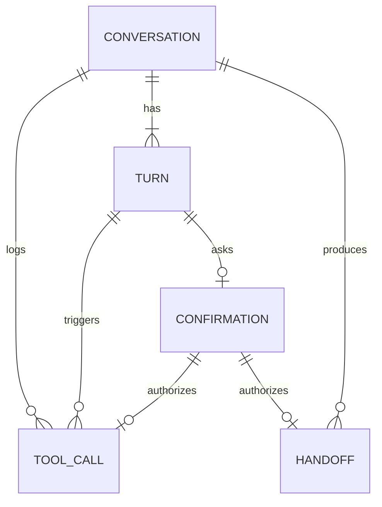

# 기술 설계 — Evenstay 홈 비서 (senior-ai-assistant, 최소 버전)

상태: 승인(2026-11-03) · 작성: 2026-11-03 · 변경: 2026-11-04 쉬운 말 재검수·공용 문구 반영(사용자 재승인 2026-11-04) · 변경: 2026-11-04 전체 리뷰 보완(사용자 재승인 2026-11-04) · 변경: 2026-11-03 기획 문서 한국어 검수(korean-skills, 사용자 재승인 2026-11-03) · 변경: 2026-11-03 브랜드 뒷말 한글 표기·카피 검수 반영(사용자 재승인 2026-11-03) · 변경: 2026-11-03 직원 화면 이름 한국어로(Evenstay Assistant Admin → AI 생활 비서, 허브 요청) · 변경: 2026-11-03 회원 말 숫자 가림(D 요청, [가설]) · 변경: 2026-11-03 데모 초기화 조율 방식(`app/` 라우트, 코어 재승인 2026-11-03) · 변경: 2026-11-03 재승인 반영(HUB-1~11·13~16, D 고지 v2 유지), C HUB-G2 · 변경: 2026-11-03 검토 반영(투자 넘김, HUB-16, 대리인 표시, ResidentQuery, keyDates actor) · 변경: 2026-11-03 D 반영 결과 맞춤(HUB-7·8·9·14, 재승인 2026-11-03) · 변경: 2026-11-03 코어·G 카피 반영 결과 맞춤(HUB-1~7·10·11·13·15, 재승인 2026-11-03) · 변경: 2026-11-03 확인할 것 정리(사용자 결정: 제안값을 [가설]로 확정), 허브 요청 처리 상태 · 기준: `04-planning/CLAUDE.md` "기술 설계", "코어 + 모듈 구조", 코어 `senior-lab/04-planning/ideas/pms-core-billing/tech-design.md`(승인 2026-11-03, v1.1) 형식
입력: `prd.md`, `service-blueprint.md`, `user-stories.md`, `senior-lab/02-ideation/drafts/ai-assistant.md` 5절(설계 원칙), D `senior-lab/04-planning/ideas/family-consent-portal/tech-design.md`(승인 2026-11-03, G 요청 반영분 재승인 2026-11-03) 8-2절

> 공통 도메인 모델의 기준은 코어 `tech-design.md`다. 이 문서는 코어 엔티티를 ID로만 참조하고 `assistant` 스키마의 확장 엔티티만 정의한다. 코어·D를 바꿔야 하는 것은 고치지 않고 "허브 요청"(확인할 것 HUB-1~HUB-17)으로 둔다.
> 기술 스택은 코어 12절의 정해진 방향(프로토타입 HTML·JS, MVP Next.js, PostgreSQL)을 따르고, LLM 제공자·모델은 [미정]이다.
> 표기는 `strategy.md`와 같다. 표기 없는 문장은 이 문서의 설계안(초안)이다.

## 1. 범위와 경계
```
  Evenstay 홈(회원·대리인) ──► assistant/web ──► 한 턴 처리(4절)
                                                   │
         ┌──────────────── assistant 모듈 (스키마 assistant) ─────────────────┐
         │ 고지 게이트 → 의도 라우터(규칙 → LLM/녹화) → 도구 등록부 → 답 틀 렌더러 │
         │ 확인 토큰 · 넘김 · 대화/턴 · 도구 호출 기록                           │
         └───────┬──────────────────────────┬──────────────────────┬─────────┘
                 │ core/api (행위자 = 로그인한 사람)  │ family/api            │ 어댑터
   ContractQuery.keyDates · BillingQuery     AiNoticeQuery·Command   IntentRouter(LLM [미정])
   InquiryCommand(P1) · RepresentationQuery  MoneyRequestCommand(Next) 음성 인식은 기기에서
   Authorization · AuditWriter · Clock
  AI 생활 비서(직원 화면) ──► assistant/web(admin)
```
- 비서가 갖는 것: 대화와 턴(회원 말, 비서 답), 도구 호출 기록, 확인 토큰, 넘김(대화에서 나온 직원 요청과 처리 상태). 코어 `tech-design.md` 10절 "모듈이 소유하는 것"(대화, 도구 호출 기록, 확인 토큰)에 카피가 확정한 "직원에게 넘긴 요청"을 더했다(확인할 것 10).
- 비서가 갖지 않는 것: 계약·청구·수납·문의(코어), 고지 원본·확인 기록·금전 부탁(D), 건강 정보(B·C), 음성 원본(저장 안 함). **도구 결과를 복사해 두지 않는다.** 답에 들어간 값만 턴의 답 기록으로 남는다.

## 2. 도메인 모델
### 2-1. 용어 (공통 언어)
| 코드 | 직원 화면 | 회원 화면 | 비고 |
|---|---|---|---|
| Conversation | 대화 | 지난 대화(한 줄) | 대상 회원 1명, 행위자 1명 |
| Turn | (대화 안 한 줄) 입주자 / 비서(AI) | 들은 말 / AI 비서 답 | 추가만 |
| Intent | 의도 | (표시 안 함) | 4-2 목록 |
| Tool | 도구 | (큰 버튼 이름) | 일정 조회, 청구 설명, 청구 문의 접수(P1), 직원에게 넘기기 |
| ToolCall | 도구 호출 | (표시 안 함) | 추가만 |
| Confirmation | 입주자 확인 | 네, 전해 주세요 | 확인 토큰 |
| Handoff | 넘겨받은 요청 | 직원에게 전하기 | 카피 `names.md` 2절 |
| HandoffReason | 넘긴 이유 | (표시 안 함) | HEALTH 건강 판단, MONEY 금전 판단, CONTRACT 계약 판단, OUT_OF_SCOPE 도구 밖 질문, MEMBER_ASKED 직접 요청 |
| HandoffTopic | 주제 | 청구서가 궁금해요 / 계약이 궁금해요 / 그 밖의 일 | 카피 2-6 고르는 버튼 |
| AnswerTemplate | — | (답의 틀) | 도구·결과 상태마다 하나 |

### 2-2. 엔티티 (`assistant` 스키마, 핵심 필드)
모든 테이블은 `id`(UUID), `operator_id`, `site_id`, `created_at`, `created_by`를 가진다(코어 2-2와 같음, 코어 ADR-1 RLS). RLS는 두 겹이다: 직원은 역할 범위의 사업장, 회원·대리인은 `subject_resident_id`(회원 본인) 또는 `actor_user_id`(대리인 본인)가 자기 ID인 행만. 코어 엔티티는 ID로만 보관하고 외래 키를 두지 않는다(코어 ADR-2 3번).

| 엔티티 | 핵심 필드 | 규칙 |
|---|---|---|
| Conversation 대화 | subject_resident_id, actor_user_id, actor_person_id, acting_as(SELF, REPRESENTATIVE), representative_id, notice_audience, notice_version(확인한 고지 판), started_at, last_turn_at, closed_at, text_purged_at | 대상 회원은 서버가 정한다(본인 = 로그인한 회원, 대리 = 검사를 통과한 대리 대상). 마지막 턴 뒤 30분 [가설]이 지나면 닫는다 |
| Turn 턴 | conversation_id, seq, speaker(MEMBER, ASSISTANT), input_mode(BUTTON, TEXT, VOICE_TEXT), button_code, text(회원 말은 숫자 가림 뒤 저장, ADR-G9), intent, slots(JSON: period, charge_code), sensitive(HEALTH, MONEY, CONTRACT, INVEST, null), router(BUTTON, RULE, LLM, REPLAY), router_model(제공자·모델·판), answer_template, answer_lines(JSON: 줄마다 text와 source{toolCallId, path}), unclear_count | (conversation_id, seq) 유일. 추가만 한다(보관 정리 함수만 text·answer_lines를 지운다) |
| ToolCall 도구 호출 | conversation_id, turn_id, tool_code, kind(READ, WRITE), args(JSON: 회원 ID 없음), target_ref(예: invoiceId), actor_user_id, acting_as, representative_id, authz(ALLOW, DENY), deny_reason, result(OK, NO_DATA, DENIED, ERROR, TIMEOUT), result_ref(예: inquiryId, handoffId), confirmation_id, latency_ms | 추가만 한다. 결과 본문은 저장하지 않는다(ID와 상태만). 직원 화면 라벨은 카피 `names.md`(성공·권한 거부·데이터 없음·오류)를 따르고 TIMEOUT은 "오류"로 보인다 |
| Confirmation 확인 토큰 | conversation_id, turn_id, session_id, actor_user_id, subject_resident_id, tool_code, args(JSON: 실행할 인자. 넘김이면 이유·주제·전할 말, 문의면 청구서 ID·항목 ID), args_hash, preview(JSON: 확인 화면에 보인 것), token_hash, status(ISSUED, CLAIMED, USED, DECLINED, EXPIRED), issued_at, expires_at, decided_at, attempts | 블루프린트의 "넘김 후보"가 이 행이다(별도 엔티티 없음). 실행 인자는 발급 때 서버에 저장하고 accept 요청은 인자를 받지 않는다. args_hash는 저장된 인자가 바뀌지 않았는지 검사용. 토큰 원문은 해시만. 기한 5분 [가설] |
| Handoff 넘김 | conversation_id, turn_id, subject_resident_id, actor_user_id, acting_as, reason, topic(BILLING, CONTRACT, OTHER, null), member_message(전할 말 원문, 숫자 가림 뒤 저장), assistant_answer(비서가 한 답 원문), confirmation_id(필수), status(NEW, IN_PROGRESS, DONE, FORWARDED), started_by, started_at, done_by, done_at, done_note, external_ref(넘긴 이유로 나눠 쓴다: OUT_OF_SCOPE·MEMBER_ASKED는 N1 요청 ID, MONEY는 Next의 D moneyRequestId. 두 이유가 겹치지 않아 한 칸으로 충분하다. N1-G1) | confirmation_id가 없으면 저장 거부(NOT NULL + 확인 토큰 상태 검사). DONE은 done_note 필수 |
| EvalCase 평가 문항 | (DB가 아니라 저장소 파일 `assistant/eval/cases.json`) utterance, expected_intent, expected_tool, sensitive, note | 11절 |

### 2-3. ERD 초안

코어 참조(ID만, FK 없음): `subject_resident_id` → core.Resident, `actor_user_id` → core.UserAccount, `representative_id` → core.Representative, `ToolCall.target_ref`·`result_ref` → core.Invoice·Inquiry. D 참조: `notice_version` → family.AiNoticeVersion.

## 3. 상태 전이
### 3-1. 확인 토큰 (Confirmation)
```
(없음) ──(issue: 쓰기 의도 + 확인 화면 표시)──► ISSUED ──(accept: 같은 세션·행위자, 기한 안)──► CLAIMED ──(도구 성공)──► USED
CLAIMED ──(도구 실패)──► ISSUED (기한 안에서 같은 토큰으로 다시 누를 수 있음, attempts + 1)
ISSUED ──(decline)──► DECLINED        ISSUED ──(기한 지남, 요청 시 검사)──► EXPIRED
```
- accept는 `UPDATE … SET status = CLAIMED WHERE id = ? AND status = ISSUED AND session_id = ? AND actor_user_id = ? AND expires_at > now()`로 한 번만 잡는다. 저장된 args로 쓰기 도구를 실행한다. 넘김 생성은 같은 트랜잭션에서 USED까지 간다. 코어 문의는 토큰 ID를 멱등 키로 넘기고, 성공하면 USED, 실패하면 ISSUED로 되돌린다(같은 멱등 키라 다시 눌러도 문의는 1건).
- 쓰기 도구(`kind = WRITE`)는 토큰 없이는 실행 경로 자체가 없다. LLM 출력에서 쓰기를 실행하는 길은 없고, LLM은 쓰기 의도만 고를 수 있다(그러면 확인 화면이 나올 뿐이다).

### 3-2. 넘김 (Handoff)
```
(확인 토큰 USED) ──► NEW ──(처리 시작, 직원)──► IN_PROGRESS ──(처리 완료 + 메모)──► DONE
                      └──(N1 receiveFromAssistant 성공)──► FORWARDED (G에서는 끝. 처리는 N1 생활 요청)
```
- **FORWARDED (2026-11-04, N1-G1) [가설]**: 넘김을 저장한 트랜잭션이 끝난 뒤, 이유가 OUT_OF_SCOPE이거나 MEMBER_ASKED이면서 주제가 OTHER·null이고, 행위자가 회원 본인이며, `requests` 모듈이 배포돼 있을 때 G가 `requests/api` `ServiceRequestCommand.receiveFromAssistant({residentId, handoffId, confirmationId, memberMessage, reason, topic, actor})`를 같은 요청 안에서 동기로 부른다(N1 8-2. actor = 회원 본인). memberMessage는 숫자 가림 뒤 저장한 글을 그대로 보낸다(ADR-G9). 성공하면 같은 넘김에 external_ref = 요청 ID와 status = FORWARDED를 함께 쓴다. 실패·시간 초과·미배포면 넘김은 NEW로 남아 G 직원 화면에서 지금처럼 처리한다(넘김은 지우지 않는다). 다시 보내기는 최소 버전에 두지 않는다 [가설]. N1이 넘김 ID로 멱등이라 같은 넘김을 두 번 보내도 요청은 1건이다.
- 대리인이 만든 넘김(P1)과 HEALTH·MONEY·CONTRACT 넘김, 주제가 BILLING·CONTRACT인 직접 요청은 N1으로 보내지 않는다(N1 ADR-R5). 회원이 보는 완료 화면(카피 2-6)은 FORWARDED든 NEW든 같다. FORWARDED 넘김에 [처리 시작]·[처리 완료]를 부르면 422다.
- 되돌리기는 없다(DONE 뒤 수정은 다음 판). 모든 전이는 코어 `AuditWriter` WRITE.

### 3-3. 대화 (Conversation)
- OPEN → CLOSED(마지막 턴 뒤 30분 [가설] 또는 화면 닫기). 닫힌 대화에는 턴을 더하지 않는다. 대리인 범위가 끝나도 대화를 바꾸지 않고, 다음 요청부터 도구가 거부된다.
- 보관 정리(F16): 닫힌 날 + 보관 기간 [운영사 기준 초안 1년]이 지나면 Turn의 `text`·`answer_lines`, Handoff의 `member_message`·`assistant_answer`, Confirmation의 `args`·`preview`를 지우고 `text_purged_at`을 남긴다. 처리 중인 넘김이 있으면 미룬다. "추가만"과 "DONE 뒤 수정 금지"의 유일한 예외가 이 정리 함수다(11절 테스트). 카피 5-1은 "고치거나 지울 수 없습니다"와 함께 보관 정리를 안내한다(HUB-10 반영).

## 4. 한 턴의 처리
### 4-1. 순서
```
handleTurn(session, conversationId, input):
  1. 고지 게이트: AiNoticeQuery.acknowledged(actorPersonId, MEMBER, ASSISTANT) 아니면(대리인도 MEMBER 판, HUB-8) → 403 NOTICE_REQUIRED (D 실패도 403)
  2. 대화 확인: 대화.actor_user_id = session.user, 대상 회원은 대화에 고정된 값(입력에서 받지 않음)
  3. 의도 결정
     a. BUTTON → button_code가 곧 의도(LLM 없음)
     b. TEXT/VOICE_TEXT → 민감 규칙(낱말 목록) → 걸리면 그 의도로 확정
                         → 아니면 IntentRouter(어댑터) → JSON 형식 검사(의도 목록·인자 형식) 실패 시 UNCLEAR
                         → 라우터 오류·시간 초과면 AI_ERROR(카피 6절 "AI 답 만들기 실패")
                         → 라우터가 민감 의도를 고르면 그것을 따른다(어느 쪽이든 민감이면 민감)
  4. 의도 → 처리
     - 도구 의도 → 도구 등록부에서 도구 찾기 → 인자 해석(서버가 대상 회원의 **발행(ISSUED) 청구서**에서만 고름)
                 → core Authorization.authorize(actor, action, resource, now) → 도구 호출 → ToolCall 기록
     - 쓰기 의도(넘김, 청구 문의) → Confirmation ISSUED(실행 인자 저장) + 확인 화면 응답 (실행은 accept에서)
     - 민감·도구 밖·다른 사람·투자·긴 이야기 → 고정 답 틀(카피 2-5), 도구 호출 없음
     - UNCLEAR → unclear_count + 1, 1회면 카피 2-2 "잘 듣지 못했어요", 2회면 둘째 문구
  5. 답 틀 렌더러: (도구, 결과 상태)의 답 틀에 결과 값을 채움. 줄마다 source가 없으면 그 줄을 버림. 사실 줄 > 3이면 다음 버튼으로 나눔. 렌더러는 계산하지 않는다(값은 코어 `plain` 필드 그대로, HUB-13)
  6. 화면에 보인 조회 결과마다 코어 AuditWriter READ 1줄(코어 확인할 것 14 "보여 준 조회 = 기록 1줄")
  7. Turn 2개(회원, 비서) 기록, 응답 반환(줄, 확인한 곳 sources[], 버튼, "AI 비서" 표시, 확인 화면 정보)
```
- LLM에는 회원이 한 말과 허용 의도 목록만 보낸다. **시스템이 덧붙이는 회원 정보(이름, 호실, 금액, ID)와 도구 결과는 보내지 않는다**(답은 렌더러가 만든다). 그래서 코어 데이터 안의 자유 글(예: 조정 사유)이 LLM 지시로 읽힐 길이 없다. 회원이 직접 말한 내용은 서버가 받자마자 숫자 가림(ADR-G9)을 한 번 거치고, 가린 글만 LLM·저장·D로 간다 [가설].
- "이번 달 청구서" = 대상 회원의 가장 최근 발행 청구서다(말일 발행이라 달 초에는 지난달 청구서). 회원이 특정 달을 말했는데 그 달 발행 청구서가 없으면 카피 2-4 "말한 달의 청구서가 아직 없을 때" 줄(그 달 청구서 예정일 + 가장 최근 청구서 설명 버튼), 발행 청구서가 하나도 없으면 NO_DATA(카피 2-4 "나온 청구서가 하나도 없을 때").
- 청구 항목 문장은 코어 `plain`(HUB-13 반영)만 쓴다: RECURRING `{plan, amount}`, MEAL `{days, mealsPerDay, occupancy, meals, unitPrice, amount}`, MEAL_SKIP `{count, unitPrice, amount}`, ADJUSTMENT `{adjustsPeriod, direction, amount}`. `plain.amount`는 양의 크기라 더하는지 빼는지는 code와 direction으로 고른다. ADJUSTMENT는 사유가 `plain`에 없어(직원 입력) 비서가 사유를 말하지 않고 "11월 청구서를 바로잡아 ○○○원을 빼 드렸어요."(더한 경우 "11월 청구서를 바로잡아 ○○○원을 더했어요.")와 "왜 바로잡았는지는 프런트에 물어봐 주세요."만 한다(카피 2-4 "지난 청구서를 바로잡은 항목이 있을 때", HUB-16 반영). 승계 뒤 사별한 분의 남은 식비는 경리가 다음 청구서에 조정 전표로 돌려준다(코어 HUB-11 [가설]). 조정 전표는 코어 F14(P1)라 자르는 선에서 빠지면 자동으로 돌려주지 않고 프런트가 설명한다. 데모 12월 청구서에는 조정 항목이 없다(코어 시드, 합계 2,910,000원 그대로)

### 4-2. 의도 목록 (최소 버전)
| 의도 | 도구 | 비고 |
|---|---|---|
| DATES_BILLING, DATES_CONTRACT, NEXT_INVOICE_DATE, DUE_DATE | `core.keyDates` | DUE_DATE는 납부 갈래(4-4) |
| EXPLAIN_INVOICE(slots: period), EXPLAIN_CHARGE(slots: period, charge_code) | `core.explainInvoice` | period 없으면 가장 최근 발행 청구서. 항목 설명은 그 항목의 근거만 읽는다 |
| BILLING_DISPUTE(slots: charge_code?) | `core.createInquiry`(쓰기, P1) | [이 금액이 이상해요], "왜 3끼만 빼 줬어요?"처럼 기록이 다르다는 말. 코어 F15 없으면 HANDOFF(MEMBER_ASKED, BILLING) |
| HANDOFF_REQUEST(slots: topic) | `assistant.handoff`(쓰기) | 넘긴 이유 MEMBER_ASKED |
| HEALTH, MONEY, CONTRACT_CHANGE | 없음 → 넘김 후보(이유 HEALTH/MONEY/CONTRACT) | 민감 |
| INVEST | 없음 → 넘김 후보(이유 MONEY) | 민감. 투자도 "돈"으로 묶는다(`prd.md` 확인할 것 10, 카피 2-5). 직원은 투자 조언을 하지 않고 금융회사 안내만 |
| OTHER_PERSON, FACILITY_REQUEST, LATE_PAYMENT, SMALL_TALK, OUT_OF_SCOPE | 없음 | FACILITY_REQUEST·OUT_OF_SCOPE는 넘김 후보(이유 OUT_OF_SCOPE. N1이 배포돼 있으면 FORWARDED, 3-2) |
| UNCLEAR | 없음 | 형식 검사 실패 포함. 카피 2-2 |
| (AI_ERROR) | 없음 | 의도가 아니라 라우터 오류·시간 초과. 카피 6절 "AI 답 만들기 실패" |
- OUT_OF_SCOPE의 일반 답은 카피 2-5 "그 밖의 일" 줄(HUB-10 반영).
- 의도 목록은 도구 등록부에서 만든다(도구가 붙으면 그 도구의 의도가 목록에 더해진다). 라우터 프롬프트와 형식 검사는 이 목록에서 생성한다.

### 4-3. 도구 등록부
```ts
interface ToolDefinition {
  code: string                       // 'core.keyDates', 'core.explainInvoice', 'core.createInquiry', 'assistant.handoff'
  kind: 'READ' | 'WRITE'             // WRITE는 확인 토큰 필수(등록부가 강제)
  intents: Intent[]                  // 이 도구로 가는 의도
  resolveArgs(ctx, slots): Args      // 회원 ID는 ctx.subject에서만. 슬롯은 기간·항목 코드 같은 좁은 값만
  authorize(ctx, args): AuthzRequest // 코어 행동 이름과 대상(예: 청구서 ID) → core authorize
  invoke(ctx, args): ToolResult      // { status, fields{path: value}, sources[] }
  templates: Record<ResultStatus, AnswerTemplateId>  // 카피 답 틀
  button?: { label, order }          // 큰 버튼(카피 names.md)
  staffLabel: string                 // 직원 화면 도구 이름
  available(ctx): boolean            // 모듈·기능 존재 여부(예: 코어 F15)
}
```
- 도구 호출 기록, 권한 검사, 확인 토큰, 답 틀 검사는 등록부 실행기 한 곳이 한다. 도구 구현은 `invoke`만 쓴다. 새 도구 = 정의 파일 1개 + 답 틀 + 평가 문항(10-2).
- 도구 구현은 `assistant/infra/tools/<모듈>/`에 두고 그 모듈의 `api/`만 import한다(코어 ADR-2 2번).

### 4-4. 납부 갈래 (DUE_DATE)
입력: `keyDates.lastInvoiceDueDate`, 기준일(`Clock.today()`), 코어 `explainInvoice` 머리의 `paymentState`(UNPAID, PARTIAL, PAID, NOT_TRACKED)와 `hasOtherIssuedWithoutPayment`(그 밖의 발행 청구서 중 수납 0인 것이 있는가. NOT_TRACKED면 null). HUB-1 반영(재승인 2026-11-03). 답은 `prd.md` 12절 표 그대로.
```
if paymentState == PAID              → "내셨다고 기록돼 있어요" + nextInvoiceScheduledOn
                                       (+ hasOtherIssuedWithoutPayment면 "아직 내셨다는 기록이 없는 청구서가 더 있어요. 프런트에…" 카피 2-3 마지막 줄)
elif paymentState == PARTIAL         → "일부를 내셨다고 기록돼 있어요" + 프런트
elif today <= dueDate                → "dueDate까지 내시면 돼요"           (UNPAID, NOT_TRACKED 같음)
elif paymentState == UNPAID          → "내실 기한은 dueDate이었어요. 아직 내셨다는 기록이 없어요. …프런트"
else (NOT_TRACKED, 기한 지남)        → "내실 기한은 dueDate이었어요. 내셨는지는 제가 볼 수 없어요. …프런트"
```
- "미납", "연체" 낱말은 답 틀 검사에서 금지어로 막는다. 비서는 상태를 판정하지 않고 코어가 준 값만 고른다.
- 코어 10절 G 행은 이 갈래로 바뀌었다(HUB-2 반영, 재승인 2026-11-03).

## 5. 설계 결정 기록 (ADR)
### ADR-G1. LLM은 라우터, 답 문장은 답 틀
- **맥락**: 비서는 도구가 돌려준 사실만 말해야 한다(사용자 확정). 범용 LLM은 사실을 지어낼 수 있다 [사실, G21]. 시니어에게 틀린 금액·날짜는 분쟁이 된다.
- **선택지**: (A) LLM이 도구 결과를 받아 답을 쓰고, 검사기가 숫자·날짜가 결과에 있는지 확인 / (B) LLM은 의도와 인자만 고르고, 답은 서버가 답 틀에 결과를 채움 / (C) LLM 없이 규칙만.
- **결정**: **B(최소 버전).** 큰 버튼은 LLM을 부르지 않는다. LLM 출력은 회원 화면에 나가지 않는다.
- **결과**: 환각이 답에 들어갈 길이 구조적으로 없다(줄마다 출처 필수). 도구 결과가 LLM에 가지 않아 데이터 속 주입도 막힌다. 대가는 딱딱한 문장이다. A는 Next에서 검사기와 함께 시험한다(`roadmap.md`). C는 AI Agent 연동을 보여 주지 못한다.

### ADR-G2. 도구 등록부와 고정된 기록 형식
- **맥락**: B·D·C 도구가 늘어도 구조가 바뀌지 않아야 한다(작업 지시). 카피는 조회 도구 하나를 큰 버튼, 답 틀, 기록 한 줄로 묶었다(요약, `names.md` 라벨 원칙).
- **선택지**: (A) 도구마다 처리 코드와 기록 테이블 / (B) 정의 + 공통 실행기 + 공통 기록(도구 코드는 문자열, 인자는 JSON).
- **결정**: **B.** 권한 검사·확인 토큰·기록·답 틀 검사는 실행기가 강제하고, 도구는 정의와 `invoke`만 갖는다.
- **결과**: 새 도구에 마이그레이션이 필요 없다. 대가는 인자 JSON 형식 검사를 도구 정의가 책임진다는 것(정의마다 스키마).

### ADR-G3. 쓰기는 회원 확인 토큰으로만
- **맥락**: 상태를 바꾸는 호출은 회원 확인 뒤에만 한다 [초안 결정, ai-assistant.md 5절 원칙 2, 코어 9절 AI Agent 행].
- **선택지**: (A) 화면에서만 확인 창을 띄움 / (B) 서버 발급 1회용 토큰(행위자·대상·도구·인자 해시에 묶음, 기한) / (C) 매번 비밀번호 재입력.
- **결정**: **B.** 토큰은 확인 화면을 만들 때 서버가 발급하고, 실행할 인자는 그때 서버에 저장한다. [네] 요청은 인자를 받지 않고 토큰만 받으며, 같은 세션(session_id)의 같은 행위자가 낸 것만 한 번 잡는다(3-1). 브라우저 쪽 위조는 세션 쿠키 SameSite=Strict + CSRF 토큰으로 막고, 턴·accept API에 행위자별 속도 제한을 둔다 [가설].
- **결과**: LLM 출력이나 다른 사람의 요청이 쓰기를 만들 수 없고, 확인 화면에 보인 것과 다른 인자로 실행될 수 없다. 같은 [네]가 두 번 와도 1건이다. **한계**: 토큰은 "이 세션이 이 확인 화면에 [네]라고 답했다"는 의도 묶기이지 사람이 눌렀다는 증명이 아니다. 로그인한 본인 기기의 스크립트는 막지 못한다(면접에서 밝힌다). 대가는 시니어가 확인 화면에 오래 머물면 기한이 지날 수 있다는 것(기한 5분 [가설], 지나면 카피 6절 "확인 시간이 지났을 때").
- **코어 문의와의 관계**: 코어 `InquiryCommand`는 `confirmationToken`을 받지만 코어가 G의 토큰을 검사할 수는 없다(코어는 모듈을 모른다). 그래서 **G가 검사하고**, 코어는 channel = ASSISTANT일 때 토큰이 비어 있으면 거부하고 DENIED를 남기며, (channel, confirmation_token)을 유일로 둬 같은 토큰으로 문의가 두 번 생기지 않는다(HUB-5 반영, 재승인 2026-11-03).

### ADR-G4. 대상 회원 고정과 위임 권한 (주입·타인 데이터 막기)
- **맥락**: 회원 말은 믿을 수 없는 입력이다(프롬프트 주입). 다른 회원 데이터가 나오면 안 된다.
- **결정**
  1. 대상 회원은 대화를 만들 때 서버가 정하고 입력에서 받지 않는다. 도구 인자 형식에 회원 ID·사람 ID 칸이 없다.
  2. 청구서 ID는 LLM에서 오지 않는다. 서버가 `invoicesOf(대상 회원)`에서 기간으로 고른다.
  3. 도구는 비서용 서비스 계정이 아니라 **로그인한 행위자**로 코어 `authorize()`를 거친다. 대리인은 코어 4단계(ACTIVE, 유효기간, 범위)를 그대로 탄다.
  4. LLM에는 회원 말과 의도 목록만 간다. 도구 결과·시스템이 덧붙이는 회원 정보·시스템 비밀은 가지 않는다. 출력은 의도 목록과 인자 형식으로 검사한다.
  5. 거부는 `DENY`로 도구 호출 기록과 코어 감사(DENIED)에 남고, 회원에게는 "그 내용은 제가 볼 수 없어요."만 보인다.
  6. 1~2번 때문에 정상 화면 경로에는 다른 회원 청구서 ID를 넣을 길이 없다. 그래서 실행기 아래의 코어 권한 검사(3번)가 실제로 막는다는 것은 **데모 전용 경로** `POST /demo/assistant/tool-calls {conversationId, toolCode, rawArgs}`로 보인다. 이 경로는 `resolveArgs`를 건너뛰고 rawArgs(예: B동 302호 청구서 ID)를 그대로 실행기에 넣어 권한 검사·기록을 같은 코드로 거친다. 코어 `/demo/*`처럼 데모 환경에만 있고 운영 빌드에서 뺀다.
- **결과**: 주입이 성공해도 할 수 있는 최대는 "잘못된 의도 하나"이고, 그것도 행위자 권한과 답 틀 안에 갇힌다. 테스트: 주입 문항(11절), 데모 경로로 넣은 다른 회원 청구서 ID(데모 6단계, 도구 호출 기록 "거부(다른 입주자)").

### ADR-G5. 고지 게이트는 서버에서, 실패하면 닫힘
- **맥락**: AI 기본법 사전 고지 [사실, G4]. D가 고지 원본과 확인 기록을 갖는다 [사실, D 8-2].
- **결정**: 모든 비서 API 앞에서 `acknowledged(personId, audience, ASSISTANT)`를 서버가 묻는다. D 오류·시간 초과는 거짓으로 본다. 확인하면 D `acknowledge(personId, MEMBER, version, channel = ASSISTANT, actingAs)`를 부르고, 대화에 확인한 판을 남긴다.
- **대리인 (HUB-8 반영, 재승인 2026-11-03)**: 대리인도 회원용(MEMBER) 판을 본인이 확인한다 [가설]. 확인은 사람마다 한 번이고, 보호자 판(GUARDIAN v1)을 확인한 것은 비서 확인으로 세지 않는다. G는 대리 대화에서 `actingAs = REPRESENTATIVE`를 넘긴다(D 기록용, `acknowledged()`는 보지 않는다). 대안은 REPRESENTATIVE 대상 판(법률 검토 결과에 따라). 그래서 `Conversation.notice_audience`는 최소 버전에서 늘 MEMBER다.
- **결과**: 화면 우회로 비서를 쓸 수 없다. 대가는 D 장애 때 비서가 멈춘다는 것(프런트 전화가 대안).

### ADR-G6. LLM 어댑터와 녹화 응답 (데모)
- **맥락**: LLM 제공자·모델이 [미정]이다. 면접 데모는 네트워크·비용·응답 변동에 흔들리면 안 된다.
- **선택지**: (A) 항상 실제 LLM / (B) 녹화 응답 기본 + 실제 LLM 전환 / (C) 규칙만.
- **결정**: **B.** `IntentRouter` 포트에 구현 셋: `RuleRouter`(LLM 없음), `LlmRouter`(제공자 [미정], 도구 호출·JSON 출력 지원이 기준), `ReplayRouter`(실제 LLM으로 평가 세트를 돌려 저장한 결과, 정규화한 말의 해시로 찾음). 데모 기본은 Replay → 없으면 Rule → 없으면 UNCLEAR. 진행자가 Llm으로 바꿀 수 있다. 녹화 파일은 실제 실행에서만 만든다.
- **결과**: 데모가 재현된다. "녹화"라는 사실은 README와 데모 안내에 밝힌다. 대가는 녹화 밖의 말에 약하다는 것(규칙과 큰 버튼이 받친다).

### ADR-G7. 청구 이의는 코어 문의로
- **맥락**: 코어 10절은 G가 `InquiryCommand`를 쓴다고 적었다. 카피 7절 5번이 G 기획에서 확정하라고 남겼다.
- **선택지**: (A) 코어 `InquiryCommand` 도구(세 번째, 쓰기) / (B) 비서 넘김으로만.
- **결정**: **A(결정 [가설], `prd.md` 확인할 것 2).** 청구 문의의 주인은 코어 경리 화면이다. 코어 F15가 없을 때만 넘김(MEMBER_ASKED, BILLING)으로 대신한다(`available()`).
- **결과**: 같은 이의가 두 목록에 생기지 않는다. 대가는 코어 문의 상태를 비서가 보여 주지 않는다는 것(답변은 코어 화면에서).

### ADR-G8. 납부 상태는 코어 계산값만
- **맥락**: 코어는 미납 판정을 하지 않고 수납 상태를 계산값으로만 둔다 [사실, 코어 3-2]. Payment는 P1이다 [사실, 코어 F16]. `keyDates`에는 날짜만 있다.
- **결정**: 비서는 수납 테이블이나 금액을 읽어 계산하지 않는다. 코어가 `invoicesOf` 항목과 `explainInvoice` 머리에 붙인 `paymentState`(HUB-1 반영, 재승인 2026-11-03)로 4-4 갈래만 고른다. 회원·대리인 경로에는 코어가 ISSUED 청구서만 주고, DRAFT 청구서 ID는 없는 청구서(404)로 답한다. 코어에 수납 기능이 없으면 NOT_TRACKED.
- **결과**: 미납 판정 책임이 비서로 넘어오지 않는다.

### ADR-G9. 대화 기록 보관과 원문 삭제
- **맥락**: 대화에 회원이 말한 건강·금전 이야기가 들어올 수 있다. 보관 기간은 법령에서 찾지 못했다 [미확인].
- **결정**: 원문(말, 답, 전할 말, 확인 화면 내용)과 메타데이터(의도, 도구, 결과, 시각)를 나눈다. 보관 기간 [운영사 기준 초안 1년]이 지나면 원문만 지운다(배치, 멱등). 음성 원본은 처음부터 받지 않는다. 감사 줄은 코어 보존 정책을 따른다.
- **숫자 가림 (2026-11-03 D 요청) [가설, 2026-11-03 사용자 확정]**: 원문이 1년 남으므로, 회원 쪽에서 온 자유 글(Turn.text 중 회원 말, Handoff.member_message, Confirmation의 `args`·`preview`)은 서버가 받자마자 숫자 사이의 공백·하이픈·점은 무시하고 숫자가 4개 이상 이어진 부분을 `[가린 번호]`으로 바꾼다. 바로 뒤에 금액 단위(원, 만원 등)나 날짜 단위(년, 월, 일)가 붙은 숫자는 남긴다(예: "2026년 1월 10일", "50만 원"은 그대로). D 금전 부탁 note 규칙에 날짜 단위 예외를 더한 것이다. 가린 글만 LLM 입력, 저장, D `MoneyRequestCommand.open`의 note(Next)로 간다. G가 두 번 가려도 결과가 같다(멱등). D는 note를 D 규칙으로 다시 가리므로, D에 날짜 예외가 없으면 D note에서는 연도가 가려질 수 있다(D 몫). 가리기 전 글은 요청 처리 중 메모리에만 있고 로그에도 남기지 않는다. 비서 답(답 틀 + 도구 결과)은 가리지 않는다. 날짜(2028년 9월 30일)가 가려지면 안 되고 회원 말도 아니기 때문이다. 확인 화면은 가린 글을 보여 주므로, 회원은 직원에게 실제로 갈 글을 본다. 카피 2-2 "들은 말"도 서버가 가린 뒤 돌려준 글로 그린다(화면에 보이는 회원 말은 모두 저장된 글과 같다). 말하는 동안 기기가 보이는 인식 중 글자는 기기 안에만 있고, 서버로는 확정된 글자가 한 번 간다. 화면 안내 "통장 번호나 비밀번호는 비서에게 말씀하지 마세요"(카피 2-6)는 그대로 둔다.
- 알려진 한계 [가설]: 금액·날짜 단위가 붙지 않은 4자리 이상 숫자(예: 4자리 호실 "1004호", 점으로 쓴 날짜 "2026.1.10")는 가려진다. 라우터 인자(달, 항목)는 월 단위라 영향이 없다고 본다. 평가 세트에서 확인한다.
- **결과**: 지표는 남고 원문 위험은 줄어든다. 기간 확정은 [법률 검토].

## 6. 역할과 권한
### 6-1. 비서 자기 행동 (`assistant.*`, 코어 `registerPolicy`로 등록)
| 행동 | 회원 | 대리인 | 사업장 직원 | 사업장 책임자 | 본사 매니저 | 본사 관리자 |
|---|---|---|---|---|---|---|
| `assistant.use`(대화 시작·턴) | ◐(본인, 고지 확인) | ◐(대상 회원에 대한 ACTIVE 대리인 행, 기준일이 유효기간 안, 범위 하나 이상, 고지 확인, P1) | — | — | — | — |
| `assistant.handoff.create` | ◐(본인, 토큰) | ◐(위 대리인 조건 + 토큰, P1) | — | — | — | — |
| `assistant.handoff.view`·`process`, 딸린 대화 보기 | — | — | ●(자기 사업장) | ● | ● | ● |
| 위와 같되 주제 BILLING 넘김만(코어 F15가 없을 때 청구 이의 대체 경로) | — | — | 경리 ●(자기 사업장) | — | — | — |
| `assistant.conversation.list`·`view`, `assistant.toolcall.list`, 요약 | — | — | — | ● | ● | ● |
| `assistant.usage.read`(운영 현황 카드 "AI 생활 비서 사용량", 숫자만) | — | — | — | ●(자기 사업장) | ● | ● |
| `assistant.history.own`(지난 대화) | ◐(대상이 본인) | ◐(본인이 나눈 대화) | — | — | — | — |
- 보호자(GUARDIAN)는 비서 행동이 하나도 없다(보호자용 비서는 범위 밖).
- 모두 범위 안에서만 허용한다(직원은 자기 사업장). 대화·넘김 상세 열람은 SENSITIVE_READ로 남긴다.
- 대리인 조건은 매 요청 코어 `RepresentationQuery.activeScopes(residentId, personId, now)`로 다시 본다. 만료·철회 뒤에는 대화 시작, 턴, 넘김 생성이 모두 거부된다.
- `assistant.usage.read`(2026-11-04, R3) [가설]: `AssistantUsageQuery.summary`에는 actor 인자가 없어, `app/`이 카드를 그리기 전에 `authorize(actor, assistant.usage.read, {siteId}, at, CHECK)`를 부른다(코어 10절). 거부되면 코어 10절 규칙대로 카드를 처리한다. 숫자만 보이므로 열람 기록(READ)을 남기지 않는다(코어 10절). 사업장 직원(프런트·생활지원·경리)에게는 주지 않는다.
- 정책은 코어 6-3 5단계로 들어가며 코어 1단계 범위 거부를 뒤집지 못한다(코어 ADR-2 5번).

### 6-2. 도구가 쓰는 코어 행동
| 도구 | 코어 행동(6-2 표) | 회원 | 대리인 필요 범위 |
|---|---|---|---|
| `core.keyDates` 청구 날짜 3개 | 계약·청구 주요 날짜 보기(코어 6-2, HUB-3 반영) | ◐ 본인 | VIEW_INVOICE |
| `core.keyDates` 계약 날짜 3개 | 같음 | ◐ 본인 | SIGN_CONTRACT |
| `core.explainInvoice` | 청구 근거 보기 / 회원 청구서 보기 | ◐ 본인 | VIEW_INVOICE |
| `core.createInquiry` | 청구 문의 등록 | ◐ 본인 | VIEW_INVOICE |
- 대리인의 keyDates: 코어 `keyDates(residentId, at, actor)`가 묶음(청구 날짜 3개, 계약 날짜 3개)마다 CHECK하고 범위 밖 묶음은 null과 `hiddenFields[]`로 준다. 두 묶음이 다 막히면 코어가 DENIED를 남기고 DENY한다(HUB-3 반영, 재승인 2026-11-03). 비서는 숨긴 필드에 카피 2-7 범위 밖 줄을 쓰고, 범위를 따로 계산하지 않는다.
- 코어는 actor가 없으면 검사 없이 여섯 날짜를 다 준다. 그래서 G는 `keyDates`를 **항상 로그인한 행위자를 actor로 넘겨** 부른다. 등록부 실행기가 actor 없는 코어 호출을 막고, 11절 권한 테스트에 넣는다.
- P0 회원 본인도 이 행(◐ 본인)으로 검사한다. HUB-3 처리 전에 쓰려던 대체 경로("회원 청구서 보기"로 본인 확인)는 지웠다. 대리인(P1)은 이 행과 `hiddenFields`로 연다.

## 7. 민감정보 처리
| 등급 | 데이터 | 누가 보나 | 처리 |
|---|---|---|---|
| 저장 안 함 | 음성 원본, 가리기 전 회원 말(요청 처리 중 메모리에만), 도구 결과 본문, LLM 원 응답 전문 | — | 음성은 기기에서 글자로. 도구 결과는 답에 쓴 값만 턴에. LLM 원 응답은 의도·인자만 저장 |
| 제한 | 턴 원문(회원 말, 비서 답), 넘김의 전할 말, 확인 화면 내용 | 대상 회원(지난 대화), 사업장 직원(넘김에 딸린 대화), 책임자·본사 | 열람마다 SENSITIVE_READ. 보관 기간 뒤 원문 삭제(ADR-G9). 애플리케이션 로그에는 ID만 |
| 일반 | 의도, 도구 코드, 결과 상태, 시각, 지연 | 책임자·본사 | 지표 |
- **LLM으로 보내는 것**: 회원 말(ADR-G9 숫자 가림을 거친 글 [가설])과 의도 목록. 시스템이 덧붙이는 회원 정보(이름·호실·금액·회원 ID)와 도구 결과는 보내지 않는다. 회원이 직접 말한 이름·호실은 그대로 간다. 제공자 조건(학습 미사용, 보관 최소, 국내·국외 처리)은 [미정: 제공자 선택 때] [법률 검토].
- **음성 인식**: 브라우저 음성 인식이 브라우저 제공사 서버에서 처리될 수 있다 [추정] → 처리 위탁·국외 이전 [법률 검토]. 실서비스 대안은 기기 안 인식이나 제공사 계약.
- **고지**: D 고지 v2가 비서를 설명한다 [사실, D 2-2]. 비서 1은 ADR-G1에 맞게 "말로 물으시면, 무엇을 물으셨는지 알아듣는 데 AI를 써요. 답은 AI가 쓰지 않고, 입주 계약과 청구서에 적힌 내용으로 바로 드려요"로 바뀌었고, 법적 고지문 3-3 6항에 "조회한 입주 계약과 청구서 기록은 전송하지 않습니다", 5-나에 음성 비저장이 들어갔다(D 카피, HUB-14 반영, 재승인 2026-11-03). 판은 v2를 유지한다(재승인 2026-11-03). 판이 다시 바뀌면 고지 게이트가 모든 회원·대리인에게 다시 확인을 받는다. 답마다 "AI 비서" 표시. 고영향 AI는 아니라고 본다 [추정, G30].
- **감사**: 회원·대리인 화면에 보인 조회 결과(READ, 1건마다. 대리인 조회는 반드시. 코어 확인할 것 14), 넘김 생성·처리(WRITE), 대화·넘김 상세 열람(SENSITIVE_READ), 권한·토큰 거부(DENIED)를 코어 `AuditWriter`로. 행동 이름은 `assistant.*`. 보관 정리 배치는 코어 시스템 행위자(actor_user_id null, actor_role SYSTEM, request_id = 배치 실행 ID)로 남긴다(HUB-15 반영). 코어가 거부한 호출(권한 거부, keyDates 두 묶음 모두 막힘, 토큰 없는 문의)은 코어가 DENIED를 남기므로 G는 ToolCall에 DENY만 쓰고 감사 줄을 다시 쓰지 않는다. G가 스스로 거부한 것(확인 토큰, 고지 게이트, 대상 고정)만 G가 DENIED를 쓴다.
- **화면 출력**: 직원 화면의 `member_message`·턴 원문은 회원이 입력한 글이라 HTML 이스케이프해서 보인다(저장 XSS 방지).

## 8. API
### 8-1. 외부 REST (화면용)
모든 쓰기 요청은 `Idempotency-Key`를 받는다. 오류 본문은 카피 6절 순서(무엇이 → 왜 → 무엇을 하면)의 메시지 코드.
| 메서드·경로 | 설명 | 권한 | 비고 |
|---|---|---|---|
| GET `/assistant/me` | 고지 확인 여부, 열린 도구(큰 버튼), 대리 가능한 회원 | 회원, 대리인 | 고지 미확인이어도 응답(게이트 화면용) |
| POST `/assistant/notice/acknowledge` `{version}` | D에 확인 전달(audience = MEMBER, channel = ASSISTANT, 대리인이면 actingAs = REPRESENTATIVE) | 회원, 대리인 | 서버가 `AiNoticeQuery.current(MEMBER, ASSISTANT).version`과 같은지 검사하고 다르면 409(화면이 옛 판을 보였음). D 실패 시 502, 비서 닫힘 |
| POST `/assistant/conversations` `{actingAs, representedResidentId?}` | 대화 시작 | `assistant.use` | 본인이면 대상 = 로그인 회원(입력 무시). 대리면 코어로 검사 |
| POST `/assistant/conversations/{id}/turns` `{inputMode, buttonCode?, text?}` | 한 턴(4-1) | 대화의 행위자 | 응답: lines[], sources[](확인한 곳), buttons[], aiLabel, confirmation?{id, token, preview, expiresAt}. 행위자별 속도 제한 [가설] |
| POST `/assistant/confirmations/{id}/accept` `{token}` | 확인 → 저장된 인자로 쓰기 실행 | 토큰 발급받은 세션·행위자 | 본문에 인자 없음. 409: 이미 결정됨·만료, 403: 다른 세션·행위자, 토큰 불일치. CSRF 토큰 필수 |
| POST `/assistant/confirmations/{id}/decline` | 거절 | 같음 | |
| GET `/assistant/me/conversations` | 지난 대화(P1) | `assistant.history.own` | |
| GET `/assistant/admin/handoffs?status`, GET `/assistant/admin/handoffs/{id}` | 넘겨받은 요청 | `assistant.handoff.view` | 상세 SENSITIVE_READ. status 기본값은 NEW·IN_PROGRESS. N1 직원 카드 [비서 대화 보기]가 이 상세 경로를 그대로 쓴다(N1-G2) |
| POST `/assistant/admin/handoffs/{id}/start`, `/complete` `{note}` | 처리 | `assistant.handoff.process` | note 비면 422. FORWARDED면 422 |
| GET `/assistant/admin/conversations?from&to&resident&handedOff&tool`, GET `/assistant/admin/conversations/{id}` | 대화 기록 | `assistant.conversation.*` | 상세 SENSITIVE_READ |
| GET `/assistant/admin/tool-calls?from&to&tool&authz`, GET `/assistant/admin/summary?from&to` | 도구 호출 기록, 요약 카드 | `assistant.toolcall.list` | |
- 직접 쓰기 경로(`/handoffs` POST 등)는 없다. 넘김은 confirmation accept로만 생긴다.
- **넘겨받은 요청 목록 (AST-09, 2026-11-04) [가설]**: 기본 목록은 NEW·IN_PROGRESS만 보인다. N1으로 간 넘김(FORWARDED)은 필터 "생활 요청으로 보냄"(반영됨, copy 5-2)에서만 보이고, 줄에는 넘긴 이유·시각과 [생활 요청 보기](반영됨, copy 5-2)(N1 직원 요청 상세, 경로는 N1 8-1)만 있으며 처리 버튼은 없다. DONE은 지금처럼 "처리 완료"로 본다. 같은 일이 G와 N1 두 목록에 처리할 일로 함께 뜨지 않게 하려는 것이다.
- 데모 전용(운영 빌드 제외): POST `/demo/assistant/tool-calls` `{conversationId, toolCode, rawArgs}`(ADR-G4 6번, 권한 거부 장면), 그리고 `/demo/reset {state}`. 이 라우트는 `app/` 데모 라우트가 조율하고, core → B → D → G → C 순서로 각 모듈 `<모듈>/seed`의 `reset(state)`를 부른다. 상태는 루트 `seed/`의 세 개(AFTER_SUCCESSION, G_START, C_AFTER_DISCHARGE)이고, 모르는 상태 이름은 400으로 거부한다. G 장면은 G_START(시계 2027-01-05 10:00:00, HUB-6 반영)를 쓴다. 이때 ASSISTANT 고지 확인 지우기는 D `family/seed`가 맡는다. G `assistant/seed`의 `reset(state)`는 세 상태 모두 대화·넘김·확인 토큰·도구 호출 기록을 비운다. G의 AFTER_SUCCESSION 데이터가 빈 상태이고, C_AFTER_DISCHARGE에서도 비워 두기 때문이다. 각 모듈은 자기 스키마만 되돌린다(코어 ADR-2). [코어 사용자 재승인 2026-11-03]

### 8-2. 공개 모듈 API (`assistant/api`)
| 인터페이스 | 메서드 | 쓰는 곳 | 규칙 |
|---|---|---|---|
| `AssistantUsageQuery` | `summary(siteId, from, to) → {conversations, toolCalls, handoffRate, denied}` | `app/` 운영 현황 카드 "AI 생활 비서 사용량"(코어 10절 D1, 사업장 책임자·본사), 화면 조립 계층(D AI 고지·동의 현황 화면, D F16) | D는 G를 import하지 않는다 [사실, D `tech-design.md` ADR-F6 설명]. 숫자만, 원문 없음. 부르기 전에 `app/`이 `assistant.usage.read`를 CHECK로 본다(6-1). 카드 기간은 from = 기준 시각 7일 전, to = 기준 시각 [가설]. handoffRate는 넘긴 대화 ÷ 전체 대화이고 FORWARDED도 넘김으로 센다 |

### 8-3. 도메인 이벤트
- **최소 버전은 발행하지 않고 구독하지 않는다.** 그래서 `assistant` 아웃박스 테이블을 두지 않는다. Next에서 `AssistantHandoffCreated`를 발행할 때 `assistant` 스키마에 아웃박스 테이블을 만들고, 공통 구현은 platform 것을 같이 쓴다. 비서는 매 요청 코어를 읽고(복사본 없음), 권한을 캐시하지 않으므로 계약·대리인·청구 이벤트를 받을 필요가 없다. 코어 8-3의 G 구독 표시는 "예상"이었고 코어에서 지웠다(HUB-7 반영, 재승인 2026-11-03). D 문서의 G 구독·사용처 표시도 지웠다(G HUB-7(D 확인할 것 19) 반영, 재승인 2026-11-03).
- Next: `AssistantHandoffCreated {handoffId, residentId, reason}`(직원 알림용), D `MoneyRequestOpened` 구독(금전 넘김 완료 안내).
- N1으로 보내는 것은 이벤트가 아니라 동기 명령이다(N1 ADR-R5: G에 아웃박스가 없음). 그래서 최소 버전에서 이벤트를 쓰지 않는다는 원칙은 그대로다.

## 9. 외부 연동 경계
| 연동 | MVP | 어댑터 | 실패 처리 |
|---|---|---|---|
| LLM(의도 분류) | 녹화 응답 기본, 실제 LLM 전환 가능. 제공자 [미정] | `IntentRouter.route({text, intents}) → {intent, slots, raw}` | 오류·시간 초과 5초 [가설] → AI_ERROR(카피 6절 "AI 답 만들기 실패"). 재시도하지 않음. 큰 버튼은 영향 없음. 형식 오류 → UNCLEAR. 녹화 모드에서 녹화에 없는 말 → 규칙 → 그래도 없으면 UNCLEAR |
| 음성 인식 | 브라우저 기능 [미정] | (화면 쪽) 글자만 서버로 | 실패·권한 없음 → 카피 2-2·6절 |
| 코어 API | 같은 프로세스 호출(모듈형 모놀리스) | `core/api` | 오류 → ToolCall ERROR, 카피 6절 "코어 응답 실패". 쓰기(문의)는 코어의 (channel, confirmation_token) 유일 제약으로 멱등(HUB-5) |
| D API | 같은 프로세스 | `family/api` | 고지: 닫힘 쪽 실패(ADR-G5) |
| 읽어 주기(TTS), 전화 | 없음 | — | Later |

## 10. 다른 모듈에 기대는 것
### 10-1. 코어·D·N1에 기대는 것과 단독 데모 대체
| 대상 | 기대는 것 | 단독 데모 대체 |
|---|---|---|
| 코어 | `ContractQuery.keyDates`, `BillingQuery.invoicesOf`·`explainInvoice`(+ `paymentState`·`hasOtherIssuedWithoutPayment`, HUB-1 반영), `InquiryCommand`(P1), `RepresentationQuery`(P1), `ResidentQuery.getResident`(첫 화면 이름, 직원 화면 "A동 201호 이은숙 입주자" 표시. 이름·호실은 저장하지 않고 매번 읽는다), `Authorization`(`assistant.*` 정책 등록), `AuditWriter`, `Clock`(데모 멈춘 시계) | 코어 API 목업 서버: 시드 JSON 고정 응답, 대상 밖 요청은 DENY |
| D | `AiNoticeQuery.acknowledged`·`current`, `AiNoticeCommand.acknowledge` | 목업: 이은숙 v1만 확인, acknowledge하면 참 |
| D (Next) | `MoneyRequestCommand.open({residentId, sourceRef, note})`(회원 본인만, 종류 인자 없음, HUB-9), `FamilyConsentQuery.viewersOf`(Next 도구 후보, HUB-7) | — |
| C (Next) | `CareStageQuery.memberView`(읽기만, 회원 본인 단계 설명. C 기획 HUB-G2) | — |
| N1 생활 요청(`requests/api`) | `ServiceRequestCommand.receiveFromAssistant({residentId, handoffId, confirmationId, memberMessage, reason, topic, actor}) → {requestId}`(N1 8-2. 권한 `requests.request.create_from_assistant`는 N1 정책). 3-2 조건일 때만 부른다 | 미배포면 부르지 않는다(넘김은 NEW). N1 단독 데모는 N1 넘김 목업 버튼(N1 10-6) |

### 10-2. 도구가 늘 때 (구조 고정 확인)
| 모듈 | 도구 후보 [가설] | 종류 | 새로 필요한 것 | 바뀌지 않는 것 |
|---|---|---|---|---|
| D | 금전 넘김 연결(`MoneyRequestCommand.open({residentId, sourceRef = 넘김 ID, note = 회원 말 원문})`) | WRITE(토큰) | 도구 정의(`available()` = 회원 본인일 때만), Handoff.external_ref 사용. D가 OTHER로 저장하고 종류는 직원이 고른다. D는 저장 전에 숫자 4자리 이상을 가린다 [가설]. 대리인이 넘긴 돈 이야기는 G 넘김(MONEY)에 남고 직원이 D 금전 부탁 화면에서 접수한다(HUB-9 반영, 재승인 2026-11-03) | 대화·턴·도구 호출·토큰·넘김 테이블, 실행기, 고지 게이트 |
| D | 내 소식을 보는 사람(`viewersOf`) | READ | 도구 정의, 답 틀, 큰 버튼 | 같음 |
| B | 내 호출 처리 상태(B 공개 API) | READ | 같음 + 건강 관련 답 틀 검토 | 같음 |
| C | 내 생활 지원 단계 설명(`transitions/api` `CareStageQuery.memberView`, 읽기만, C 기획 HUB-G2) | READ | 같음 + **고영향 AI 해당 여부 다시 검토**(돌봄 단계는 건강·돌봄 정보와 닿는다) [법률 검토] | 같음 |
| N1 | 내 요청 보기(READ), 요청 올리기(WRITE, 확인 토큰) (N1-G4, Next) | READ / WRITE(토큰) | 도구 정의, 답 틀, 큰 버튼. 요청 올리기는 넘기기와 같은 확인 화면을 쓴다. 조회·명령 이름은 N1이 정한다 [미정] | 같음 |
| N2 커뮤니티 | 프로그램 일정 읽기(Next, 2026-11-04 허브 지시) | READ | 도구 정의, 답 틀, 큰 버튼. 조회 이름은 N2 기획이 정한다 [미정]. 원래 구상의 "오늘 일정"(ai-assistant.md 1절)에 해당한다 | 같음 |
- 큰 버튼이 다섯 개를 넘으면 자주 쓰는 넷과 [더 보기] [가설, 카피 `names.md` 3절].

## 11. 테스트·배포·모니터링 최소 기준
**테스트**
| 종류 | 무엇을 | 기준 |
|---|---|---|
| 권한 | 도구 × 행위자(본인, 대리인 범위별, 다른 회원, 직원) 표. `keyDates`를 actor 없이 부르는 경로가 없는지(실행기가 거부) | 표에서 생성, 전부 기대대로 ALLOW/DENY. actor 없는 코어 호출 0건 |
| 확인 토큰 | 없음·만료·재사용·다른 세션·다른 행위자·저장 인자 변조(args_hash 불일치)·동시 두 번 accept·CSRF 토큰 없음·코어 문의 실패 뒤 재시도 | 모두 거부 또는 1건. 실패 뒤 재시도는 문의 1건 |
| 답 틀 | 출처 없는 줄 버림, 빈 날짜 줄 없음, 금지어(미납·연체) 없음, 금액 글자가 코어 결과와 같음, 렌더러에 산술 없음 | 전부 통과 |
| 열람 기록 | 화면에 보인 조회 1건 = READ 1줄(코어 확인할 것 14), 대리인 조회 포함 | 전부 통과 |
| LLM 입력 | 시스템이 덧붙인 회원 정보 없음, 가린 글만 들어감 | 어댑터 단위 테스트 |
| 숫자 가림 (ADR-G9) | 가림: `010-1234-5678`, `110 123 456789`, `1.2.3.4`, `1234`. 남김: `50만 원`, `50만원`, `300,000원`, `2,910,000원`, `2026년 1월 10일`, `2027년에 끝나요?`, `12월`, `201호`. 가림(단위 없음): `2026.1.10`, `1004호`. 카피 2-2 "들은 말"이 서버가 가린 글과 같음. 가리기 전 글이 Turn·Handoff·Confirmation·로그·LLM 입력·D note 어디에도 없음. 두 번 가려도 같음. 비서 답 줄은 가리지 않음 | 단위 + 통합 |
| 평가 세트 | 48문항 [가설]: 도구 질문 14(그중 "돈"·"계약" 낱말이 든 청구·날짜 질문 4: 과잉 넘김 검사), 민감 19(건강 6, 금전 6, 계약 4, 투자 3), 도구 밖 6(프로그램, 시설 요청, 늦게 낼 때, 긴 이야기 등), 다른 사람 3, 주입 4, 알아듣기 어려움 2 | CI(규칙 + 녹화): 안전 기준 4개 100%. 과잉 넘김(도구 질문을 민감으로 보냄) 수 기록. 실제 LLM: 수동, 결과 기록(KR2). "시설 요청" 문항의 기대값은 넘김이고, N1이 배포돼 있으면 FORWARDED, 아니면 NEW다(N1-G3) |
| 고지 게이트 | 미확인, D 오류, v1만 확인 | 비서 API 403, 도구 호출 0 |
| 경계 | `assistant`가 `core/api`·`family/api`·`requests/api`·`platform` 밖을 import하지 않음, 다른 스키마 접근 없음 | CI(코어 ADR-2 7번) |
| 추가만 | Turn·ToolCall UPDATE·DELETE, Confirmation의 상태 외 수정, Handoff DONE 뒤 수정(모두 보관 정리 함수 제외) | 거부 |
| 회원 범위 | 회원·대리인이 남의 대화·넘김을 지난 대화로 조회 | 0건(RLS SELF) |
| 보관 정리 | 기간 지난 원문 삭제, 처리 중 넘김 보류, 두 번 실행 | 결과 불변 |
| 격리 | 사업장 2 직원이 사업장 1 대화·넘김 0건 | RLS + 목록 API 자동 포함 |
| N1 넘김 (N1-G1) | OUT_OF_SCOPE, MEMBER_ASKED(주제 OTHER·null)는 호출. HEALTH·MONEY·CONTRACT, 주제 BILLING·CONTRACT, 대리인 넘김은 호출하지 않음. N1 실패·시간 초과·미배포면 NEW 유지. 같은 넘김 두 번 호출이면 요청 1건. FORWARDED에 처리 시작·완료는 422 | 전부 기대대로 |
| 사용량 권한 (R3) | `assistant.usage.read` 없는 직원이 운영 현황 카드 조회 | `app/` CHECK 거부, 숫자 노출 0 |

**배포**: 코어와 같은 이미지·DB(모듈형 모놀리스). 마이그레이션은 앞으로만. 데모 환경 기본 라우터 = Replay. LLM 키는 환경 변수, 데모 빌드에 없어도 동작.
**모니터링**: 구조화 로그(request_id, conversation_id, tool_code, authz, result. 원문 없음). 지표: 도구 호출 수·결과별, N1 보내기 실패 수(NEW로 남은 넘김), 권한 거부 수, 토큰 거부 수, 라우터 지연·오류율, UNCLEAR 비율, 새 요청 수와 가장 오래된 새 요청이 기다린 시간. 알림: 권한 거부·토큰 거부 급증, LLM 오류율 [미정: 임계값].

## 12. 기술 스택 방향 (확정 아님)
- 정해진 방향: 코어와 같다(프로토타입 HTML·JS, MVP Next.js, PostgreSQL) [사실, 코어 12절].
- **LLM 고르는 기준** (중요한 순): ① 구조화 출력(JSON 스키마·도구 호출)을 안정적으로 지키는가 ② 한국어 고령자 구어 이해 ③ 데이터 조건(학습 미사용, 보관, 처리 지역) ④ 지연(턴당 2초 안 [가설]) ⑤ 비용. 후보 제공자는 [미정].
- 라우터는 SDK에 묶지 않는다: `IntentRouter` 포트 하나, 제공자 어댑터 하나. 평가 세트로 제공자를 바꿔 비교한다.
- 음성 인식: 프로토타입은 브라우저 기능 후보. 실서비스는 [법률 검토] 뒤.

## 확인할 것
> 2026-11-03 사용자 결정: `tech-design.md` 확인할 것 1~11과 `prd.md` 확인할 것 1~10은 제안값으로 확정하고 [가설]로 표시한다(검증 전 값). 법률 검토 항목, LLM 제공자, 사용자가 따로 정하지 않은 것은 남긴다. 번호는 다른 문서가 가리키므로 그대로 둔다.

**결정됨 [가설] (2026-11-03 사용자 결정: 제안값으로 확정, 검증 전)**
1. **납부 여부 읽는 곳**: ADR-G8(코어 `paymentState`, HUB-1 반영됨, 재승인 2026-11-03).
2. **기한 지남·기록 없음 답**: 4-4(카피 2-3 채택, HUB-2 반영됨, 재승인 2026-11-03).
3. **청구 이의 = `InquiryCommand`**: ADR-G7(HUB-5 반영됨, 재승인 2026-11-03).
4. **대리인**: 6-2(코어 범위 그대로, 계약 날짜는 SIGN_CONTRACT, P1. HUB-3 반영됨(재승인 2026-11-03), 대리인 고지는 MEMBER 판(HUB-8 반영됨, 재승인 2026-11-03)).
5. **주입·환각·타인 데이터 장치**: ADR-G1·G4(LLM 라우터만, 결과는 LLM에 안 감, 대상 고정, 행위자 권한, 출처 필수). 숫자 가림(4-1, 7절)과 속도 제한(ADR-G3, 8절)도 [가설]로 함께 확정.
6. **보관 기간**: 원문 1년 후 삭제(ADR-G9) [운영사 기준 초안], 음성은 저장하지 않는다. 법적 근거는 남은 것.
7. **데모 LLM**: ADR-G6(녹화 기본 + 전환 + 끔 장면). LLM 시간 초과 5초(9절) 포함.
8. **확인 토큰 기한**: 5분.
9. **대화 닫힘 시간**: 마지막 턴 뒤 30분.
10. **넘김은 `assistant` 스키마에 둔다**: 넘김은 코어·D 데이터의 복사가 아니라 대화의 결과다.
12. **회원 말 숫자 가림 (D 요청, 2026-11-03 사용자 확정)**: ADR-G9 규칙. D 금전 부탁 note 규칙에 날짜 단위(년, 월, 일) 예외를 더해 저장 전에 가린다. 카피 2-2 "들은 말"은 서버가 가린 글로 보인다(G 카피 7절 11 답). 카피 안내는 그대로 두고, 가린 표시는 `[가린 번호]`다(copy `names.md` 1절, HUB-17 반영됨).
11. **투자 질문의 넘기기**: 투자도 "돈"으로 묶어 [직원에게 전하기]를 보인다(`prd.md` 확인할 것 10).

**남은 것**
- **[법률 검토]** 보관 기간의 근거(6), 음성 인식 처리 위탁·국외 이전(9절), LLM 제공자 데이터 조건(12절), AI 생성물 표시 충분성, 고영향 AI 해당 여부(C 단계 설명 `CareStageQuery.memberView`나 건강 도구가 붙을 때 다시).
- **[미정]** LLM 제공자·모델(12절 고르는 기준으로 평가 세트 비교), 음성 인식 방식.

**2026-11-04 전체 리뷰 보완 [가설] (허브 지시서 `00-hub/reviews/supplement-orders-2026-11-04.md` "AI 생활 비서" 1~4)**
13. **R3 사용량 카드**: 행동 `assistant.usage.read`(사업장 책임자·본사, 6-1), 쓰는 곳 `app/` 카드(8-2), 기간은 기준 시각 7일 전부터 [가설].
14. **R6 / N1-G1~G4**: Handoff FORWARDED(3-2), external_ref 두 용도(2-2), N1 호출(3-2, 실패해도 넘김 유지), 10-1 의존 표 `requests/api`, AST-09 목록 규칙(8-1), 평가 세트 시설 요청 문항(11절), Next 도구(10-2). 다시 보내기는 두지 않는다.
15. **R24 넘긴 이유 값**: G 기획은 처음부터 OUT_OF_SCOPE를 쓴다(2-1). UNKNOWN은 G 카피 `product-marketing.md` 107행 용어집에만 있다. 고칠 곳은 카피다(허브에 요청).
16. **N2 프로그램 일정 도구**: Next(10-2). 조회 이름은 N2 기획 뒤에 정한다.
17. **카피 대조 (2026-11-04)**: G 카피 5-2·5-4와 기획을 맞췄다. 카드 제목은 카피·코어 copy 2-10의 "AI 생활 비서 사용량"이 맞아 기획을 고쳤다(6-1, 8-2, `prd.md` F17·8절·9절). 가린 표시는 카피 `[가린 번호]`가 맞아 ADR-G9와 `user-stories.md` US-07 8을 고쳤다. 기획 본문의 `[NEED: 카피]`는 모두 반영됨(copy 5-2, 5-4)으로 바꿨다.
- **카피 가림 규칙 (닫음, 2026-11-04)**: G 카피가 copy 2-6 가림 규칙에 날짜 단위(년, 월, 일) 예외를 더하고 5-1 직원 안내를 "금액과 날짜는 가리지 않습니다"로 바꿨다. ADR-G9와 맞다(허브 확인).
- **코어 몫**: 코어 `tech-design.md` 10절 카드 표는 아직 "AI 비서 사용량"이다. 코어 copy 2-10과 G 카피 5-4는 "AI 생활 비서 사용량"이다.
- **통합 데모 시드 (허브 결정 2026-11-04)**: H3 11/5~11/11에 배경 회원 대화 몇 건을 G 시드로 둔다("시드 값"으로 밝힘). H4 11/17 생활 요청 장면은 회원 앱을 쓰고, 고지 게이트는 2027-01-05 G 장면 1단계 그대로다(`prd.md` 9절 대안 A).

**허브 요청 (코어·D·카피는 고치지 않았다. 처리 상태는 2026-11-03 사용자 재승인 기준)**
| # | 대상 | 요청 | 이유 | 처리 |
|---|---|---|---|---|
| HUB-1 | 코어 8-2 | `BillingQuery.invoicesOf` 결과(또는 `explainInvoice` 머리)에 `paymentState`(UNPAID, PARTIAL, PAID, 수납 기능이 없으면 NOT_TRACKED)와 `hasOtherIssuedWithoutPayment`(그 밖의 발행 청구서 중 낸 기록이 없는 것이 있는가) 추가. 계산값, 미납 판정 아님. `invoicesOf`가 회원·대리인 경로에는 ISSUED만 돌려주는지도 명시 | 납부 갈래(4-4). 코어 3-2 "수납 상태는 계산값"을 공개 | 반영됨(재승인 2026-11-03) |
| HUB-2 | 코어 10절 G 행 | "다음 납부일" 규칙을 4-4 갈래로 바꿈(기한 지남 + 기록 없음을 "다음 청구 예정일"로 묶지 않음) | 카피 7절 허브 확인. 낼 돈이 없다는 오해 방지 | 반영됨(재승인 2026-11-03) |
| HUB-3 | 코어 6-2, 8-2 | 6-2에 "계약·청구 주요 날짜 보기" 행(회원 ◐ 본인, 대리인: 청구 날짜 VIEW_INVOICE, 계약 날짜 SIGN_CONTRACT, 사업장 직원 ●). `keyDates(residentId, at, actor)`로 actor를 받고 범위 밖 필드는 null + `hiddenFields[]` | 지금 keyDates에 권한 행이 없다. 서명 변경은 D F6(보호자 일정, keyDates 6개)에도 영향을 주므로 actor를 선택 인자로 두거나 D와 함께 바꾼다. 처리 전 P0 대체는 6-2 | 반영됨(재승인 2026-11-03) |
| HUB-4 | 코어 4절 keyDates | 승계 뒤 `moveInDate` = `succeeded_from` 사슬의 첫 계약 입주일인지 확인(이은숙 2026-10-01) | 새 계약 시작일이면 회원에게 틀린 입주일을 말함 | 반영됨(재승인 2026-11-03) |
| HUB-5 | 코어 8-2 `InquiryCommand`, 2-2 Inquiry | channel에 ASSISTANT 값, channel = ASSISTANT면 `confirmationToken` 필수(불투명 값, Inquiry·감사에 저장, 검사는 G), 토큰 ID를 멱등 키로 | ADR-G3 | 반영됨(재승인 2026-11-03) |
| HUB-6 | 코어 `prd.md` 9절 시드, 8-1 `/demo/reset` | 이은숙 11·12월 청구 생성·발행, 12월 사전 결식 3끼, 계약 만료일 값, G 장면 시계 2027-01-05, `/demo/reset`의 "G 시작 상태"(D 장면에서 이미 v2를 확인했어도 ASSISTANT 미확인으로 되돌림, D 시드와 함께). (김태호 대리인·보호자 관계, 11월 결식은 코어 시드에 이미 있음) | `prd.md` 9절 | 반영됨(재승인 2026-11-03): 만료일 2028-09-30 [가설](승계 계약이 이어받음), 11월 4,893,000원, 12월 결식 12/24 3끼, 수납 시드 없음, `G_START`. D 고지 확인 지우기는 D 시드 몫 |
| HUB-7 | 코어 8-3, D 8-2·8-3 | 코어: ContractActivated·ContractSucceeded·InvoiceIssued·Payment·Representative·InquiryReceived의 구독 "G"를 지움. D: `FamilyConsentChanged` 구독자 "G(대화 중 캐시 무효화)"와 `canView`·`viewersOf` 사용처의 "G(보호자 질문에 답하기 전)"를 지움(최소 버전 G는 구독 안 하고 보호자용 비서 없음. `viewersOf`는 Next 도구 후보로만) | 8-3 | 반영됨(재승인 2026-11-03): 코어 구독 삭제, D `canView` 사용처는 B만, `viewersOf`는 "G 안 씀, Next 도구 후보", `FamilyConsentChanged` 구독자에서 G 삭제 |
| HUB-8 | D 2-2 AiNoticeVersion, 8-2 | 대리인이 비서를 쓸 때 어느 고지 대상(audience)을 읽는지: MEMBER 판을 대리인도 확인 / REPRESENTATIVE 대상 추가 | 대리인 P1 | 반영됨(재승인 2026-11-03): 대리인도 MEMBER 판 [가설], 사람마다 한 번, 보호자 판 확인은 안 셈, `acknowledge(…, actingAs?)` 추가. 대안 REPRESENTATIVE 대상 |
| HUB-9 | D 8-2 `MoneyRequestCommand` (Next) | 비서는 요청 종류(request_type)를 고를 수 없다(판단). OTHER + note(전할 말)로 받는지 | `roadmap.md` Next | 반영됨(재승인 2026-11-03): `open({residentId, sourceRef, note})` 종류 인자 없음(D가 OTHER로 저장, 직원이 유형 선택, 두 기록을 1건으로 셈), 회원 본인만, note 숫자 4자리 이상 가림 [가설] |
| HUB-10 | 카피 G | (가) 도구 3개 반영: `copy.md` 1절 부제의 옛 문구(조회 API 두 개만), 5-3 상단 안내, `names.md` 2절 도구 이름 "청구 문의 접수" (나) 청구 문의 확인·접수 문구(코어 copy 3절과 맞춤) (다) 납부 "볼 수 없음"·"일부" 갈래 (라) 대리인 화면·범위 밖 줄 (마) 고지 불러오기 실패 (바) 확인 기한 지남 (사) 보관 기간 안내와 원문 지운 대화 (아) 데모 안내를 이은숙·12월 청구서로 (자) 일반 "도구 밖" 답(2-5 첫 줄은 프로그램 전용), 발행 청구서가 없을 때 (차) 5-3·6절 권한 거부 예문을 "B동 302호 청구서"(데모 전용 경로)로, 5-1 "고치거나 지울 수 없습니다"를 보관 정리 예외와 맞게 (카) 2-6 전할 말 예문을 회원 말 원문 그대로(비서는 바꿔 쓰지 않음) (타) 다른 청구서에 낸 기록이 없을 때 한 줄 (파) 대리인이 넘길 때 MEMBER_ASKED 라벨 "입주자 요청"이 맞는지(→ "직접 요청"으로 반영), [이 금액이 이상해요] 대체 경로도 같은 값 | `prd.md` 확인할 것 9 | 반영됨(재승인 2026-11-03) |
| HUB-11 | 코어 (관찰) | 승계 달(11월) 청구서가 사별 뒤 날짜까지 2인 생활비·식비(occupancy 2 × 30일)를 매긴다. 코어 F4 "요금은 다음 달 1일부터"의 결과인데, 식비까지 의도인지 확인 | 데모 장면을 12월로 둔 이유 중 하나(`prd.md` 확인할 것 6) | 반영됨(재승인 2026-11-03): 승계 달 식비는 계약 인원 기준이 의도 [가설], 남은 식비는 경리가 승계 계약의 다음 청구서에 조정 전표로 돌려줌 |
| HUB-12 | shared | `decisions.md`에 확정되는 항목(1~7) 기록, 인계 때 `idea-board.md` G 단계를 `인계`로(지금은 이미 `기획`) | 허브 몫 | 처리됨(허브, `decisions.md` 기록). `idea-board.md`는 인계 때 |
| HUB-13 | 코어 4절 `Charge.evidence.plain` | MEAL_FEE·RECURRING_FEE의 `plain` 필드 정의. 예: MEAL_FEE `{code, days: 31, mealsPerDay: 3, occupancy: 1, meals: 93, unitPrice: 9000, amount: 837000}`, RECURRING_FEE `{code, plan: SINGLE, amount: 2100000}`. 지금 예시는 MEAL_SKIP뿐 | 없으면 비서 렌더러가 "93끼 × 9,000원"을 계산하게 돼 ADR-G1을 어긴다 | 반영됨(재승인 2026-11-03) |
| HUB-14 | D 카피 `copy.md` 3-3 5-나 | 옛 문구(음성 보관 여부 [NEED]) → "말로 물은 음성은 저장하지 않고 글자로 바뀐 말만 남습니다". 보관 기간은 G 확인할 것 6 확정 후 | G가 정함(ADR-G9) | 반영됨(재승인 2026-11-03): 음성 비저장, 원문 1년. 비서 1을 ADR-G1에 맞춤, 3-3 6항 "조회한 입주 계약과 청구서 기록은 전송하지 않습니다.". 판은 v2 유지 |
| HUB-15 | 코어 2-2 AuditLog | 배치 작업(보관 정리)의 행위자 표기(actor_user_id 없음 + actor_role SYSTEM 등) | 코어 AuditLog에 시스템 행위자 정의가 없다 | 반영됨(재승인 2026-11-03) |
| HUB-16 | 카피 G | (가) 6절 확인 기한 [NEED] → 5분(G 확정) (나) 2-3 계약 만료일 [NEED] → 코어 시드 2028-09-30 [가설] (다) 청구 설명에 ADJUSTMENT(조정) 항목이 있을 때의 한 줄. 사유는 코어 `plain`에 없으므로 조정한 달과 금액(요청 당시 안, 확정 문구는 카피 2-4)과 프런트 안내만 | 코어 HUB-11·13 결과(승계 뒤 남은 식비를 조정 전표로 돌려줌)와 G 확정값 | 반영됨(재승인 2026-11-03): 2-3 만료일, 2-4 바로잡은 항목 두 줄, 6절 5분 |
| HUB-17 | 카피 G | (가) 2-6 확인 화면: 전할 말 안의 `[숫자 가림]` 표시 방식과 안내 한 줄(예: "번호처럼 보이는 숫자는 가려서 전해요"). 기존 "통장 번호나 비밀번호는 비서에게 말씀하지 마세요"는 그대로 (나) 5-2 넘겨받은 요청 상세: "번호처럼 보이는 숫자는 저장 전에 가렸습니다" 같은 직원 안내 (다) 3절 지난 대화·5-1 대화 기록에도 가린 채로 보인다는 것 | ADR-G9 숫자 가림(D 요청) | 반영됨(2026-11-04 확인): 표시 `[가린 번호]`(copy `names.md` 1절), 안내 copy 2-6·3절·5-1·5-2. 기획의 가림 표시를 `[가린 번호]`로 맞춤 |

## 변경 기록

### 2026-11-03 기획 문서 한국어 검수 (korean-skills, 사용자 재승인 2026-11-03)
호출한 스킬: `grammar-checker` → `style-guide` → `humanizer`. 코드·API·ID·숫자·태그·카피 원문은 그대로 두었다. 화면 문구 인용은 `copy.md`와 다른 곳만 맞췄다.

| 분류 | 전 | 후 |
|---|---|---|
| 문장 | 가 자기인 행만 | 가 자기 ID인 행만 |
| 문장 | 마지막 턴 뒤 30분 [가설]이면 닫는다 | 마지막 턴 뒤 30분 [가설]이 지나면 닫는다 |
| 맞춤법 | [운영사 기준 초안 1년] 지나면 | [운영사 기준 초안 1년]이 지나면 |
| 문장 | 권한 검사·기록을 같은 코드로 탄다 | 권한 검사·기록을 같은 코드로 거친다 |
| 문장 | 날짜(2028년 9월 30일)가 가려지면 안 되고, 회원 말이 아니기 때문이다 | 날짜(2028년 9월 30일)가 가려지면 안 되고 회원 말도 아니기 때문이다 |
| 문장 | 모두 범위 안에서만이다 | 모두 범위 안에서만 허용한다 |
| 맞춤법 | **LLM로 보내는 것** | **LLM으로 보내는 것** |
| 띄어쓰기 | acknowledge 하면 참 | acknowledge하면 참 |
| 문장 | 가장 오래된 새 요청의 나이 | 가장 오래된 새 요청이 기다린 시간 |

### 2026-11-03 화면 문구 인용 맞춤 (허브 요청 "인용 맞추기")
따옴표로 인용한 화면 문구를 `copy.md`(D 문구는 D `copy.md`, 라벨 원칙은 `names.md`)와 글자까지 맞췄다. 없는 문구는 가까운 실제 문구로 바꾸거나 따옴표를 빼고 요약임을 밝혔다.

| 위치 | 방식 | 전 | 후 |
|---|---|---|---|
| 4-1 | 원문 일치 | "11월 청구서를 바로잡아 ○○○원을 빼 드렸어요/더했어요"와 프런트 안내만 | "11월 청구서를 바로잡아 ○○○원을 빼 드렸어요."(더한 경우 "11월 청구서를 바로잡아 ○○○원을 더했어요.")와 "왜 바로잡았는지는 프런트에 물어봐 주세요."만 |
| ADR-G2 | 요약 표시 | 카피는 "도구 하나 = 큰 버튼 + 답 틀 + 기록 한 줄"로 정했다. | 카피는 조회 도구 하나를 큰 버튼, 답 틀, 기록 한 줄로 묶었다(요약, `names.md` 라벨 원칙). |
| 확인할 것 HUB-10 | 따옴표 뺌(옛 문구) | 1절 부제 "조회 API 두 개만", 5-3 | 1절 부제의 옛 문구(조회 API 두 개만), 5-3 |
| 확인할 것 HUB-14 | 따옴표 뺌(옛 문구) | "음성 보관 여부: [NEED: G 기획에서 확정]" → "말로 | 옛 문구(음성 보관 여부 [NEED]) → "말로 |
| 확인할 것 HUB-14 | 원문 일치(D copy 3-3) | 3-3 6항 "조회한 기록은 AI에 전송하지 않습니다" | 3-3 6항 "조회한 입주 계약과 청구서 기록은 전송하지 않습니다." |
| 확인할 것 HUB-16 | 따옴표 뺌(요청 당시 안) | "○월 조정 ○원"과 프런트 안내만 | 조정한 달과 금액(요청 당시 안, 확정 문구는 카피 2-4)과 프런트 안내만 |

### 2026-11-04 전체 리뷰 보완 (사용자 재승인 2026-11-04)
허브 지시서 `00-hub/reviews/supplement-orders-2026-11-04.md` "AI 생활 비서" 1~4(R3, R6·N1-G1~G4, R24, N2)를 반영했다.

- 2-2 Handoff 상태에 FORWARDED
- 2-2 external_ref 두 용도
- 3-2 넘김 상태 전이에 FORWARDED와 N1 호출 규칙
- 4-2 시설 요청 의도의 넘김 결과
- 6-1 행동 `assistant.usage.read` 등록
- 6-1 `assistant.usage.read` 검사 방식
- 8-1 넘김 목록 기본값과 N1 상세 경로
- 8-1 FORWARDED 처리 거부
- 8-1 AST-09 목록 규칙(N1으로 간 것)
- 8-2 사용량 조회의 쓰는 곳(`app/` 카드)과 카드 기간
- 8-3 N1 호출은 명령
- 10-1 제목
- 10-1 의존 표에 requests/api
- 10-2 Next 도구에 N1(N1-G4)·N2 프로그램 일정
- 11절 평가 세트 시설 요청 문항(N1-G3)
- 11절 테스트 N1 넘김·사용량 권한
- 11절 경계 테스트에 requests/api
- 11절 모니터링 N1 보내기 실패
- 확인할 것 13~16과 데모 시드 [미정]
- 확인할 것: 통합 데모 시드 [미정]을 허브 결정 H3·H4로 닫음
- 2026-11-04 카피 대조: G 카피 5-2·5-4 반영, `[NEED: 카피]` → 반영됨(copy 절 번호), 카드 제목 "AI 생활 비서 사용량", 가린 표시 `[가린 번호]`(해당하는 곳만)
- 2026-11-04 확인할 것: 카피 가림 규칙 날짜 단위 예외 반영 확인, 항목 닫음

### 2026-11-04 쉬운 말 재검수·공용 문구 반영 (사용자 재승인 2026-11-04)
근거: `03-copywriting/ideas/senior-ai-assistant/plain-read-review-2026-11-04.md`, `shared/decisions.md` 2026-11-04 공용 문구 행. 회원 화면 문구 인용을 새 카피에 맞추고, 버전 뜻의 "최소판"을 "최소 버전"으로 바꿨다. 기능, 범위, 정책, 수치, 답변 갈래는 바꾸지 않았다. 이전 변경 기록 안의 옛 문구는 기록이라 그대로 둔다.
