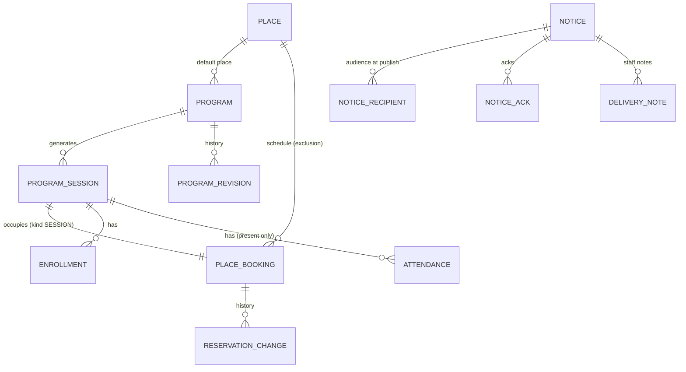

# 기술 설계 — community (프로그램·시설·공지)

상태: 승인(2026-11-04, 사용자 "보류된것 승인해") · 변경: 2026-11-04 `[NEED: 카피]` 반영 표시(카피 보완 2026-11-04, 사용자 재승인 2026-11-04) · 변경: 2026-11-04 N2 시드 출처 명시(사용자 재승인 2026-11-04) · 변경: 2026-11-04 면회 시간·이용 규칙 표기를 [미정]으로(사용자 재승인 2026-11-04) · 변경: 2026-11-04 쉬운 말 재검수·공용 문구 인용 반영(사용자 재승인 2026-11-04) · 작성: 2026-11-04 · 방법: 스킬을 쓰지 않음(코어 `tech-design.md`와 N1 `tech-design.md` 형식을 따름) · 기준: `04-planning/CLAUDE.md` "기술 설계", "코어 + 모듈 구조", 모듈 경계 `CLAUDE.md` "모듈 경계" 1~9번
입력: `prd.md`, `service-blueprint.md`, `user-stories.md`(모두 초안), `copy/names.md`(승인, 라벨과 코드), `copy.md`(승인), `senior-lab/04-planning/ideas/pms-core-billing/tech-design.md`(승인, 공통 도메인 모델 기준. 장기 부재·운영 현황 카드·모듈 시스템 주체는 사용자 재승인 2026-11-04), `senior-lab/04-planning/ideas/family-consent-portal/tech-design.md` 8-1·9절(D 일정의 N2 조회 [가설], 사용자 재승인 2026-11-04), `senior-lab/04-planning/ideas/life-requests/tech-design.md`(형식)

> 공통 도메인 모델의 기준은 코어 `tech-design.md` 하나다. 이 문서는 코어 엔티티를 ID로만 참조하고 N2의 확장 엔티티와 이벤트만 정의한다. 코어·D·G·N1에 바꿀 것은 직접 고치지 않고 10절과 "확인할 것"에 요청(N2-C·N2-D·N2-G·N2-N1·N2-H 번호)으로 적는다.
> 기술 스택은 코어 12절 방향(MVP Next.js, PostgreSQL)을 따르고 새로 정하지 않는다. 표기 규칙은 `strategy.md`와 같다.

## 1. 범위와 경계
```
   Evenstay 홈(회원)            Evenstay 패밀리(보호자, D 화면)           운영(직원·책임자)
          │                              │                                     │
          └──────── app/ 라우트 → community/web ─────────────────────────────────┘
                                         │
   D family ──enrolledSessionsOf · guardianNoticesFor · attendedIn──►  community (스키마 community)
   (community/api만 import)                                         장소 · 프로그램 · 회차 · 자원 예약 · 신청 · 출석
                                                                    공지 · 공지 대상 · 확인 · 아웃박스
                                         │
          core/api: ResidentQuery · SiteQuery · StaffQuery · AbsenceQuery · Authorization · AuditWriter · Clock
          platform: Notifier · 아웃박스
   app/ 운영 현황 카드 후보 ──► community/api CommunityBoardQuery.todayOf
```
- N2가 갖는 것: 장소(예약 받는 방과 프로그램 장소), 프로그램, 회차, 자원 예약(회차·시설 예약·막은 시간), 신청(신청·대기), 출석(온 분만), 공지, 공지 대상, 공지 확인, 직접 전함 메모, `community` 아웃박스.
- N2가 갖지 않는 것: 입주자·호실·동·직원·장기 부재(코어, 읽기만), 보호자 허락(D), 문자 발송기(platform), 청구(코어, 이번 버전은 쓰지 않음). 사본을 두지 않고 매 요청 `api/`로 읽는다(경계 8번).
- import: `community` 구현은 `core/api`·`platform`만. `community/api`도 `core/api`·`platform`만 import한다. D 구현이 `community/api`를 import한다(경계 2번, 순환 없음). N2는 `family/api`, `requests/api`, `assistant/api`, `safety/api`를 import하지 않는다.

## 2. 도메인 모델
### 2-1. 용어 (공통 언어)
카피 `names.md`의 코드 이름을 그대로 쓴다(ProgramSession, Enrollment, Attendance, FacilityReservation, Notice, NoticeAck, Audience). 아래 "추가" 행의 직원 화면 열은 코드를 설명하는 말이고 화면 라벨이 아니다. 화면에 나와야 하면 `[NEED: 카피]`다(`prd.md` 12절).
| 코드 | 직원 화면 | 회원 화면 | 비고 |
|---|---|---|---|
| Program / ProgramSession / Enrollment / Attendance / Notice / NoticeAck / Audience | names 2~5절 | names 2~5절 | — |
| FacilityReservation | 예약 | 예약 | names 4-2. 저장은 PlaceBooking(kind = RESERVATION) |
| Place | 장소, 공용 시설 | 방(회원 화면은 "1층 모임방"처럼 이름) | 추가. 예약 받는 방(reservable)과 프로그램 장소만인 곳(라운지, 정원, 텃밭) |
| PlaceBooking | (방 일정표의 한 칸) | (표시 안 함) | 추가. 회차·예약·막은 시간(BLOCK, names 4-2 "이용 안 함")을 한 테이블에 둔다(ADR-M1) |
| NoticeRecipient | 대상 | (표시 안 함) | 추가. 게시 때 정한 대상 입주자(ID만) |
| DeliveryNote | 메모(직원만 봄) | (표시 안 함) | 추가. copy 4-8 "전하지 못했을 때" |
| EnrollmentDeadline | 신청 마감 | 신청은 전날 오후 6시까지 받아요 | 추가. 저장하지 않고 계산(4절) |

### 2-2. 엔티티 (핵심 필드)
모든 테이블은 `community` 스키마이고 `id`(UUID), `operator_id`, `site_id`, `created_at`, `created_by`를 가진다. 코어 엔티티는 ID만 보관하고 외래 키를 두지 않는다(경계 3번). RLS는 코어 ADR-1과 같은 방식으로 `site_id`에 건다.

| 엔티티 | 핵심 필드 | 규칙 |
|---|---|---|
| Place 장소 | name, member_label(회원 화면 한 줄 풀이), kind(ROOM, OUTDOOR), building_id(코어 동 ID, 선택), reservable, max_people, slot_minutes, daily_max_minutes, open_from, open_to, booking_window_days, rules_text, rules_version, active, row_version | reservable = false면 프로그램 장소로만 쓴다. 규칙을 바꾸면 rules_version + 1(다음 예약 때 회원에게 다시 보임, copy 5-1) |
| Program 프로그램 | name, description(한 줄 풀이), weekdays[], start_time, duration_minutes, place_id, capacity(null = 신청 없음), lead_user_id(진행 직원, 코어 계정 ID), starts_on, ends_on, ended_at, generated_through(회차를 만든 마지막 날), row_version | 바꾸면 다음 회차부터(이미 지난 회차는 그대로). 변경 전후는 ProgramRevision에 추가 |
| ProgramRevision 프로그램 변경 이력 | program_id, before(JSON), after(JSON), changed_by, changed_at | 추가만. copy 4-2 "변경 이력" |
| ProgramSession 회차 | program_id, place_id, starts_at, ends_at, capacity(그 회차 정원, 프로그램 값에서 시작해 회차마다 바꿀 수 있음), status(ACTIVE, CANCELLED), cancel_reason(WEATHER, LEAD_UNAVAILABLE, PLACE_MAINTENANCE, OTHER, PROGRAM_ENDED), attendance_saved_at, attendance_saved_by, row_version | (program_id, starts_at) 유일 → 회차 생성 멱등. 화면 상태(OPEN, FULL, CLOSED, FREE_JOIN, DONE)는 저장하지 않고 계산(ADR-M8) |
| PlaceBooking 자원 예약 | place_id, period(tstzrange, [시작, 끝)), kind(SESSION, RESERVATION, BLOCK), session_id(SESSION), resident_id·unit_id·party_size·source(RESIDENT_APP, FRONT_PROXY, STAFF_PROXY)·taken_by_user_id·heard_via(PHONE, IN_PERSON)·rules_version_acked·rules_ack_kind(MEMBER = 회원이 [알겠어요], STAFF_TOLD = 직원이 말로 전함)(RESERVATION), block_reason(CLEANING, INSPECTION, SITE_EVENT, OTHER), status(ACTIVE, CANCELLED), cancel_kind(RESIDENT, STAFF_PROXY, SITE), cancel_reason, row_version | **`EXCLUDE USING gist (place_id WITH =, period WITH &&) WHERE (status = 'ACTIVE')`** — 같은 장소의 겹치는 활성 칸은 DB가 거부한다(ADR-M1). 모든 회차가 SESSION 칸을 가진다(정원, 텃밭 포함) |
| ReservationChange 예약 변경 이력 | booking_id, period_before, period_after, changed_by, changed_at | copy 2-9 "바뀜". 바꾸기는 같은 행의 period를 고치는 한 트랜잭션 |
| Enrollment 신청 | session_id, resident_id, unit_id(신청 때 호실), status(ENROLLED, WAITLISTED, CANCELLED), queued_at(서버가 받은 시각), seq(bigserial, 같은 시각일 때 순서), source(RESIDENT_APP, FRONT_PROXY = 프런트 대신 신청, STAFF_PROXY = 직원 대신 신청. 받은 직원의 코어 직무가 FRONT면 FRONT_PROXY로 쓸 때 정해 저장), taken_by_user_id, heard_via, promoted_at, promoted_by(null = 자동, 사용자 ID = 마감 뒤 직원), cancel_kind(RESIDENT, STAFF_PROXY, SESSION_CANCELLED, WAITLIST_LEFT), cancelled_at, cancelled_by_user_id, row_version | (session_id, resident_id) 중 CANCELLED 아닌 것 하나(부분 유일 인덱스). 대기 순서 = (queued_at, seq) |
| Attendance 출석 | session_id, resident_id, kind(ATTENDED, WALK_IN), recorded_at, recorded_by | (session_id, resident_id) 유일. **오지 않음 행은 없다**(ADR-M4) |
| Notice 공지 | title, body, audience_kind(ALL, BUILDING, FLOOR), building_id, floor, requires_ack, guardian_visible(기본 false), send_sms, status(DRAFT, SCHEDULED, PUBLISHED, ARCHIVED), publish_at, published_at, archived_at, concerns_on(공지 날, 선택, P1), ack_round(1부터), author_user_id, row_version | 게시 뒤 대상은 바꾸지 않는다(바꾸려면 내리고 새 공지) [가설] |
| NoticeRecipient 공지 대상 | notice_id, resident_id, unit_id | 게시 순간 대상 입주자를 코어에서 읽어 한 번 쓴다(ADR-M5). (notice_id, resident_id) 유일 |
| NoticeAck 확인 | notice_id, resident_id, round, kind(ACKED, DELIVERED_IN_PERSON), method(PHONE, VISIT, FRONT_DESK, 직접 전함일 때), actor_user_id(직원 또는 회원 본인), at | (notice_id, resident_id, round) 유일 → 멱등. 다시 받기(P1)는 ack_round + 1 |
| DeliveryNote 메모 | notice_id, resident_id, note, by, at | 직원만 본다. 이벤트·문자에 넣지 않는다 |
| OutboxEvent 아웃박스 | 코어 2-2 OutboxEvent와 같은 열 | `community` 스키마에 두고 `platform` 구현을 쓴다(코어 HUB-C7) |

### 2-3. ERD 초안

코어 ID(resident_id, unit_id, building_id, site_id, user_id)는 값으로만 보관한다.

## 3. 상태 전이
### 3-1. 회차 (ProgramSession)
저장 상태는 둘이다. 화면 상태는 계산한다(ADR-M8, 4-1).
```
(생성) ──► ACTIVE ──(cancel_session: 이유 4개 | end_program)──► CANCELLED
```
| 동작 | 허용 | 조건 | 부수 효과 |
|---|---|---|---|
| generate | — | SYSTEM 또는 프로그램 등록. (program_id, starts_at) 있으면 건너뜀 | ACTIVE + SESSION 칸. 겹침이면 그 회차를 만들지 않고 진행 직원 알림(copy 4-3·8-3) |
| change_capacity | ACTIVE, 시작 전 | 새 정원 ≥ ENROLLED 수(copy 4-3) | 늘었고 마감 전이면 늘어난 만큼 승급(4-3) |
| cancel_session | ACTIVE, 시작 전 | 이유 필수 | 모든 ENROLLED·WAITLISTED → CANCELLED(SESSION_CANCELLED), SESSION 칸 CANCELLED, 문자(P1) |
| record_attendance | ACTIVE, 시작 뒤 | 진행 직원·생활 지원 직무·책임자. 고치기는 그날 안 [가설] | Attendance 행 바꿈, attendance_saved_at |

### 3-2. 신청 (Enrollment)
라벨은 names 3-1. PROMOTED는 상태가 아니라 ENROLLED + promoted_at이다.
```
(enroll, 자리 있음) ──► ENROLLED
(enroll, 정원 참) ──► WAITLISTED ──(promote: 마감 전 자동 | 마감 뒤 직원)──► ENROLLED
ENROLLED ──(cancel: 회원 마감 전 | 직원 시작 전)──► CANCELLED
WAITLISTED ──(leave: 회원 | 직원 대신)──► CANCELLED(WAITLIST_LEFT)
ENROLLED · WAITLISTED ──(회차 취소·프로그램 끝)──► CANCELLED(SESSION_CANCELLED)
```
| 동작 | 허용 상태 | 조건 | 부수 효과 |
|---|---|---|---|
| enroll `{intent: ENROLL \| WAITLIST}` | — | 회차 ACTIVE, 시작 전, 정원 있음(신청 없음 회차는 422). 회원은 본인·마감 전, 직원은 시작 전. 같은 회차에 열린 신청이 있으면 409 "이미 신청하셨어요." | 회차 행 잠금 뒤: 자리가 있고 **4-3 규칙으로 올릴 대기가 없으면** ENROLLED. 그 밖이면 회원 intent = ENROLL은 행 없이 409 FULL(copy 7절 "방금 다른 분이 마지막 자리를 신청하셨어요. …"), intent = WAITLIST는 WAITLISTED. 직원 대신 신청은 intent 없이 자리가 없으면 WAITLISTED(copy 4-4). 대기가 있는 회차의 빈자리는 promote로만 채운다(마감 뒤 대기 순서를 앞지르지 않게) |
| cancel | ENROLLED | 회원 본인은 마감 전, 직원은 시작 전(들은 방법 필수) | 같은 트랜잭션에서 4-3 승급(마감 전만). 마감 뒤면 진행 직원 알림 |
| leave | WAITLISTED | 회원 본인 또는 직원 대신. 회차 행을 먼저 잠근다(승급과 부딪히지 않게) | CANCELLED(WAITLIST_LEFT). 다시 기다리면 새 행(맨 뒤) |
| promote(자동) | WAITLISTED | 마감 전, 자리 생김. SYSTEM이 아니라 자리를 낸 행위자의 트랜잭션 안에서 | ENROLLED, promoted_at, 승급 문자 아웃박스(P0) |
| promote(직원) | WAITLISTED | 마감 뒤 시작 전, 자리 있음, **이 행이 4-3 규칙의 대기 맨 앞**(아니면 409) | ENROLLED, promoted_by = 직원. 문자 없음 [가설] |
- 닫힌 상태는 CANCELLED 하나다. 닫힌 신청은 어떤 동작도 받지 않는다(409).
- 모든 전이는 같은 트랜잭션에서 코어 `AuditWriter` WRITE 1줄 + (필요하면) 아웃박스 행을 쓴다. 동시 수정은 회차 행 잠금으로 막는다(신청 행은 row_version).

### 3-3. 자원 예약 (PlaceBooking, kind = RESERVATION)
```
(book) ──► ACTIVE ──(change: 같은 행 period 교체)──► ACTIVE(바뀜, ReservationChange)
ACTIVE ──(cancel: 회원 | 직원 대신 | 사업장 + 이유)──► CANCELLED
(BLOCK 추가 + 겹친 RESERVATION 사업장 취소) = 한 트랜잭션
```
| 동작 | 조건 | 거부 |
|---|---|---|
| book | reservable, 이용 시간 안, slot_minutes 배수, 인원 ≤ max_people, 그 입주자의 그날 합계 ≤ daily_max_minutes, 오늘 ≤ 날짜 ≤ 오늘 + booking_window_days, 시작 > now. 회원 첫 예약·규칙 버전이 바뀐 뒤면 rules_version_acked 필수(직원 대신 예약은 rules_ack_kind = STAFF_TOLD). 하루 최대 검사는 (입주자, 날짜) 트랜잭션 advisory lock 안에서 한다(다른 칸 두 개를 동시에 예약해 합계를 넘지 않게) | 겹침은 배제 제약 위반(SQLSTATE 23P01) → 409 + 같은 장소 빈 칸(4-4). 나머지는 422 + copy 7절 메시지 코드 |
| change | 시작 전, 새 칸이 book 조건을 만족 | 새 칸 실패 시 기존 예약 그대로(copy 2-9) |
| cancel | 회원은 시작 전, 직원은 언제나(이유: 사업장 취소면 필수) | — |
- 시작한 뒤의 예약은 회원 화면에 "이미 쓰고 계신 시간이에요."(copy 2-9). 오지 않은 예약은 기록하지 않는다.

### 3-4. 공지 (Notice)와 확인 (NoticeAck)
```
DRAFT ──(publish)──► PUBLISHED ──(archive)──► ARCHIVED
DRAFT ──(schedule)──► SCHEDULED ──(publish_at ≤ now, SYSTEM)──► PUBLISHED
SCHEDULED ──(unschedule)──► DRAFT
PUBLISHED ──(edit: 내용만, P1)──► PUBLISHED (requires_ack이면 [다시 받기] 선택 시 ack_round + 1)
NoticeRecipient: 확인 전(행 없음) ──(ack: 회원 본인)──► ACKED
                                  └─(deliver_in_person: 직원, 방법 필수)──► DELIVERED_IN_PERSON
```
- publish는 한 트랜잭션에서 상태, NoticeRecipient 전부, (send_sms면) 문자 아웃박스를 쓴다. 대상이 0명이면 422(copy 7절 "○동 ○층에 지금 사는 입주자가 없습니다. …").
- 확인은 그 round에 한 번이다. 이미 ACKED인 입주자에게 직접 전함을 기록하면 409(이미 확인함) [가설: 덮어쓰지 않음].
- 회원의 공지 열람은 기록하지 않는다(ADR-M5).

## 4. 계산
### 4-1. 회차 화면 상태 (저장하지 않음)
| 화면 상태 | 조건 (now = `Clock.now()`) |
|---|---|
| 회차 취소 | status = CANCELLED |
| 마침 | now ≥ ends_at (출석 체크 전/함은 attendance_saved_at으로) |
| 신청 없음 | capacity null |
| 신청 마감 | now ≥ deadline(4-2) |
| 정원 참 | ENROLLED 수 ≥ capacity |
| 신청 받는 중 | 그 밖 |
- 회원 화면의 "자리 ○개 남았어요"는 capacity − ENROLLED 수다. 대기 수는 회원 화면에 보이지 않고 본인 순서만 보인다.

### 4-2. 신청 마감
deadline = (회차 날짜 − 1일) + 18:00 사업장 시간대 [가설: 사업장 설정 `enrollment_cutoff = {daysBefore: 1, time: "18:00"}`, copy 2-3]. 저장하지 않고 매번 계산한다.

### 4-3. 승급 (자리를 낸 트랜잭션 안에서)
```
lock session FOR UPDATE
free = capacity − count(ENROLLED)
if now < deadline:
  for w in WAITLISTED order by (queued_at, seq):
    if free = 0: break
    a = core.AbsenceQuery.absenceOf(w.resident_id, now)
    if a is OPEN and (a.expectedReturnOn is null or a.expectedReturnOn > 회차 날짜): continue   # F20, P1. 건너뛴 대기는 그대로
    w → ENROLLED(promoted_at = now); outbox(승급 문자); free −= 1
else if free > 0:
  outbox(진행 직원 알림 "마감 뒤 자리")
```
- 직원의 마감 뒤 [신청으로 올리기]가 허용되는 행 = 위 반복에서 처음 올라갈 행(부재 건너뜀 반영).
- 코어 조회(`absenceOf`)를 잠금 안에서 부른다. 같은 프로세스·같은 DB라 짧다 [가설]. F20이 꺼져 있으면 건너뛰기 없이 맨 앞을 올린다.

### 4-4. 비어 있는 시간
장소의 이용 시간을 slot_minutes로 나눈 칸 중 그날 ACTIVE 칸(SESSION, RESERVATION, BLOCK)과 겹치지 않고 시작 > now인 칸. 회원 시설 예약 화면(copy 2-8)은 이 칸을 모두 보인다. 겹침 오류 응답(copy 7절)은 그중 **요청한 시각 뒤 가장 가까운 2칸**만 담는다(데모 M5: 14:00 요청 → 16:00, 17:00) [가설]. 보여 주는 것은 계산 결과일 뿐이고, 마지막에 거르는 것은 배제 제약이다.

### 4-5. 공지 대상
- ALL: 코어 `ResidentQuery.listResidents(siteId, at = 게시 시각)`.
- BUILDING: 위 결과 중 그 동의 호실(코어 `SiteQuery.listUnits`의 building_id).
- FLOOR(P1): 코어 Unit에 층 칸이 없어 호실 번호의 백의 자리로 계산한다(201 → 2층) [가설]. 코어가 층 칸을 열면 그것을 쓴다(N2-C3).
- 확인 현황 숫자: 대상 = NoticeRecipient 수, 확인함 = 그 round ACKED 수, 직접 전함 = DELIVERED_IN_PERSON 수, 확인 전 = 대상 − 둘.

### 4-6. 회차 생성
매일 0시(데모 시계를 옮길 때 따라잡기) SYSTEM이 활성 프로그램마다 generated_through 다음 날부터 오늘 + 28일까지 요일에 맞는 회차를 만든다 [가설: 4주, copy 4-2]. 예약 기간(14일)이 회차 생성 기간(28일)보다 짧아, 회원 예약이 아직 만들어지지 않은 회차 시간을 먼저 차지하는 일은 생기지 않는다. 막은 시간(BLOCK)은 기간 제한이 없어 겹칠 수 있고, 그 회차는 만들지 않고 알린다(3-1 generate).

## 5. 설계 결정 기록 (ADR)
### ADR-M1. 회차·시설 예약·막은 시간을 한 테이블에 두고 DB 배제 제약으로 겹침을 막는다
- 맥락: 같은 방을 프로그램, 회원 예약, 청소 막기가 함께 쓴다. 신청 길이 셋이라 앱 검사만으로는 동시 요청을 못 막는다.
- 선택지: (가) 테이블마다 따로 두고 앱에서 서로 조회, (나) 한 테이블 + `EXCLUDE USING gist`, (다) 칸(slot) 행을 미리 만들어 유일 제약.
- 결정: (나). `btree_gist` 확장으로 (place_id =, period &&)를 활성 행에만 건다.
- 결과: 겹침 규칙이 한 곳이다(카피 1절 "한 방, 한 일정"). 칸 단위가 다른 장소도 같은 규칙. 코어 호실 계약 겹침 거부와 같은 모양이라 면접 설명이 이어진다 [추정: coverage review N2 행]. 프로토타입(HTML·JS)은 같은 검사를 목업 저장소에서 흉내 낸다.

### ADR-M2. 정원은 회차 행 잠금으로, 순서는 서버가 받은 시각으로 정한다
- 맥락: 마지막 자리를 앱과 프런트가 동시에 신청한다(카피 1절).
- 선택지: (가) 낙관적 잠금(row_version) 재시도, (나) 회차 행 `SELECT … FOR UPDATE`, (다) 정원 카운터 컬럼 원자 감소.
- 결정: (나). 한 회차의 쓰기(신청, 취소, 승급, 정원 바꾸기)는 모두 회차 행을 먼저 잠근다. 순서는 (queued_at, seq).
- 결과: 늦은 쪽은 자동으로 대기가 된다(copy 7절 "방금 다른 신청이 먼저 들어와 정원이 찼습니다. 대기 1번으로 넣었습니다."). 한 회차의 쓰기가 줄을 서지만 회차당 사람 수가 적어 문제 되지 않는다 [가설].

### ADR-M3. 승급은 마감 전에만 자동이고 자리를 낸 트랜잭션 안에서 한다
- 맥락: 사용자 결정 N2-3. 회원이 문자를 못 보면 "자리가 났다고 알리고 다시 누르기"는 자리를 놓친다.
- 결정: 마감 전 취소·정원 늘림은 같은 트랜잭션에서 대기 맨 앞을 올리고 문자는 아웃박스로. 마감 뒤에는 올리지 않고 진행 직원에게 알려 사람이 전화로 묻는다.
- 결과: 별도 승급 작업(배치)이 없어 "취소됐는데 승급 안 됨" 같은 중간 상태가 없다. 문자 실패는 승급을 되돌리지 않는다.

### ADR-M4. 출석은 온 분만 저장한다
- 맥락: 출석은 운영 기록이고 평가에 쓰지 않는다(카피 공통 규칙 2).
- 결정: Attendance는 ATTENDED·WALK_IN 행만. "오지 않음"은 신청이 있고 출석 행이 없으며 attendance_saved_at이 있는 경우 직원 화면에서만 계산해 보인다. 입주자별 합계를 돌려주는 조회를 만들지 않는다.
- 결과: 오지 않은 기록이 데이터로 존재하지 않으니 다른 모듈·보호자로 샐 수 없다. D 생활 소식 재료(`attendedIn`)도 온 회차만이다.

### ADR-M5. 공지 대상은 게시 때 정해 두고, 확인은 두 길만 받는다
- 맥락: "A동 대상"을 볼 때마다 다시 계산하면 그 사이 입주·퇴거로 숫자가 바뀐다. 확인은 [읽었어요]와 직접 전함이다(카피 1절).
- 결정: 게시 순간 코어에서 대상 입주자를 읽어 NoticeRecipient(ID만)에 쓴다. 이것은 코어 데이터의 사본이 아니라 "이 공지를 누구에게 보냈는가"라는 N2의 사실이다(이름·호실 번호는 저장하지 않고 화면에서 코어로 읽는다). 열람은 기록하지 않는다.
- 결과: 확인 현황 숫자가 시간에 따라 흔들리지 않는다. 게시 뒤 들어온 입주자는 그 공지 대상이 아니고 목록에도 보이지 않는다 [가설]. 필요하면 내리고 다시 게시한다.

### ADR-M6. 보호자 조회 두 행동을 모두 "D 동의로 연다"고 선언한다: 일정은 SCHEDULE 허락으로, 공지는 보호자 관계만으로
- 맥락: 보호자 일정은 회원 허락(D SCHEDULE)이 필요하고(사용자 결정 N2-2), 보호자 공지는 허락 항목과 묶지 않는다(N2-5).
- 결정: `community.enrollment.view_as_guardian`과 `community.notice.view_as_guardian` 둘 다 `community/api`에 "D 동의로 연다"고 선언한다(코어 ADR-2 5번, 코어 6-1의 "보호자 행동은 D가 정책으로 연다"). D는 일정 행동을 SCHEDULE 허락으로, 공지 행동은 허락 항목과 상관없이 그 회원과의 활성 보호자 관계만으로 연다(사용자 결정 N2-5 "허락 항목과 묶지 않는다"). N2 정책은 두 행동에 ALLOW를 주지 않는다.
- 결과: N2는 `family/api`를 import하지 않는다. 일정에 "건강 관련" 표시가 없다(건강 상태를 짐작하게 하는 프로그램을 다루지 않음, `prd.md` 12절).

### ADR-M7. 장기 부재는 필요할 때 읽고 구독하지 않는다
- 맥락: 부재 중인 대기자에게 자리가 가면 빈다. N1·B와 같은 원칙(`AbsenceQuery`를 읽음).
- 결정: 승급 때와 명단·확인 현황을 그릴 때 `absenceOf`를 읽는다. 부재 시작 이벤트로 신청을 자동 취소하지 않는다(사람이 회원·가족과 이야기한 뒤 대신 취소).
- 결과: 부재 데이터 사본이 없다. 대신 이미 신청된 부재 입주자의 자리는 직원이 정리해야 한다.

### ADR-M8. 회차 화면 상태는 계산한다
- 맥락: 신청 받는 중·정원 참·마감·마침은 시계와 숫자에서 나온다. 데모는 시계만 옮긴다.
- 결정: 저장은 ACTIVE·CANCELLED만, 나머지는 4-1 계산.
- 결과: 시계를 옮겨도 상태를 고치는 배치가 필요 없다. 시드 행도 시계 기준으로 보인다(코어 장기 부재 시드와 같은 방식): 신청의 queued_at, 예약의 created_at이 now보다 뒤인 행은 조회에서 뺀다. 통합 데모는 처음 "기본" 초기화 한 번으로 N2 시드를 넣고 그 뒤 시계만 옮기기 때문이다(`prd.md` 9절 "시드 출처").

### ADR-M9. 이번 버전은 무료만, 코어 청구를 부르지 않는다
- 맥락: 사용자 결정 N2-4. 청구 연결 데모는 N1 세탁이 이미 보인다.
- 결정: 비용 칸 없음. 회원 상세 "따로 내실 돈은 없어요."(copy 2-3). 모듈 시스템 주체(`SYSTEM:community`)도 등록하지 않는다(코어 명령을 부르지 않으므로).
- 결과: 코어 골든 금액이 바뀌지 않는다. 다음 버전에 N1 ADR-R4와 같은 방식으로 붙인다.

### ADR-M10. 사업장마다 켜는 기능을 정한다 (Multi-site·자산 유형)
- 맥락: 코어는 자산 유형이 다른 두 사업장을 한 모델로 다룬다(새봄 레지던스: 시니어 레지던스, 다온하우스: 임대주택) [사실: 코어 `prd.md` 9절]. 임대주택에는 여가 프로그램이 없을 수 있다 [추정].
- 선택지: (가) 모든 사업장에 다 연다, (나) 자산 유형으로 코드에서 가른다, (다) 사업장 설정 `community_features = {notices, programs, places}`.
- 결정: (다). 모든 테이블은 site_id를 갖고 RLS로 나뉜다(코어 ADR-1). 자산 유형으로 분기하는 코드는 두지 않는다. 시드: 새봄 레지던스는 셋 다 켬, 다온하우스는 공지만 켬 [가설]. 꺼진 기능의 REST는 404, 화면과 버튼은 나오지 않는다. 설정 라벨은 copy 5-1 "이 사업장에서 쓰는 기능". 설정은 N2 자기 테이블(SiteFeature, site_id 유일)에 둔다. 코어 사업장 설정에 둘지는 N2-C4.
- 결과: 새 자산 유형이 와도 코드 변경 없이 설정으로 켠다. 본사 화면에서 사업장마다 켠 기능이 다르게 보인다.

## 6. 역할과 권한
### 6-1. 원칙
- N2는 앱 시작 때 `registerPolicy(communityPolicy)`로 `community.*` 행동의 허용 정책만 등록한다. 코어 1단계(범위 밖) 거부를 뒤집지 못한다(경계 5번).
- 모든 `community/api` 메서드와 REST 핸들러는 actor를 받아 안에서 `authorize()`를 부른다.
- `community.enrollment.view_as_guardian`과 `community.notice.view_as_guardian`은 D 정책이 연다(ADR-M6). N2 정책은 두 행동에 ALLOW를 주지 않는다.

### 6-2. 역할 × 행동
● 가능 · ◐ 조건부 · — 불가. "생활 지원"은 코어 직무 LIFE_SUPPORT, "진행"은 그 프로그램의 lead_user_id.
| 행동 코드 | 회원 | 보호자 | 사업장 직원 | 사업장 책임자 | 본사 운영 매니저 | 본사 관리자 |
|---|---|---|---|---|---|---|
| `community.program.view`(일정, 회차, 남은 자리) | ●(자기 사업장) | — | ● | ● | ● | ● |
| `community.program.manage`(등록, 바꾸기, 끝내기) | — | — | ◐(생활 지원) | ● | — | — |
| `community.session.manage`(정원, 쉬기) | — | — | ◐(진행 또는 생활 지원) | ● | — | — |
| `community.enrollment.create`·`cancel`·`leave` | ◐(본인, 마감 전) | — | ●(대신, 시작 전) | ● | — | — |
| `community.enrollment.promote_after_deadline` | — | — | ● | ● | — | — |
| `community.enrollment.view`(명단) | ◐(본인 것) | — | ● | ● | ● | ● |
| `community.enrollment.view_as_guardian` | — | (D 정책, SCHEDULE) | — | — | — | — |
| `community.attendance.record` | — | — | ◐(진행 또는 생활 지원) | ● | — | — |
| `community.attendance.view`(`attendedIn`, 지난 프로그램) | ◐(본인 것) | — | ●(D 생활 소식 초안은 직무와 상관없이 직원이 만든다, D `family.report.edit`) | ● | — | — |
| `community.place.manage`(공용 시설 설정) | — | — | — | ● | ● | — |
| `community.reservation.create`·`change`·`cancel` | ◐(본인) | — | ●(대신) | ● | — | — |
| `community.reservation.block`(시간 막기, 사업장 취소) | — | — | ● | ● | — | — |
| `community.notice.write`(쓰기, 게시, 예약 게시, 고치기, 내리기) | — | — | ● | ● | — | — |
| `community.notice.view` | ◐(대상인 공지) | — | ● | ● | ● | ● |
| `community.notice.view_as_guardian` | — | (D 정책, 보호자 관계. 보이기 켠 공지 중 자기 회원이 대상인 것) | — | — | — | — |
| `community.notice.ack` | ◐(본인, 대상) | — | — | — | — | — |
| `community.notice.deliver_in_person`, 메모 | — | — | ● | ● | — | — |
| `community.summary.read`(`todayOf`) | — | — | — | ● | ● | ● |
- 대리인(대신 처리하실 분)은 행동이 없다. 코어 대리 범위 대응표에 `community.*`를 더하지 않는다(`prd.md` 10절).
- 소유주(OWNER_VIEWER)는 행동이 없다(월 리포트 칸은 Next).
- SITE_MANAGER의 ●는 자기 사업장 안에서만이다(코어 6-2).

### 6-3. 감사
- 모든 쓰기: 코어 `AuditWriter` WRITE(action = 행동 코드, entity = Enrollment·PlaceBooking·Notice 등). 대신 넣은 쓰기는 taken_by·heard_via를 after에 남긴다.
- SYSTEM 작업(회차 생성, 예약 게시, 알림 예약): actor_user_id = null, actor_role = SYSTEM, action = `community.session.generate`·`community.notice.publish_scheduled`, request_id = 실행 ID(코어 2-2 배치 규칙). 자동 승급은 자리를 낸 사람의 행동 안에서 일어나므로 같은 actor로 `community.enrollment.promote` 한 줄을 더 쓴다.
- READ 기록: 명단·확인 현황·출석 화면은 READ를 남기지 않는다 [가설: 건강·금전 정보가 없는 운영 목록]. 보호자 조회의 열람 기록은 D가 `app/` 조립 때 정한다(N2-D2).
- 감사 전후 값에서 공지 본문과 DeliveryNote 메모는 가린다(코어 7절).

## 7. 민감정보 처리
| 등급 | 데이터 | 누가 보나 | 처리 |
|---|---|---|---|
| 저장 안 함 | 오지 않음, 입주자별 참여 횟수·비율, 공지 열람, 건강 관련 정보 | — | 행·칸·조회가 없다(ADR-M4·M5) |
| 개인정보 | 신청·대기·출석(누가 어느 모임에), 예약(누가 언제 어느 방, 인원), 확인 기록, 메모 | 본인(자기 것), 범위 안 직원, 보호자(SCHEDULE 허락 시 확정 신청의 날짜·이름·장소만) | 애플리케이션 로그에는 ID만. 이벤트 payload에 이름·프로그램 이름을 넣지 않는다 |
| 직원 전용 | 들어온 곳·받은 직원, 장기 부재 표시, 메모, 확인 전 목록 | 범위 안 직원 | 회원·보호자 DTO에 필드 없음(KR3) |
| 일반 | 프로그램 일정, 장소 규칙, 공지(대상 안에서) | 범위 안 계정 | — |
- 공지 본문에 개인 정보를 쓰지 않게 하는 것은 쓰기 안내에 기댄다(copy 4-7). 시스템 검사는 하지 않는다 [가설].
- 보존 기간: [미정](코어 7절과 함께 법무 확인).

## 8. API
### 8-1. 외부 REST (화면용)
모든 쓰기는 `Idempotency-Key`를 받는다. 409는 허용되지 않은 전이·겹침·정원(대기로 넣지 못하는 경우)·대기 맨 앞 아님, 403은 권한, 422는 입력(마감 뒤, 인원, 하루 최대, 이용 시간, 예약 기간). 오류 본문에 copy 7절 메시지 코드와, 겹침이면 그날 빈 칸 목록을 넣는다.
| 메서드·경로 | 설명 | 권한 | 비고 |
|---|---|---|---|
| GET `/me/programs?week=this\|next`, GET `/me/sessions/{id}` | 이번 주 프로그램, 상세(남은 자리, 내 신청 상태·순서, 마감) | `program.view` | 대기 수·다른 입주자 없음 |
| POST `/me/sessions/{id}/enrollments` `{intent: ENROLL\|WAITLIST, confirmSameTime?}` | 신청 또는 기다리기 | `enrollment.create` | ENROLL인데 자리가 없으면 409 FULL(행 없음), WAITLIST면 순서를 돌려줌 |
| POST `/me/enrollments/{id}/cancel`, `/leave` | 신청 취소, [그만 기다릴게요] | `enrollment.cancel`·`leave` | 마감 뒤 422 |
| GET `/me/enrollments?when=upcoming`, GET `/me/programs/past` | 앞으로 가실 프로그램·대기, 지난 프로그램(Attendance 행 기준이라 신청 없이 온 회차도 나온다) | `enrollment.view`·`attendance.view` | 오지 않음 없음 |
| GET `/me/places`, GET `/me/places/{id}/free-slots?date=` | 예약 받는 방, 빈 시간 | `program.view` | 4-4 |
| POST `/me/reservations`, PATCH `/me/reservations/{id}`, POST `/me/reservations/{id}/cancel`, GET `/me/reservations` | 예약, 바꾸기(P1), 취소, 내 예약 | `reservation.*` | 겹침 409 + 빈 칸 |
| GET `/me/notices?state=current\|past`, GET `/me/notices/{id}`, POST `/me/notices/{id}/ack` | 공지, [읽었어요] | `notice.view`·`ack` | 열람 기록 없음 |
| GET `/staff/sites/{id}/community/today` | 직원 첫 화면 숫자와 목록 | `program.view` | copy 4-1 |
| GET·POST `/staff/sites/{id}/programs`, PATCH `/staff/programs/{id}`, POST `/staff/programs/{id}/end` | 프로그램 | `program.manage` | 겹침 409 + 겹친 날 목록 |
| GET `/staff/programs/{id}/sessions`, PATCH `/staff/sessions/{id}/capacity`, POST `/staff/sessions/{id}/cancel` | 회차, 정원, 쉬기 | `session.manage` | P1(정원·쉬기) |
| GET `/staff/sessions/{id}/roster` | 명단(신청, 대기 순서, 들어온 곳, 부재 표시) | `enrollment.view` | 참여 횟수 칸 없음 |
| POST `/staff/sessions/{id}/enrollments` `{residentId, heardVia}`, POST `/staff/enrollments/{id}/cancel` `{heardVia}`, `/leave`, `/promote` | 대신 신청·취소·그만두기, 마감 뒤 올리기 | `enrollment.create`·`cancel`·`promote_after_deadline` | promote는 맨 앞만 |
| PUT `/staff/sessions/{id}/attendance` `{present: [{residentId, kind}]}` | 출석 저장(전체 교체) | `attendance.record` | 그날 뒤 422 |
| GET `/staff/sites/{id}/place-schedule?date=`, POST `/staff/sites/{id}/reservations`, POST `/staff/sites/{id}/blocks` | 방 일정표, 대신 예약, 시간 막기(겹친 예약 사업장 취소 포함) | `reservation.create`·`block` | P1(막기) |
| GET·POST `/staff/sites/{id}/places`, PATCH `/staff/places/{id}` | 공용 시설 설정 | `place.manage` | P1 |
| GET·POST `/staff/sites/{id}/notices`, PATCH `/staff/notices/{id}`, POST `/staff/notices/{id}/{publish\|schedule\|unschedule\|archive}` | 공지 | `notice.write` | publish 응답에 대상 수, 문자 실패는 아웃박스 결과로 |
| GET `/staff/notices/{id}/acks`, POST `/staff/notices/{id}/residents/{rid}/delivered` `{method}`, POST `…/notes` | 확인 현황, 직접 전함, 메모 | `notice.view`·`deliver_in_person` | |
| (데모) 기본 시드와 `/demo/reset {state}`의 community 단계 | `community/seed` `base()`(COM-03 "기본", 처음 배포)와 `reset(state)` | 데모 환경만 | `app/`이 requests 다음에 부른다 [N2-H1]. 시드 출처는 `prd.md` 9절 |

### 8-2. 내부 모듈 API (`community/api`)
| 인터페이스 | 메서드 | 쓰는 곳 | 규칙 |
|---|---|---|---|
| `ProgramQuery` | `enrolledSessionsOf(residentId, from, to, actor) → [{sessionId, programName, startsAt, endsAt, placeName, state: ENROLLED \| SESSION_CANCELLED}]` | D(일정, N2-D1) | **이름 확정**. D [가설]의 이름은 그대로이고 형태를 바꿨다: actor 인자 추가, title → programName, place → placeName, endsAt·state 추가, healthRelated 삭제. `community.enrollment.view_as_guardian`(보호자) 또는 `community.enrollment.view`(직원)를 ENFORCE로 검사. ENROLLED와, ENROLLED였다가 회차 취소된 것만. 대기·회원 취소·예약·출석 없음. `healthRelated` 필드는 두지 않는다(ADR-M6) |
| | `sessionsIn(siteId, from, to, actor) → [{sessionId, programName, startsAt, placeName, seatsLeft \| null, state}]` | G(Next, N2-G1) | `community.program.view`. 이름 제안 |
| `NoticeQuery` | `guardianNoticesFor(residentId, at, actor) → [{noticeId, title, body, publishedAt}]` | D(첫 화면 레지던스 공지, N2-D2) | `community.notice.view_as_guardian`. guardian_visible이고 PUBLISHED이며 그 회원이 NoticeRecipient인 것(대상 전체·동 공지도 게시 때 대상이었어야 함) |
| `AttendanceQuery` | `attendedIn(residentId, from, to, actor) → [{sessionId, programName, startsAt}]` | D(생활 소식 재료, N2-D3) | `community.attendance.view`를 CHECK(숫자 카드가 아닌 목록이지만 D 리포트 작성 직원의 근거 패널이라 D가 자기 규칙으로 기록) |
| `CommunityBoardQuery` | `todayOf(siteId, at, actor) → {asOf, sessionsToday, attendancePending, reservationsToday, ackPending: {notices, units}}` | `app/`(운영 현황 카드 후보, N2-C2) | `community.summary.read`를 CHECK(숫자 카드는 열람 기록 없음, 코어 10절). 이름·호실 없음. 매번 계산 |
| 선언(D 동의 행동) | `GUARDIAN_CONSENT_ACTIONS = ['community.enrollment.view_as_guardian', 'community.notice.view_as_guardian']`, resource 형태 `{siteId, residentId}` | D(정책 등록) | 코어 ADR-2 5번의 선언 |

### 8-3. 도메인 이벤트
payload는 ID와 코드만 담는다. 이름, 프로그램 이름, 공지 본문을 넣지 않는다. 모든 이벤트에 `event_id`, `occurred_at`, `schema_version`, `site_id`.
| 이벤트 | payload | 구독 |
|---|---|---|
| ProgramEnrollmentChanged | enrollmentId, sessionId, residentId, change(ENROLLED, PROMOTED, CANCELLED, SESSION_CANCELLED, SESSION_RESCHEDULED) | [미정: D가 보호자 새 소식 문자에 쓸지 정한다, N2-D5]. 지금 구독자 없음 |
- 내부 아웃박스 처리(이벤트가 아닌 작업 행): 회원 문자·직원 알림(`Notifier.send`, sendAfter로 출석 체크 전 알림), 공지 문자.

## 9. 외부 연동 경계
| 연동 | MVP | 어댑터 | 멱등·실패 처리 |
|---|---|---|---|
| 문자·직원 알림 | 화면 로그(코어와 같음) | `platform` `Notifier.send(template, recipientRef, vars, sendAfter?)` | 아웃박스, 재시도 5회 [가설] 뒤 실패 표시. 공지 문자 실패는 쓴 직원에게(copy 7절) |
| 소리로 듣기 | 없음(Next) | 기기 읽어 주기 | — |
| 결제 | 없음(무료만) | — | — |
| 출입·IoT | 없음. 출석을 출입 신호로 추정하지 않는다 | — | — |
| AI | 없음. 추천·분류를 하지 않는다 | — | — |

## 10. 다른 모듈과의 경계
### 10-1. 코어에 기대는 것과 요청
**지금 있는 것으로 쓰는 것**: `ResidentQuery.getResident`·`listResidents`·`residentsInUnit`, `SiteQuery.getSite`·`listUnits`(동), `StaffQuery.listStaff`(진행 직원 고르기, 직무 확인), `AbsenceQuery.absenceOf`(승급·명단 표시 때 읽기, 이벤트 구독 없음), `Authorization`(`community.*` 정책 등록, D 동의 행동 선언), `AuditWriter`, `Clock`, 아웃박스 구현(`platform`), `Notifier`. 새 시드 직원은 필요 없다(윤서연·최민수·최영미가 코어 시드에 있다).

**코어에 요청 (N2-C)**
| 번호 | 요청 | 이유 | 없을 때 |
|---|---|---|---|
| N2-C1 | 문서 동기화: 10절 의존 표에 community 줄(기대는 것: 위 목록, 소유하는 것: 장소·프로그램·회차·자원 예약·신청·출석·공지, 단독 데모 대체: 시드 JSON), 8-1 `/demo/reset` 순서 끝에 community, 6-2 아래 "`community.*` 권한은 N2 문서가 정한다" 주석, ADR-2 5번 선언 행동에 `community.enrollment.view_as_guardian` 더하기, 2-2 스키마 목록에 `community` | 공통 모델 기준 문서 | — |
| N2-C2 | 운영 현황 카드 후보 "프로그램·시설·공지"(copy 5-2): `CommunityBoardQuery.todayOf`(8-2). 카드로 둘지와 순서는 코어 10절이 정한다. 데모 장면 M10(11/18 16:10)에 넣을지도 | 책임자 첫 화면 | 조회만 두고 카드 없음 |
| N2-C3 | (선택) `SiteQuery.listUnits` 항목에 floor. 없으면 N2가 호실 번호로 계산한다(4-5) | 층 대상 공지(P1) | 번호 규칙 계산 [가설] |
| N2-C4 | ADR-2 5번 선언 행동 목록에 `community.notice.view_as_guardian`도 더하기(허락 항목과 무관하게 D가 보호자 관계로 여는 첫 선언 행동이라는 주석). 사업장 설정에 N2 켜는 기능(ADR-M10)을 둘 자리가 코어 사업장 설정이면 그 칸 | ADR-M6·M10 | N2 자기 설정 테이블에 둔다 |
- 코어 명령(청구 등)은 부르지 않으므로 모듈 시스템 주체 등록이 필요 없다(ADR-M9). 코어 골든 금액은 바뀌지 않는다.

### 10-2. D에 요청 (N2-D)
| 번호 | 요청 | 이유 |
|---|---|---|
| N2-D1 | 일정 조회 이름 확정 `ProgramQuery.enrolledSessionsOf(residentId, from, to, actor)`와 반환 형태(8-2). D `tech-design.md` 9절 [가설] 해제, `healthRelated` 필드 없음(건강 상태를 짐작하게 하는 프로그램을 다루지 않음). D 정책이 `community.enrollment.view_as_guardian`을 SCHEDULE 허락으로 연다. 쉬게 된 회차 줄(copy 3-1 "…수채화는 쉬어요.")을 일정 화면에 그린다 | 사용자 결정 N2-2 |
| N2-D2 | 보호자 첫 화면 "레지던스 공지" 칸(copy 3-2)을 D 첫 화면에 둔다(D handoff [미정] 해소: 자리는 D, 데이터는 N2 `NoticeQuery.guardianNoticesFor`). 허락 항목과 묶지 않는다(N2-5). D 정책이 `community.notice.view_as_guardian`을 회원과의 활성 보호자 관계만으로 연다(ADR-M6). 열람을 회원 "본 기록"에 넣을지는 D가 정한다(공지는 회원 개인 기록이 아니라 넣지 않는 쪽을 제안 [가설]) | 사용자 결정 N2-5 |
| N2-D3 | 생활 소식 프로그램 재료(`ReportSourceAdapter.programs`)를 시드 대신 `AttendanceQuery.attendedIn`으로. 그러면 11월 셋째 주 이은숙 줄은 "수요일 가벼운 체조(M3), 목요일 수채화(M11)" 2회가 되므로 D 카피 4-2 예시와 D `prd.md` 9절 "프로그램 2회(노래 교실, 산책 모임)"의 이름을 맞춘다(회수는 같음, D 카피 `[NEED]`). `attendedIn`은 사업장 직원이면 CHECK를 통과한다(D 초안 작성자 범위와 같게) | D `tech-design.md` 9절 "주인은 N2 후보" |
| N2-D4 | 통합 데모 장면 D-N2-1: 2026-11-18 14:50 이은숙이 FAM-01에서 김지민에게 "일정" 보여 주기(D-N1-1과 같은 꼴). 프로그램이 일정에 더해진 뒤 허락하므로 ScopeNoticeAck(SCHEDULE_PROGRAMS)는 필요 없는지 확인(D 확인할 것 28). `C_AFTER_DISCHARGE`·`G_START` D 시드에 김지민 SCHEDULE 허락(11/18) 넣기 | 데모 M7·M8 |
| N2-D5 | (선택) `ProgramEnrollmentChanged`를 구독해 보호자 새 소식 문자를 보낼지 D가 정한다. N2 카피 8-2는 "D의 새 소식 문자 규칙을 따른다 [가설]" | 보호자 연락은 D 하나 |

### 10-3. G에 요청 (N2-G)
| 번호 | 요청 | 이유 |
|---|---|---|
| N2-G1 (Next) | G roadmap의 프로그램 일정 도구 이름 제안: "이번 주 프로그램" = `ProgramQuery.sessionsIn`(READ), "내 신청" = `ProgramQuery.enrolledSessionsOf`(actor = 회원 본인, READ). 신청하기 같은 쓰기 도구는 두지 않는다 [가설]. 그때까지 도구 밖 답 "프로그램 일정은 제가 아직 몰라요"는 그대로 맞다 | 허브 보완 지시 G 4번 |

### 10-4. N1 생활 요청과의 관계 (N2-N1)
| 번호 | 내용 |
|---|---|
| N2-N1-1 | 코드 연결 없음. "그 밖의 일"로 들어온 프로그램 문의는 프런트가 N2 [대신 신청]으로 넣고 N1 요청을 [완료]한다(한 일 예: "수채화를 대신 신청했어요" [시연 입력]) [가설]. N1 문서 변경 없음 |
| N2-N1-2 | 정기 청소·점검(N1 정기 작업)과 N2 시간 막기는 별개다. 청소 시간을 방 일정에 막을 때는 직원이 N2에서 직접 막는다 |

### 10-5. 허브·루트에 요청 (N2-H)
| 번호 | 요청 |
|---|---|
| N2-H1 | evenstay 루트 `CLAUDE.md`: 모듈 표에 `community/` 행(프로그램·시설·공지, `docs/community/`), 경계 1번 스키마 목록에 `community`, 9번 `/demo/reset` 순서 끝에 community, 구조 줄에 `community/` |
| N2-H2 | 코어 카피 `names.md` 모듈 표에 N2 행(프로그램·시설·공지 / 프로그램, 시설 예약, 공지 / D 일정·레지던스 공지)(카피 names 1절) |
| N2-H3 | `shared/idea-board.md` N2 단계, `shared/decisions.md`에 ADR-M1·M3·M4·M6 |
| N2-H4 | 화면 정의서 `design/mvp-screens.md`: CMN-01~23, 5절 통합 흐름에 11/18 장면(M0~M11) 넣기 |
| N2-H5 | 소개 사이트: SITE-LIFE-03 프로그램 이름·풀이를 카피 names 2-1과 맞추기, 1층 모임방·노래방을 가상 시설(랜딩 11절)에 더할지 |

### 10-6. 단독 데모 대체
| 대상 | 대체 |
|---|---|
| 코어 | 시드 JSON(입주자·호실·동·직원·부재) 고정 조회 목업 |
| D | 보호자 정책 목업(김지민 SCHEDULE 허락), 보호자 화면은 CMN-12·13만 단독으로 그림 |
| 문자 | `Notifier` 화면 로그 |

## 11. 테스트·배포·모니터링 최소 기준
| 종류 | 무엇을 | 기준 |
|---|---|---|
| 상태 전이 | 3-1~3-4 모든 (상태, 동작) 조합 | 표 기반 테스트로 허용·거부 전부 |
| 동시성 | 정원 1 남은 회차에 신청 2개 동시(반복), 같은 칸 예약 2개 동시, 같은 입주자가 다른 칸 두 개를 동시에 예약(하루 최대), 취소·[그만 기다릴게요]와 신청 동시 | 정원 초과 0, 겹침 0, 하루 최대 초과 0, 늦은 회원은 409 FULL(행 없음)·늦은 직원 대신 신청은 대기 첫 번째(KR2) |
| 승급 | 대기가 있는 회차에 마감 뒤 자리가 나도 새 대신 신청은 대기로 들어감, 마감 전 취소 → 맨 앞 승급 1건 + 문자 1건, 마감 뒤 취소 → 승급 0 + 직원 알림 1건, 정원 +2 → 2건, 장기 부재 대기자 건너뜀(F20), 맨 앞 아닌 행 promote 409 | 전부 통과 |
| 겹침 | 프로그램 등록이 예약과 겹침 → 회차 0개 생성, 회차 생성 작업이 BLOCK과 겹침 → 그 회차만 건너뜀 + 알림 | 전부 통과 |
| 지킬 것 | 회원·보호자 DTO에 ABSENT·참여 횟수·비율·부재 표시 없음, 보호자 일정에 WAITLISTED·RESERVATION 없음, 입주자별 합계 API 없음(라우트 목록 검사) | KR3 |
| 멱등 | 같은 Idempotency-Key 신청·예약·[읽었어요]·직접 전함, 같은 날 회차 생성 두 번, 예약 게시 두 번 | 결과 수 불변 |
| 시계 | "기본" 초기화 직후 시계가 11/7보다 앞이면 N2 시드 신청·예약이 조회에 없음. 데모 시계 11/10 → 11/18 08:50: N-01 게시, 지난 회차가 "출석 체크 전"으로 쌓이지 않음(시드는 시계 앞 회차 없음), 회차 생성 따라잡기가 12/8 뒤부터 12/16까지만 만듦, 11/18 18:00 마감 경계, 11/19 김정희 부재 표시 사라짐 | 전부 통과 |
| 권한 | 6-2 표의 모든 칸, 다른 사업장 403, 보호자 SCHEDULE 없음 403, 대상 아닌 회원 공지 403 | 표에서 테스트 생성 |
| 감사 | 쓰기 1번 = AuditLog WRITE 1줄(자동 승급은 2줄: 취소 + 승급), SYSTEM 작업 actor_role | 전부 통과 |
| 경계 | `community`가 `core/api`·`platform` 밖을 import하지 않음, 다른 스키마 접근 없음 | CI 실패로 막음 |
| 금지어 | 화면 문구에 고립, 외로움, 활동량, 참여율, 결석, 불참, 노쇼, 미확인자, 낙상, 쓰러짐, 응급, 위험, 배회, 미납, 연체, 퇴소, 판정, 노인, 직원 화면의 "회원" | CI |

**배포**: 코어와 같은 이미지(모듈형 모놀리스). 시계 작업(회차 생성, 예약 게시)은 아웃박스 디스패처와 같은 상주 작업자에서 돈다. `btree_gist` 확장이 필요하다. **모니터링**: 아웃박스 지연, 문자 실패 수, 회차 생성 건너뜀 수, 배제 제약 거부 수, 권한 거부 수(구조화 로그, 개인정보 없음).

## 12. 기술 스택 방향 (확정 아님)
코어 12절을 따른다. N2가 더하는 기준: 범위 타입과 배제 제약(PostgreSQL `tstzrange` + `btree_gist`), 행 잠금을 ORM에서 쓸 수 있는가, 시계 작업을 데모 멈춘 시계와 함께 돌릴 수 있는가.

## 확인할 것
**결정한 것 [가설]** (이 문서의 설계안, 사용자 확인 전)
1. ADR-M1 한 테이블 배제 제약, ADR-M2 회차 행 잠금, ADR-M4 출석은 온 분만, ADR-M5 공지 대상 게시 때 고정, ADR-M6 보호자 두 행동 모두 D 동의 행동으로 선언, ADR-M8 회차 상태 계산, ADR-M10 사업장별 켜는 기능. 신청 intent(회원은 기다리기를 골라야 대기), 대기가 있으면 빈자리는 승급으로만, 겹침 응답은 가까운 2칸.
2. 마감 뒤 직원 승급은 문자 없음, 확인함 뒤 직접 전함은 409, 게시 뒤 대상 바꾸기 없음.
3. 명단·확인 현황·출석 화면은 READ 기록을 남기지 않는다.

**남은 것**
4. **[미정] N2-D5 보호자 새 소식 문자**: D가 정한다.
5. **[확인] N2-C4**: 선언 행동 목록에 공지 행동 더하기, 켜는 기능 설정의 자리.
6. **[법률 검토] 기록 보존 기간**.
7. **[미정: 사업장 이용 규칙, 운영이 정할 값], [NEED] 실제 프로그램 일정, 프런트 번호**.

**다른 모듈에 보낼 요청 목록**: 10-1 N2-C1~C4, 10-2 N2-D1~D5, 10-3 N2-G1, 10-4 N2-N1-1~2, 10-5 N2-H1~H5.

## 변경 기록
- 2026-11-04 처음 작성(허브 요청, 사용자 "승인하고 기획 시작").
- 2026-11-04 검토 에이전트(critic) 1회 반영: enroll intent(회원 ENROLL이 자리 없으면 409 FULL, 행 없음)와 "대기가 있으면 빈자리는 승급으로만", leave도 회차 잠금, 하루 최대 검사 advisory lock, 들어온 곳 코드 셋(FRONT_PROXY 추가), rules_ack_kind, 겹침 응답은 가까운 2칸, 게시 뒤 입주자는 공지 대상 아님, ADR-M6 보호자 공지도 D 동의 행동으로 선언(코어 6-1과 맞춤), `attendance.view`를 사업장 직원으로, 지난 프로그램 조회를 출석 기준으로, D 조회 형태 변경 명시, ADR-M10 사업장별 켜는 기능, N2-C4·N2-D2·N2-D3 고침, 테스트 표 보강.
- 2026-11-04 N2 시드 출처 명시(허브 요청, 사용자 재승인 2026-11-04): 8-1 데모 줄에 `base()`, ADR-M8 결과에 시드 행 기준 시각 규칙(queued_at·created_at > now 제외), 11절 시계 테스트.
- 2026-11-04 카피 보완 반영 표시(허브 전달, 사용자 재승인 2026-11-04): N2 카피 세션이 `prd.md` 12절 `[NEED: 카피]` 14개를 copy.md에 넣어 본문의 `[NEED: 카피]`를 "반영됨(copy 절 번호)"으로 바꿨다.
- 2026-11-04 면회 시간·이용 규칙 표기 고침(허브 전달, 사용자 재승인 2026-11-04): `[NEED]`를 카피와 같은 `[미정]`으로 맞춤. 운영이 정할 값이다.
- 2026-11-04 쉬운 말 재검수·공용 문구 인용 반영(허브 전달, 사용자 "추천대로", 사용자 재승인 2026-11-04): 회원·보호자 화면 인용만 `03-copywriting/ideas/community/plain-read-review-2026-11-04.md`의 새 문구로 맞춤. 기능·범위·정책·수치는 그대로다.
