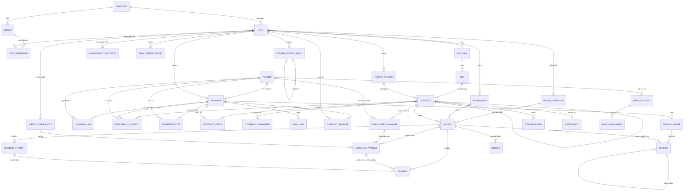

# 기술 설계 — Evenstay Core (pms-core-billing)

상태: 승인(2026-11-03) · 변경: 2026-11-03 비상 연락처 추가(사용자 재승인 2026-11-03) · 작성: 2026-11-02 · 기준: `04-planning/CLAUDE.md` "기술 설계", "코어 + 모듈 구조" · 변경: 2026-11-03 납부 기한·keyDates(사용자 재승인 2026-11-03) · 변경: 2026-11-03 v1.1 보강(사용자 재승인 2026-11-03) · 변경: 2026-11-03 B·D 동기화(사용자 재승인 2026-11-03) · 변경: 2026-11-03 G 요청 반영(사용자 재승인 2026-11-03) · 변경: 2026-11-03 C 요청 반영(사용자 재승인 2026-11-03)
변경: 2026-11-03 브랜드 뒷말 한글 표기·카피 검수 반영(사용자 재승인 2026-11-03)
변경: 2026-11-03 기획 문서 한국어 검수(korean-skills, 사용자 재승인 2026-11-03)
변경: 2026-11-03 장기 부재·운영 현황 대시보드 추가(사용자 재승인 2026-11-04)
변경: 2026-11-04 전체 리뷰 보완(사용자 재승인 2026-11-04)
변경: 2026-11-04 쉬운 말 재검수·공용 문구 반영(사용자 재승인 2026-11-04)
변경: 2026-11-04 시니어 하우징 조사 반영(사용자 재승인 2026-11-04)
변경: 2026-11-05 배치 전송 시간 초과·시스템 작업 범위 보강(사용자 재승인 2026-11-05)
변경: 2026-11-05 회원·대리인 청구서 결제 목업 추가(사용자 재승인 2026-11-05, 결제 화면)
입력: `prd.md`, `service-blueprint.md`, `user-stories.md`, `senior-lab/01-research/outputs/pms-landscape.md`(B 출처), `senior-lab/03-copywriting/ideas/pms-core-billing/product-marketing.md`(용어집)

> **이 문서가 모든 모듈(safety, family, assistant, transitions, requests, community, leasing)의 공통 도메인 모델 기준이다.** 다른 모듈은 여기 코어 엔티티를 참조하고 자기 확장 엔티티와 이벤트만 정의한다. 코어 모델을 바꿔야 하면 이 문서를 먼저 고치고 이유를 `shared/decisions.md`에 남긴다(허브가 기록).
> 기술 스택은 확정하지 않는다. 후보와 선택 기준만 둔다(12절). 확정은 `evenstay` 프로젝트에서 한다.
> 표기 규칙은 `strategy.md`와 같다. 표기 없는 문장은 이 문서의 설계안(초안)이다.

## 1. 범위와 경계
```
            ┌──────────── 화면: 운영(직원·소유주) · Evenstay 홈(회원·대리인) · Evenstay 패밀리(D) ─────────────┐
            │                                                                                                   │
   safety(B)      family(D)       assistant(G)      transitions(C)      leasing(E, 예비)        ← 모듈: 자기 스키마
      │              │                 │                  │                   │
      └──────── core 공개 API(조회·명령·권한 검사) + 도메인 이벤트(아웃박스) ─────────────────────┘
                                         │
                core: 조직 계층 · 사람·관계 · 대리인 · 계약 · 요금표 · 식사 기록 · 청구 원장 · 역할 · 변경 이력
                                         │
                 어댑터: 결제(목업) · ERP 내보내기(목업) · 알림(로그) · 파일 저장(목업)
```
- 코어가 갖는 것: 운영사, 소유주, 사업장, 동, 호실, 사람, 입주자, 보호자 관계(관계만), 대리인, 계약, 요금표, 식사 기록, 청구 원장(청구 항목·청구서·수납·조정·보증금), 문의, 계정·역할, 변경 이력, 아웃박스.
- 코어가 갖지 않는 것: 건강·돌봄 정보(B, C), 보호자 동의 정책(D), 대화 기록(G), 상담 리드(E), 회계 분개(ERP).

## 2. 도메인 모델
### 2-1. 용어 (공통 언어)
`product-marketing.md` 용어집을 코드 이름으로 그대로 쓴다. 용어집에 없는 것만 아래에 더했다.
| 코드 | 직원 화면 | 회원 화면 | 비고 |
|---|---|---|---|
| Operator / Owner / Site / Unit / Resident / Contract / Charge / Invoice / Deposit / Forfeiture / Representative / AuthorityScope / AuditLog | 용어집과 같다 | 용어집과 같다 | — |
| Building | 동 | ○동 | 추가 |
| SiteOwnership | 소유 기간 | (표시 안 함) | 추가. 사업장 소유주가 바뀌어도 기간별로 나눈다 |
| Person | 인물 | (표시 안 함) | 추가. 입주자·보호자·대리인의 공통 신원 |
| GuardianLink | 보호자 | 함께 보실 분 | 추가. 관계만. 동의 정책은 D. 회원 화면 라벨은 확정된 "함께 보실 분"(2026-11-03 v1.1). D의 상세 관계 9종은 D `tech-design.md` 2-2 GuardianAccess 대응표대로 CHILD·SPOUSE·SIBLING·OTHER로 줄인다 |
| StaffDuty | 직무 | — | 추가(2026-11-03 v1.1). 사업장 직원의 직무: FRONT 프런트, LIFE_SUPPORT 생활지원, CARE 간호 |
| EmergencyContact | 비상 연락처 | 급할 때 연락할 분 | 추가(2026-11-03). 보호자 화면에서는 "비상 연락처에 적힌 분"(119 신고·병원 이송 기록에서만) [사실, family-consent-portal `names.md` 1-1] |
| ResidentAbsence | 장기 부재(반영됨, copy 2-9) | (표시 안 함) | 추가(2026-11-03, S44). 입원·외박·그 밖의 이유로 사업장에 없는 기간을 이유 없이 날짜로만 적는다 |
| ServiceUsage | 서비스 사용 기록(반영됨, copy 2-14) | (표시 안 함) | 추가(2026-11-04, N1-C1). 생활 요청 같은 모듈의 유료 사용을 다음 청구서에 넣기 전까지 기다리는 기록. 회원 화면 이름은 N1 `names.md`(evenstay `docs/requests/copy/names.md`)를 따른다 |
| Contract.deposit_protection | 보증금 보호 상태(반영됨, copy 2-14) | 보증금 보호(회원·대리인만, copy 2-14) | 추가(2026-11-04, S05). 전세권 설정일과 보증보험 가입 여부 |
| ManagementContract | 위탁 운영 계약(반영됨, copy 2-14) | (표시 안 함) | 추가(2026-11-04, S59). 사업장의 설치자와 위탁 운영자, 기간 |
| PricingVersion | 요금표 버전 | (표시 안 함) | 추가. 사업장 요금 규칙 3종을 묶은 버전 |
| BillingSchedule | 청구 일정 | (표시 안 함) | 추가(2026-11-03). 사업장의 청구 예정일·납부 기한 규칙 버전 |
| Invoice.due_date | 납부 기한 | 납부 기한(반영됨, copy 2-3·3절) | 추가(2026-11-03) |
| MealSkip / MealPeriodClose | 결식 / 식사 마감 | 드시지 않은 식사 / — | 추가 |
| Adjustment | 조정 | 조정 | 용어집의 Adjustment(MealSkip)은 이 문서에서 **규칙 감면 = `MEAL_SKIP_DISCOUNT` 청구 항목**, **조정 = 발행 후 정정 전표**로 나눈다 |
| Payment | 수납 | 납부 | 추가 |
| Inquiry | 입주자가 문의한 청구 | 이 금액이 이상해요 | 추가 |
| BillingRun | 청구 생성 실행 | — | 추가 |
| RoleAssignment | 역할 | — | 추가 |
| OutboxEvent | — | — | 추가. 모듈 간 이벤트 |

### 2-2. 엔티티 (핵심 필드)
모든 테이블은 `id`(UUID 후보), `operator_id`, `created_at`, `created_by`를 가진다. 사업장에 속한 테이블은 `site_id`를 가진다(ADR-1). 금액은 원 단위 정수다(ADR-4).

| 엔티티 | 핵심 필드 | 규칙 |
|---|---|---|
| Operator 운영사 | name | MVP는 1곳 |
| Owner 소유주 | name, type(FUND, REIT, CORP) | |
| Site 사업장 | name, asset_type(SENIOR_RESIDENCE, RENTAL_HOUSING), address | 자산 유형은 요금 규칙 조합만 바꾼다 |
| SiteOwnership 소유 기간 | site_id, owner_id, valid_from, valid_to | 같은 사업장의 기간은 겹치지 않는다 |
| Building 동 | site_id, name | |
| Unit 호실 | building_id, site_id, number, floor(2026-11-04, N2-C3), area_m2, max_occupancy | floor는 정수. 시드는 호실 번호 앞자리(201호 → 2층) [가설] |
| Person 인물 | name, birth_date, phone | 주민번호를 받지 않는다 |
| Resident 입주자 | person_id, site_id, privacy_consent_at | 사업장마다 한 행. 거주 상태는 계약에서 계산 |
| GuardianLink 보호자 관계 | resident_id, person_id, relation(CHILD, SPOUSE, SIBLING, OTHER), is_primary_contact | **관계만**. D가 `guardian_link_id`로 동의 정책을 붙인다 |
| EmergencyContact 비상 연락처 | contract_id, resident_id, person_id, relation(CHILD, SPOUSE, SIBLING, RELATIVE, FRIEND, OTHER), phone, priority(1부터), legal_basis(CONTRACT_CONSENT, VITAL_INTEREST_EXCEPTION), consent_recorded_at, consent_recorded_by, contact_notified_at(등록 사실을 그분께 알린 일시), removed_at | 입주 계약에 딸린다. 한 입주자에 여러 명, (contract_id, resident_id, priority) 유일. 삭제하지 않고 removed_at으로 뺀다. 승계·계약 변경 때 새 계약으로 복사한다. **GuardianLink와 다른 점: GuardianLink는 "누가 보호자인가"(D 동의 정책의 대상)이고, EmergencyContact는 "응급 때 직원이 누구에게 어떤 순서로 전화하는가"(계약 조건, 동의 항목과 무관)다.** 같은 사람이 둘 다일 수 있다. 법적 근거는 [법률 검토]: 계약 때 받은 동의인지, 생명·신체가 급박할 때의 예외인지 |
| Representative 대리인 | resident_id, person_id, basis(ADULT_GUARDIANSHIP 성년후견, LIMITED_GUARDIANSHIP 한정후견, SPECIFIC_GUARDIANSHIP 특정후견, VOLUNTARY_GUARDIANSHIP 임의후견, POWER_OF_ATTORNEY 위임장), scopes[](SIGN_CONTRACT, VIEW_INVOICE, PAY, MANAGE_GUARDIAN_ACCESS), evidence_type, evidence_issued_on, evidence_checked_by, evidence_file_name, valid_from, valid_until(필수), status, registered_by, approved_by | approved_by ≠ registered_by. ACTIVE이고 기준일이 유효기간 안일 때만 권한 검사에 쓴다 |
| PricingVersion 요금표 버전 | site_id, version, valid_from, rules(JSON: 아래 4절) | 바꾸면 새 버전. 옛 버전은 지우지 않는다 |
| BillingSchedule 청구 일정 | site_id, version, valid_from, cycle(MONTHLY), issue_day(청구 대상 달 기준 발행 예정일: 숫자 또는 LAST_DAY), due_days_after_issue | 요금표와 같은 방식(사업장 설정, 바꾸면 새 버전). 요금표와 달리 계약에 고정하지 않고 기준일의 버전을 쓴다. 기본값: 매월 말일 발행, 발행 후 10일 [가설] |
| Contract 입주 계약 | site_id, unit_id, status, occupancy(1, 2), rate_plan_code, pricing_version_id, deposit_amount, deposit_jeonse_registered_on(전세권 설정일, 없으면 null, 2026-11-04), deposit_guarantee_insured(YES, NO, UNKNOWN, 2026-11-04), start_date(입주일), end_date(계약 만료일), billing_start, billing_end, signed_at, move_out_date, settled_at, succeeded_from_id, row_version | 같은 호실의 입주 예정·거주 중·퇴거 예정 계약 기간은 겹치지 않는다. **보증금 보호 칸(2026-11-04, S05)**: 입소보증금 50% 보증보험 가입 의무와 근저당·전세권 설정 때 면제는 리서치가 정리한 2차 자료다 [사실, `01-research/outputs/service-coverage-review.md` S05, A14, P-002]. 코어는 입력된 사실 두 개만 보여 주고 법 기준을 채웠는지는 판단하지 않는다. 승계 때 새 계약으로 복사한다 |
| ContractParty 계약 당사자 | contract_id, resident_id, role(PRIMARY, CO) | 1인 1행 |
| ContractSignature 서명 기록 | contract_id, signer_person_id, signed_as(SELF, REPRESENTATIVE), representative_id, signed_on | 전자서명은 MVP 밖. 서명 사실만 |
| EvidenceCheck 증빙 확인 | subject_type(SUCCESSION, REPRESENTATIVE), subject_id, document_type, checked_by, checked_on | 원본은 저장하지 않는다 |
| MealSkip 결식 | site_id, resident_id, date, slot(BREAKFAST, LUNCH, DINNER), advance_notice, channel(PHONE, FRONT_DESK, APP, IMPORT) | (resident_id, date, slot) 유일. 이유는 받지 않는다 |
| MealPeriodClose 식사 마감 | site_id, period(YYYY-MM), closed_by, closed_at, absence_meal_snapshot(JSON, 2026-11-03: 입주자별 부재 끼니) | (site_id, period) 유일 |
| ResidentAbsence 장기 부재 (2026-11-03, S44) | site_id, resident_id, unit_id(시작 때 사는 호실), started_on(시작일), expected_return_on(예정 복귀일, 모르면 null), returned_on(실제 복귀일), cancelled_on(등록 취소일), status(OPEN, ENDED, CANCELLED), channel(PHONE, FRONT_DESK, GUARDIAN, REPRESENTATIVE), registered_by, ended_by, cancel_reason_code(WRONG_RESIDENT 다른 입주자, WRONG_DATE 날짜 오류, DUPLICATE 중복) | 입주자마다 OPEN은 하나뿐이고, CANCELLED가 아닌 부재끼리는 기간이 겹치지 않는다(EXCLUDE 제약, OPEN은 끝 없는 기간으로 본다). 거주 중·퇴거 예정 계약의 당사자만 시작할 수 있다. **이유, 종류(입원·외박 구분), 병명, 병원 이름, 자유 메모 칸은 두지 않는다** [가설]: 입원인지 아닌지도 건강 상태를 짐작하게 하므로 "언제부터 언제까지 사업장에 없음"만 남긴다. 계약이 아니라 입주자에 딸려 승계해도 이어진다. 지우지 않고, 잘못 등록하면 CANCELLED. 취소 사유는 위 세 가지 중에서 고르고 자유 글은 받지 않는다(변경 이력 전후 값에도 자유 글이 남지 않는다) |
| BillingRun 청구 생성 실행 | site_id, period, status, target_count, created_count, discount_count, failures(JSON), idempotency_key | |
| Invoice 청구서 | contract_id, site_id, period, status(DRAFT, ISSUED), total_amount(발행 시 고정), issued_at, issued_by, due_date(납부 기한), billing_schedule_version_id, billing_run_id | (contract_id, period) 유일. due_date = 실제 발행일 + due_days_after_issue로 발행 때 정하고 이후 바꾸지 않는다 |
| Charge 청구 항목 | invoice_id, contract_id, site_id, period, type(RECURRING_FEE, MEAL_FEE, MEAL_SKIP_DISCOUNT, ADJUSTMENT, SERVICE_FEE(2026-11-04)), service_usage_id(SERVICE_FEE만), amount(부호 있음), pricing_version_id, evidence(JSON), adjusts_charge_id, reason | 발행된 청구서의 항목은 **추가만 한다**(ADR-4). DRAFT 청구서의 항목만 재계산 때 지울 수 있다. ADJUSTMENT는 adjusts_charge_id·reason 필수. 원래 항목의 계약이 이 청구서의 계약과 달라도 되지만 같은 승계 사슬(succeeded_from_id로 이어진 계약)이어야 한다(승계 달 정정용, 2026-11-03 G 요청, HUB-11) |
| ServiceUsage 서비스 사용 기록 (2026-11-04, N1-C1) | site_id, resident_id, contract_id(사용일에 활성인 계약), source_module(넘긴 모듈의 키, 코어는 뜻을 모르는 문자열. 데모 값 `requests`), source_label(화면에 보일 출처 이름, 넘긴 모듈이 준다), source_id, service_code, pricing_version_id(회원에게 안내한 버전), quantity, unit_price, amount, occurred_on, target_period, status(PENDING, BILLED), charge_id, recorded_by(모듈 시스템 주체, 예: `SYSTEM:requests`) | (source_module, source_id) 유일(멱등). 금액은 넘겨받은 pricing_version_id 버전의 `SERVICE_FEES` 값 × quantity다(회원에게 안내한 금액 = 청구 금액) [가설]. 청구 생성 실행이 target_period의 DRAFT 청구서에 SERVICE_FEE 항목을 만들고 charge_id를 잇는다. DRAFT 재실행으로 항목을 지우면 charge_id를 비우고 다시 만들 때 다시 잇는다. 그 청구서가 발행되면 BILLED. 사용 기록이 DRAFT가 만들어진 뒤에 들어와 재실행 없이 발행되면, 발행 때 그 사용 기록의 target_period를 다음 달로 옮기고 변경 이력에 남긴다 [가설]. 지우지 않는다. 취소는 MVP에 없고 정정은 조정 전표다(ADR-4) |
| Payment 수납 | invoice_id, amount, method(BANK_TRANSFER, CARD, CASH, DIRECT_DEBIT(2026-11-04, 사용자 재승인 2026-11-04), OTHER), paid_on, provider, provider_dedupe_key(제공자별 멱등 키, 9절. 2026-11-04 `provider_event_id`에서 바꿈, 사용자 재승인 2026-11-04), expected_payment_id(없으면 null, 2026-11-04, 사용자 재승인 2026-11-04), payment_attempt_id(없으면 null (2026-11-05, 사용자 재승인 2026-11-05, 결제 화면)), idempotency_key | (provider, provider_dedupe_key) 유일. 추가만 한다. 환불과 되돌림은 음수 행 |
| DirectDebitMandate 자동이체 동의 (2026-11-04, R6, 사용자 재승인 2026-11-04) | site_id, contract_id, payer_person_id(출금 계좌 명의자), consented_by_person_id, signed_as(SELF, REPRESENTATIVE), representative_id, consent_method(WRITTEN 서면, RECORDED_CALL 녹취, ARS), evidence_location(증빙 보관 위치), evidence_checked_by, witnessed_by(입회한 직원, 없으면 null), provider, provider_mandate_ref, account_last4, status(REQUESTED, REGISTERED, REJECTED, REVOKED), requested_on, registered_on, revoked_on | 계약마다 REGISTERED는 하나뿐이다 [가설]. 동의는 본인이나 PAY 범위의 유효한 대리인만 한다. 계좌 명의자가 이 둘이 아니면 명의자 동의가 따로 필요한지는 [미확인]이다. 보호자는 PAY 범위 대리인으로 등록되지 않으면 할 수 없다(I-31). 계좌번호 원문은 코어에 두지 않고 제공자 참조와 끝 네 자리만 둔다 [가설]. 상태 전이는 3-5 |
| DirectDebitBatch 출금 의뢰 배치 (2026-11-04, R6, 사용자 재승인 2026-11-04) | site_id, period, provider, requested_debit_on(요청한 출금일), adjusted_debit_on(영업일로 옮긴 날), status(DRAFT, SENT, RESULT_RECEIVED, RESULT_UNKNOWN, CLOSED, REJECTED), line_count, total_amount, idempotency_key, sent_at, closed_at | RESULT_UNKNOWN은 제공자가 받았는지, 결과가 어떤지 알 수 없는 상태다 [가설] (2026-11-05, 사용자 재승인 2026-11-05). 상태 전이는 3-5. (provider, idempotency_key) 유일. ISSUED 청구서의 ExpectedPayment만 싣는다. REGISTERED 동의만 싣고 보내기 직전에 다시 확인한다 [가설]. 건당·월 한도를 넘는 건은 싣지 않고 예상 수납을 닫아 사람이 다른 방법으로 받는다 [가설]. 월 한도를 넘을 때 어느 건을 뺄지는 [미정]이다. 한도 값은 코드가 아니라 사업장 설정이다 [가설] |
| ExpectedPayment 예상 수납 (2026-11-04, R6, 사용자 재승인 2026-11-04) | site_id, invoice_id, amount, channel(DIRECT_DEBIT, VIRTUAL_ACCOUNT), mandate_id, debit_batch_id, batch_line_no, virtual_account_ref, expires_on(가상계좌만), status(EXPECTED, PENDING_BANK_RESULT, CONFIRMED, FAILED, EXPIRED, CANCELLED, REVERSED), result_code, provider | **원장이 아니라 작업 기록이다.** 돈이 들어왔다는 사실은 Payment만 말한다(ADR-4 그대로). Payment가 `expected_payment_id`로 이 행을 가리키고, 한 행에 확정 1건과 되돌림 1건까지 붙는다. 같은 청구서에 열린 행(EXPECTED, PENDING_BANK_RESULT)은 하나뿐이다 [가설]. 금액은 만들 때 그 청구서의 남은 금액이다 [가설]. 실패하면 행을 다시 쓰지 않고 새 행을 만든다 |
| PaymentAttempt 결제 시도 (2026-11-05, 사용자 재승인 2026-11-05, 결제 화면) | site_id, invoice_id, amount, actor_person_id(누른 사람), signed_as(SELF, REPRESENTATIVE), representative_id, provider, idempotency_key, status(REQUESTED, SUCCEEDED, FAILED, CANCELLED), reason_code, requested_at, closed_at | **원장이 아니라 작업 기록이다.** 같은 청구서에 REQUESTED는 하나뿐이다 [가설]. 카드 번호·계좌 번호를 두지 않는다. 상태 전이는 3-6 |
| DepositEntry 보증금 원장 | contract_id, type(RECEIVED, TRANSFER_OUT, TRANSFER_IN, OFFSET, REFUND), amount, ref_id | 청구 원장과 분리. 수익이 아니라 맡긴 돈 |
| LedgerExportBatch 원장 내보내기 배치 (2026-11-04, R8, 사용자 재승인 2026-11-04) | site_id, period(청구 기간), accounting_period(ERP에 넣을 회계 기간), kind(ISSUED_INVOICES, REFUNDS), version, status(DRAFT, SENT, ACKED, REJECTED), lines(JSON: 라인 번호, 원본 ID, 금액, 외부 참조), line_count, total_amount, external_ref, reject_reason_code, sent_at, acked_at, replaces_batch_id | (site_id, period, kind, version) 유일. "무엇을 언제 보냈는가"의 기록이고 원장을 고치지 않는다. 상태와 다시 보내는 규칙은 9절 |
| Settlement 퇴거 정산 | contract_id, deposit_balance, unpaid_balance, manual_adjustments(JSON, 사유 필수), refund_amount, status(DRAFT, APPROVED), approved_by | P1 |
| Inquiry 청구 문의 | invoice_id, charge_id, resident_id, channel(APP, FRONT_DESK, PHONE, ASSISTANT), confirmation_token, status(RECEIVED, IN_REVIEW, ANSWERED, CANCELLED), assigned_to, answer, adjustment_charge_id | P1. channel = ASSISTANT면 confirmation_token 필수(G가 발급·검사한 불투명 값, 코어는 비어 있는지만 본다). (channel, confirmation_token) 유일: 같은 토큰으로 다시 오면 처음 만든 문의를 돌려준다(2026-11-03 G 요청, HUB-5) |
| UserAccount 계정 | person_id(선택), login, kind(STAFF, OWNER_USER, MEMBER, GUARDIAN) | GUARDIAN 추가(2026-11-03 v1.1). 한 사람이 회원이면서 다른 입주자의 보호자일 수 있어 계정 종류가 아니라 역할로 권한을 판단한다 |
| RoleAssignment 역할 | user_id, role, scope_type(OPERATOR, OWNER, SITE, SELF), scope_id, duties[](StaffDuty, SITE_STAFF·SITE_MANAGER만), valid_from, valid_to | 6절. duties는 2026-11-03 v1.1 추가(D의 임시 `family.staff_duty`를 대신한다) |
| AuditLog 변경 이력 | occurred_at, actor_user_id, actor_role, on_behalf_of_resident_id, representative_id, action, category(WRITE, READ, SENSITIVE_READ, DENIED), entity_type, entity_id, before, after, reason, request_id, site_id | 추가만 한다. before/after의 개인정보는 가린다. **배치 작업**(대리인 만료 일일 배치, G 보관 정리 등)은 actor_user_id = null, actor_role = SYSTEM, action = 작업 이름(예: `core.representative.expire`, `assistant.retention.purge`), request_id = 배치 실행 ID로 남긴다(2026-11-03 G 요청, HUB-15) |
| ManagementContract 위탁 운영 계약 (2026-11-04, S59) | site_id, installer_owner_id(설치자. 시드는 소유주와 같다고 둔다 [가설]), operator_id(위탁 운영자), valid_from, valid_to(없으면 null), status(ACTIVE, ENDED), note_code(NEW, RENEWAL, OPERATOR_CHANGE), registered_by | 같은 사업장의 기간은 겹치지 않는다(EXCLUDE). 지우지 않고 바뀌면 새 행과 변경 이력으로 남긴다. 위탁운영자 선정·변경 신고 칸은 두지 않는다: 노인복지법 시행규칙 개정안이 입법예고 단계라 [미정] [사실, A3: 입법예고 2026-10-13~11-23, 시행일 미정] |
| OutboxEvent 아웃박스 | event_type, schema_version, aggregate_type, aggregate_id, payload(ID 위주), occurred_at, available_at, published_at, attempts, last_error | 상태 변경과 같은 트랜잭션에 쓴다. 이 행은 코어 스키마의 코어 아웃박스다. **(2026-11-03 C 요청, HUB-C7)** 같은 열 구성의 아웃박스 테이블을 모듈마다 자기 스키마에 두고(ADR-2), 쓰기·발송·재시도 로직은 `platform` 아웃박스 구현 하나를 함께 쓴다. 디스패처는 `available_at ≤ Clock.now()`인 행만 보낸다(기본값 occurred_at, 데모 시계를 옮기면 그 시각이 된 행이 나감). 실패하면 attempts·last_error를 올리고 다시 보낸다. 최대 횟수와 그 뒤 처리는 모듈이 정한다(C: 5회 뒤 FEED_FAILED). `Notifier.send(…, sendAfter)`는 이 구현 위에서 available_at = sendAfter로 동작한다 |

### 2-3. ERD 초안

**코어와 확장의 구분**: 위 ERD 전체가 코어다. 시니어 고유 확장은 `MEAL_SKIP`, `MEAL_PERIOD_CLOSE`, `RESIDENT_ABSENCE`(2026-11-03), `REPRESENTATIVE`, `CONTRACT.succeeded_from_id`, 요금 규칙 `MEAL_FEE`·`MEAL_SKIP_DISCOUNT`다. 임대주택은 이것들을 쓰지 않고 같은 계약·청구 구조만 쓴다(H2 검증 대상). 모듈 확장 엔티티는 10절. 자동이체·예상 수납·원장 내보내기 관계는 2026-11-04에 더했고 사용자 재승인 2026-11-04다.

## 3. 상태 전이
### 3-1. 계약 (Contract)
상태 이름은 용어집과 같다(2026-11-03 확정, SIGNED 추가로 6개): DRAFT 작성 중 / SIGNED 입주 예정 / ACTIVE 거주 중 / SUCCEEDED 승계됨 / TERMINATING 퇴거 예정 / SETTLED 정산 완료.
```
DRAFT ──(sign: 서명 기록)──► SIGNED ──(move_in)──► ACTIVE
ACTIVE ──(succeed)──► SUCCEEDED          (+ 남는 회원의 새 계약 ACTIVE, 같은 트랜잭션)
ACTIVE ──(request_termination)──► TERMINATING ──(settle, 본사 승인)──► SETTLED
DRAFT ──(discard)──► (삭제 표시, 이력만 남음)
```
| 전이 | 조건 | 부수 효과 | 이벤트 |
|---|---|---|---|
| sign | DRAFT, 서명자 = 당사자 본인 또는 SIGN_CONTRACT 범위의 유효한 대리인, 호실 기간 겹침 없음, 입주자마다 비상 연락처 1명 이상 [가설] | ContractSignature 추가, DRAFT → SIGNED. 이때부터 호실을 잡는다 | ContractSigned |
| move_in | SIGNED, 입주일 있음 | SIGNED → ACTIVE. billing_start = 입주일이 속한 달 1일(일할 없음, 2026-11-03 확정) | ContractActivated |
| succeed | ACTIVE, 2인 계약, 사별 증빙 확인 기록 있음 | 옛 계약 billing_end = 이번 달 말일. 새 계약(1인, 새 요금 플랜, billing_start = 다음 달 1일, end_date = 옛 계약 end_date [가설], succeeded_from_id). 보증금 TRANSFER_OUT/IN. 남는 입주자의 비상 연락처를 새 계약으로 복사(사별한 분은 비상 연락처에서도 뺀다). 실연동 때 옛 계약의 자동이체 동의 REVOKED(3-5, 2026-11-04, 사용자 재승인 2026-11-04) | ContractSucceeded |
| request_termination | ACTIVE, 요청자 = 본인 또는 SIGN_CONTRACT 대리인 | move_out_date, billing_end = 퇴거일이 속한 달 말일 | ContractTerminationRequested |
| settle | TERMINATING, Settlement APPROVED(승인자 = 본사). 실연동 때 열린 예상 수납 없음 [가설](3-5, 2026-11-04, 사용자 재승인 2026-11-04). REQUESTED 결제 시도 없음 [가설](3-6) (2026-11-05, 사용자 재승인 2026-11-05, 결제 화면) | DepositEntry OFFSET/REFUND, 이후 원장 쓰기 금지. 실연동 때 자동이체 동의 REVOKED(2026-11-04, 사용자 재승인 2026-11-04) | ContractSettled |
- 허용되지 않은 전이는 모두 409로 거부한다. 동시 수정은 `row_version`으로 막는다(낙관적 잠금).
- **입주 월 청구(2026-11-03 확정)**: 입주일과 상관없이 그 달 1개월분이다. 일할 계산은 하지 않고, 데모 시드의 입주일은 모두 1일이다.
- SIGNED 상태에서 입주 전에 계약을 거두는 전이(입주 전 해지)는 MVP에 없다. 필요하면 다음 버전에서 SIGNED → 취소를 더한다.

### 3-2. 청구서 (Invoice)
```
(없음) ──(billing_run)──► DRAFT ──(issue: due_date 확정)──► ISSUED
DRAFT ──(billing_run 재실행)──► DRAFT (항목 삭제 후 재계산)
```
- 수납 상태는 상태 값이 아니라 계산값이다: UNPAID(수납 0) / PARTIAL / PAID(수납 합계 ≥ 청구 합계) / NOT_TRACKED(수납 기능 F16이 꺼진 배포. 2026-11-03 G 요청, HUB-1).
- **미납 판정과 연체 처리는 MVP 범위 밖이다.** 납부 기한이 지나도 상태가 바뀌지 않고, 연체료·독촉·알림을 만들지 않는다. `due_date`는 청구서 표시와 G 납부 갈래(10절)에만 쓴다.
- ISSUED 이후에는 Charge를 추가할 수 없다. 정정은 다음 DRAFT 청구서에 ADJUSTMENT로 들어간다.

### 3-3. 대리인 (Representative)
```
PENDING_APPROVAL ──(approve, 승인자 ≠ 등록자)──► ACTIVE ──(기준일 > valid_until, 일일 배치 + 요청 시 검사)──► EXPIRED
PENDING_APPROVAL ──(reject)──► REJECTED
ACTIVE ──(revoke, 사유 필수)──► REVOKED
```
- 갱신은 새 행을 만든다(옛 행은 EXPIRED로 남는다). 이벤트: RepresentativeActivated, RepresentativeExpired, RepresentativeRevoked.

### 3-4. 그 밖
- 식사 마감: 열림 → 마감(되돌리지 않음. 정정은 조정 전표).
- 청구 생성 실행: RUNNING → COMPLETED | FAILED. FAILED는 같은 키로 다시 실행한다.
- 문의: RECEIVED → IN_REVIEW → ANSWERED, RECEIVED → CANCELLED(접수 후 10분 안, 회원만).
- **장기 부재(2026-11-03, S44)**: OPEN ──(end: 실제 복귀일 기록)──► ENDED, OPEN ──(cancel: 잘못 등록, 사유 코드 필수)──► CANCELLED. 시작하면 `ResidentAbsenceStarted`, ENDED·CANCELLED가 되면 `ResidentAbsenceEnded`를 낸다(취소도 구독자가 멈춘 규칙을 되돌려야 하므로 같은 이벤트 [가설]). 예정 복귀일은 OPEN일 때 고칠 수 있고, 이벤트 없이 변경 이력만 남긴다 [가설]. 시작일과 실제 복귀일은 기준일보다 뒤일 수 없고, 실제 복귀일은 시작일보다 앞일 수 없다. 끝난 부재와 기간이 겹치는 새 부재(소급 시작 포함)는 거부한다. **조회는 기준 시각(at) 기준이다(2026-11-04, 이어 붙이는 통합 데모)**: 날짜를 가진 시드 행은 시계가 그 날짜에 닿아야 보이고, `AbsenceQuery`·`TodoQuery`는 at에 시작했고 at까지 복귀하지 않은 부재를 OPEN으로, 그 결과의 status·returnedOn도 at 기준으로 돌려준다(at 뒤의 복귀는 아직 OPEN, returnedOn null). 화면·API의 "시작일·복귀일은 기준일보다 뒤일 수 없다" 검사는 사람의 입력에만 걸고 시드에는 걸지 않는다. 사별 승계(succeed)·정산 확정(settle) 때 그 계약을 떠나는 입주자의 OPEN 부재는 그날 날짜로 ENDED가 되고 `ResidentAbsenceEnded`를 낸다(같은 트랜잭션).

### 3-5. 자동이체와 예상 수납 (2026-11-04, R6, 사용자 재승인 2026-11-04)
실연동 때의 설계다. 화면을 더하지 않고, 프로토타입과 데모 시드에도 넣지 않으며, 시드 금액은 그대로다. 건별 `requestPayment`는 바로 답이 오는 결제에 그대로 쓴다. CMS는 동의 등록 → 일괄 출금 의뢰 → 하루 이상 뒤 결과 확정으로 모양이 달라 따로 둔다 [가설].
```
자동이체 동의   REQUESTED ──(제공자 등록)──► REGISTERED ──(철회, 계약 끝남)──► REVOKED
                REQUESTED ──(등록 거절)──► REJECTED
출금 의뢰 배치  DRAFT ──(보냄)──► SENT ──(결과 받음)──► RESULT_RECEIVED ──(모든 건 반영)──► CLOSED
                SENT ──(배치 전체 거절)──► REJECTED
                SENT ──(보내기 응답 시간 초과, 결과 기한 지남)──► RESULT_UNKNOWN   (2026-11-05, 사용자 재승인 2026-11-05)
                RESULT_UNKNOWN ──(재확인으로 결과 받음)──► RESULT_RECEIVED   (2026-11-05, 사용자 재승인 2026-11-05)
                RESULT_UNKNOWN ──(접수 안 됨을 제공자에게 확인, 사람이 확정)──► REJECTED   (2026-11-05, 사용자 재승인 2026-11-05)
예상 수납       EXPECTED ──(배치에 실어 보냄)──► PENDING_BANK_RESULT ──(출금 성공)──► CONFIRMED
                PENDING_BANK_RESULT ──(출금 실패)──► FAILED
                EXPECTED ──(가상계좌 입금 통지)──► CONFIRMED
                EXPECTED ──(만료일 지남)──► EXPIRED
                EXPECTED ──(동의 철회, 다른 방법으로 이미 냄, 금액이 달라짐, 사람이 닫음)──► CANCELLED   (2026-11-05, 사용자 재승인 2026-11-05)
                PENDING_BANK_RESULT ──(배치 거절, 출금 없음을 제공자에게 확인하고 사람이 닫음)──► CANCELLED   (2026-11-05, 사용자 재승인 2026-11-05)
                CONFIRMED ──(제공자 조회로 확인, 또는 대사 예외를 사람이 확정)──► REVERSED
```
- **원장(ADR-4 그대로)**: Payment는 CONFIRMED가 될 때 한 건만 쓴다. 결과 대기, 실패, 만료는 Payment를 쓰지 않는다. REVERSED는 원래 행을 고치지 않고 음수 Payment를 더한다. 그래서 수납 상태 계산(3-2)은 바뀌지 않고, 결과 대기 중인 청구서는 UNPAID로 계산된다. 조사 노트의 흐름은 은행 입금까지 본 뒤 원장을 확정하지만, 여기서는 제공자 결과로 먼저 쓰고 은행 입금은 사후 대사로 본다 [가설]. 어긋나면 사람이 확정해 되돌린다.
- **결과가 오지 않을 때**: PENDING_BANK_RESULT는 기한이 지나도 자동으로 닫지 않는다. 돈이 이미 나갔을 수 있어서다. 조회로 다시 읽고, 그 줄의 출금이 없음을 제공자에게 확인한 뒤에만 사람이 닫는다 [가설] (2026-11-05, 사용자 재승인 2026-11-05). 기한은 [미정]이다.
- **배치 전송 시간 초과 (2026-11-05, 사용자 재승인 2026-11-05)**: `submitBatch`의 응답이 시간 안에 오지 않으면 제공자가 배치를 받았는지 알 수 없다 [가설]. 실패로 적지 않고 RESULT_UNKNOWN으로 둔다 [가설]. 연결 끊김처럼 분명한 거절 응답이 아닌 오류와, 보낸 뒤 결과 기한이 지난 경우도 같다 [가설]. 프로세스가 중간에 멈춰도 같은 길을 타도록, 배치의 SENT와 sent_at, 줄의 PENDING_BANK_RESULT를 한 트랜잭션으로 먼저 저장하고 나서 `submitBatch`를 부른다 [가설]. 그래서 SENT는 "보내기 시작함"이고 제공자의 접수를 뜻하지 않으며, DRAFT로 돌아가는 길은 없다 [가설]. 결과 기한은 sent_at부터 센다 [가설]. 응답 시간 초과 값과 결과 기한은 [미정]이다.
- **재확인 (2026-11-05, 사용자 재승인 2026-11-05)**: 시스템이 `fetchResults`(9절)로 결과를 다시 읽는다 [가설]. 주기와 횟수는 [미정]이다. 결과가 있으면 RESULT_RECEIVED로 옮겨 줄마다 반영한다 [가설]. 일부 줄만 결과가 오면 나머지 줄은 PENDING_BANK_RESULT에 남고 배치는 CLOSED가 되지 않는다 [가설]. 결과가 없다는 응답을 접수되지 않았다는 뜻으로 읽지 않는다 [가설]. 접수 여부만 읽는 조회가 있는지는 제공자마다 달라 [미확인]이다. 그래서 "접수 안 됨"은 사람이 제공자에게 확인하고 확정하며, 확정한 사람과 확인 방법을 감사 로그에 남긴다 [가설]. 확정하면 배치는 REJECTED, 남은 PENDING_BANK_RESULT 줄은 CANCELLED가 된다 [가설]. 확정할 수 있는 역할과, 제공자가 끝내 답하지 않을 때 사람에게 알리는 곳은 [미정]이다. 그동안 배치는 자동으로 닫히지 않는다 [가설].
- **중복 출금을 막는 처리 (2026-11-05, 사용자 재승인 2026-11-05) [가설]**: (가) RESULT_UNKNOWN 배치는 시스템도 사람도 다시 보내지 않는다. 제공자가 같은 키를 실제로 한 번만 처리하는지는 [미확인]이라(9절), idempotencyKey는 마지막 방어선으로만 본다. (나) PENDING_BANK_RESULT 줄은 배치 상태와 상관없이 동의 철회, 승계, 사람의 판단만으로 닫지 않는다. 결과가 오거나, 배치가 거절되거나, 그 줄의 출금이 없음을 제공자에게 확인해야 닫는다. 줄이 열려 있으면 같은 청구서에 새 ExpectedPayment를 만들지 못하고(열린 행 하나 규칙), 정산도 확정되지 않는다. 결과 대기 중 승계할 때의 처리(확인할 것 32)도 이 규칙을 기본안으로 본다. (다) 다시 출금할 때는 제공자 정산 파일이나 은행 내역에 그 청구서의 출금이 없는지 먼저 본 뒤, 새 ExpectedPayment, 새 배치, 새 idempotencyKey로만 연다. 새 키에는 제공자 쪽 멱등이 걸리지 않으므로 이 확인이 마지막 관문이다. (라) 줄이 PENDING_BANK_RESULT가 아닌데(CANCELLED, FAILED) 성공 결과가 늦게 오면 Payment를 자동으로 쓰지 않고 3자 대사(9절)의 예외 목록으로 보내 사람이 확정한다. 계약이 이미 SETTLED이면 원장 쓰기가 막혀 있으므로 Payment를 쓰지 않고 예외 목록에만 둔다. 가상계좌 행이 CANCELLED나 EXPIRED인데 입금이 오거나, 입금액이 행 금액과 다를 때도 같이 예외 목록으로 보낸다. CANCELLED로 닫을 때 은행 쪽 계좌도 닫을 수 있는지는 [미확인]이다. 다시 출금한 뒤이거나 SETTLED 뒤라서 돈을 돌려줘야 할 때의 절차는 [미정]이다. (마) PENDING_BANK_RESULT 줄이 있는 청구서에는 수동 수납과 건별 결제를 넣지 못하게 막는 쪽을 기본안으로 둔다. 최종 선택은 확인할 것 32에 남는다 [미정]. (바) 배치를 만들 때와 보내기 직전에 청구서를 다시 읽어, 이미 낸 청구서의 줄과 줄 금액이 지금 남은 금액과 다른 줄은 싣지 않는다. 그 EXPECTED 행은 사람이 CANCELLED로 닫고, 남은 금액이 있으면 새 행을 연다. 보내기 직전의 확인은 SENT, sent_at, 줄의 PENDING_BANK_RESULT를 저장하는 트랜잭션 안에서 청구서 행을 잠그고 한다. 싣지 않은 줄은 배치에서 빼고 line_count와 total_amount를 같은 트랜잭션에서 확정한다. 실을 줄이 하나도 남지 않으면 SENT로 바꾸지 않고 `submitBatch`도 부르지 않으며, 그 배치는 DRAFT에 남겨 쓰지 않는다. 건별 결제가 시작되고 결과가 아직 오지 않은 청구서의 줄도 싣지 않는 쪽을 기본안으로 둔다. 이 줄은 닫지 않고 EXPECTED로 둔다. 건별 결제 시작은 같은 청구서 행 잠금 안에서 진행 중 표시를 함께 쓴다. 진행 중 표시는 PaymentAttempt의 REQUESTED다(3-6) (2026-11-05, 사용자 재승인). (마)의 기본안을 따르면 수동 수납 입력과 건별 결제 요청의 시작은 같은 잠금 아래에서 PENDING_BANK_RESULT 줄이 없을 때만 받는다. 이미 시작된 결제의 웹훅이나 조회 결과가 그 줄과 겹쳐 오면 버리지 않고 3자 대사(9절)의 예외 목록으로 보내 사람이 확정한다. (사) ExpectedPayment의 전이는 모두 지금 상태가 출발 상태일 때만 되는 조건부 갱신으로 한다. 그래서 이미 PENDING_BANK_RESULT면 사람이 EXPECTED처럼 닫지 못하고 (나)를 따른다. 가상계좌 입금 통지는 청구서 행을 잠근 트랜잭션 안에서 행 금액이 지금 남은 금액과 같을 때만 CONFIRMED와 Payment를 쓰고, 다르면 예외 목록으로 보낸다.
- **이번에 함께 맞춘 곳 (2026-11-05, 사용자 재승인 2026-11-05)**: 2-2 DirectDebitBatch의 status 목록, 9절 CMS 줄, 확인할 것 32. 화면과 시드 금액은 그대로다.
- **이벤트**: 새 이름을 만들지 않는다. CONFIRMED는 `PaymentRecorded`, FAILED는 `PaymentFailed`, REVERSED는 음수 금액의 `PaymentRecorded`다 [가설].
- **실패**: 자동으로 다시 출금하지 않는다 [가설]. 사람이 확인한 뒤 새 ExpectedPayment를 만든다. 주된 실패 사유는 계좌 해지와 동의 철회라는 제3자 설명이 있다 [사실, 포트원 블로그 2026-09-03].
- **출금일**: 출금은 은행 영업일에만 되고 주말·공휴일은 다음 영업일로 밀린다는 제3자 설명이 있다 [사실, 같은 블로그]. 밀린 날은 `adjusted_debit_on`에 남기고, 청구서의 `due_date`는 바꾸지 않는다(발행 때 고정). 영업일 달력을 어디서 받을지는 [미정]이다.
- **한도 [추정]**: 조사 노트 기준으로 CMS 월 출금 한도는 법인 5천만 원 안에서 정하고, 건당 한도는 월 한도의 10% 이내다. 그러면 건당 최대 500만 원이다. 보증금은 CMS로 받지 않는다 [추정]. 자세한 내용은 확인할 것 32.
- **예상 입금 매칭**: 입주자별 고정 가상계좌에 기대지 않고, 청구서 1건에 일반식 계좌 1개를 잇는다 [추정]. 고정식 발급을 제한한다는 2026-04-29 금감원 발표 보도가 있고 시행일은 [미확인]이다. 은행 입금 내역과의 대사는 9절.
- **동의와 승계**: 승계(ADR-5) 때 동의를 새 계약으로 복사하지 않고 옛 계약의 동의를 REVOKED로 둔다 [가설]. 계좌 명의자가 돌아가신 분일 수 있어서다. 남는 회원이 새로 동의한다. 정산 확정 때도 REVOKED로 둔다 [가설]. 예상 수납의 동의는 그 청구서의 계약과 같아야 한다 [가설]. 그래서 승계 뒤 발행되는 옛 계약의 마지막 청구서는 자동이체로 받지 못하고 다른 방법으로 받는다. 정산 뒤에는 원장 쓰기가 막히므로, 열린 예상 수납이 있으면 정산을 확정하지 않는다 [가설].

### 3-6. 회원·대리인 결제 시도 (2026-11-05, 사용자 재승인 2026-11-05, 결제 화면)
```
(없음) ──(결제 시작)──► REQUESTED ──(성공 결과)──► SUCCEEDED
                        REQUESTED ──(실패 결과)──► FAILED
                        REQUESTED ──(목업: 그만두기)──► CANCELLED
                        REQUESTED ──(실연동: 결제 화면에서 돌아감, 결제 없음을 제공자에게 확인하고 사람이 닫음)──► CANCELLED
```
- **시작 [가설]**: 서버가 청구서 행 잠금 안에서 `core.payment.pay`(본인 또는 유효한 PAY 대리인), ISSUED, 계약이 SETTLED가 아님, 남은 금액, 진행 중 시도, PENDING_BANK_RESULT 줄을 확인한다. 금액은 요청에서 받지 않고 남은 금액으로 정한다. 전액(남은 금액)만 내고 일부 금액은 고르지 않는다(사용자 결정 2026-11-05) (2026-11-05, 사용자 재승인). 이미 REQUESTED가 있으면 새로 열지 않고 그 시도를 돌려준다. 남은 금액이 없으면 거부한다.
- **입력값**: 코어와 프로토타입은 카드 번호·계좌 번호를 받지 않고, 직원도 카드 번호를 받지 않는다(사용자 결정 2026-11-05) (2026-11-05, 사용자 재승인). 실연동에서도 제공자 화면이 받는다 [가설]. 목업 화면은 성공, 실패, 그만두기만 고른다. 그만두면 돈이 움직이지 않았으므로 바로 CANCELLED가 된다. 사람이 제공자에게 확인해 닫는 길은 실연동에만 있다. 목업 Payment는 `provider` MOCK, `method` CARD로 적는다 [가설].
- **결과 [가설]**: 웹훅(9절)의 성공 결과는 청구서 행을 잠근 뒤, 시도가 REQUESTED이고 남은 금액이 시도 금액과 같고 계약이 SETTLED가 아닐 때만 한 트랜잭션에서 SUCCEEDED와 Payment(`payment_attempt_id`)를 쓰고 `PaymentRecorded`를 낸다. 하나라도 어긋나면(이미 닫힌 시도에 온 성공 포함) Payment를 쓰지 않고 3자 대사(9절)의 예외 목록으로 보내 사람이 확정한다. 목록의 저장 위치와 확인하는 역할은 [미정]이다. 같은 성공이 다시 오면 시도가 SUCCEEDED이고 Payment가 이미 있으므로 아무것도 하지 않는다. 실패는 FAILED와 `PaymentFailed`를 내고 Payment를 쓰지 않는다. 다시 내면 새 시도, 새 idempotencyKey다. 전이는 지금 상태가 REQUESTED일 때만 되는 조건부 갱신이다. 권한은 시작 때 본다. 그 사이 대리인이 만료돼도 들어온 결과는 기록한다.
- **결과가 오지 않을 때 [가설]**: REQUESTED로 두고 제공자 조회로 다시 읽는다. 돈이 나갔을 수 있어 자동으로 닫지 않는다. 기한은 [미정]이다. 목업에는 이 경우가 없다.
- **겹침 [가설]**: 3-5 (바)의 "건별 결제 진행 중"은 REQUESTED다 (2026-11-05, 사용자 재승인). REQUESTED 동안 경리의 수동 수납과 배치 싣기를 막고, 정산도 확정하지 않는다. PENDING_BANK_RESULT 줄이 있는 청구서는 결제를 시작하지 않는다(3-5 (마)).
- **수납 상태**: 3-2 계산은 그대로다. REQUESTED 동안은 UNPAID 또는 PARTIAL이다.
- **되돌림**: 앱에서 취소하는 길은 두지 않고 프런트로 안내한다(사용자 결정 2026-11-05) (2026-11-05, 사용자 재승인). 음수 Payment 규칙은 ADR-4와 3-5 그대로이고, 경리의 처리 절차와 화면은 [미정]이다.

## 4. 청구 계산
**요금표 버전(`PricingVersion.rules`) 예시 — 사업장 1(가상)**
```json
{
  "RECURRING_FEE": { "plans": { "SINGLE": 2100000, "COUPLE": 3300000 } },
  "MEAL_FEE": { "unit_price": 9000, "meals_per_day": 3 },
  "MEAL_SKIP_DISCOUNT": { "unit_price": 9000, "advance_notice_only": true,
                          "absence_meals": { "enabled": false, "min_days": null } },
  "SERVICE_FEES": { "LAUNDRY_BEDDING": 10000 }
}
```
사업장 2(임대주택)는 `{"RECURRING_FEE": {"plans": {"SINGLE": 850000, "COUPLE": 850000}}}`만 둔다.

**계산 (계약 c, 기간 p)**
- 대상: `c.billing_start ≤ p의 말일` 그리고 `(c.billing_end 없음 또는 c.billing_end ≥ p의 1일)`. 상태가 아니라 청구 기간으로 고른다.
- RECURRING_FEE = plans[c.rate_plan_code]
- MEAL_FEE = p의 일수 × meals_per_day × c.occupancy × unit_price
  - **식비는 식사 기록이 아니라 계약 인원 기준이다(2026-11-03 G 요청, HUB-11) [가설]**: 승계 달(사별한 달)도 옛 2인 계약의 청구서에 2인 식비가 그 달 끝까지 붙는다. 의도한 결과다. 근거: (1) 사업장 1은 하루 3끼 의무식이고 코어가 기록하는 것은 결식뿐이라 "드신 끼니" 기록이 없다. (2) 일할 계산 없음(확인할 것 5)과 같은 원칙으로 계산을 한 가지로 둔다. (3) 사별일은 코어가 받지 않는 민감한 값이다(증빙 확인 기록에 서류 종류만 남긴다). 사별한 분의 남은 식비는 경리가 승계한 새 계약의 다음 DRAFT 청구서에 조정 전표(ADJUSTMENT, 사유 필수)로 돌려준다(`prd.md` 15절). 조정 전표(F14)는 P1이라, 자르는 선에서 빠지면 MVP는 자동으로 돌려주지 않고 프런트가 회원께 설명하며 정정은 다음 버전에서 한다. 대안: 사별 증빙 확인일 다음 날부터 사별한 분 식비를 자동으로 빼기(사별일 저장 필요). 실제 시설 관행은 [미확인].
- MEAL_SKIP_DISCOUNT = −(c 당사자들의 p 결식 중 인정 건수) × unit_price. 인정 건수 = advance_notice_only면 사전 신청 건만.
  - **장기 부재 끼니(2026-11-03, S44) [가설]**: `absence_meals.enabled`가 켜져 있으면 부재 기간의 끼니를 인정 결식으로 더한다. **이 설정은 계약에 고정하지 않는다**: 단가가 아니라 운영 규칙이라, 청구 기간 p의 말일에 유효한 사업장 요금표 버전의 값을 모든 계약에 쓴다(청구 일정과 같은 방식) [가설]. 세는 날 = 시작일 다음 날부터 실제 복귀일 전날까지(OPEN이면 끝 없음) 중 p에 든 날. 떠나는 날과 돌아오는 날은 드셨을 수 있어 세지 않는다 [가설]. 그 부재의 세는 날이 모두 합쳐 `min_days`보다 적으면 세지 않는다. 끼니 = 세는 날 × meals_per_day. 같은 끼니에 결식 기록이 있으면 한 번만 센다. 직원이 등록한 기간이라 advance_notice_only와 상관없이 인정한다 [가설]. CANCELLED는 세지 않는다. 켤지와 `min_days`는 운영 규칙이라 [미정]이다(확인할 것 21, [NEED: 입주 계약서 식비 조항]). 종류를 받지 않으므로 입원과 외박을 나눠 다루지 않는다(나누려면 확인할 것 22). **데모 시드의 요금표는 끈다**(시드 청구서 금액이 바뀌지 않게). 근거의 `sources`에 `{type: "ResidentAbsence", ids}`가 붙고 `plain`은 MEAL_SKIP 그대로다(회원 화면에는 "드시지 않은 식사"로 함께 보인다). **식사 마감 때 부재 끼니를 얼린다**: 마감(MealPeriodClose)하면 그 달의 입주자별 부재 끼니(세는 날, 끼니 수, 부재 ID)를 `absence_meal_snapshot`에 남기고, 마감한 달의 청구 생성(재실행 포함)은 살아 있는 부재 행이 아니라 이 스냅샷을 쓴다. 그래서 마감 뒤에 부재를 고치거나 취소해도 마감한 달 금액은 같은 키로 다시 돌려도 바뀌지 않고, 정정은 조정 전표로 한다(ADR-4, 멱등). 마감 전 청구 생성(X3)은 그때의 부재 행으로 계산하고 DRAFT라 다시 만들 수 있다. `MealQuery.mealsOf`는 부재 끼니를 `absent`로 따로 돌려준다(설정과 상관없이 같은 날 세기 규칙, 결식 기록과 겹치는 끼니는 skipped에만) [가설].
- 계약은 체결 때의 `pricing_version_id`를 쓴다(가격 고정). 사업장 요금이 바뀌어도 기존 계약은 계약 변경(Next) 전까지 옛 버전이다(2026-11-03 확정).

**근거(`Charge.evidence`) 예시 — 201호 10월 결식 감면**(항목별 `plain`은 아래 표)
```json
{
  "rule": "MEAL_SKIP_DISCOUNT", "pricing_version": 1,
  "formula": "-(3 × 9000)",
  "inputs": { "recognized_skips": 3, "unit_price": 9000, "advance_notice_only": true },
  "sources": [{ "type": "MealSkip", "ids": ["…", "…", "…"] }],
  "plain": { "code": "MEAL_SKIP", "count": 3, "unitPrice": 9000, "amount": 27000 }
}
```
- `plain`은 회원 화면과 G 비서가 쓰는 쉬운 말 문장의 재료다. 문장 자체는 화면(카피)이 만든다.
- **`plain` 필드(2026-11-03 G 요청, HUB-13)**: 화면과 비서가 더하거나 곱하지 않도록 문장에 쓰는 숫자를 코어가 모두 계산해 담는다. `plain.amount`는 문장에 쓰는 크기(원 단위 양의 정수)이고, 더하는지 빼는지는 code가 말한다. 부호 있는 값은 `Charge.amount`다(기존 MEAL_SKIP 예시와 같음).

| 항목 type | `plain` | 예시(이은숙 12월, 1인) |
|---|---|---|
| RECURRING_FEE | `{code: "RECURRING", plan, amount}` | `{code: "RECURRING", plan: "SINGLE", amount: 2100000}` |
| MEAL_FEE | `{code: "MEAL", days, mealsPerDay, occupancy, meals, unitPrice, amount}` (meals = days × mealsPerDay × occupancy) | `{code: "MEAL", days: 31, mealsPerDay: 3, occupancy: 1, meals: 93, unitPrice: 9000, amount: 837000}` |
| MEAL_SKIP_DISCOUNT | `{code: "MEAL_SKIP", count, unitPrice, amount}` | `{code: "MEAL_SKIP", count: 3, unitPrice: 9000, amount: 27000}` |
| ADJUSTMENT | `{code: "ADJUSTMENT", adjustsPeriod, direction(ADD, SUBTRACT), amount}` (사유 문장은 직원 입력이라 `plain`에 넣지 않는다) | — |
| SERVICE_FEE (2026-11-04) | `{code: "SERVICE", serviceCode, quantity, unitPrice, amount}` | `{code: "SERVICE", serviceCode: "LAUNDRY_BEDDING", quantity: 1, unitPrice: 10000, amount: 10000}`(데모 자리값) |
- 근거는 생성 시점 값의 스냅샷이다. 규칙이 바뀌어도 바뀌지 않는다.

**청구 일정과 keyDates 계산 (2026-11-03)**
- 발행 예정일(기간 p) = BillingSchedule(기준일 버전)의 issue_day를 p에 적용한 날짜(LAST_DAY면 p의 말일).
- 다음 청구 예정일 = 아직 청구서가 없는 가장 이른 기간 p(계약의 청구 기간 안)의 발행 예정일. 청구 기간이 끝났으면(billing_end 지남, 청구서 다 있음) null.
- 최근 청구 발행일·납부 기한 = 그 입주자의 ISSUED 청구서 중 가장 최근 것의 issued_at, due_date.
- 승계로 계약이 바뀌어도 입주자 기준으로 계산하므로 옛 계약의 최근 청구서가 이어진다.
- **입주일(moveInDate) = `succeeded_from_id` 사슬의 첫 계약 start_date(2026-11-03 G 요청, HUB-4 확정)**: 승계한 새 계약의 시작일이 아니다. 이은숙은 2026-10-01이다. 계약 만료일(contractEndDate)은 지금 계약의 end_date이고, 승계한 새 계약은 옛 계약의 end_date를 이어받는다 [가설].

**서비스 요금(2026-11-04, N1-C1·C2)**
- `SERVICE_FEES`는 서비스 코드별 1회 단가다. 사업장 1 시드 `LAUNDRY_BEDDING` = 10,000원은 데모 자리값이다 [가설: 근거 없음, NEED: 사업장 요금표]. 사업장 2(임대주택)에는 없다.
- 단가 안내는 계약 고정이 아니라 기준일에 유효한 사업장 요금표 버전을 쓴다(장기 부재 끼니 설정과 같은 예외) [가설]. `ServiceFeeQuery.priceOf`가 그 버전 ID를 함께 주고, N1은 회원에게 안내한 버전 ID를 `record`에 넘긴다. 그래서 안내 뒤 요금표가 바뀌어도 청구 금액은 안내 금액과 같다.
- **넣을 청구 기간(확정 [가설])**: 사용일에 활성인 계약의 청구 기간 안에서, ISSUED 청구서가 없는 가장 이른 달(사용일의 달 이상). 승계 달에는 새 계약의 첫 달이 된다(이은숙 11/17 사용 → 1인 계약 12월 청구서). `record` 시점에 그 달 청구서가 이미 발행됐으면 다음 달로 넘긴다. 다른 안 "사용일이 속한 달(발행됐으면 다음 달)"은 승계 달에 옛 계약으로 가서 택하지 않았다.
- 청구 생성 실행은 대상 기간의 PENDING 사용 기록을 그 계약 DRAFT 청구서의 SERVICE_FEE 항목으로 만든다. 재실행은 다른 항목처럼 DRAFT 항목만 지우고 다시 만든다. 근거 `sources: [{type: <넘긴 모듈이 준 출처 종류>, module: <source_module>, ids}]`(데모 `{type: "ServiceRequest", module: "requests"}`). 코어는 이 값을 해석하지 않고 그대로 보여 준다. 시드에는 사용 기록을 넣지 않는다(골든 금액 불변. 데모에서 직접 만든다).

**멱등**: 청구 생성 실행은 `(site_id, period)`를 키로 한다. 재실행은 DRAFT 청구서의 항목만 지우고 다시 계산한다. ISSUED 청구서는 건드리지 않는다. 같은 계약·같은 달의 청구서는 (contract_id, period) 유일 제약으로 하나뿐이다.

## 5. 설계 결정 기록 (ADR)
### ADR-1. Multi-site·Multi-owner 테넌시
- **맥락**: 운영사 하나가 소유주가 다른 여러 사업장과 여러 자산 유형을 운영한다 [사실, S2·S4·S6]. 소유주는 자기 사업장만 봐야 한다(P-018). 사업장 소유주는 바뀔 수 있다 [추정]. 참고: Mews는 Enterprise 아래 Property를 두고 여러 Property를 Portfolio로 묶으며, 단일 Property용과 Portfolio용 토큰을 구분한다 [사실, B8].
- **선택지**
  | 안 | 내용 | 장점 | 단점 |
  |---|---|---|---|
  | A | 운영사(또는 소유주)마다 DB 분리 | 격리가 가장 강함 | 소유주 간 합산·이관이 어렵다. 1인 개발에 운영 부담 |
  | B | 소유주마다 스키마 분리 | 격리 강함 | 사업장 소유 변경 시 데이터 이동. 마이그레이션 N배 |
  | C | 공유 스키마 + 모든 행에 operator_id, 사업장 행에 site_id. 범위는 애플리케이션이 강제 | 단순, 합산 쉬움, 소유 변경은 SiteOwnership 기간 한 줄 | 필터 누락 시 유출 위험 |
  | D | C + DB 행 수준 보안(예: PostgreSQL RLS)을 이중 방어로 | C의 유출 위험을 DB가 한 번 더 막음 | DB 종류에 묶임, 요청마다 세션 변수 설정 |
- **결정**: **D(2026-11-03 확정).** 공유 스키마(C)에 PostgreSQL RLS를 이중 방어로 켠다. 소유주 범위는 행에 owner_id를 복사하지 않고 `SiteOwnership`에서 기준일의 site_id 목록으로 푼다. 모든 조회 저장소 함수는 범위(`Scope`) 인자를 필수로 받는다.
- **결과**: 사업장 추가 = 행 추가. 소유 변경 = 기간 한 줄. 대가는 "필터 누락" 위험이며, 모든 목록 API의 소유주 격리 자동 테스트(KR3)로 막는다.
- **운영 문맥 보완 (2026-11-05, 사용자 반영 지시) [가설]**: 서버가 `operator_id`, `allowed_site_ids`, `principal_id`를 트랜잭션 범위에 넣는다. 운영사 문맥이나 주체가 없으면 거부하고, 운영사 범위 행은 운영사 일치, 사업장 행은 운영사 일치와 허용 사업장 포함을 모두 검사한다. 연결 풀에 이전 문맥이 남지 않게 한다. 사람과 시스템 작업에 같은 경계를 적용하며, 작업자의 사업장 목록은 먼저 허용된 운영사 범위에서 조회한다. 여러 RLS 정책의 결합이 운영사 조건을 무력화하지 않게 한다.
- **남은 설계 빈칸(2026-11-04, R9, 사용자 재승인 2026-11-04)**: 결정 D는 그대로다. 세션과 시스템 작업 범위의 기본안, 모듈별 DB 역할과 연결 풀 고정 실측의 미결정은 확인할 것 35에 적었다.

### ADR-2. 모듈 경계 규칙
- **맥락**: 코어 위에 B, D, G, C, E를 하나의 백엔드로 얹는다 [사실, 2026-11-02 확정: 모듈형 모놀리스]. 혼자 만들고 모듈마다 worktree로 병행한다. 경계가 무너지면 모듈 하나를 고칠 때 다른 모듈이 깨진다.
- **선택지**: (A) 모든 모듈이 테이블을 자유롭게 읽고 씀 / (B) 모듈별 스키마 + 공개 API + 이벤트 / (C) 마이크로서비스.
- **결정**: **B.**
  1. 모듈마다 DB 스키마를 갖는다: `core`, `safety`, `family`, `assistant`, `transitions`, `requests`(2026-11-04), `community`(2026-11-04), `leasing`. 가능하면 DB 역할 권한으로 다른 스키마 쓰기를 막는다.
  2. 모듈 구현은 `core/api`와 **다른 모듈의 `api/`**(공개 인터페이스, DTO, 이벤트 타입)만 가져다 쓴다(2026-11-03 v1.1 보강). 다른 모듈(코어 포함)의 domain·infra는 import하지 않는다. `api/` 패키지는 `core/api`와 `platform`만 import하고 다른 모듈의 `api/`는 import하지 않는다. 그래서 B 구현 → `family/api`, D 구현 → `safety/api`처럼 서로 불러도 패키지 의존에 순환이 생기지 않는다. 순환 의존은 금지하고 CI에서 검사한다.
  3. 다른 모듈 테이블을 직접 조인하지 않는다. 스키마 사이에 외래 키를 두지 않고 ID만 보관한다.
  4. 모듈 사이의 변화 전달은 도메인 이벤트(아웃박스 → 프로세스 안 디스패처)로 한다. 정한 시각에 보내야 하면 아웃박스 행의 `available_at`을 쓴다(2026-11-03 C 요청). 소비자는 이벤트 ID로 멱등 처리한다(최소 한 번 전달). 소비자별 처리 완료를 구분해 한 소비자의 실패를 그 소비자만 재시도한다. 상태 사본을 적용하는 이벤트는 해당 계약의 revision을 확인하고, 정본 조회로 처리하는 이벤트는 소유 모듈 API를 다시 읽는다 [가설]. 모든 이벤트에 공통 revision을 강제하지 않는다.
  5. 권한 검사는 코어의 `authorize()` 하나다. 모듈은 `registerPolicy`로 **자기 이름공간 행동**(`safety.*`, `family.*` …)의 허용 정책을 등록한다(2026-11-03 v1.1 보강). 예외는 보호자 동의 하나다: 다른 모듈이 자기 `api/`에 "D 동의로 연다"고 선언한 행동에 한해 D가 허용 정책을 등록한다(2026-11-04 기준 선언한 행동은 N1의 `requests.request.view_as_guardian`, `requests.request.create_as_guardian`(N1 ADR-R6), N2의 `community.enrollment.view_as_guardian`, `community.notice.view_as_guardian`(N2 ADR-M6)이다. `community.notice.view_as_guardian`은 허락 항목과 상관없이 D가 보호자 관계만으로 여는 첫 선언 행동이다(N2-C4). 모듈이 코어 명령을 시스템으로 부를 때는 모듈 시스템 주체(6-1, 6-3 0단계)를 쓰고 코어는 모듈 키를 미리 알지 않는다. B는 보호자가 B를 부르지 않기로 했다, B ADR-S3). 어떤 정책도 코어의 범위 거부(6-3 1단계)를 뒤집을 수 없다.
  6. 변경 이력은 코어 AuditLog 하나에 모은다. 모듈은 `AuditWriter` API로 쓴다.
  7. CI에서 아키텍처 테스트로 1~3을 검사한다(도구 후보는 12절. 프레임워크와 무관하게 "import 경계 검사 + DB 스키마 권한" 두 겹으로 한다).
- **결과**: 나중에 모듈을 서비스로 떼어 낼 수 있다. 대가는 모듈마다 필요한 조회용 복사본(읽기 모델)이 조금 생기는 것이다.

### ADR-3. 저장소·패키지 구조
- **맥락**: 개발 저장소는 `` 하나에 코어와 모듈을 하위 폴더로 둔다 [사실, 2026-11-02 확정]. 상위 `CLAUDE.md`에는 공통 규칙, 모듈 폴더 `CLAUDE.md`에는 그 모듈의 범위와 하지 않을 것을 둔다.
- **선택지**: (A) 모듈마다 저장소 / (B) 한 저장소 + 모듈마다 따로 배포 / (C) 한 저장소 + 한 번에 배포(모듈형 모놀리스).
- **결정**: **C.**
```
evenstay/
├─ CLAUDE.md                 # 공통: 용어집(2-1절), 권한 원칙(6절), 경계 규칙(ADR-2)
├─ docs/{core,safety,family,assistant,transitions,leasing}/   # senior-lab 인계 문서
├─ platform/                 # 도메인 없는 공통 기술: Money(원 단위 정수), Clock(now·today, 데모 시계), ID, 아웃박스·디스패처, AuditWriter 구현, Notifier(문자·알림톡 어댑터)
├─ core/
│  ├─ CLAUDE.md              # 코어 범위·하지 않을 것
│  ├─ api/                   # 공개: 조회·명령 인터페이스, DTO, 이벤트 타입, authorize()
│  ├─ domain/                # 엔티티, 상태 전이, 청구 계산
│  ├─ application/           # 유스케이스, 트랜잭션
│  ├─ infra/                 # 저장소, 어댑터(결제·ERP·알림·파일 목업)
│  └─ web/                   # HTTP 핸들러 함수(Next.js라면 app/의 route handler가 이 함수를 부른다)
├─ safety/  family/  assistant/  transitions/  requests/  community/  leasing/   # 각자 api/ domain/ application/ infra/ web/ + CLAUDE.md
├─ app/                      # 실행 진입점: 라우팅, 모듈 조립, 설정, 마이그레이션 실행(MVP는 Next.js 앱)
├─ ui/                       # 화면 컴포넌트(운영, Evenstay 홈, Evenstay 패밀리). 프로토타입은 HTML·JS, MVP는 Next.js
└─ seed/                     # 공유 시드(prd.md 9절), 데모 CSV, 데모 상태 목록(8-1). 모듈 시드는 `<모듈>/seed`, 순서 조율은 `app/`
```
- 각 폴더는 워크스페이스 패키지(예: npm·pnpm workspaces)다. 화면 프레임워크(Next.js)는 `app/`·`ui/`에만 들어오고, `core/`와 모듈의 domain·application은 프레임워크를 import하지 않는다. 의존 방향: 모듈 구현 → `core/api`·다른 모듈 `api/`(ADR-2), 모두 → `platform`. `core`는 어떤 모듈도 모른다.
- 병행 작업: 모듈별 브랜치·worktree. 코어 변경은 순서대로 머지한다.
- **결과**: 시드·데모·배포를 하나로 공유한다. 대가는 빌드가 한 덩어리라는 것이고, 모듈별 테스트 실행으로 줄인다.

### ADR-4. 원장 불변성과 정정 방식
- **맥락**: 청구는 돈이고 분쟁 근거다(P-047, A14). 금액이 왜 바뀌었는지 설명해야 한다. 해외 PMS는 AccountingItem을 Order·Payment로 나눈다 [사실, B8].
- **선택지**: (A) 행을 수정하고 변경 이력만 남김 / (B) 추가만 하는 원장 + 조정 전표 / (C) 전체 이벤트 소싱.
- **결정**: **B.**
  1. Payment, DepositEntry는 추가만 한다. Charge는 소속 청구서가 ISSUED이면 UPDATE·DELETE를 막고, DRAFT 청구서의 항목만 재계산 때 DELETE를 허용한다. Charge UPDATE는 언제나 막는다. 강제 수단은 청구서 상태를 확인하는 트리거다(또는 DB 권한 + 재계산 전용 함수)(2026-11-03 확정: RLS와 함께 켠다).
  2. 청구서는 DRAFT일 때만 다시 계산한다(항목을 지우고 새로 만든다). 이것은 아직 "발행 전 초안"이라 원장에 올라간 것으로 보지 않는다. **원장 확정 시점 = 발행.**
  3. 발행 후 정정은 ADJUSTMENT 항목(원래 항목 ID와 사유 필수)을 다음 청구서에 넣는다. 원래 계약이 승계로 닫혔으면 승계한 새 계약의 다음 DRAFT 청구서에 넣는다(2026-11-03 G 요청).
  4. 환불은 음수 Payment, 보증금 반환은 DepositEntry REFUND다.
  5. 금액은 원 단위 정수(64비트)다. 부동소수를 쓰지 않는다. MVP 규칙은 단가가 정수라 반올림이 없다. 일할 계산을 넣을 때의 반올림 규칙은 [미정](원 미만 버림 제안).
  6. 잔액은 합계로 계산한다. 청구서 합계는 발행 때 고정해 저장하고, 테스트로 "고정 합계 = 항목 합계"를 확인한다.
- **결과**: 어떤 숫자든 "어떤 항목들의 합인지, 무엇이 왜 고쳐졌는지"로 거슬러 올라간다. 대가는 화면에서 원래 항목과 조정을 함께 보여 줘야 한다는 것이다(US-11).

### ADR-5. 사별 승계는 새 계약으로 한다
- **맥락**: 2인 → 1인이 되면 당사자, 요금 플랜, 청구 기간이 함께 바뀐다(P-014).
- **선택지**: (A) 기존 계약의 당사자·요금을 고침 / (B) 기존 계약을 SUCCEEDED로 닫고 새 계약을 연다.
- **결정**: **B.** 옛 계약의 가격 고정·청구 기간·이력이 그대로 남고, 새 계약은 `succeeded_from_id`로 이어진다.
- **결과**: 생활 지원 단계에 따른 요금 플랜 변경(C)은 승계가 아니므로 별도 계약 변경(Amendment, Next)으로 다룬다. 두 방식의 경계: 당사자가 바뀌면 새 계약, 당사자는 같고 조건만 바뀌면 계약 변경.

## 6. 역할과 권한 (RBAC + 대리권)
### 6-1. 역할
| 역할 코드 | 이름 | 범위 유형 |
|---|---|---|
| HQ_ADMIN | 본사 관리자 | OPERATOR |
| HQ_MANAGER | 본사 운영 매니저 | OPERATOR 또는 SITE(여러 개) |
| SITE_ACCOUNTANT | 사업장 경리 | SITE |
| SITE_MANAGER | 사업장 책임자 | SITE |
| SITE_STAFF | 사업장 직원(프런트·생활지원·간호, 직무는 duties) | SITE |
| OWNER_VIEWER | 소유주 | OWNER(기준일의 소유 사업장으로 풀림) |
| MEMBER | 입주자(회원) | SELF |
| GUARDIAN | 보호자 | 기준일에 활성 GuardianLink가 있는 입주자(2026-11-03 v1.1 명시). 관계가 끊기면 1단계에서 거부된다. 코어 MVP에는 화면·허용 행동 없음. D가 정책으로 연다 |
| (대리인) | 대리인 | 역할이 아니라 **Representative 행**으로 판단 |
| (모듈 시스템 주체, 2026-11-04) | `SYSTEM:<moduleKey>` | 사람 역할이 아니다. 모듈이 시작할 때 등록하고, 코어가 정한 모듈 호출용 행동만 호출의 siteId 범위에서 한다(6-3 0단계) |

### 6-2. 역할 × 행동
● 가능 · ◐ 조건부(괄호) · — 불가
- **SITE_MANAGER(2026-11-03 v1.1)**: 아래 표의 "본사 운영 매니저" 열과 같되 범위가 자기 사업장이다. 다만 대리인 승인·철회와 정산 확정 승인은 하지 않는다(승인자는 `service-blueprint.md` 확인할 것 3에서 [미정]). 모듈 행동(`safety.*`, `transitions.*` 등)의 권한은 각 모듈 문서가 정한다.
| 행동 | 본사 관리자 | 본사 운영 매니저 | 경리 | 사업장 직원 | 소유주 | 입주자 | 보호자 | 대리인 |
|---|---|---|---|---|---|---|---|---|
| 사업장·동·호실·요금표 설정 `core.site.configure` | ● | — | — | — | — | — | — | — |
| 계약 작성·수정(작성 중) `core.contract.draft` | ● | ● | ● | — | — | — | — | — |
| 계약 서명 기록 `core.contract.sign` | ● | ● | ● | — | — | ◐(본인 서명) | — | ◐(SIGN_CONTRACT) |
| 입주 처리 `core.contract.move_in` | ● | ● | ● | ● | — | — | — | — |
| 사별·후견 증빙 확인 기록 `core.evidence.record` | ● | ● | ● | ● | — | — | — | — |
| 계약 승계 `core.contract.succeed` | ● | ● | ● | — | — | — | — | — |
| 퇴거 접수 `core.contract.request_termination` | ● | ● | ● | — | — | ◐(본인 요청) | — | ◐(SIGN_CONTRACT) |
| 정산 확정 승인 `core.settlement.approve` | ● | ● | — | — | — | — | — | — |
| 결식 입력 `core.meal_skip.record` | ● | ● | ● | ● | — | — | — | — |
| 식사 마감, 청구 생성·발행, 조정 전표 `core.meal_period.close`, `core.billing.run`, `core.invoice.issue`, `core.adjustment.create` | ● | ● | ● | — | — | — | — | — |
| 청구 근거 보기 `core.charge.evidence.view` | ● | ● | ● | ● | — | ◐(본인, 쉬운 말) | — | ◐(VIEW_INVOICE) |
| 계약·청구 주요 날짜 보기(keyDates, 2026-11-03 G 요청) `core.key_dates.view` | ● | ● | ● | ● | — | ◐(본인) | — (D 정책) | ◐(청구 날짜 VIEW_INVOICE, 계약 날짜 SIGN_CONTRACT) |
| 수납 기록 `core.payment.record` | ● | ● | ● | — | — | — | — | — |
| 결제(납부) `core.payment.pay` | — | — | — | — | — | ◐(본인) | — | ◐(PAY) |
| 회원 청구서 보기 `core.invoice.view` | ● | ● | ● | ● | — | ◐(본인) | — (D 정책) | ◐(VIEW_INVOICE) |
| 청구 문의 등록 `core.inquiry.create` | — | — | — | ●(대신 등록) | — | ◐(본인) | — | ◐(VIEW_INVOICE) |
| 청구 문의 답변 `core.inquiry.answer` | ● | ● | ● | — | — | — | — | — |
| 대리인 등록 입력 `core.representative.register` | ● | ● | — | ● | — | — | — | — |
| 대리인 승인·철회 `core.representative.approve`, `core.representative.revoke` | ● | ● | — | — | — | — | — | — |
| 보호자 관계 등록·끊기 `core.guardian_link.manage` | ● | ● | — | ● | — | ◐(본인. D 초대 수락·빼기로) | — | ◐(MANAGE_GUARDIAN_ACCESS, D 초대 수락·빼기로) |
| 비상 연락처 보기 `core.emergency_contact.view` | ● | ● | ● | ● | — | ◐(본인 것) | — | ◐(SIGN_CONTRACT) |
| 비상 연락처 등록·수정·순서 변경 `core.emergency_contact.manage` | ● | ● | ● | ● | — | — (직원에게 요청) | — | — (직원에게 요청) |
| 장기 부재 시작·예정 복귀일 수정·복귀·등록 취소(2026-11-03) `core.absence.manage` | ● | ● | ● | ● | — | — (직원에게 알림) | — | — (직원에게 알림) |
| 장기 부재 보기(사업장 목록, 입주자 상세)(2026-11-03) `core.absence.view` | ● | ● | ● | ● | — | — | — (D 정책) | — |
| 운영 현황 보기(CORE-01 카드, 2026-11-03) `core.operations.view` | ● | ● | — | — | — | — | — | — |
| 보호자 열람 권한 관리 (D 행동 `family.consent.*`) | (D) | (D) | — | (D) | — | (D, 본인) | — | ◐(MANAGE_GUARDIAN_ACCESS, D) |
| 입주자 개인정보 상세(연락처·생년월일) `core.resident.view_detail` | ● | ● | ● | ● | — | ◐(본인) | — | — |
| 소유주 현황(합계, 이름 가림) `core.owner_summary.view` | ● | ● | — | — | ● | — | — | — |
| 서비스 사용 기록 넣기(2026-11-04) `core.service_charge.record` | — | — | — | — | — | — | — | — |
| 다음 청구서에 들어갈 사용 기록 보기(2026-11-04) `core.service_usage.view` | ● | ● | ● | — | — | — | — | — |
| 보증금 보호 상태 입력(2026-11-04) `core.deposit_protection.manage` | ● | ● | ● | — | — | — | — | — |
| 보증금 보호 상태 보기(2026-11-04) `core.deposit_protection.view` | ● | ● | ● | ● | — | ◐(본인) | —(2026-11-04 결정 H6) | ◐(SIGN_CONTRACT) |
| 소유주 월 리포트 보기(2026-11-04) `core.owner_report.view` | ● | ● | — | — | ● | — | — | — |
| 위탁 운영 계약 입력·종료(2026-11-04) `core.management_contract.manage` | ● | — | — | — | — | — | — | — |
| 위탁 운영 계약 이력 보기(2026-11-04) `core.management_contract.view` | ● | ● | — | — | ◐(자기 사업장) | — | — | — |
| 변경 이력 조회 `core.audit_log.view` | ● | ● | ◐(자기 사업장) | — | — | — | — | — |
- **C 행동(2026-11-03 C 요청)**: `transitions.*` 권한은 C 문서가 정하고 C가 자기 이름공간 정책으로 등록한다(ADR-2 5번). 회원 본인의 단계 보기는 6-3 3단계(본인), 대리인은 SIGN_CONTRACT(6-3), 보호자는 D 정책을 따른다. 이 표에는 C 행을 두지 않는다.
- **행동 코드(2026-11-04, R12)**: 각 행 뒤의 백틱이 `authorize(actor, action, …)`의 action 값이다. 코어 행동은 `core.` 이름공간이고, 모듈 행동은 각 모듈 문서가 정한다. `core.service_charge.record`는 어떤 역할에도 열지 않는다. **모듈 시스템 주체(2026-11-04)**: 모듈은 시작할 때 `Authorization.registerSystemPrincipal(moduleKey)`로 `SYSTEM:<moduleKey>` 주체를 등록한다. 코어는 이 주체에 "모듈 호출용 코어 행동" 목록(지금은 `core.service_charge.record` 하나)만 열고, 범위는 호출에 담긴 siteId 하나로 본다(6-3 0단계). 코어는 어떤 모듈 키가 있는지 미리 모른다(ADR-2·3) [가설]. 감사 줄은 actor_role SYSTEM, actor_user_id null, action = 코드, request_id = 모듈이 넘긴 sourceId다.
- **N1 행동(2026-11-04, N1-C4)**: `requests.*` 권한은 N1 문서가 정하고 N1이 자기 이름공간 정책으로 등록한다(C 행동과 같은 꼴). 이 표에는 N1 행을 두지 않는다.
- **N2 행동(2026-11-04, N2-C1)**: `community.*` 권한은 N2 문서가 정하고 N2가 자기 이름공간 정책으로 등록한다. 이 표에는 N2 행을 두지 않는다. N2는 코어 명령을 부르지 않아 모듈 시스템 주체가 필요 없다(N2 ADR-M9).
- **"(D)" 칸**: 코어 행동이 아니라 D 행동으로 열린다. 보호자 열람 권한 관리 → `family.consent.grant`·`propose`·`revoke`, 보호자 청구서 보기 → `family.view(BILLING)`. 허용 규칙은 D 문서(ADR-2 5번).
- 모든 ● ◐는 **범위 안에서만**이다(경리는 자기 사업장, 소유주는 기준일 소유 사업장).
- **운영 현황 보기(2026-11-03)**: 사업장 책임자는 위 SITE_MANAGER 규칙대로 자기 사업장의 카드를 본다. 이 행동은 카드 영역을 여는 권한일 뿐이고, 카드마다 그 카드를 주는 모듈의 조회가 같은 actor로 다시 권한을 검사한다. 볼 수 없는 카드는 빈 카드가 아니라 아예 나오지 않는다.
- "정산 확정"과 "대리인 승인"은 입력자와 같은 사람이면 거부한다.
- 비상 연락처는 보호자 동의(D)와 상관없이 범위 안 직원이 본다. 야간 직원이 119 신고·병원 이송 때 바로 꺼내야 하기 때문이다. 대신 조회할 때마다 SENSITIVE_READ로 기록한다.

### 6-3. 권한 검사 순서
```
authorize(actor, action, resource, at):
  0. actor가 모듈 시스템 주체(`SYSTEM:<moduleKey>`, 2026-11-04)면: 행동이 "모듈 호출용 코어 행동" 목록에 있고 resource가 호출의 siteId 사업장 안이면 ALLOW, 아니면 DENY(기록). 1~6단계를 타지 않는다
  1. resource의 site가 actor 역할 범위(at 기준) 밖이고, actor가 본인·대리인 경로도 아니면 → DENY(기록)
  2. 역할 × 행동 표에 ● 이면 → ALLOW
  3. actor가 resource의 입주자 본인이고 행동이 본인 허용(◐ 본인)이면 → ALLOW
  4. actor에게 resource 입주자에 대한 ACTIVE 대리인 행이 있고, at이 유효기간 안이고, 행동에 필요한 scope가 있으면 → ALLOW (대리 사실을 감사 로그에 남김)
  5. 등록된 확장 정책(D 등)이 ALLOW를 주면 → ALLOW. 단 1번의 DENY는 뒤집지 못한다
  6. 그 밖에는 → DENY(기록)
```
행동 → 필요한 대리 범위: 계약 서명·퇴거 요청·보증금 보호 상태 보기 → SIGN_CONTRACT, 청구서·근거 보기·문의 → VIEW_INVOICE, 결제 → PAY, 보호자 열람 권한 관리 → MANAGE_GUARDIAN_ACCESS, 주요 날짜 보기 → 청구 날짜(lastInvoiceIssuedOn, lastInvoiceDueDate, nextInvoiceScheduledOn)는 VIEW_INVOICE, 계약 날짜(moveInDate, contractEndDate, moveOutDate)는 SIGN_CONTRACT(2026-11-03 G 요청). **D 행동(2026-11-03 v1.1 추가)**: 허락 상태 보기, 건강정보 별도 동의, 보호자 초대·빼기(코어 관계 등록·끊기 포함), 열람 기록 보기 → MANAGE_GUARDIAN_ACCESS. D의 행동 코드는 D 문서가 정하고, 대리 사실은 4단계가 감사 로그에 한 번에 남긴다. **C 행동(2026-11-03 C 요청, HUB-C3)**: `transitions.member.view`(회원 화면의 생활 지원 단계 보기), `transitions.review_request.create`(다시 살펴보기 요청) → SIGN_CONTRACT. 단계가 계약 조건(요금 플랜)으로 이어지기 때문이다.

## 7. 민감정보 처리
| 등급 | 데이터 | 누가 보나 | 처리 |
|---|---|---|---|
| 저장 안 함 | 주민등록번호, 카드번호, 계좌 비밀번호, 건강·돌봄 정보, 사망·후견 증빙 원본(MVP) | — | 입력 필드 자체가 없다. 결제는 결제사 토큰만 |
| 제한 | 사별 사실, 후견·대리 근거(판단 능력 저하를 짐작하게 함 [추정]), 대리인 증빙 확인 기록 | 본사, 해당 사업장 직원·경리 | 소유주·다른 사업장·이벤트 payload에 넣지 않는다. 조회 시 SENSITIVE_READ 기록 |
| 개인정보 | 이름, 생년월일, 연락처, 비상 연락처(제3자의 이름·전화번호) | 범위 안 직원, 본인 | 소유주 화면 이름 가림(이○숙), 생년월일·연락처 숨김. 애플리케이션 로그에는 ID만. 연락처·생년월일은 컬럼 암호화(후보) |
| 금융 | 청구·수납 금액, 보증금, 보증금 보호 상태(2026-11-04), 서비스 사용 기록(2026-11-04) | 본인, 범위 안 직원, VIEW_INVOICE 대리인. 소유주는 합계만 | 원장 불변(ADR-4) |
| 금융(자동이체 자료, 2026-11-04, 사용자 재승인 2026-11-04) | 출금 동의 증빙(녹취 음성 포함), 계좌 끝 네 자리, 명의자 | 본인, PAY 대리인, 범위 안 경리 [가설]. 소유주 볼 수 없음 | 계좌번호 원문은 제공자에 둔다 [가설]. 제출 파일에 원문이 필요하면 어디에 두는지는 [미확인] |
| 일반 | 사업장, 호실, 요금표 | 범위 안 계정 | — |
- **동의**: 계약 작성 때 개인정보 수집·이용 동의 일시를 `Resident.privacy_consent_at`에 남긴다(없으면 저장 거부). 보호자 열람 동의는 D, AI 이용 고지·동의는 D(I-42)가 맡는다.
- **감사**: 모든 쓰기, 제한 등급 조회, 권한 거부를 AuditLog에 남긴다. 범주(2026-11-03 v1.1): WRITE(쓰기), READ(보호자·대리인의 일반 열람: 청구서, 생활 소식), SENSITIVE_READ(건강 소식, 제한 등급, 비상 연락처), DENIED(거부). 건강 소식을 올리지 않는 결정(이유 MEMBER_REQUEST, NOT_A_HEALTH_EVENT)은 D 소관이고, 코어에는 WRITE 범주와 `reason`으로 남는다. AuditLog는 추가만 한다. before/after 안의 개인정보는 가려서 저장한다.
- **보존 기간·파기**: [미정]. 퇴거 후 보존 기간과 파기 절차는 법무 확인이 필요하다 [미확인].
- **장기 부재(2026-11-03)**: 개인정보 등급으로 다룬다. 이유·종류·병명·병원을 받지 않아 건강정보가 되지 않게 한다 [가설]. 범위 안 직원만 보고, 소유주 화면·소유주 합계·이벤트 payload에는 이름을 넣지 않는다. 시작·수정·복귀·취소는 WRITE로 남는다.

## 8. API
### 8-1. 외부 REST (화면용)
모든 쓰기 요청은 `Idempotency-Key` 헤더를 받는다. 오류 응답 본문에는 `copy.md` 4절 순서(무엇이 → 왜 → 무엇을 하면)의 메시지 코드를 넣는다.
| 메서드·경로 | 설명 | 권한 | 비고 |
|---|---|---|---|
| GET `/owners`, `/sites`, `/sites/{id}/buildings`, `/sites/{id}/units` | 조직 계층 | 범위 안 | 소유주는 자기 사업장만 |
| PUT `/sites/{id}/pricing-versions` | 요금표 새 버전 | 본사 관리자 | 이전 버전 보존 |
| GET/POST `/sites/{id}/residents`, GET `/residents/{id}` | 입주자 | 범위 안 직원 | 상세는 개인정보 등급 |
| POST `/residents/{id}/guardian-links` | 보호자 관계 등록 | 본사, 사업장 직원 | 관계만 |
| GET/POST `/contracts/{id}/emergency-contacts`, PATCH·DELETE(빼기) `/emergency-contacts/{id}`, PUT `/contracts/{id}/emergency-contacts/order` | 비상 연락처 | 6-2 표 | 조회는 SENSITIVE_READ 기록. 빼기는 removed_at |
| POST `/residents/{id}/representatives`, POST `/representatives/{id}/approve`, `/reject`, `/revoke` | 대리인 | 6-2 표 | P1 |
| POST `/contracts`, PATCH `/contracts/{id}` | 계약 작성·수정(DRAFT) | 경리 이상 | 호실 겹침 검사 |
| POST `/contracts/{id}/sign`, `/move-in`, `/succeed`, `/request-termination`, `/settle` | 상태 전이(sign: DRAFT → SIGNED, move-in: SIGNED → ACTIVE) | 6-2 표 | 409: 허용 안 된 전이 |
| GET `/contracts/{id}`, `/contracts/{id}/history` | 상세, 변경 이력 | 범위 안 | 승계 연결 포함 |
| POST `/sites/{id}/meal-skips`, POST `/sites/{id}/meal-skips/import` | 결식 입력, CSV(미리보기 → 확정) | 사업장 직원, 경리 | 중복은 한 건 |
| POST `/sites/{id}/meal-periods/{yyyy-mm}/close` | 식사 마감 | 경리 이상 | |
| GET·POST `/residents/{id}/absences`, PATCH `/absences/{id}`(예정 복귀일), POST `/absences/{id}/end` `{returnedOn}`, POST `/absences/{id}/cancel` `{reasonCode}`, GET `/sites/{id}/absences?status=OPEN` | 장기 부재(2026-11-03, S44) | 6-2 표 | 입주자마다 OPEN 하나(두 번째는 409). P1 |
| GET `/sites/{id}/operations-board` | 운영 현황 카드(2026-11-03, D1) | 6-2 "운영 현황 보기" | `app/` 라우트다. 매 요청 코어·모듈 `api/`를 읽어 조립하고 저장하지 않는다(10절). `?cards=safety,requests`로 고른 카드만 다시 읽는다(2026-11-04, R13). P1 |
| POST `/sites/{id}/billing-runs` `{period}` | 청구 생성 | 경리 이상 | (site, period) 멱등 |
| GET `/invoices?site&period`, GET `/invoices/{id}`, POST `/invoices/{id}/issue`, POST `/invoices/issue` (여러 장) | 청구서(응답에 due_date 포함) | 범위 안 | 발행 후 불변. 발행 때 due_date 확정 |
| GET·PUT `/sites/{id}/billing-schedules` | 청구 일정(발행 예정일, 납부 기한 규칙) 새 버전 | 본사 관리자 | 이전 버전 보존 |
| GET `/charges/{id}/evidence` | 근거 | 6-2 표 | |
| POST `/invoices/{id}/adjustments` | 조정 전표 | 경리 이상 | 사유 필수, P1 |
| POST `/invoices/{id}/payments` | 수납 기록 | 경리 이상 | P1 |
| POST `/webhooks/payments/{provider}` | 결제 결과 수신 | 제공자별 검증(9절, 2026-11-04, 사용자 재승인 2026-11-04) | 수납은 (provider, provider_dedupe_key) 유일, 그 밖은 상태 전이로 한 번만(9절, 2026-11-04, 사용자 재승인 2026-11-04), P1 |
| POST `/invoices/{id}/inquiries`, GET `/inquiries`, POST `/inquiries/{id}/answer`, `/cancel` | 청구 문의 | 6-2 표 | P1 |
| GET `/contracts/{id}/settlement`, POST `/contracts/{id}/settlement/approve` | 퇴거 정산 | 경리(작성), 본사(승인) | P1 |
| GET `/me/invoices`, `/me/invoices/{id}` | 회원·대리인 청구서(쉬운 말 재료, 납부 기한 포함) | 본인, VIEW_INVOICE | 조회 기록. ISSUED만(DRAFT id는 404, 2026-11-03 G 요청) |
| GET `/me/representation` | 내가 대신 처리할 수 있는 일 | 대리인 | |
| POST `/me/invoices/{id}/payment-attempts`, GET `/me/payment-attempts/{id}` | 회원·대리인 결제 시작과 결과 보기 (2026-11-05, 사용자 재승인 2026-11-05, 결제 화면) | 6-2 `core.payment.pay` | 요청에 금액·카드 정보를 받지 않는다. 청구서마다 REQUESTED 하나(3-6), P1 |
| GET `/owner/summary?period` | 소유주 현황 | 소유주 | 이름 가림 |
| GET `/owner/reports/{yyyy-mm}?siteId` | 소유주 월 리포트(2026-11-04, CORE-14) | 6-2 `core.owner_report.view` | `app/` 라우트. 매 요청 코어·모듈 조회를 읽어 조립하고 저장하지 않는다(10절). 숫자만, 이름 없음 |
| GET `/sites/{id}/service-usages?status=PENDING` | 다음 청구서에 들어갈 사용 기록(2026-11-04) | 6-2 `core.service_usage.view` | 경리 화면(CORE-07 탭) |
| PUT `/contracts/{id}/deposit-protection` `{jeonseRegisteredOn, guaranteeInsured}` | 보증금 보호 상태(2026-11-04) | 6-2 표 | 변경 이력 WRITE |
| GET·POST `/sites/{id}/management-contracts`, POST `/management-contracts/{id}/end` | 위탁 운영 계약 이력(2026-11-04, CORE-15) | 6-2 표 | 기간 겹침 409 |
| GET `/audit-logs?entity_type&entity_id` | 변경 이력 | 본사, 경리(자기 사업장) | |
| POST `/demo/actor`, `/demo/clock`, `/demo/reset` | 데모 전용. `/demo/clock`은 날짜·시각(초 단위)을 정하는 **멈춘 시계**다(2026-11-03 v1.1). 진행자가 옮길 때만 시간이 간다. `/demo/reset {state}` 상태 목록(루트 `seed/states`에 한 번 정의): `AFTER_SUCCESSION`(승계 후, 시계 2026-11-10), `G_START`(2026-11-03 G 요청, HUB-6: 승계 후 + 11·12월 청구서 발행 + 12월 결식 + 시계 2027-01-05 10:00:00, D의 ASSISTANT 고지 확인 기록 없음, G 대화·넘김 비움), `C_AFTER_DISCHARGE`(2026-11-03 C 요청, HUB-C8: 승계 후 + 11월 청구서 발행 + 시계 2026-12-07 저녁(시각은 C `prd.md` 9절). 12월 결식은 아직 없다. C 문서의 "퇴원 후"). **방식(2026-11-03 C 요청)**: 이 경로는 `app/`의 데모 라우트다. `app/`이 코어 시드부터 `<모듈>/seed`의 `reset(state)`를 정해진 순서(core → safety → family → assistant → transitions → requests → community, 2026-11-04 requests·community 추가)로 부른다. 코어는 자기 데이터만 되돌리고 다른 모듈을 모른다(ADR-2·3). 각 모듈은 자기 스키마만 쓰고, 목록의 상태마다 자기 시작점을 정한다(예: `C_AFTER_DISCHARGE`에서 D는 D 데모 끝 상태(김지민 건강 별도 동의 유지)를 자기 시작점으로 둔다). 목록에 없는 상태 이름은 400으로 거부한다. C 시작점: `AFTER_SUCCESSION` → C 기록 없음, `G_START` → C "결정 후"(12/10 결정까지), `C_AFTER_DISCHARGE` → C "퇴원 후"(C 기록 없음). **코어 장기 부재 시드(2026-11-04 고침, R9)**: 기본 시드와 세 상태 모두 날짜를 가진 행으로 넣고 조회는 at 기준으로 거른다(3-4). A동 301호 김정희(2026-11-08~11-19, 예정 복귀 11-20), B동 402호 최순덕(2026-12-01~12-09, 예정 복귀 12-06이라 12/7에는 "예정 복귀일 지남"). B 호출벨 데모 호실(A동 401호 박영순)에는 넣지 않는다. A동 201호 이은숙(2026-12-02~12-07, 예정 복귀일 모름)은 통합 데모에서 직원이 직접 시작하고 복귀를 기록한다. `C_AFTER_DISCHARGE`·`G_START`에는 이은숙 ENDED 행을 넣는다(`prd.md` 9절). 직원 4명(한도윤, 오수진, 정태영, 윤서연)은 기본 시드와 모든 상태에 있다(N1-C3) | 데모 환경에서만 존재 | 운영 빌드에서 제외 |

### 8-2. 내부 모듈 API (`core/api`)
| 인터페이스 | 메서드 | 쓰는 모듈 |
|---|---|---|
| `SiteQuery` | getSite, listUnits(siteId), ownerOf(siteId, at) | B, E |
| `ResidentQuery` | getResident(id), listResidents(siteId, at), residentsInUnit(unitId, at) | B, C, D, G |
| `ContractQuery` | activeContractOf(residentId, at), contractHistory(contractId), keyDates(residentId, at, actor?) → moveInDate(입주일, 승계 사슬의 첫 계약 기준), contractEndDate(계약 만료일), lastInvoiceIssuedOn(최근 청구 발행일), lastInvoiceDueDate(최근 청구 납부 기한), nextInvoiceScheduledOn(다음 청구 예정일), moveOutDate(퇴거 예정일), hiddenFields[]. 없는 값은 null. **actor를 주면(2026-11-03 G 요청, HUB-3)** 6-2 "주요 날짜 보기"로 청구 날짜·계약 날짜 묶음을 각각 검사(mode = CHECK)해 범위 밖 묶음의 필드는 null로 두고 이름을 hiddenFields에 넣는다. 두 묶음 다 막히면 keyDates가 AuditWriter로 DENIED 1줄을 직접 남기고 DENY한다(CHECK는 감사 줄을 남기지 않으므로, 확인할 것 14). actor가 없으면 지금처럼 6개를 모두 돌려준다(D F6 보호자 일정이 지금 서명을 쓰고 D 정책으로 먼저 검사하기 때문. 호출 모듈이 검사 책임을 진다) | C, D, G |
| `BillingQuery` | invoicesOf(residentId, actor?) → [{invoiceId, period, status, totalAmount, issuedOn, dueDate, paymentState}], explainInvoice(invoiceId, actor?) → 머리{invoiceId, period, totalAmount, issuedOn, dueDate, paymentState, hasOtherIssuedWithoutPayment} + 항목별 `plain` 재료와 근거. **(2026-11-03 G 요청, HUB-1)** `paymentState`는 UNPAID(수납 0) / PARTIAL / PAID / NOT_TRACKED(수납 기능 F16이 꺼진 배포)이고 3-2의 계산값이다. 미납 판정이 아니다. `hasOtherIssuedWithoutPayment`는 그 입주자의 다른 ISSUED 청구서 중 수납 0인 것이 있는가(NOT_TRACKED면 null). 회원·대리인 actor 경로에는 ISSUED 청구서만 돌려준다. `explainInvoice`도 회원·대리인 actor가 DRAFT 청구서를 물으면 없는 청구서로 답한다(404와 같음). DRAFT는 직원만 본다 | D, G |
| `GuardianQuery` | guardiansOf(residentId, at) | D, B, C |
| `GuardianCommand` (2026-11-03 v1.1) | link(residentId, personId, relation, actor, source = STAFF \| INVITATION), unlink(guardianLinkId, actor, reason) | D(초대 수락, 함께 보실 분에서 빼기). 권한은 6-2 "보호자 관계 등록·끊기". GuardianLinked/Unlinked 발행 |
| `StaffQuery` (2026-11-03 v1.1) | listStaff(siteId, at) → [{userId, personId, displayName, role, duties}] | B(당번표, 모두 호출), D(직무 확인), C(평가 직원) |
| `MealQuery` (2026-11-03 v1.1) | mealsOf(residentId, from, to) → {served, skipped, absent, taken} (served = 일수 × 하루 끼니 수, skipped = 결식 기록 수, absent = 장기 부재 끼니(2026-11-03, 결식 기록과 겹치는 끼니는 빼고), taken = served − skipped − absent) | D(생활 소식 "21끼 중 18끼". 부재가 없으면 지금과 같다) |
| `EmergencyContactQuery` | emergencyContactsOf(residentId, at, actor) → 순서대로 이름, 관계, 전화번호. 코어가 `authorize(actor)` 후 SENSITIVE_READ를 남긴다(2026-11-03 v1.1 actor 추가) | B(119 신고·병원 이송). D는 쓰지 않는다(D HUB-11) |
| `RepresentationQuery` | activeScopes(residentId, personId, at), representativesOf(residentId, at) → [{representativeId, personId, scopes, validUntil}](at에 ACTIVE이고 유효기간 안인 대리인, 2026-11-03 C 요청, HUB-C9) | D, G, C |
| `Authorization` | authorize(actor, action, resource, at, mode = ENFORCE \| CHECK), registerPolicy(policy). CHECK는 확인만 하는 호출(D `canView` 등)이라 코어가 READ·DENIED 감사 줄을 남기지 않는다(2026-11-03 B·D 동기화, 확인할 것 14) | 모든 모듈(자기 이름공간 정책 등록. ADR-2 5번) |
| `InquiryCommand` | createInquiry(invoiceId, chargeId?, actor, channel, confirmationToken?). channel = ASSISTANT면 confirmationToken 필수(없으면 거부하고 DENIED 기록). 토큰은 G가 검사한 불투명 값이고 코어는 Inquiry와 생성 감사 줄(after)에 그대로 저장하며 토큰 ID를 멱등 키로 쓴다(2026-11-03 G 요청, HUB-5) | G |
| `TodoQuery` (2026-11-03 C 요청) | itemsOf(siteId, at, actor) → [{kind(REPRESENTATIVE_EXPIRING, EMERGENCY_CONTACT_MISSING, ABSENCE_RETURN_OVERDUE), refId, dueOn}]. ABSENCE_RETURN_OVERDUE(2026-11-03, S44)는 예정 복귀일이 기준일보다 앞인데 아직 OPEN인 부재이고 dueOn = 예정 복귀일 | `app/`(대시보드 "확인할 일" 조립, 10절) |
| `AbsenceQuery` (2026-11-03, S44) | openAbsences(siteId, at, actor) → [{absenceId, residentId, unitId, startedOn, expectedReturnOn, returnOverdue}], absenceOf(residentId, at) → 기준일에 OPEN인 부재 또는 null, absencesIn(residentId, from, to) → 기간이 겹치는 부재 목록(CANCELLED 포함). absenceOf·absencesIn의 항목은 {absenceId, residentId, unitId, startedOn, expectedReturnOn, returnedOn(없으면 null), status(OPEN, ENDED, CANCELLED)}다(2026-11-03 D 요청: D가 `ResidentAbsenceEnded`를 받은 뒤 status로 등록 취소를 가려 "돌아오셨어요" 소식을 보내지 않는다, D tech-design 3-6). 이벤트 payload에는 끝난 이유를 넣지 않는 방침은 그대로다. 이유·종류는 원래 없다 | `app/`(운영 현황 카드), B(신호를 평가할 때마다 `absenceOf`를 읽음. 부재를 저장하지 않음, B ADR-S7), D(허락 범위 안 보호자 소식) |
| `ServiceChargeCommand` (2026-11-04, N1-C1) | record({siteId, residentId, sourceModule, sourceLabel, sourceType, sourceId, serviceCode, pricingVersionId, quantity = 1, occurredOn}) → {serviceUsageId, contractId, targetPeriod, unitPrice, amount}. 행위자는 모듈 시스템 주체(N1은 `SYSTEM:requests`, sourceModule `requests`), 행동 `core.service_charge.record`. (sourceModule, sourceId)로 멱등(같은 값이면 처음 결과를 돌려준다). 사용일에 활성 계약이 없거나 그 버전에 서비스 코드가 없으면 거부 | N1(CONFIRMED·AUTO_CLOSED 때 아웃박스로) |
| `ServiceChargeQuery` (2026-11-04, N1-C1) | previewTargetPeriod(residentId, occurredOn) → period(4절 넣을 기간 규칙, 기록하지 않고 계산만), pendingUsages(siteId, at, actor) → 경리 목록 | N1(확인 화면의 "○월 청구서"), `app/`·CORE-07 |
| `ServiceFeeQuery` (2026-11-04, N1-C2) | priceOf(siteId, serviceCode, at) → {unitPrice, pricingVersionId} 또는 null(기준일 유효 버전), priceIn(pricingVersionId, serviceCode) → unitPrice 또는 null | N1 |
| `OwnerReportQuery` (2026-11-04, CORE-14) | monthOf(siteId, period, actor) → {asOf, unitSummary(`OccupancyQuery.summary`를 그달 말일로, 지난 달이 아니면 at으로), invoiceCount·invoicedTotal(ISSUED 청구서만), paidTotal(F16이 없으면 null), absentResidents(그달 하루라도 장기 부재였던 입주자 수)} | `app/`(소유주 월 리포트) |
| `ContractQuery.depositProtection` (2026-11-04, S05) | depositProtection(residentId, at, actor?) → {jeonseRegisteredOn, guaranteeInsured} | 코어 CORE-08(회원·대리인만. 보호자에게는 보이지 않는다, 2026-11-04 결정 H6) |
| `ManagementContractQuery` (2026-11-04, S59) | historyOf(siteId, actor) → [{installerOwnerId, operatorId, validFrom, validTo, status, noteCode}] | `app/`(CORE-15) |
| `OccupancyQuery` (2026-11-03, D1) | summary(siteId, at, actor) → {units, occupied, movingIn, vacant, movingOut, byBuilding[]}. 호실마다 하나로 센다: occupied = 거주 중·퇴거 예정 계약이 있는 호실, movingIn = 입주 예정 계약만 있는 호실, vacant = 그 밖. units = occupied + movingIn + vacant. movingOut은 occupied 가운데 퇴거 예정인 호실 수(부분 수) | `app/`(운영 현황 카드) |
| `AuditWriter` | write(entry) | 모든 모듈 |
| `Clock` (`platform`) | now()(초 단위 시각), today() (데모의 멈춘 시계 포함, 2026-11-03 v1.1) | 모든 모듈 |
| `Notifier` (`platform`, 2026-11-03 v1.1) | send(template, recipientRef, vars, sendAfter?) → notifierRef | B, D(같은 문자 발송기. 템플릿과 받는 사람 결정은 각 모듈) |
| `ContractCommand` (Next) | requestAmendment(contractId, ratePlan, effectiveDate, reasonRef). **(2026-11-03 C 요청, HUB-C4)** reasonRef = C 단계 결정 ID, effectiveDate는 매월 1일만 받는다(일할 없음, 아니면 거부). 단계별 서비스 요금은 `RECURRING_FEE.plans`의 요금 플랜(예: SINGLE_LIVING_SUPPORT)으로 둔다 [가설]. 계약에 고정된 요금표 버전에 그 플랜이 없을 때의 처리는 [미정](확인할 것 19) | C |
| `LeasingQuery`·`ContractCommand.createDraft` (Next) | vacantUnits(siteId, from), quote(siteId, plan, occupancy), createDraft(...) | E |

### 8-3. 도메인 이벤트
payload는 ID와 꼭 필요한 값만 담는다. 장기 부재 이벤트(2026-11-03)는 허브가 B·D에 미리 알린 이름 그대로이고, 이유·종류·종료 사유(복귀·취소·계약 종료)를 담지 않는다. 예정 복귀일만 바뀌면 이벤트를 내지 않으므로 D는 필요할 때(B는 원래 신호 평가 때마다) `AbsenceQuery.absenceOf`로 다시 읽는다 [가설]. G 최소판은 어떤 이벤트도 구독하지 않는다(2026-11-03 G 요청, HUB-7). 이름·연락처·제한 등급 정보는 넣지 않는다. 모든 이벤트에 `event_id`, `occurred_at`, `schema_version`, `site_id`가 붙는다.
| 이벤트 | payload | 구독(예상) |
|---|---|---|
| ContractSigned | contractId, unitId, startDate | E(대기 명단 정리) |
| ContractActivated | contractId, unitId, residentIds, startDate | B(입주자 등록), D |
| ContractSucceeded | fromContractId, toContractId, residentIds(옛 계약 당사자 전원, 2026-11-03 v1.1), remainingResidentId, billingStartOfNew | D(보호자 안내, 사별한 분 = residentIds − remainingResidentId), B(사별한 분의 침대 센서 연결 종료, 2026-11-03 B·D 동기화) |
| ContractTerminationRequested | contractId, unitId, residentIds(2026-11-03 v1.1), moveOutDate | B(기기 연결 종료), D |
| ContractSettled | contractId, residentIds(2026-11-03 v1.1) | D, E |
| InvoiceIssued | invoiceId, contractId, residentIds(2026-11-03 B·D 동기화), period, totalAmount | D(동의한 보호자에게 표시) |
| PaymentRecorded / PaymentFailed | paymentId 또는 invoiceId, amount(되돌림은 음수, 2026-11-04, 사용자 재승인 2026-11-04), reasonCode(코어 일반 코드만. 제공자 원문 코드와 계좌 정보는 싣지 않는다 [가설], 2026-11-04, 사용자 재승인 2026-11-04) | D |
| RepresentativeActivated / Expired / Revoked | representativeId, residentId, scopes, validUntil | D(I-31 금전 경계) |
| GuardianLinked / GuardianUnlinked | guardianLinkId, residentId | D |
| EmergencyContactsChanged | contractId, residentId (전화번호·이름 없음) | 없음(변경 이력용. B는 캐시하지 않는다, 2026-11-03 v1.1) |
| InquiryReceived | inquiryId, invoiceId, channel | 없음(경리 화면은 직접 조회한다) |
| ResidentAbsenceStarted (2026-11-03, S44) | absenceId, residentId, unitId, startedOn, expectedReturnOn(모르면 null) | D(허락 범위 안에서 보호자 소식). B는 신호 평가 때 `AbsenceQuery.absenceOf`를 읽는다(구독하지 않음, B ADR-S7) |
| ResidentAbsenceEnded (2026-11-03, S44) | absenceId, residentId, unitId, endedOn(returned_on, 취소면 cancelled_on), expectedReturnOn | D. B는 신호 평가 때 `AbsenceQuery.absenceOf`를 읽는다(구독하지 않음, B ADR-S7) |

## 9. 외부 연동 경계
| 연동 | MVP | 어댑터 인터페이스 | 멱등·실패 처리 |
|---|---|---|---|
| 결제(PG, 계좌 이체) | 목업. 가짜 결제 화면과 가짜 웹훅 | `PaymentGateway.requestPayment(invoiceId, amount, idempotencyKey)`, 웹훅 수신기 | 제공자별 검증과 멱등 키(아래 표, 2026-11-04 R7, 사용자 재승인 2026-11-04)로 중복 무시. 순서가 바뀌어 온 이벤트만으로는 이미 확정된 수납을 되돌리지 않고, 제공자 조회로 되돌림을 확인해야 음수 Payment를 쓴다(3-5). 수신 실패는 결제사 재시도에 맡기고, 매일 대사(목업)로 누락 탐지 |
| 자동이체(CMS, 2026-11-04 R6, 사용자 재승인 2026-11-04) | 없음. 화면·시드 없이 설계만 둔다 | `DirectDebitGateway.registerMandate(mandateId)`, `fetchMandateResult(mandateId)`, `revokeMandate(mandateId)`, `submitBatch(batchId, lines, idempotencyKey)`, `fetchResults(batchId)` | 어댑터는 idempotencyKey를 함께 보낸다. 제공자가 같은 키를 실제로 한 번만 처리하는지는 [미확인]이라 이것을 믿고 다시 보내지 않는다 [가설] (2026-11-05, 사용자 재승인 2026-11-05). 결과는 (debit_batch_id, batch_line_no)로 한 번만 반영한다. 응답 시간 초과나 결과 기한이 지나면 배치를 RESULT_UNKNOWN으로 두고 `fetchResults`로 다시 읽는다(3-5) [가설] (2026-11-05, 사용자 재승인 2026-11-05). 파일인지 API인지는 제공자마다 달라 [미확인]이다 |
| ERP(분개, 보증금 반환 지급) | 내보내기 파일 목업(CSV) | `ErpExporter.exportBatch(batchId)`, `findByExternalRef(externalRef)`(2026-11-04 R8, 사용자 재승인 2026-11-04. 옛 `exportIssuedInvoices`, `exportRefunds`는 배치의 kind로 합쳤다) | 코어는 `LedgerExportBatch`를 먼저 만들고 보낸다. 내보내기 단위마다 배치 번호. 배치 번호·라인 번호로 만든 외부 참조를 모든 줄에 넣고, 보내기 전에 ERP에 이미 있는지 조회한다 [가설]. SAP Journal Entry Post API는 중복 검사를 하지 않는다 [사실, SAP KB]. 그룹 ERP 제품은 [미확인]이다 |
| 알림(문자·알림톡) | 화면 로그 | `platform`의 `Notifier.send(template, recipientRef, vars, sendAfter?)`. 코어·B·D가 같은 발송기를 쓴다(2026-11-03 v1.1) | 아웃박스로 보내고 실패 시 재시도(최대 N회 [미정]) 후 직원 대시보드에 "전달 실패" 표시 |
| 전자서명·본인 인증 | 서명 사실 기록만 | `SignatureProvider`(자리만) | — |
| 파일 저장(증빙) | 파일 이름만 | `DocumentStore`(자리만) | 실서비스 전 보관 근거 확인 [미확인] |
| AI Agent(G) | 코어는 도구 API를 제공할 뿐 LLM을 부르지 않는다 | `BillingQuery.explainInvoice`, `InquiryCommand` | 상태를 바꾸는 도구는 회원 확인 토큰 없으면 거부(G 설계 원칙 [사실, ai-assistant.md 2절]) |
| 출입통제·IoT | 코어에는 없음 | B가 소유 | B 설계 |

**제공자별 검증과 멱등 키 (2026-11-04, R7, 사용자 재승인 2026-11-04)**: 키는 어댑터가 만들어 `provider_dedupe_key`로 넘기고, 코어는 제공자를 모른 채 (provider, provider_dedupe_key)만 본다. 아래 키는 모두 [가설]이고 제공자가 권장한 값이 아니다.
| 들어오는 것 | 검증 | 멱등 키 [가설] | 참고 |
|---|---|---|---|
| 토스 `PAYMENT_STATUS_CHANGED` | 공통 헤더 `tosspayments-webhook-signature`. 이 이벤트에 붙는지는 [미확인]이라, 받은 뒤 결제 조회로 상태를 다시 읽고 쓴다 [가설] | `transactionKey`+`orderId`. 본문에 두 값이 모두 있는지는 연동 때 확인한다 [미확인] | `eventId`가 없다 [사실, 허브 대조] |
| 토스 `DEPOSIT_CALLBACK` | 결제 객체의 `secret`과 비교 [사실, 토스 문서] | 위와 같은 키 | 두 이벤트를 다 받으면 같은 입금에 두 번 온다 [사실, 토스 문서]. 이벤트 종류를 키에 넣지 않아 Payment는 1건이다 |
| CMS 출금 결과 | 파일·조회. 채널 인증은 제공자 규격 [미확인] | (debit_batch_id, batch_line_no) | 웹훅 제공 여부 [미확인] |
| 목업 어댑터 | 가짜 서명 | (provider, event_id) | 데모용. 실제 제공자 규격이 아니다 |
| 되돌림 Payment(음수 행) | 제공자 조회로 확인 | 제공자의 취소 거래 키. 없으면 원래 키에 `:REVERSAL`을 붙인다 | 원래 입금과 같은 키를 쓰면 유일 조건에 걸린다 |

토스 웹훅은 200이 아니면 최대 7회 다시 보낸다 [사실, 토스 문서]. 합계 약 3.8일이라 웹훅만 믿지 않고 조회와 대사로 메운다 [추정].

**중복을 막는 두 층 [가설]**: 수신기는 같은 키가 와도 버리지 않고 제공자 조회로 지금 상태를 읽는다. 그래야 입금 뒤 취소처럼 키가 같은 상태 변화를 놓치지 않는다. (가) Payment는 유일 조건으로 한 번만 쓴다. (나) Payment가 없는 실패·만료·취소는 ExpectedPayment 상태 전이로 막는다. 이미 그 상태면 아무것도 하지 않고 `PaymentFailed`도 다시 내지 않는다.

**원장 내보내기 상태 (2026-11-04, R8, 사용자 재승인 2026-11-04)**: DRAFT → SENT → ACKED, SENT → REJECTED(기간 마감 등) [가설]. 코어는 확정 원장(ISSUED 청구서, 반환 기록)만 싣는다. 같은 배치를 다시 보낼 때는 같은 외부 참조로 ERP를 먼저 조회한다. 거절되면 그 배치를 고치지 않고, 같은 period·kind에 version을 올린 새 배치를 다음 accounting_period로 만들어 `replaces_batch_id`로 잇는다 [가설]. 어댑터는 자동전표 적재, 파일, REST 중 하나를 맡는다 [가설].

**3자 대사 (2026-11-04, R6, 사용자 재승인 2026-11-04) [가설]**: 예상 수납, 제공자 결과·정산 파일, 은행 입금 내역을 키로 맞춘다. 맞지 않는 건은 예외 목록으로 모으고 사람이 확정한다. 입금자명과 금액만으로는 잘못 맞출 수 있어 자동 확정하지 않는다. 은행 내역 수집 어댑터 `BankStatementFeed`는 자리만 두고, 예외 목록 화면은 이번에 더하지 않는다.

## 10. 다른 모듈이 코어에 기대는 확장 지점
| 모듈 | 코어에 기대는 것 | 모듈이 소유하는 것(예상) | 코어 없이 단독 데모할 때 대체 |
|---|---|---|---|
| safety(B) | ResidentQuery, SiteQuery(호실), StaffQuery(당번표), GuardianQuery, **EmergencyContactQuery(actor 포함)**, Authorization(`safety.*` 정책 등록), AuditWriter, Clock.now, Notifier, Contract 이벤트(residentIds 포함), `AbsenceQuery.absenceOf`(신호 평가 때 읽음. 부재 이벤트는 구독하지 않음, B ADR-S7, 2026-11-03), `family/api`(ADR-2) | 신호 이벤트, 알림, 에스컬레이션, 기기 | 시드 JSON(입주자·호실·직원) 고정 조회 |
| family(D) | GuardianQuery·GuardianCommand, RepresentationQuery(MANAGE_GUARDIAN_ACCESS와 D 행동 대응), Authorization(`family.*` 정책 + 선언된 보호자 동의 행동), BillingQuery, MealQuery, StaffQuery(직무), Notifier, AuditWriter(READ·SENSITIVE_READ), InvoiceIssued·Representative·Contract 이벤트, `ResidentAbsenceStarted`·`Ended`와 `AbsenceQuery`(2026-11-03), `MealQuery`의 absent | 동의 정책, 열람 기록, 주간 리포트, 금전 업무 경계(I-31), AI 고지·동의(I-42) | 보호자·청구서 목업 데이터 |
| assistant(G) | BillingQuery.invoicesOf·explainInvoice(`paymentState`, `hasOtherIssuedWithoutPayment`), ContractQuery.keyDates(actor 포함), InquiryCommand(channel = ASSISTANT), Authorization(회원·대리인으로 행동), AuditWriter, Clock. 이벤트 구독 없음 | 대화, 도구 호출 기록, 확인 토큰 | 코어 API 목업 서버 |
| transitions(C) | ResidentQuery, ContractQuery(activeContractOf·keyDates. 입주일은 `moveInDate` = 승계 사슬의 첫 계약 기준, HUB-C1), StaffQuery, GuardianQuery, RepresentationQuery(representativesOf 포함), Authorization(`transitions.*`), AuditWriter, Clock. ContractCommand.requestAmendment는 Next. 코어 이벤트는 구독하지 않는다(2026-11-03 C 요청, HUB-C5) | 단계 정의, 평가, 제안, 결정, 외부 돌봄 | 시드 JSON |
| requests(N1, 2026-11-04 N1-C4) | ResidentQuery(getResident·listResidents·residentsInUnit), SiteQuery.listUnits, StaffQuery.listStaff, `AbsenceQuery.absenceOf`(회차 만들 때 읽음, 이벤트 구독 없음), ServiceChargeCommand·ServiceChargeQuery·ServiceFeeQuery, Authorization(`requests.*` 정책 + D 동의 행동 두 개 선언), AuditWriter, Clock, 아웃박스(`platform`), Notifier | 생활 요청, 정기 작업 회차, 담당 팀 설정, 요청 이벤트(`ServiceRequestStatusChanged` 등) | N1 문서 10-1(코어 API 목업) |
| community(N2, 2026-11-04 N2-C1, 초안) | ResidentQuery(getResident·listResidents·residentsInUnit), SiteQuery(getSite·listUnits, floor 포함), StaffQuery.listStaff, `AbsenceQuery.absenceOf`(승급·명단 표시 때 읽음, 이벤트 구독 없음), Authorization(`community.*` 정책 + D 동의 행동 두 개 선언), AuditWriter, Clock, 아웃박스(`platform`), Notifier | 장소, 프로그램, 회차, 자원 예약, 신청, 출석, 공지. 사업장마다 켜는 기능 설정도 N2 자기 테이블에 둔다(코어 사업장 설정에 두지 않는다. 코어는 모듈을 모른다, ADR-2·3) [가설] | 시드 JSON |
| leasing(E, 예비) | 공실·견적 조회, DRAFT 계약 생성(Next) | 리드, 투어, 대기 명단 | 요금표 JSON 직접 읽기 |
- **G 최소판의 "일정"(2026-11-03 확정)**: `ContractQuery.keyDates`(입주일, 계약 만료일, 최근 청구 발행일, 최근 청구 납부 기한, 다음 청구 예정일, 퇴거 예정일. 2026-11-03 나눔)만 쓴다. 코어에 `SiteSchedule`을 두지 않는다.
- **G의 납부 갈래(2026-11-03 G 요청, HUB-2)**: "언제까지 내요?"는 `lastInvoiceDueDate`, 기준일, 그 청구서의 `paymentState`로 G 4-4 갈래를 고른다. PAID → 낸 기록 있음 + 다음 청구 예정일(다른 청구서에 낸 기록이 없으면 한 줄 더). PARTIAL → 일부 + 프런트. 기한 안(UNPAID·NOT_TRACKED) → 그 기한. 기한 지남 + UNPAID → 기한이었음 + 낸 기록 없음 + 프런트. 기한 지남 + NOT_TRACKED → 낸 기록은 볼 수 없음 + 프런트. **기한이 지났는데 낸 기록이 없는 경우를 "다음 청구 예정일"로 묶지 않는다**(낼 돈이 없다는 오해 방지). "미납"·"연체" 낱말은 쓰지 않는다.
- **대시보드 "확인할 일"(2026-11-03 C 요청, HUB-C6)**: `app/`이 코어 `TodoQuery`와 각 모듈 `api/`의 확인할 일 조회(예: C `TransitionsInboxQuery`의 경리 확인할 일 "계약 변경 요청")를 붙여 조립한다. 코어는 모듈을 모르므로(ADR-3) 코어가 모아 주지 않는다. 코어는 자기 항목(대리인 만료 3일 전, 비상 연락처 없음)만 `TodoQuery`로 준다.
- **보호자 청구서(2026-11-03 확정)**: 화면은 D가 연다. 코어는 `BillingQuery`(청구서·근거 API)만 준다.
- **운영 현황 카드(D1, 2026-11-03, 사업장 책임자)**: CORE-01 "오늘의 운영" 위에 카드를 둔다. `app/`이 매 요청 코어와 각 모듈 `api/`를 같은 actor·기준 시각으로 읽어 조립하고 복사해 두지 않는다(모듈 경계 8번). 숫자는 사실(건수, 시간)만 보이고 목표선과 좋음·나쁨 색은 두지 않는다. 입주자 개인 활동량·위치는 올리지 않고 사업장 단위 숫자와 처리할 것만 둔다. 숫자 옆에 기준 시각을 쓴다. 모듈이 배포에 없거나 actor가 그 조회 권한이 없으면 그 카드는 나오지 않고, 한 카드의 조회가 실패해도 다른 카드는 그대로 보인다(실패 문구 반영됨, copy 2-10). "확인할 일" 카드는 기존 CORE-01 목록 그대로 호실·입주자 이름이 나오는 업무 목록이고, 지금처럼 열람 기록을 남기지 않는다(제한 등급 값은 싣지 않는다). 그 밖의 카드는 숫자만 보이므로 열람 기록을 남기지 않고, 이름이 나오는 목록은 카드를 눌러 연 화면이 자기 규칙대로 기록한다 [가설]. actor 인자가 없는 조회(G `AssistantUsageQuery.summary`, D `FamilyConsentSummaryQuery.siteSummary`)는 `app/`이 그리기 전에 그 모듈이 정한 권한을 `authorize(..., CHECK)`로 확인한다(행동 이름은 G 기획이 정한다). D2(야간 당번 보기, SAF-01 확장)는 B가 맡는다.
- **다시 불러오기(2026-11-04, R13)**: 화면을 열 때 한 번 읽고 자동으로 다시 읽지 않는다 [가설: 데모 시계가 멈춘 시계라서]. 카드의 [다시 불러오기]는 `GET /sites/{id}/operations-board?cards=<카드>`로 그 카드의 조회만 다시 부르고 그 카드의 기준 시각만 바뀐다. 데모 시계를 옮긴 뒤에는 화면을 다시 열거나 [다시 불러오기]를 누른다. 응답은 카드마다 {card, status(OK, FAILED), asOf, data}이고, 볼 수 없거나 모듈이 없는 카드는 응답에 없다.
- **소유주 월 리포트(2026-11-04, CORE-14)**: CORE-09에서 연다. 운영 현황 카드와 같은 방식으로 `app/`이 매 요청 읽고 저장하지 않는다. 사업장마다 한 묶음이고 숫자만 보인다(입주자 이름 없음). 코어 `OwnerReportQuery.monthOf`(입주 현황, 발행한 청구·수납 합계, 장기 부재 수), B `SafetyBoardQuery.monthOf(siteId, period, actor)` → {period, asOf, complete, signalCount, alertCount, logOnlyCount, ackTimes{count, medianMinutes, longestMinutes}, escalatedCount, resolvedCount}(B 확정 2026-11-04, B가 행동 `safety.owner_report.view`로 소유주 자기 사업장만 허용, 이름·호실·종류별 수 없음), N1 `ServiceRequestQuery.monthlySummary(siteId, period, actor)` → {period, created, closed, confirmed, autoClosed, openAtEnd, byType: [{type, created, closed}], recurring: {total, done, skipped, missed}}(N1 확정 2026-11-04, N1이 행동 `requests.summary.owner_read`로 소유주 기준일 소유 사업장만 허용, 이름·호실·글 없음). B·N1 숫자도 소유주에게 보인다(2026-11-04 결정 H5, 이름·호실 없음). 그달 조회는 actor를 받아 각 모듈이 권한을 검사한다(B는 `safety.owner_report.view`, N1은 `requests.summary.owner_read`). 이번 달이면 B는 complete = false로 at까지 센다. N1은 `requests.summary.owner_read`로 검사한다. 입주 현황은 OccupancyQuery의 사실 숫자로만 보이고 목표선은 두지 않는다.

  | 카드 | 읽는 조회 | 지금 | 비고 |
  |---|---|---|---|
  | 호실 현황 | 코어 `OccupancyQuery.summary` | 이 문서에서 정함 | 동별 입주·빈 호실·입주 예정·퇴거 예정 |
  | 확인할 일 | 코어 `TodoQuery.itemsOf` + 모듈 확인할 일 조회(C `TransitionsInboxQuery` 등) | 있음 | 기존 CORE-01 목록 |
  | 장기 부재 중인 분 | 코어 `AbsenceQuery.openAbsences` | 이 문서에서 정함 | 수와 "예정 복귀일 지남" 수. 누르면 CORE-13 |
  | 열린 안전 신호와 맡지 않은 것 | B `SafetyBoardQuery.boardOf(siteId, at, actor)`(반환 형태 [가설]) | B 확정(2026-11-03) | 아래 세 카드와 같은 조회 한 번으로 읽는다 |
  | 지난 24시간 확인까지 걸린 시간 | 같은 `SafetyBoardQuery.boardOf` | B 확정 | 목표값을 두지 않는다 |
  | 끊긴 기기 | 같은 `SafetyBoardQuery.boardOf` | B 확정 | |
  | 오늘 당번 | 같은 `SafetyBoardQuery.boardOf` | B 확정 | 직원 이름은 코어 `StaffQuery`와 같은 값 |
  | 보호자 동의 현황 | D `FamilyConsentSummaryQuery.siteSummary(siteId, at)`(반환 형태 [가설]) | D 확정(2026-11-03) | 사람 수만. actor 인자가 없어 `app/`이 먼저 `authorize(actor, family.summary.read, site, at, CHECK)`를 부른다(행동 이름은 D 확정) |
  | AI 생활 비서 사용량 | G `AssistantUsageQuery.summary(siteId, from, to)` | 있음 | 숫자만, 대화 원문 없음 |
  | 프로그램·시설·공지 (2026-11-04 후보, N2-C2) | N2 `CommunityBoardQuery.todayOf(siteId, at, actor)` → {asOf, sessionsToday, attendancePending, reservationsToday, ackPending: {notices, units}} | N2 확정(초안) | 카드로 둘지는 [가설: 둔다, 열린 생활 요청 다음]. N2가 `community.summary.read`를 CHECK로 검사. 이름·호실 없음. 문구 반영됨(copy 2-10 카드 9). 데모 M10(11/18 16:10)에 넣을지는 N2·허브 [미정] |
  | 열린 생활 요청 | N1 `ServiceRequestQuery.openCount(siteId, at, actor)` → {asOf, open, unassigned, awaitingConfirmation, overdue, recurringToday: {total, scheduled, inProgress, done, skipped, missed}} | N1 확정(2026-11-04, N1 8-2) | 권한은 N1 `requests.summary.read`(N1이 검사) |

## 11. 테스트·배포·모니터링 최소 기준
**테스트**
| 종류 | 무엇을 | 기준 |
|---|---|---|
| 상태 전이 | 계약·청구서·대리인의 모든 (상태, 동작) 조합 | 표 기반 테스트로 허용·거부 전부 |
| 청구 계산 | 시드 시나리오 골든 테스트(201호 10월 4,947,000원, 11월 2인 4,893,000원, 12월 1인 31일·결식 3끼 2,910,000원, 임대 850,000원), "고정 합계 = 항목 합계", 항목마다 `plain`의 곱(meals × unitPrice 등) = `plain.amount` = \|`Charge.amount`\| | 전부 통과 |
| 권한 | 6-2 표의 모든 칸, `keyDates(actor)`의 묶음별 null·hiddenFields(VIEW_INVOICE만 가진 김태호 → 계약 날짜 3개 숨김), 회원·대리인 `invoicesOf`·`explainInvoice`·`/me/invoices`에 DRAFT 0건 | 표에서 테스트를 생성 |
| 격리 | 모든 목록 API에서 소유주 2가 사업장 1 데이터를 0건 받음 | 새 목록 API 추가 시 자동 포함 |
| 운영 문맥 격리 [가설] | 운영사·주체 누락, 다른 운영사, 사업장 없는 운영사 행, 사업장 범위 밖 행, 연결 풀 재사용을 API와 작업자 경로에서 검사 | 문맥 누락·범위 밖은 거부, 이전 문맥이 새 요청에 남지 않음 |
| 사업장 반복 작업 [가설] | 첫 사업장 성공·둘째 실패·셋째 성공 뒤 재시작 | 나머지는 계속 처리, 실패 사업장만 재시도, 기존 업무 명령의 사업장·기간 멱등 유지 |
| 이벤트 소비 [가설] | 한 소비자 성공 뒤 다른 소비자 실패·재시도, 순서가 바뀐 이벤트 | 성공 소비자는 중복 효과 없음, 실패 소비자만 재시도, 정본 재조회 또는 해당 계약의 revision으로 최신 상태 유지 |
| 멱등 | 청구 생성 재실행, 웹훅 중복(같은 입금의 두 이벤트, 같은 실패의 재전송 → `PaymentFailed` 1건, 2026-11-04, 사용자 재승인 2026-11-04), CSV 재업로드, 같은 확인 토큰의 ASSISTANT 문의 재요청 | 결과 수 불변 |
| 원장 불변 | 발행 청구서 수정 시도, ISSUED 청구서 Charge의 UPDATE·DELETE, 모든 Charge UPDATE, Payment·DepositEntry UPDATE·DELETE | 거부. DRAFT 재계산의 DELETE는 허용 |
| 경계 | 모듈 구현이 `core/api`·다른 모듈 `api/` 밖을 import하지 않음, `api/`끼리 의존 없음, 순환 없음, 다른 스키마 접근 없음. 운영 현황 조립(`app/`)은 `api/`만 읽고 자기 테이블이 없음 | CI 실패로 막음 |
| 장기 부재(2026-11-03) | 한 입주자에 OPEN 두 개 거부, 시작일 미래·복귀일 < 시작일 거부, 끝난 부재와 겹치는 새 부재 거부, 복귀일이 기준일보다 뒤면 거부, 취소 사유 코드 밖의 값 거부, 취소·복귀 때 `ResidentAbsenceEnded` 1건, 승계·정산 때 떠나는 입주자의 OPEN 자동 종료와 `ResidentAbsenceEnded` 1건(정산 쪽은 F17과 함께), `absencesIn`이 CANCELLED를 포함하고 항목마다 status·returnedOn을 돌려줌, 이벤트 payload에 이름·이유 없음, 예정 복귀일 지남이 `TodoQuery`에 1건. 끼니 계산 예시(요금표 설정을 켠 경우만): 2026-11-08 시작, 11-19 복귀 → 11/9~11/18의 10일 × 3끼 = 30끼, −270,000원(같은 끼니 결식 기록은 한 번만). 마감 뒤 부재를 고치고 같은 키로 재실행해도 마감한 달 금액 불변(스냅샷). 설정을 켠 버전 이전에 체결한 계약에도 적용(계약 고정 예외). 설정을 끈 시드에서는 청구서 금액이 그대로. `MealQuery.mealsOf`의 absent·taken | 전부 통과 |
| 서비스 요금(2026-11-04) | 같은 (sourceModule, sourceId) 두 번 → 사용 기록 1건, 등록하지 않은 모듈 주체·다른 사업장 siteId → DENY, DRAFT 재실행 뒤 charge_id 다시 이음, DRAFT 뒤에 들어온 사용 기록이 재실행 없이 발행되면 다음 달로 옮김, 이은숙 11/17 사용 → targetPeriod 2026-12(승계 새 계약), 그 달 청구서가 이미 발행됐으면 다음 달, 안내 뒤 요금표가 바뀌어도 넘긴 버전 단가, 사람 역할 행위자는 DENY, 시드에서 12월 청구서 2,910,000원 그대로 | 전부 통과 |
| 보증금 보호·위탁 운영(2026-11-04) | 승계 때 보증금 보호 칸 복사, 같은 사업장 위탁 운영 기간 겹침 거부, 소유주는 자기 사업장 이력만 | 전부 통과 |
| 자동이체·내보내기(2026-11-04, 사용자 재승인 2026-11-04, 실연동 때) | 3-5 모든 (상태, 동작) 조합, 결과 대기·실패·만료에 Payment 0건, CONFIRMED에 Payment 1건, 되돌림은 음수 행 1건이고 원래 행 불변, 같은 출금 결과 두 번 → Payment 1건, 같은 청구서에 열린 예상 수납 두 개 거부, 내보내기 거절 뒤 원래 배치 불변 | 전부 통과 |
| 자동이체 운영 전환 [가설] | 결과 대기 중 수동 수납·건별 결제·승계, 닫힌 상태 뒤 늦은 성공, 승계 뒤 되돌림 | 확인할 것 32의 정책을 정하고 상태 조합을 통과하거나 CMS를 끈 상태로 운영 전환 |
| 운영 현황(2026-11-03) | 모듈이 없거나 권한이 없으면 그 카드가 응답에 없음, 한 모듈 조회 실패 때 나머지 카드 정상, 응답에 입주자 이름·활동량·위치 필드 없음(부재 카드는 수만), `?cards=`로 고른 카드만 다시 읽음, 시드 행이 at 기준으로 보임(11/12에는 김정희 부재 중, 11/20에는 아님) | 전부 통과 |
| API 계약 | OpenAPI 명세와 응답 일치 | CI |

**배포**: 한 개의 컨테이너 이미지 + 관리형 DB. 마이그레이션은 앞으로만(롤백 대신 새 마이그레이션). PR마다 린트·타입 검사·테스트·경계 검사, main 머지 시 데모 환경 배포와 시드 초기화.
**모니터링**: 구조화 로그(request_id, actor_role, site_id. 개인정보 없음), 지표(청구 생성 소요 시간·실패 수, 웹훅 거부·중복 수, 아웃박스 지연, 권한 거부 수, 4xx·5xx), 오류 추적 도구, 헬스 체크. 알림 조건: 청구 생성 실패, 아웃박스 지연이 일정 시간 초과 [미정: 임계값]. 백업: 관리형 DB 일일 백업 + 시점 복구(후보).

## 12. 기술 스택 방향 (확정 아님)

> **현재 기술 기준(2026-11-05)**: MVP는 만들지 않는다. 화면은 Next.js, A안 코어는 Java·Spring 계열의 설계 기준이다. A·B·C 구성안의 최종 선택과 ORM 등 세부는 미정이며 아키텍처 설계안 3·9절을 따른다. 아래 2026-11-03 표현은 당시 기록이다.

**정해진 방향(2026-11-03 확정)**: 프로토타입은 HTML·JS로, MVP는 Next.js로 만든다. DB는 PostgreSQL이다. 언어·ORM·배포처 같은 나머지 스택 확정은 [미정]이다.

**나머지를 고를 때의 기준** (중요한 순)
1. 모듈 경계를 도구로 강제할 수 있는가(ADR-2)
2. 금액·트랜잭션 정확성(정수 금액, 트랜잭션, 낙관적 잠금)
3. 혼자 2~4주 생산성
4. 테스트 속도(실제 PostgreSQL로 통합 테스트)
5. AI Agent 연동(G)의 SDK·도구 호출 지원
6. 공고와의 연결: 공고의 기술 스택 항목은 비어 있다 [사실, S2]

**Next.js 기준 경계 강제 후보** (ADR-2 7번)
| 수단 | 막는 것 |
|---|---|
| ESLint import 경계 규칙(예: `eslint-plugin-boundaries`, `no-restricted-imports`) | 모듈 구현이 `core/api`·다른 모듈 `api/` 밖을 import, `api/`가 다른 모듈 `api/`를 import, domain이 Next.js를 import |
| dependency-cruiser | 패키지 간 의존 방향(모듈 구현 → `core/api`·다른 모듈 `api/`, 모두 → `platform`)과 순환 의존을 CI에서 검사 |
| 워크스페이스 패키지의 `exports` 필드 | `core`의 내부 경로를 패키지 밖에서 못 쓰게 함 |
| PostgreSQL 스키마 권한(모듈별 DB 역할) | 다른 모듈 스키마 쓰기 |

- **DB(2026-11-03 확정)**: PostgreSQL. 스키마 분리, RLS(ADR-1), 발행 항목 보호 트리거(ADR-4), 기간 겹침 제약(EXCLUDE), JSON 컬럼(요금표·근거)을 한 DB로 해결한다.
- **금액 주의**: JavaScript 숫자는 2^53 안의 정수까지만 정확하다. 원 단위 정수 금액은 이 범위 안이지만, DB의 64비트 정수를 읽을 때 문자열 또는 BigInt로 받는 설정을 정한다 [미정].
- **배포 후보**: Next.js와 관리형 PostgreSQL을 함께 쓸 수 있는 곳. 기준은 비용, CI 연동, 데모 URL 유지, 이벤트 디스패처·일일 배치(대리인 만료)를 돌릴 수 있는지.
- **인증**: 데모는 계정 전환(US-17). 실서비스는 OIDC 기반 직원 로그인과 회원 본인 인증 [미정].

## 확인할 것
**결정됨(2026-11-03 확정, 사용자 확정)**
1. ADR-1: 공유 스키마 + PostgreSQL RLS(D안).
2. ADR-4: 발행 항목 보호 트리거를 RLS와 함께 켠다(DRAFT 재계산 삭제만 허용).
3. G 최소판 일정은 코어 `keyDates`만 쓴다. `SiteSchedule`은 두지 않는다.
4. 가격 고정: 계약은 체결 때 요금표 버전을 쓴다.
5. 일할 계산 없음: 입주 월 1개월분, 승계는 다음 달 1일부터, 퇴거는 그 달 말일까지.
6. 계약 상태에 SIGNED(입주 예정)를 더해 6개. 대리 근거에 특정후견 추가. 보호자 청구서 화면은 D, 코어는 청구서 API만.
7. 용어집 동기화(MEAL_SKIP_DISCOUNT 결식 감면, ADJUSTMENT 조정, SIGNED 입주 예정)는 허브가 반영했다.

**남은 것**
8. **[미정] 기술 스택 확정**: 방향(프로토타입 HTML·JS, MVP Next.js, PostgreSQL)만 정해졌다. 언어 설정, ORM·쿼리 도구, 배포처, 64비트 정수 처리 방식은 `evenstay` 착수 때 정한다.
9. **[법률 검토] 비상 연락의 법적 근거**: 입주 계약 때 받은 동의(입주자 본인, 그리고 등록되는 그분께 알림)로 볼지, 생명·신체가 급박할 때의 예외로 볼지 확인한다. 모델은 두 경우를 `legal_basis`로 모두 담는다.
10. **체결 때 비상 연락처 필수(결정됨, 2026-11-03 사용자: 제안값으로 확정) [가설]**: 체결(sign) 때 입주자마다 1명 이상. 현장에서 체결 뒤에 받는 일이 잦으면 입주 처리 때까지로 늦춘다.
11. **청구 일정 기본값(결정됨, 2026-11-03 사용자: 제안값으로 확정) [가설]**: 매월 말일 발행, 납부 기한은 발행 후 10일(데모 10월 청구서 발행 2026-10-31 → 기한 2026-11-10). 대안은 다음 달 N일 발행. 실제 시설 관행은 [미확인].

**v1.1 보강 (2026-11-03, B·D 기획 요청, 사용자 재승인 2026-11-03)**
12. 반영: ADR-2 모듈 간 `api/` 의존·순환 금지·자기 이름공간 정책 등록, SITE_MANAGER 역할, 직원 직무(duties), GUARDIAN 범위와 계정 종류, D 행동의 대리 범위 대응, `GuardianCommand`, `StaffQuery`, `MealQuery`, `EmergencyContactQuery`의 actor, `platform`의 `Notifier`와 `Clock.now()`·멈춘 데모 시계, 감사 범주 READ, 계약 이벤트 residentIds, 시드 보강(`prd.md` 9절).
13. **[미정] SITE_MANAGER의 승인 권한**: 지금은 대리인 승인·정산 확정 승인을 하지 않는다. 대리인 승인자를 사업장 책임자로 바꿀지는 `service-blueprint.md` 확인할 것 3과 함께 정한다.

**B·D 동기화 (2026-11-03 B·D 동기화, 사용자 재승인 2026-11-03)**
14. **확인 전용 호출의 감사(결정됨, [가설])**: `authorize(..., mode = CHECK)`는 감사 줄을 남기지 않는다. 화면에 실제로 보여 준 조회만 그 화면을 그린 모듈이 READ(일반) 또는 SENSITIVE_READ(건강·제한·비상 연락처)로 남긴다. 그래서 G가 답하기 전 `canView`로 확인만 하고 답하지 않으면 기록이 없고, 답하면 G가 READ를 남긴다. 위험: CHECK로 확인한 뒤 기록 없이 보여 주는 실수 → 모듈 테스트에서 "보여 준 조회 = 기록 1줄"을 검사한다.
15. 반영: `ContractSucceeded` 구독자에 B, `InvoiceIssued`에 residentIds, ADR-2 5번 예시 삭제(선언된 행동 없음), 6-2 "(D)" 칸 주석, 10절 D 줄의 `safety/api` 의존 삭제(D ADR-F4).

**G 요청 반영 (2026-11-03 G 요청 반영, 재승인됨(2026-11-03))**
16. 반영(G `tech-design.md` 확인할 것 허브 요청 HUB-1~5·7·11·13·15, HUB-6은 `prd.md` 9절): `paymentState`·`hasOtherIssuedWithoutPayment`와 회원·대리인 경로 ISSUED만(8-2), 10절 G 납부 갈래, 6-2 "주요 날짜 보기"와 `keyDates(actor?)`·hiddenFields, 입주일 = 승계 사슬의 첫 계약(4절), Inquiry channel ASSISTANT와 확인 토큰 멱등(2-2, 8-2), `/demo/reset` G_START(8-1), 이벤트 구독자 G 삭제(8-3), `plain` 필드 표(4절), 배치 행위자 SYSTEM(2-2).
17. **승계 달 식비는 계약 인원 기준(재승인됨(2026-11-03)) [가설] (HUB-11)**: 사별한 달은 2인 식비가 그 달 끝까지 붙고, 경리가 다음 청구서 조정 전표로 돌려준다. 대안은 사별 증빙 확인일 다음 날부터 자동 제외(사별일 저장 필요).
18. **승계한 새 계약의 만료일은 옛 계약 만료일을 이어받는다(재승인됨(2026-11-03)) [가설]**: 승계는 남은 기간을 잇는 것으로 본다. 대안은 승계일부터 새 기간. 실제 계약서 조항은 [미확인].

**C 요청 반영 (2026-11-03 C 요청 반영, 사용자 재승인 2026-11-03)**
19. **[미정] 단계 요금 플랜이 고정 요금표 버전에 없을 때**: 계약은 체결 때 요금표 버전을 고정한다(확인할 것 4). C가 요청한 플랜(예: SINGLE_LIVING_SUPPORT)이 그 버전에 없으면 (가) 계약 변경을 거부하고 경리가 요금표 버전 갱신을 함께 처리, (나) 계약 변경 때 사업장의 현재 버전으로 다시 고정, (다) 플랜만 현재 버전에서 가져오는 안 중에서 정한다. Next 범위라 MVP에는 영향 없다. 함께 정할 것: 단계 플랜과 인원 플랜(SINGLE·COUPLE)이 함께 있을 때의 코드 체계(식비는 지금처럼 occupancy로 따로 계산), 계약 변경(Amendment)의 상태 전이(3-1에 아직 없음). C 문서의 "다음 달 1일"과 코어의 "매월 1일만"은 같은 규칙이다.
20. 반영(C `tech-design.md` 허브 요청 HUB-C1·C3~C9, HUB-C2는 `prd.md` 15절): 10절 C 줄(moveInDate 첫 계약 기준, 쓰는 조회, 이벤트 구독 없음), 6-3 C 행동 → SIGN_CONTRACT, `requestAmendment` 인자 규칙과 단계 요금 [가설], 8-3 `ContractTerminationRequested`에서 C 삭제, 8-2 쓰는 모듈에 C, "확인할 일"은 `app/` 조립과 코어 `TodoQuery`, 아웃박스 `available_at`·attempts·last_error(모듈마다 자기 스키마 테이블, platform 구현 공유), `/demo/reset`은 `app/`이 순서대로 각 시드를 부름(코어는 자기 데이터만, 모듈은 상태마다 자기 시작점을 정함, 모르는 이름은 400)과 `C_AFTER_DISCHARGE`, `representativesOf`, 6-2 C 행동 주석.

**장기 부재·운영 현황 대시보드 (2026-11-03, 허브 요청: 사용자 "넓게(N1 포함)", 사용자 재승인 2026-11-04)**
21. **[미정] 장기 부재 끼니 규칙**: 요금표 `absence_meals`를 켤지, 최소 일수(`min_days`), 떠나는 날·돌아오는 날을 세지 않는 것 [가설], 이 설정을 계약에 고정하지 않는 것 [가설]. 종류를 받지 않으므로 입원과 외박은 나누지 않는다(나누려면 22). `prd.md` 15절의 "입원 기간 식비 처리 [미정]"이 이 설정으로 표현된다. [NEED: 입주 계약서 식비 조항]. 데모 시드는 끈다.
22. **부재 종류를 받지 않음 [가설]**: 입원·외박 구분도 받지 않는다(입원 여부가 건강 상태를 짐작하게 하므로). 대안은 종류(입원/외박/기타)를 받아 D 소식 문구를 나누는 것인데, 그러면 이 기록이 건강정보에 가까워져 동의·열람 기록이 무거워진다.
23. **이벤트 범위 [가설]**: `ResidentAbsenceStarted`·`ResidentAbsenceEnded`는 허브가 B·D에 알린 이름과 payload(absenceId, residentId, siteId(공통), unitId, 날짜, 예정 복귀일) 그대로다. 등록 취소도 Ended로 내고, 예정 복귀일 변경은 이벤트를 내지 않는다. D가 변경 이벤트를 원하면 `ResidentAbsenceUpdated`를 더한다. B는 이벤트를 구독하지 않는다(B ADR-S7).
24. **운영 현황 카드의 모듈 조회 이름(N1 확정 2026-11-04)**: B `SafetyBoardQuery.boardOf(siteId, at, actor)`(열린 신호, 맡지 않은 것, 걸린 시간, 끊긴 기기, 오늘 당번을 한 번에)와 D `FamilyConsentSummaryQuery.siteSummary(siteId, at)`는 각 모듈이 확정했다(2026-11-03). 두 조회의 반환 형태는 아직 [가설]이다. N1 `ServiceRequestQuery.openCount`는 이름과 반환 형태 모두 N1이 확정했다(2026-11-04). 코어가 정한 것은 `OccupancyQuery.summary`, `AbsenceQuery`, `TodoQuery`의 ABSENCE_RETURN_OVERDUE다.
25. **이은숙의 12/2~12/7 입원 기간을 장기 부재로(닫힘, 2026-11-04 허브 지시 R9)**: 통합 데모에서 B 병원 동행 기록 뒤 직원이 CORE-13에서 시작하고(예정 복귀일 모름) 12/7에 복귀를 기록한다. 종류·병원 이름은 받지 않는다. 시드 요금표는 부재 끼니 설정이 꺼져 있어 12월 청구서는 2,910,000원 그대로다.

**전체 리뷰 보완 (2026-11-04, 허브 지시서 `00-hub/reviews/supplement-orders-2026-11-04.md`, 사용자 재승인 2026-11-04)**
26. **통합 데모를 이어 돌릴 때의 12월 청구서(닫힘, 2026-11-04 결정 H1)**: N1 L9 유료 요청은 배경 입주자 정옥자(A동 202호) 것이다. 그 사용은 정옥자 11월 청구서에 들어가고, 이은숙 12월 청구서는 이어 돌려도 2,910,000원이다.
27. **넣을 청구 기간 규칙(확정 [가설], N1 확인할 것 10)**: 사용일에 활성인 계약의 청구 기간 안에서 ISSUED 청구서가 없는 가장 이른 달. 대안은 사용일이 속한 달(승계 달에는 옛 계약으로 감).
28. **[가설] 서비스 단가는 계약 고정이 아님**: 안내 때 기준일 유효 버전을 쓰고 넘긴 버전으로 청구한다. 대안은 계약 고정 버전(그러면 요금표에 서비스를 더하거나 값을 바꿔도 이미 체결한 계약에는 반영되지 않는다).
29. **[미정] 위탁 운영 신고 칸**: 개정안 확정 전이라 두지 않는다. 설치자를 소유주로 둔 것도 [가설]이다(실제 설치자와 소유주가 다를 수 있음).
30. **소유주 월 리포트의 모듈 숫자(결정 H5, 2026-11-04)**: B·N1 숫자를 보인다. B는 `SafetyBoardQuery.monthOf`·`safety.owner_report.view`로 확정했다(2026-11-04). N1은 `ServiceRequestQuery.monthlySummary`·`requests.summary.owner_read`로 확정했다(2026-11-04). 모듈 이름 [가설]은 닫혔다.
31. **N2 커뮤니티 연동(2026-11-04, N2-C1~C4, 초안)**: 10절 community 줄, `/demo/reset` 끝에 community, 6-2 N2 주석, ADR-2 1·5번, Unit.floor [가설]. 운영 현황 카드 "프로그램·시설·공지"는 두는 쪽 [가설]이고 데모 장면 포함은 [미정]. N2 켜는 기능 설정은 N2 자기 테이블 [가설].

**시니어 하우징 조사 반영 (2026-11-04, 허브 `00-hub/reviews/research-reflection-2026-11-04.md` R6~R10, 사용자 재승인 2026-11-04)**
32. **[미정] CMS 자동이체 실연동(R6)**: 3-5와 9절에 설계만 더했고 화면은 없다. 결제원 직접 계약인지 대행사인지, 파일 규격은 [미확인]이다. 한도 [추정]: 법인 월 5천만 원 안에서 정하고 건당은 월 한도의 10% 이내라, 입주자 수십 명이 월 수백만 원을 내면 월 한도를 넘어 협의 대상이 된다. 신규 기관은 1년간 월 한도 100%의 보증이 필요하고, 한도를 올릴 수 있는지는 [미확인]이다. 시드 201호 10월 청구 4,947,000원은 건당 500만 원 바로 아래다. 정할 것: 결과 대기 중 경리가 수동 수납을 넣을 때 막을지(3-5 기본안은 막는 쪽 [가설], 확정 아님 (2026-11-05, 사용자 재승인 2026-11-05)), 결과 대기 중에 승계할 때 처리(3-5 기본안은 줄을 닫지 않고 남기는 쪽 [가설], 확정 아님 (2026-11-05, 사용자 재승인 2026-11-05)), 결과 대기 기한, 건별 결제 진행 중 표시는 PaymentAttempt REQUESTED로 닫음(3-5 (바) (2026-11-05, 사용자 재승인)), 승계 달 옛 계약의 마지막 청구서를 받는 방법, 실패 뒤 사람이 다시 출금을 여는 시기, 대리인이 만료·철회됐을 때 그 대리인이 한 동의를 다시 받을지, 동의 증빙 보관 기간과 책임 [미확인], 시니어 동의 때 직원 입회 절차 [가설], 내는 사람이 입주자가 아닐 때의 구분. 6-2의 행동 코드(`core.direct_debit.*`)와 권한은 실연동 때 더한다 [미정]. 결과 대기는 UNPAID로 계산되므로 G 납부 갈래가 "낸 기록 없음"으로 답할 수 있다. 회원·G에게 어떻게 보일지는 G와 함께 정한다.
33. **제공자별 멱등 키 [가설] (R7)**: 9절 표의 키는 문서가 권장한 값이 아니다. 같은 거래의 상태가 바뀔 때(입금 뒤 취소, `DONE`에서 `WAITING_FOR_DEPOSIT`으로 되돌아감) 키가 같으면 뒤 이벤트를 놓칠 수 있다. 그래서 상태 변화는 멱등 키가 아니라 제공자 조회로 확인한다(3-5) [가설]. 이벤트별 서명 헤더는 [미확인]이다. 토스 문서는 영문판 기준이고 한글판과 다를 수 있다.
34. **[미확인] 그룹 ERP(R8)**: [지원 회사]의 ERP 제품을 찾지 못했다. 요약 전표와 건별 전표 중 어느 쪽이 정본인지, 계정 코드 매핑을 어디 둘지는 [미정]이고 거절 사유 코드는 ERP마다 다르다 [미확인].
35. **[미정] RLS 운영 빈칸(R9)**: ADR-1 결정은 그대로다. (가) 세션 설정: 트랜잭션 안 `set_config(..., true)`로 운영사·허용 사업장·주체 문맥을 넣고 필수 문맥이 없으면 거부하는 안 [가설]. 앱 역할은 테이블 소유자가 아니고 BYPASSRLS가 없으며 `FORCE ROW LEVEL SECURITY`를 켠다 [가설]. (나) 시스템 작업 범위: 대리인 만료 배치, 디스패처, 출금 의뢰처럼 사람이 없는 작업이 어떤 범위로 도는지 정해지지 않았다. 기본안은 사업장별 `runAs`다. 작업 하나가 사업장을 돌며 사업장마다 범위를 넣고 처리한다 [가설] (2026-11-05, 사용자 재승인 2026-11-05). 운영사 범위에서 사업장을 열거하고 한 사업장이 실패해도 나머지를 계속 처리하며 실패 사업장만 재시도한다. 기존 업무 명령은 사업장·기간 단위의 멱등을 지킨다 [가설]. 구체적인 작업 분할 방식은 [미정]이다. 시스템 전용 역할은 대안으로 남기고, M1에 닫는다(`01-research/outputs/senior-housing-architecture-design.md` 9절 7번). (다) 모듈별 DB 역할: ADR-2 1번의 "가능하면"을 역할별 연결로 할지 `SET ROLE`로 할지 정하지 않았다. (라) 연결 풀 고정: RDS Proxy는 `SET`·`set_config`를 세션 고정 사유로 문서화했고 [사실, 검색요약], PgBouncer 트랜잭션 모드는 `SET/RESET`을 지원하지 않는다 [사실]. 트랜잭션 로컬 설정이 고정되는지는 [미확인]이라 실측이 필요하다. 실측은 소형 검증 코드라 MVP를 만들지 않는 결정과 닿으므로 사용자 확인이 먼저다.
36. **[미확인] 동반 입주자 90일 규정(R10)**: 법 제33조의2 제7항과 시행규칙 제17조의2는 입소자격자가 사망하거나 거주하지 않으면 동반 배우자·자녀가 90일 안에 퇴소하고, 90일 미만 해외 체류와 의료기관 입원은 예외라고 읽힌다. 미러 본문 기준이고 법령 원본 대조 전이다. 입원 중 요금 규칙은 아니다 [추정]. **상태기계에는 넣지 않는다.** 사별 승계와 맞춰 볼 점: (가) ADR-5는 남는 분과 새 1인 계약을 맺는데, 남는 분이 자격자가 아닌 동반자면 새 계약이 아니라 90일 규정이 걸릴 수 있다. (나) 코어는 자격자와 동반자를 나누지 않는다. `ContractParty.role`의 PRIMARY는 자격자라는 뜻이 아니다. 시드의 이은숙은 나이와 자격을 적지 않았고, 승계 데모는 이은숙이 스스로 자격을 갖췄다고 전제한다 [가설]. (다) 장기 부재는 이유를 받지 않으므로(확인할 것 22) 자격자의 부재가 입원 예외인지 코어가 모른다. 입법예고(2026-10-13~11-23, 확정 여부·시행일 [미확인])의 계속 거주 허용은 C, 입소자대표회의는 N2, 위탁 신고는 확인할 것 29와 닿는다.

**회원·대리인 결제 목업 (2026-11-05, 사용자 재승인 2026-11-05, 결제 화면)**
37. **[미정] 결제 시도(3-6)**: 결과가 오지 않는 시도의 기한, 예외 목록을 볼 역할과 화면, 낸 뒤 경리의 처리 절차와 화면을 정하지 않았다. 전액만 내기, 직원이 카드 번호를 받지 않기, 앱 취소 없이 프런트 안내는 사용자 결정 2026-11-05다 (2026-11-05, 사용자 재승인). `prd.md` 확인할 것 19~20과 같이 본다.

## 변경 기록

- 2026-11-05 아키텍처 v0.1.1 보완(사용자 반영 지시): 운영사·사업장 RLS 문맥, 사업장별 실패 격리, 소비자별 이벤트 재시도와 CMS 운영 전환 시험을 설계에 덧붙였다. 변경분의 별도 재승인은 표시하지 않았다.

### 2026-11-03 한국어 검수 (korean-skills, 허브 요청, 사용자 재승인 2026-11-03)
`grammar-checker`(맞춤법·띄어쓰기·조사·구두점) → `style-guide`(용어 일관성: 코어 Glossary, names.md v4, 직원 화면 모듈 이름, 브랜드) → `humanizer`(번역투·피동·명사 나열) 순서로 봤다(모두 Skill 도구로 호출). 걸리는 구절만 고쳤고 뜻, 숫자, 날짜, ID, 태그, 백틱 안 이름, 화면 문구 인용은 그대로 두었다.
고친 곳: 맞춤법 1, 용어 9, 문장 3 (형식 1)

| 구분 | 전 → 후 |
|---|---|
| 문장 | 모든 목록 API에 대한 소유주 격리 자동 테스트(KR3) → 모든 목록 API의 소유주 격리 자동 테스트(KR3) |
| 문장 | 청구서 상태를 확인하는 트리거(또는 DB 권한 + 재계산 전용 함수)(2026-11-03 확정: RLS와 함께 켠다). → 청구서 상태를 확인하는 트리거다(또는 DB 권한 + 재계산 전용 함수)(2026-11-03 확정: RLS와 함께 켠다). |
| 맞춤법 | **"(D)" 칸({S})** → **"(D)" 칸** |
| 용어 | 계약의 고정 요금표 판에 그 플랜이 → 계약에 고정된 요금표 버전에 그 플랜이 |
| 용어 | 플랜이 고정 요금표 판에 없을 때** → 플랜이 고정 요금표 버전에 없을 때** |
| 용어 | 계약은 체결 때 요금표 판을 고정한다 → 계약은 체결 때 요금표 버전을 고정한다 |
| 용어 | 그 판에 없으면 (가) → 그 버전에 없으면 (가) |
| 용어 | 경리가 요금표 판 갱신을 → 경리가 요금표 버전 갱신을 |
| 용어 | 사업장의 현재 판으로 다시 고정 → 사업장의 현재 버전으로 다시 고정 |
| 문장 | (다) 플랜만 현재 판에서 가져옴 중에서 정한다 → (다) 플랜만 현재 버전에서 가져오는 안 중에서 정한다 |
| 용어 | 아래 표의 "본사 매니저" 열과 → 아래 표의 "본사 운영 매니저" 열과 |
| 용어 | \| 행동 \| 본사 관리자 \| 본사 매니저 \| → \| 행동 \| 본사 관리자 \| 본사 운영 매니저 \| |
| 용어 | 케어 단계에 따른 요금 플랜 변경(C) → 생활 지원 단계에 따른 요금 플랜 변경(C) |
- 형식: 6-2 권한표 중간에 끼어 있던 주석 두 줄(C 행동, "(D)" 칸)을 표 아래로 옮겼다. 표가 끊겨 뒤의 세 행(입주자 개인정보 상세, 소유주 현황, 변경 이력 조회)이 표 밖으로 떨어지던 문제다. 내용은 그대로다.

### 2026-11-03 장기 부재·운영 현황 대시보드 추가 (허브 요청, 사용자 재승인 2026-11-04)
근거: `01-research/outputs/service-coverage-review.md` 4-2(S44), 5절(대시보드). 사용자 선택 "넓게(N1 포함)".
- 장기 부재(S44): 2-1 용어, 2-2 `ResidentAbsence`, ERD, 3-4 상태 전이, 4절 요금표 `absence_meals`와 끼니 계산 [가설]·[미정], 6-2 행 2개, 7절, 8-1 REST, 8-2 `AbsenceQuery`·`TodoQuery` ABSENCE_RETURN_OVERDUE, 8-3 `ResidentAbsenceStarted`·`ResidentAbsenceEnded`, `/demo/reset` 부재 시드, 11절 테스트.
- 운영 현황 카드(D1): 6-2 "운영 현황 보기"와 주석, 8-1 `/sites/{id}/operations-board`(`app/` 라우트), 8-2 `OccupancyQuery`, 10절 카드 표와 모듈별 새 조회 [가설], 11절 테스트.
- 확인할 것 21~25.
- 검토 반영(같은 날): 마감 때 부재 끼니 스냅샷(`absence_meal_snapshot`), 취소 사유는 코드 3개(자유 글 없음)와 `cancelled_on`, 부재 끼니 설정은 계약 고정 예외, `MealQuery` absent, 끝난 부재와 겹침 거부·복귀일 ≤ 기준일, 10절 B·D 의존과 N1 줄, `OccupancyQuery` 정의, 확인할 일 카드의 이름 표시와 기록 규칙, actor 없는 G 조회의 권한 확인.
- 모듈 조회 이름 맞춤(같은 날, 허브 요청): 10절 카드 표의 B 조회를 `SafetyBoardQuery.boardOf` 하나로(`DeviceQuery`·`DutyQuery`·`ackTimes` 삭제), D를 `FamilyConsentSummaryQuery.siteSummary(siteId, at)`로 바꾸고 actor 없는 조회 주석과 확인할 것 24를 고쳤다. N1은 [가설] 그대로.
- B 부재 조회로 맞춤(같은 날, 허브 요청, B ADR-S7): B는 부재를 저장하지 않고 장기 부재 이벤트를 구독하지 않으며, 신호를 평가할 때마다 `AbsenceQuery.absenceOf`를 읽는다. 이 문서에서 B를 부재 이벤트 구독자로 적은 곳을 고쳤다. D는 그대로.
- D 요청 반영(같은 날, 허브 전달): 8-2 `AbsenceQuery` 항목에 status·returnedOn을 넣고 `absencesIn`이 CANCELLED도 돌려주게 했다(취소 구분은 조회로, 이벤트 payload는 그대로). 10절 D 카드에 권한 행동 `family.summary.read`. 11절 테스트 한 항목.
- 카피 반영 표시(같은 날, 허브 요청): 코어 카피 세션이 `copy.md` 2-9(장기 부재), 2-10(운영 현황 카드), 2-5(장기 부재 끼니 설정)를 넣어 이 기능의 `[NEED: 카피]`를 "반영됨(copy 절 번호)"으로 바꿨다. B·D 반환 형태가 정해지지 않아 카피가 [NEED]로 남긴 곳(2-10 확인까지 걸린 시간, 보호자 동의 현황)은 그렇게 적었다.
- 남은 카피 반영 표시(같은 날, 허브 요청): 코어 카피 세션이 채운 비상 연락처(`copy.md` 2-8·3절), 납부 기한(2-3·2-5·3절), 데모 계정 고르기(2-11)에 맞춰 이 문서의 `[NEED: 카피]`를 "반영됨(copy 절 번호)"으로 바꿨다.

### 2026-11-04 전체 리뷰 보완 (허브 지시서, 사용자 재승인 2026-11-04)
- R1·N1-C3: 시드 직원 4명(8-1 데모 줄). R8·N1-C1·C2·C4: `ServiceUsage`, `SERVICE_FEE`, 요금표 `SERVICE_FEES`, `ServiceChargeCommand`·`ServiceChargeQuery`·`ServiceFeeQuery`, 넣을 청구 기간 규칙, 10절 requests 줄과 `openCount` 반환 확정, `/demo/reset`에 requests, 6-2 N1 주석, ADR-2 5번.
- R9: 장기 부재 시드를 김정희·최순덕으로 옮기고 이은숙 12/2~12/7을 통합 데모에 넣음, at 기준 조회(3-4), 확인할 것 25 닫음.
- R12: 6-2 행동 코드. R13: 카드 다시 불러오기(10절, 8-1).
- 새 기능: 소유주 월 리포트(CORE-14, `OwnerReportQuery`), 보증금 보호 상태(Contract 칸, `depositProtection`), 위탁 운영 계약 이력(`ManagementContract`, CORE-15).
- 11절 테스트, 확인할 것 26~30.
- 검토 반영(같은 날): 모듈 시스템 주체(`SYSTEM:<moduleKey>`, 6-1, 6-3 0단계, ADR-2 5번)로 코어가 모듈 키를 미리 알지 않게 함, ServiceUsage source_module·source_label을 불투명 값으로, charge_id 재연결과 DRAFT 뒤 사용 기록 규칙, `requests`를 스키마 목록·저장소 구조·머리말에 추가, `OwnerReportQuery` 필드(unitSummary, ISSUED만, 이번 달), 확인할 것 28 문구, 6-2 보호자 열람 행 코드.
- 결정 반영(같은 날, 사용자 "모두 추천대로", 허브 전달): H1 11/17 유료 요청 대상은 정옥자(이은숙 12월 2,910,000원 유지), H5 소유주 월 리포트에 B·N1 월 숫자 표시(이름·호실 없음, 조회 이름은 B·N1 확정 대기), H6 보증금 보호 상태는 회원·대리인 화면에만(보호자 없음), H8 회원 앱 결식 알림은 Next 후보.
- B 소유주 월 숫자 이름 맞춤(같은 날, 허브 전달 H5): B 조회 `SafetyBoardQuery.monthOf(siteId, period, actor)`, 행동 `safety.owner_report.view`(B 확정, B F30·US-34). N1 이름은 대기.
- N1 소유주 월 숫자 이름 맞춤(같은 날, 허브 전달 H5): N1 조회 `ServiceRequestQuery.monthlySummary(siteId, period, actor)`, 행동 `requests.summary.owner_read`(N1 확정, N1 prd F22). 소유주 월 리포트의 모듈 이름 [가설]을 모두 닫았다.
- 카피·N2 반영(같은 날, 허브 요청): 코어 카피 2-2·2-3·2-10·2-12·2-13·2-14·3절 보완 문구에 맞춰 `[NEED: 카피]`를 "반영됨"으로, 카드 이름 "AI 생활 비서 사용량"(G 확인), N2 커뮤니티 요청 N2-C1~C4 반영(카드 후보 [가설], 호실 층, 선언 행동 두 개, 켜는 기능은 N2 설정).
- N2 카드 문구 반영 표시(같은 날): 코어 카피 2-10 카드 9 "프로그램·시설·공지"와 2-13 운영사 이름(새봄라이프운영)이 채워져 남은 `[NEED: 카피]`를 "반영됨"으로 바꿨다.

### 2026-11-04 쉬운 말 재검수·공용 문구 반영 (허브 요청, 사용자 "추천대로", 사용자 재승인 2026-11-04)
근거: `03-copywriting/ideas/pms-core-billing/plain-read-review-2026-11-04.md`, `shared/decisions.md` 2026-11-04 공용 문구. 기능, 범위, 정책, 수치는 그대로다. 직원 화면과 업무 용어 "퇴거"도 그대로다.
- 2절 용어표 EmergencyContact의 보호자 화면 말을 "비상 연락처에 적힌 분"으로 맞췄다.

### 2026-11-04 시니어 하우징 조사 반영 (허브 `00-hub/reviews/research-reflection-2026-11-04.md` R6~R10, 사용자 "검토 후 반영", 사용자 재승인 2026-11-04)
근거: `01-research/outputs/senior-housing-architecture.md` 6·9절, `01-research/sources/arch-erp-payment-crm.md`, `01-research/sources/arch-design-requirements.md`. 화면, 원장 불변(ADR-4), 시드 금액은 그대로다. 실연동 설계라 프로토타입과 데모에는 넣지 않는다.
- R6: 2-2에 DirectDebitMandate, DirectDebitBatch, ExpectedPayment, Payment.method DIRECT_DEBIT·expected_payment_id. 2-3 ERD, 3-5 상태 전이, 9절 CMS 줄과 3자 대사, 11절 테스트 줄, 3-1 승계·정산 줄, 7절 자동이체 자료, 8-3 비고.
- R7: Payment 유일 조건을 (provider, provider_dedupe_key)로, 8-1 웹훅 줄, 9절 제공자별 검증·멱등 키 표와 중복을 막는 두 층. 키는 [가설].
- R8: 2-2 LedgerExportBatch, 9절 ERP 줄과 내보내기 상태. 그룹 ERP는 [미확인].
- R9: ADR-1 남은 빈칸 한 줄, 확인할 것 35.
- R10: 확인할 것 36. 동반자 타이머는 상태기계에 넣지 않았다.

### 2026-11-05 배치 전송 시간 초과·시스템 작업 범위 보강 (허브 요청, 사용자 "승인, 허브에 요청", 사용자 재승인 2026-11-05)
근거: `01-research/outputs/senior-housing-architecture-design.md` 9절 7번, 11번. 화면, 원장 불변(ADR-4), 시드 금액은 그대로다. `evenstay/docs/core/`는 고치지 않았다.
- 3-5: 출금 의뢰 배치에 RESULT_UNKNOWN과 전이 세 줄, 배치 전송 시간 초과, 재확인, 중복 출금을 막는 처리, 함께 맞춘 곳. 값은 [미정], 규칙은 [가설]이다. 결과 대기 줄은 제공자 확인 없이 닫지 않도록 CANCELLED 전이를 둘로 나누고 "결과가 오지 않을 때" 줄을 맞췄다. 보내기 직전 확인은 청구서 행 잠금 안에서 하고, ExpectedPayment 전이는 조건부 갱신으로 했다. 건별 결제 진행 중인 청구서는 싣지 않는 기본안을 두었다.
- 확인할 것 35 (나): 시스템 작업 범위의 기본안을 사업장별 `runAs`로 적었다. [가설]이고 M1에 닫는다.
- 허브 추가 요청으로 같은 내용을 맞췄다: 2-2 DirectDebitBatch status에 RESULT_UNKNOWN, 9절 CMS 줄의 새 상태와 멱등 표현 낮춤, 확인할 것 32의 수동 수납·승계가 3-5 기본안을 가리키게 함(둘 다 확정 아님).

### 2026-11-05 회원·대리인 청구서 결제 목업 추가 (프로토타입 세션 요청, 사용자 "결제 화면 추가", 사용자 재승인 2026-11-05, 결제 화면)
2-2 PaymentAttempt와 Payment.payment_attempt_id, 2-3 ERD, 3-6, 8-1 결제 API, 확인할 것 37. 승인 대기 중인 3-5 (바)와 확인할 것 32는 고치지 않았다. 권한(6-2)과 9절 목업 줄은 그대로다.
- 사용자 결정 반영 (2026-11-05, 사용자 재승인): 3-5 (바), 확인할 것 32의 진행 중 표시를 PaymentAttempt REQUESTED로 닫고 3-6, 확인할 것 37을 맞췄다.
