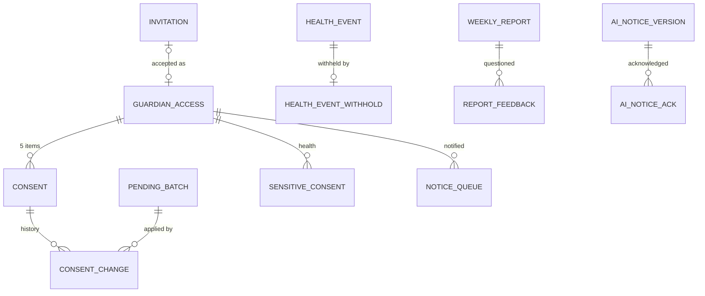

# 기술 설계 — Evenstay 패밀리 (family-consent-portal)

상태: 승인(2026-11-03) · 작성: 2026-11-03 · 변경: 2026-11-03 허브·사용자 확정 반영(올리지 않기, 일정 keyDates, AI 고지 v2) · 변경: 2026-11-03 코어 v1.1 반영, 문장 보관 결정, 문자 예정 시각, 데모 주인공 이은숙 · 변경: 2026-11-03 검토 반영, 확인할 것 정리 · 변경: 2026-11-03 G 요청 반영(사용자 재승인 2026-11-03) · 변경: 2026-11-03 C 요청 반영(사용자 재승인 2026-11-03) · 변경: 2026-11-03 직원 화면 이름 한국어(Evenstay Family Admin → 보호자 포털·동의, 허브 요청) · 변경: 2026-11-03 브랜드 뒷말 한글 표기·카피 검수 반영(사용자 재승인 2026-11-03) · 변경: 2026-11-03 기획 문서 한국어 검수(korean-skills, 사용자 재승인 2026-11-03) · 변경: 2026-11-03 장기 부재 소식·동의 집계 추가(사용자 재승인 2026-11-04) · 변경: 2026-11-03 코어 장기 부재 확정 맞춤(사용자 재승인 2026-11-04) · 변경: 2026-11-03 생활 요청 허락 항목·카피 반영(사용자 재승인 2026-11-04) · 변경: 2026-11-04 전체 리뷰 보완(사용자 재승인 2026-11-04) · 변경: 2026-11-04 열린 결정 반영(사용자 재승인 2026-11-04) · 변경: 2026-11-04 N2 요청 N2-D1~D5 반영(사용자 재승인 2026-11-04) · 변경: 2026-11-04 확인할 것 31 결정(사용자 재승인 2026-11-04) · 변경: 2026-11-04 쉬운 말 재검수·공용 문구 인용 맞춤(사용자 재승인 2026-11-04) · 기준: `04-planning/CLAUDE.md` "기술 설계", "코어 + 모듈 구조", 코어 `senior-lab/04-planning/ideas/pms-core-billing/tech-design.md`(v1.1, 재승인 2026-11-03) 형식
입력: `prd.md`, `service-blueprint.md`, `user-stories.md`, `copy/names.md`(코드 이름), `copy.md`

> **공통 도메인 모델의 기준은 코어 `tech-design.md`다.** 이 문서는 코어 엔티티(Resident, GuardianLink, Representative, Contract, Invoice, RoleAssignment, AuditLog)를 ID로만 참조하고, `family` 스키마의 확장 엔티티·정책·API·이벤트만 정의한다. 코어에 요청했던 것(HUB-1~11)은 코어 v1.1로 처리됐다(확인할 것). 이 문서는 코어를 고치지 않는다.
> 기술 스택은 코어 12절 방향(프로토타입 HTML·JS, MVP Next.js, PostgreSQL)을 따르고 나머지는 확정하지 않는다. 표기 규칙은 `strategy.md`와 같다. 표기 없는 문장은 이 문서의 설계안(초안)이다.

## 1. 범위와 경계
```
   Evenstay 홈(회원·대리인)   Evenstay 패밀리(보호자)   보호자 포털·동의(직원)
                 │                      │                        │
                 └──────────── family/web (REST) ────────────────┘
                                        │
   safety(B) ──► family/api ◄── assistant(G), transitions(C)        ← 공개: 동의 조회, 건강 소식 수신, AI 고지, 금전 인계
                                        │
                  family/domain · application  ──►  family 스키마(동의, 별도 동의, 건강 소식, 리포트, 고지, 열람 기록, 금전 부탁)
                                        │
          core/api: authorize()+registerPolicy · GuardianQuery·GuardianCommand · RepresentationQuery · BillingQuery · ContractQuery · ResidentQuery · StaffQuery · MealQuery · AuditWriter · 코어 이벤트
          platform: Notifier(sendAfter) · Clock(now, 데모의 멈춘 시계)
                                        │
          어댑터: 휴대전화 본인 확인(목업) · AI 초안(목업/LLM). 문자는 `platform` Notifier(로그)
```
- D가 갖는 것: 보호자별 항목 허락과 이력, 확인 대기 묶음, 건강정보 별도 동의, 건강 소식(B·C가 올린 본문 스냅샷), 주간 생활 리포트, AI 고지문 버전과 확인 기록, 열람 기록(조회용), 초대, 금전 부탁 기록. 직원 직무는 코어 `RoleAssignment.duties`(v1.1)를 쓴다.
- D가 갖지 않는 것: 보호자 관계 자체(코어 GuardianLink), 대리권(코어 Representative), 청구서(코어), 비상 연락처와 119, 병원 전화(코어 + B), 신호·조치 원본(B), 케어 단계(C), 대화(G), 금융 정보(어디에도 저장 안 함).
- **D는 `family` 스키마에만 쓴다.** 코어 데이터는 `core/api`로만 읽는다. B·G·C는 `family/api`만 쓴다. D는 B·G·C를 import하지 않는다(코어 ADR-2 2번, v1.1: 모듈 구현 → 다른 모듈 `api/` 허용, `api/`끼리는 import 금지, 순환 금지).

## 2. 도메인 모델
### 2-1. 용어 (공통 언어)
코어 2-1 용어와 `names.md` 코드를 그대로 쓴다. D에서 더하는 것만 적는다.
| 코드 | 직원 화면 | 회원 화면 | 보호자 화면 | 비고 |
|---|---|---|---|---|
| GuardianAccess | 보호자 연결 | 함께 보실 분 | (본인) | 코어 GuardianLink 1개당 1행. 상세 관계와 연결 상태 |
| ConsentItem `LIFE_REPORT` / `SCHEDULE` / `BILLING` / `HEALTH_EVENT` / `LIFE_REQUEST` | 주간 생활 리포트 / 일정 / 청구 / 건강 소식 / 생활 요청 | 생활 소식 / 일정 / 청구서 / 건강 소식 / 생활 요청 | 같음 | 5개. `LIFE_REQUEST`는 2026-11-03 N1 결정으로 추가(P1, 사용자 재승인 2026-11-04). 요청 데이터는 N1 것이고 D는 허락만 갖는다 |
| Consent `NOT_GRANTED` / `PENDING_MEMBER_CONFIRMATION` / `GRANTED` / `REVOKED` | 미허용 / 입주자 확인 대기 / 허용 / 철회 | 안 보여요 / 회원님 확인을 기다려요 / 보여요 / 안 보여요(날짜) | 볼 수 없어요 / 볼 수 없어요 / 볼 수 있어요 / 볼 수 없어요 | `names.md` 3절 |
| PendingBatch | 입주자 확인 대기 묶음 | 직원이 적은 내용 | — | 직원 대신 입력 한 번 |
| SensitiveConsent(HEALTH) `AGREED` / `NOT_AGREED` / `WITHDRAWN` | 건강정보 별도 동의 완료 / 없음 / 철회 | 건강 소식 따로 동의 | (표시 안 함) | 보호자마다. `names.md` 3절 |
| HealthEvent `SAFETY_SIGNAL` / `HOSPITAL_TRANSFER` / `CARE_NOTE` / `CARE_STAGE_CHANGE` / `EXTERNAL_CARE_START` | 건강 소식(`names.md` 1절. 2026-11-03 카피에서 "건강 소식"으로 통일, 사용자 재승인 2026-11-03) | 건강 소식 · 직원이 다녀간 일 / 병원에 가신 일 / 그 밖의 건강 기록 / 생활 지원 단계가 바뀐 일 / 다른 기관 돌봄이 시작된 일(C 두 종류, `names.md` 1-1 반영됨, 카피 사용자 재승인 2026-11-03) | 같음 | `names.md` 1-1. C 두 종류는 2026-11-03 C 요청 HUB-D1 |
| WeeklyReport `DRAFT` / `IN_REVIEW` / `SENT` | AI 초안 / 검토 중 / 발송 완료 | (발송된 것만) | (발송된 것만) | |
| AiNoticeVersion / AiNoticeAck | AI 사용 고지 / 확인 | AI 사용 안내 | AI 사용 안내 | G도 같은 것을 쓴다 |
| AccessLog | 열람 기록 | 내 소식을 본 기록 | (표시 안 함) | 조회용 읽기 모델. 원본은 코어 AuditLog |
| MoneyRequest | 금전 부탁 | (표시 안 함) | (표시 안 함) | I-31 |

### 2-2. 엔티티 (family 스키마, 핵심 필드)
모든 테이블은 `id`(UUID 후보), `operator_id`, `site_id`, `created_at`, `created_by`를 가진다(코어 ADR-1 규칙과 같게 RLS 대상). 코어 엔티티는 ID만 보관하고 외래 키를 두지 않는다(코어 ADR-2).

| 엔티티 | 핵심 필드 | 규칙 |
|---|---|---|
| GuardianAccess 보호자 연결 | guardian_link_id(코어, 유일), resident_id, person_id, relation_detail(`names.md` 2절 9종), status(ACTIVE, ENDED), ended_reason(MEMBER_REMOVED, UNLINKED, MOVED_OUT, DECEASED), ended_at | 코어 관계 코드 대응: DAUGHTER·SON → CHILD, SPOUSE → SPOUSE, SIBLING → SIBLING, 나머지 → OTHER. ENDED면 모든 Consent를 SYSTEM 철회 |
| Consent 허락(현재) | guardian_link_id, resident_id, item, status, pending_batch_id, row_version, updated_at | (guardian_link_id, item) 유일. 행이 없으면 NOT_GRANTED. 낙관적 잠금 |
| ConsentChange 허락 이력 | guardian_link_id, item, from_status, to_status, actor_kind(SELF, STAFF, REPRESENTATIVE, SYSTEM), actor_user_id, representative_id, channel(APP, TABLET_WITH_STAFF, PHONE, FRONT_DESK), pending_batch_id, reason_code(SYSTEM일 때), request_id, occurred_at | **추가만 한다.** 화면의 "근거" 표시는 이 행을 가리킨다 |
| PendingBatch 확인 대기 묶음 | resident_id, entered_by_user_id, channel, items(JSON: [{guardian_link_id, item}] 또는 [{health_event_id, action: REPOST}]), status(WAITING, CONFIRMED, REJECTED, SUPERSEDED), decided_at, decided_device(MEMBER_DEVICE, STAFF_TABLET) | 넓힘만 담는다. 회원 본인 세션만 CONFIRMED로 바꿀 수 있다 |
| SensitiveConsent 건강정보 별도 동의 | guardian_link_id, resident_id, kind(HEALTH), status(AGREED, NOT_AGREED, WITHDRAWN), legal_text_version, decided_at, decided_by_person_id, signed_as(SELF, REPRESENTATIVE), representative_id, staff_present_user_id, withdrawn_at, withdrawn_by | 동의·거부할 때마다 새 행(거부 = [동의하지 않기]를 누른 기록, NOT_AGREED). 행이 없어도 동의 없음. 유효한 것은 보호자당 마지막 AGREED 하나 |
| HealthEvent 건강 소식 | resident_id, source_module(SAFETY, TRANSITIONS, FAMILY_STAFF[Next: 간호·생활지원 직원이 D에서 직접 쓰는 기록]), source_id, revision, kind(SAFETY_SIGNAL, HOSPITAL_TRANSFER, CARE_NOTE, CARE_STAGE_CHANGE(생활 지원 단계가 바뀐 일, C), EXTERNAL_CARE_START(다른 기관 돌봄이 시작된 일, C P1). EXTERNAL_CARE_END는 Next. C 두 종류는 [가설, C 결정 1]. 종류는 D가 가진 닫힌 목록이라 출처가 새 종류를 쓰려면 D에 더해야 한다), occurred_at, summary_line, body(암호화 후보), recorded_by_user_id, involves_emergency_call(119 신고 또는 병원 이송이 기록됨), status(POSTED, WITHHELD, SUPERSEDED), posted_at | (source_module, source_id, revision) 유일. 새 버전이 오면 옛 버전 SUPERSEDED. 금지 필드(진단명, 진료 결과, 처방)는 받지 않는다 |
| HealthEventWithhold 올리지 않기 | resident_id, source_module, source_id, kind, event_occurred_at(사건 시각), reason_code(MEMBER_REQUEST, NOT_A_HEALTH_EVENT. **TRANSITIONS 출처는 MEMBER_REQUEST만**, 잘못 올린 C 소식은 C가 새 버전으로 `post`해 바로잡는다 [C 요청 중: C ADR-T6은 revision 1 고정]), sub_reason(OTHER_RESIDENT, DUPLICATE, DEVICE_TEST. B 출처용), heard_by_user_id, heard_at(회원 말을 들은 시각), requested_by_kind(SELF, REPRESENTATIVE), via(SOURCE_MODULE, FAMILY_ADMIN), involves_emergency_call, note, occurred_at | 추가만 한다. resident_id로 사업장(RLS), 회원 화면(`copy.md` 2-9), 매니저 주간 목록을 묶는다(B 확인할 것 D-3 수용). MEMBER_REQUEST는 heard_by 필수. involves_emergency_call이면 MEMBER_REQUEST만 허용(prd 12절, 2026-11-03 확정) |
| WeeklyReport 주간 생활 리포트 | resident_id, week_start(그 주 월요일, 한국 시간. 기간은 월~일), status, draft_source(AI, STAFF), body, member_message, evidence(JSON: 문장별 근거 참조), ai_adapter, prompt_version, reviewed_by, reviewed_at, sent_at, recipients_snapshot(JSON: guardian_link_id[]) | (resident_id, week_start) 유일. SENT 이후 수정 금지(트리거) |
| ReportFeedback 내용이 이상해요 | report_id, guardian_link_id, assigned_to, due_at(2영업일 [가설]), status(OPEN, RESOLVED), resolution | P1 |
| AiNoticeVersion 고지문 버전 | audience(MEMBER, GUARDIAN. 대리인은 MEMBER 버전을 읽는다 [가설], 확인할 것 18), version, copy_ref(`copy.md` 3절 버전), covers[](LIFE_REPORT, ASSISTANT), changed_purposes[](이 버전에서 내용이 바뀐 목적), published_at | 버전을 지우지 않는다. 시드: MEMBER v1 = covers [LIFE_REPORT]; **MEMBER v2(2026-11-03 재승인, `copy.md` 3절)** = covers [LIFE_REPORT, ASSISTANT], changed_purposes [ASSISTANT](생활 소식 덩어리의 약속은 v1과 같음); GUARDIAN v1 = covers [LIFE_REPORT](3-2, 비서 없음) |
| AiNoticeAck 고지 확인 | person_id, audience, version, acting_as(SELF, REPRESENTATIVE), acknowledged_at, channel(APP, TABLET_WITH_STAFF, ASSISTANT) | 추가만 한다. 확인은 사람마다 한 번이다(대리 대상 회원마다가 아님). 같은 사람은 역할(본인·대리인)과 상관없이 MEMBER 버전 확인 한 번으로 된다. 다른 사람의 확인은 서로 대신하지 않는다(회원이 확인했어도 대리인은 따로 확인). acting_as는 기록용 라벨이고 `acknowledged()`는 보지 않는다 |
| AiPreference AI 미사용 선택 | resident_id, life_report_ai_opt_out, set_by_kind, set_at | [가설] |
| ScopeNoticeAck 범위 안내 확인 | resident_id, notice_key(LIFE_REPORT_ABSENCE = `copy.md` 2-10, SCHEDULE_PROGRAMS = 일정에 신청한 프로그램 [가설, 2026-11-04]), person_id, acting_as(SELF, REPRESENTATIVE), channel(APP, TABLET_WITH_STAFF), acknowledged_at | 추가만 한다. 회원마다 한 번이면 된다(회원 본인이나 MANAGE_GUARDIAN_ACCESS 대리인). 쓰임은 3-6 [가설, prd 확인할 것 25]. P1 |
| AccessLog 열람 기록(조회용) | resident_id, viewer_kind(GUARDIAN, REPRESENTATIVE, STAFF), viewer_ref, item, target_type, target_id, result(ALLOW, DENIED. `names.md` 4절), basis_ref(ConsentChange id 또는 직무), request_id, audit_log_id, at | item에 LIFE_REQUEST(target_type = SERVICE_REQUEST, target_id = N1 requestId)도 온다(2026-11-04 H2, `GuardianViewLogCommand`로만, 이때 audit_log_id는 비고 원본 감사는 N1 READ). 추가만 한다(DB 권한으로 UPDATE·DELETE 금지). 원본 감사는 코어 AuditLog |
| Invitation 초대 | resident_id, invited_by_kind(SELF, STAFF, REPRESENTATIVE), name, relation_detail, phone(암호화), token_hash, expires_at(7일 [가설]), status(SENT, ACCEPTED, EXPIRED, CANCELLED), accepted_guardian_link_id | 1회용. 같은 번호의 SENT는 새 초대 때 CANCELLED. P1 |
| NoticeQueue 알림 대기 | guardian_link_id, resident_id, reason(NEW_NEWS, SCOPE_WIDENED, INVITE), source_ref(부재 소식이면 코어 absenceId, 생활 요청 소식이면 N1 requestId. ID 참조만, 2026-11-03·04), send_after, sent_at, notifier_ref | 조용한 시간(22~08시) 묶음. 보낼 때 권한 재검사 |
| MoneyRequest 금전 부탁 | resident_id, request_type(BANKBOOK_CARD, CASH, TRANSFER, PASSWORD_OTP, FINANCIAL_PRODUCT, LENDING, OTHER), category(ALLOWED, HANDOFF. `names.md` 4절: 직원이 할 수 있는 일로 끝남 / 넘김. 비서 접수 행은 null), channel(FRONT_DESK, PHONE, ASSISTANT), source_ref(비서 접수일 때 G handoffId), follows_request_id(직원이 비서 접수를 이어받아 쓴 행일 때), received_by_user_id, actions_taken[], handoff(REPRESENTATIVE, FAMILY, SELF_INSTITUTION, MANAGER, NONE), representative_id, guardian_link_id, member_permitted_contact, escalated, note, occurred_at | 추가만 한다. **REPRESENTATIVE와 FAMILY는 member_permitted_contact = true일 때만**(`copy.md` 5-3 "입주자가 대리인에게 알리는 데 동의하실 때", "입주자가 허락하시면"). MANAGER는 허락 없이도 된다(착취 의심 보고). 비서 접수(channel = ASSISTANT, Next)는 request_type = OTHER, note = 회원 말 원문, received_by_user_id = null로 한 행을 만들고, 직원이 유형을 골라 처리한 내용은 follows_request_id로 이은 새 행에 쓴다(추가만, 8-2). follows_request_id는 유일(한 접수는 한 번만 이어받음), 이어 쓴 행의 channel은 원행과 같다. **건수·목록은 사슬 하나를 1건으로 센다**(반복 부탁 7일 3건, 주간 확인 목록). 직원 "확인할 일" = follows_request_id가 비어 있는 ASSISTANT 행 중 그 행을 가리키는 이어 쓴 행이 없는 것(이어 쓴 행 자체는 들어가지 않음). note는 저장 전에 D가 가린다: 숫자 사이의 공백, 하이픈, 점은 무시하고 숫자가 4개 이상 이어진 부분을 가린다. 단 바로 뒤에 금액 단위(원, 만 원 등)나 날짜 단위(년, 월, 일)가 붙은 숫자는 남긴다(직원이 유형을 고르려면 금액과 날짜가 필요. 예: "2026년 1월 10일"은 가리지 않음. 날짜 예외는 G와 같은 규칙, 2026-11-03 사용자 확정) [가설]. 이 규칙은 D 스키마 안의 것이고, G 넘김에 남는 원문 보관은 G 몫이다(허브 요청). P1 |

### 2-3. ERD 초안

- 코어 참조(외래 키 없음, ID만): GuardianAccess.guardian_link_id → core GuardianLink, *.resident_id → core Resident, representative_id → core Representative, *_user_id → core UserAccount, AccessLog.audit_log_id → core AuditLog.
- HealthEvent·MoneyRequest·AccessLog는 회원(resident_id) 기준으로만 묶는다. 보호자 기준 목록은 Consent를 거쳐 계산한다.

## 3. 상태 전이
### 3-1. 허락 (Consent, 보호자 × 항목)
```
NOT_GRANTED ──(grant: SELF·REPRESENTATIVE)──────────────► GRANTED
NOT_GRANTED·REVOKED ──(propose: STAFF)──► PENDING ──(confirm: SELF)──► GRANTED
                                           PENDING ──(reject: SELF / 같은 항목 직접 변경)──► 이전 상태
GRANTED ──(revoke: 누구든 SELF·STAFF·REPRESENTATIVE·SYSTEM)──► REVOKED ──(grant)──► GRANTED
```
| 전이 | 조건 | 부수 효과 | 이벤트 |
|---|---|---|---|
| grant | 행위자 = 회원 본인, 또는 MANAGE_GUARDIAN_ACCESS 대리인(4절). GuardianAccess ACTIVE. HEALTH_EVENT면 유효한 SensitiveConsent 필수 | ConsentChange 1행. NoticeQueue(SCOPE_WIDENED) [가설] | FamilyConsentChanged |
| propose | 행위자 = 같은 사업장 SITE_STAFF. 넓힘만 | PendingBatch WAITING, 대상 Consent PENDING. 보호자에게는 계속 거부 | — |
| confirm | **회원 본인 세션만**(직원·대리인 세션 거부). HEALTH_EVENT는 SensitiveConsent 생성 후에만 | 묶음 CONFIRMED, 대상 GRANTED, ConsentChange(pending_batch_id), NoticeQueue(SCOPE_WIDENED) [가설] | FamilyConsentChanged |
| revoke | 누구든 범위 안이면. **좁힘은 확인 없이 즉시** | ConsentChange. STAFF가 했으면 회원 화면 알림. HEALTH_EVENT면 SensitiveConsent WITHDRAWN | FamilyConsentChanged |
| SYSTEM revoke | GuardianUnlinked, 함께 보실 분에서 빼기, ContractSettled·ContractSucceeded(사별한 분) [가설] | GuardianAccess ENDED, 모든 항목 REVOKED | FamilyConsentChanged |
- 동시 수정은 `Consent.row_version`으로 막는다. 같은 `Idempotency-Key` 재요청은 같은 결과를 돌려준다.
- 허락하지 않은 상태와 철회 상태는 권한 판단에서 같다. 구분은 직원·회원 화면 표시에만 쓴다.
- **공유 철회의 범위 (2026-11-05, 사용자 반영 지시) [가설]**: 특정 보호자의 허락을 철회하면 그 보호자의 해당 항목 조회와 예정 발송을 차단하고 관련 캐시를 무효화한다. 원본을 함께 삭제하지 않는다. 원본과 파생물의 보존·파기는 각각의 소유 모듈이 처리 목적·근거·보존 정책에 따라 판단한다. 복원 뒤에는 복원 시점 이후의 철회를 재적용하고 검증할 때까지 해당 보호자 공유 조회와 발송을 열지 않는다. AI 투입 동의 철회가 있는 경우 새 투입과 대기 작업을 막고 AI 파생물의 처리는 별도 정책으로 정한다.

### 3-2. 건강정보 별도 동의
`(없음) ──(agree)──► AGREED ──(withdraw)──► WITHDRAWN` · `(없음) ──(decline)──► NOT_AGREED` · 다시 동의하면 새 행. HEALTH_EVENT의 GRANTED는 AGREED가 있을 때만 유지된다(철회하면 같은 트랜잭션에서 Consent도 REVOKED).

### 3-3. 건강 소식 (HealthEvent)
```
(post, revision n) ──► POSTED ──(post, revision n+1)──► SUPERSEDED (새 버전 POSTED)
(withhold) ──► WITHHELD            POSTED ──(withhold: MEMBER_REQUEST)──► WITHHELD
WITHHELD(MEMBER_REQUEST, 본문 있음) ──(repost: 직원 입력 → PendingBatch → 회원 확인)──► POSTED   [가설, prd 확인할 것 15]
```
- **다시 올리기 경로 [가설]**: `withhold(MEMBER_REQUEST)`는 B가 `post` 없이 부르므로, 다시 올릴 수 있게 **본문(summaryLine, body)도 함께 받아** HealthEvent 행을 WITHHELD 상태로 저장한다(보호자에게는 안 보임). 회원·대리인이 다시 보여 달라고 하면 직원이 [다시 올리기] → PendingBatch(REPOST) → 회원이 태블릿에서 확인 → POSTED. B를 다시 부를 필요가 없어 D → `safety/api` 의존이 생기지 않는다. `NOT_A_HEALTH_EVENT`는 본문을 받지 않는다. 잘못 뺀 경우는 B가 바로잡아 새 버전으로 `post`한다(B에 요청, 확인할 것 17).
- withhold는 이유 코드 2가지만 받는다(prd 12절, 2026-11-03 확정). involves_emergency_call(119 신고 또는 병원 이송)이면 MEMBER_REQUEST만 받고 NOT_A_HEALTH_EVENT는 거부한다. WITHHELD는 보호자에게 보이지 않고 운영 매니저 주간 목록에 나온다.
- **보이는 조건**: POSTED + 보호자의 HEALTH_EVENT GRANTED + 유효한 AGREED + `occurred_at의 날짜(한국 시간) ≥ decided_at의 날짜(한국 시간)`. 동의한 **날** 0시 이후의 소식부터 보이고, 그 전날까지의 소식은 보이지 않는다 [가설, user-stories 확인할 것 1]. 데모의 11월 12일 새벽 소식(B 사건)은 전날(11월 11일) 동의 뒤라 보인다.

### 3-4. 주간 생활 리포트
`DRAFT ──(edit)──► IN_REVIEW ──(send: 생활지원 직무, 건강 낱말 0)──► SENT` · SENT 이후 본문 불변. 정정은 다음 주 리포트에. 발송 때 recipients_snapshot을 남기고, 열람 때 권한을 다시 계산한다(철회된 보호자는 받은 리포트도 못 봄).

### 3-5. 그 밖
- PendingBatch: WAITING → CONFIRMED | REJECTED | SUPERSEDED(같은 항목을 회원이 직접 바꿈).
- Invitation: SENT → ACCEPTED | EXPIRED(7일) | CANCELLED(새 초대).
- ReportFeedback: OPEN → RESOLVED. due_at 지나면 매니저 목록.

### 3-6. 장기 부재 소식 (P1, 2026-11-03 코어 확정에 맞춤) [가설]
**D는 부재 기록을 저장하지 않는다**(모듈 경계 8번). 상태의 주인은 코어 `ResidentAbsence`(OPEN, ENDED, CANCELLED)다. D가 남기는 것은 NoticeQueue의 source_ref(absenceId)와 이벤트 멱등 처리용 event_id뿐이다.
- **화면**: 볼 때마다 코어 `AbsenceQuery.absencesIn(residentId, at − 90일, at)`을 불러 카드를 그린다 [가설: 90일]. 취소된 부재는 그리지 않는다(처음부터 없던 일). 부재마다 자리를 비우신 소식(startedOn, 지금의 expectedReturnOn)을 그리고, 실제로 돌아오셨으면 돌아오신 소식(returnedOn)을 더한다. 예정 복귀일은 이벤트 없이 바뀌므로 볼 때 읽는 값을 쓴다.
- **보이는 조건**: 보는 때 그 보호자의 LIFE_REPORT가 GRANTED. 주간 생활 리포트와 같은 규칙이라 철회되면 지난 부재 소식도 보이지 않는다. HEALTH_EVENT만 허락받은 보호자에게는 보이지 않는다. 열람 기록은 item = LIFE_REPORT, target = absenceId로 남긴다.
- **범위가 늘기 전에 허락한 회원 [가설, prd 확인할 것 25]**: 사업장 설정 `absence_notice_started_at`(장기 부재 소식을 켠 시각)보다 앞서 그 보호자에게 LIFE_REPORT를 허락한 회원이면, ScopeNoticeAck(LIFE_REPORT_ABSENCE)가 있어야 그 보호자에게 부재 카드가 보이고 문자가 간다. 켠 뒤 허락했으면(마지막 GRANTED ConsentChange가 그 시각 뒤) 확인 없이 보인다. 확인 전 부재는 확인 뒤에 화면에 나오고, 지난 부재 문자는 보내지 않는다.
- **알림**: `ResidentAbsenceStarted`를 받으면 그 시각 LIFE_REPORT가 GRANTED인 보호자마다 NoticeQueue(NEW_NEWS, source_ref = absenceId)를 만든다. 문자는 새 소식 문자와 같고(내용 없음), 조용한 시간 규칙도 같다. 보낼 때 권한과 함께 `AbsenceQuery.absenceOf(residentId, 보내는 날)`이 아직 그 absenceId인지 다시 보고, 아니면(그새 취소·종료) 보내지 않는다. 허락한 보호자가 없으면 아무것도 만들지 않는다.
- **끝남 판단(등록 취소·자동 종료)**: `ResidentAbsenceEnded`는 실제 복귀, 등록 취소, 사별 승계·정산 때 자동 종료에 모두 온다(payload에 끝난 이유 없음). D는 아래 둘을 모두 만족할 때만 돌아오신 소식 알림을 만든다. (1) `AbsenceQuery.absencesIn(residentId, endedOn, endedOn)`에서 그 absenceId의 상태가 ENDED다(CANCELLED가 아님. 코어 반영됨, 확인할 것 26). (2) `ContractQuery.activeContractOf(residentId, endedOn)`가 있다(승계·정산으로 계약을 떠난 입주자가 아님). 떠난 입주자의 보호자 허락은 `ContractSettled`·`ContractSucceeded`로 이미 SYSTEM 철회되므로 화면에도 나오지 않는다.
- **사람이 개입하는 지점**: 부재 기록은 직원이 코어에 남긴다. D는 AI 초안도 직원 검토도 거치지 않고 코어의 사실만 보인다.

## 4. 권한 정책 (코어 `authorize()` 확장)
D는 앱 시작 때 `Authorization.registerPolicy(familyPolicy)`로 정책 하나를 등록한다. 코어 6-3 순서에서 **5단계로만** 실행되고, ALLOW 또는 ABSTAIN만 돌려준다(DENY를 만들지 않는다). 1단계(범위 밖) DENY는 뒤집지 못한다.
- **정책을 등록할 수 있는 행동(코어 ADR-2 5번, v1.1)**: D 자기 이름공간 `family.*`만. 코어 6-2의 "(D)" 칸(보호자 열람 권한 관리, 보호자 청구서 보기)은 코어 행동이 아니라 아래 `family.consent.*`와 `family.view(BILLING)`으로 연다(문서 동기화는 허브 요청). 그래야 코어 4단계의 VIEW_INVOICE 대리 범위가 보호자 청구서 화면에 끼어들지 않는다(대리인 김태호도 Evenstay 패밀리에서는 회원이 허락한 것만 본다). 다른 모듈이 자기 `api/`에 "D 동의로 연다"고 선언한 행동이 있으면 그 행동도 D가 연다. **지금은 N1과 N2다**: N1이 보호자 행동 두 개(생활 요청 보기, 대신 올리기)를 선언하면 D가 `LIFE_REQUEST` 허락으로 연다(2026-11-03, F20). N2가 보호자 행동 두 개(`community.enrollment.view_as_guardian`, `community.notice.view_as_guardian`)를 선언하면 D가 각각 SCHEDULE 허락과 활성 보호자 관계로 연다(2026-11-04 N2-D1·D2, N2 ADR-M6). 그 밖에는 없다: B·C는 보호자용 결과를 D 건강 소식으로 올리므로(B ADR-S3, C ADR-T6) 보호자는 `family.view`만 쓴다.

```
# 도우미
self(actor, r)  = actor.role = MEMBER and actor.personId = r.resident.personId and 세션 종류 MEMBER
hq(actor)       = actor.role ∈ {HQ_ADMIN, HQ_MANAGER}
mgr(actor)      = actor.role = SITE_MANAGER          # 코어 v1.1 역할
staff(actor)    = actor.role ∈ {SITE_STAFF, SITE_MANAGER} # 사업장 범위는 코어 1단계가 이미 걸렀다
duty(actor, d)  = d ∈ actor.duties                   # 코어 v1.1 RoleAssignment.duties
# ◆ 행동은 코어 6-3 대응표(v1.1)가 MANAGE_GUARDIAN_ACCESS로 묶어 두어 대리인은 코어 4단계가 판단하고 대리 사실도 거기서 감사에 남긴다. D 정책은 대리인을 따로 보지 않는다.

familyPolicy(actor, action, resource, at):
  case family.view(item):                          # 회원 소식 보기 (6-2). 보호자 청구서 보기도 이 행동으로 연다
    if self(actor, resource)                                      → ALLOW   # 회원 본인의 것
    link = GuardianQuery.guardiansOf(resource.residentId) 중 person_id = actor.personId
    if link 없음 or GuardianAccess(link).status ≠ ACTIVE        → ABSTAIN
    c = Consent(link, item);       if c.status ≠ GRANTED          → ABSTAIN
    if item = HEALTH_EVENT:
      if resource.status ≠ POSTED                                 → ABSTAIN   # WITHHELD·SUPERSEDED는 ID로 열어도 안 보임
      s = 마지막 SensitiveConsent(link, HEALTH);  if s.status ≠ AGREED → ABSTAIN
      if 날짜KST(resource.occurredAt) < 날짜KST(s.decidedAt)       → ABSTAIN   # 3-3
    if item = LIFE_REPORT and resource.status ≠ SENT              → ABSTAIN
    return ALLOW(basis = 최신 ConsentChange.id)
  case family.consent.grant ◆ (넓히기, 바로 적용):  self                → ALLOW   # 코어 6-2 "보호자 열람 권한 관리 (D, 본인)"
  case family.consent.propose (직원 넓힘 → 확인 대기): staff           → ALLOW
  case family.consent.revoke ◆ (좁히기, 바로 적용):  self or hq or staff → ALLOW
  case family.health_event.repost (뺀 일 다시 올리기 → 회원 확인): staff → ALLOW   # [가설]
  case family.consent.read ◆:        self or hq or staff          → ALLOW   # 허락 상태 보기
  case family.consent.confirm:       self                         → ALLOW   # 직원·대리인 세션은 ABSTAIN
  case family.health_consent.decide ◆ (agree·decline·withdraw): self → ALLOW # 대리인 동의는 [법률 검토]
  case family.guardian.invite ◆, family.guardian.remove ◆: self or staff → ALLOW   # 코어 GuardianCommand.link·unlink를 부른다
  case family.health_event.staff_read: staff and (duty LIFE_SUPPORT or duty CARE) → ALLOW   # 본사도 직무 없으면 불가(copy 6절)
  case family.health_event.withhold:   staff                      → ALLOW   # 이유 코드 검사는 애플리케이션
  case family.report.edit (초안 만들기·고치기): staff              → ALLOW
  case family.report.send:           staff and duty LIFE_SUPPORT  → ALLOW
  case family.access_log.read ◆:     hq or mgr                    → ALLOW   # 허용·거부 모두(mgr는 자기 사업장)
                                     self                         → ALLOW   # ALLOW 행만(애플리케이션이 거름)
  case family.access_log.export:     hq                           → ALLOW
  case family.money_request.create:  staff                        → ALLOW
  case family.money_request.open_from_assistant (Next): self       → ALLOW   # G가 회원 확인 토큰 뒤 부른다. 대리인의 금전 넘김은 G 넘김에 남고 직원이 접수 [가설]
  case family.money_request.review, family.health_event.withheld_review: hq or mgr → ALLOW   # 매주 확인(확정 1)
  case family.ai_notice.ack:         actor.personId = resource.personId → ALLOW   # 회원·보호자·대리인 본인(대리인은 MEMBER 버전, 확인할 것 18)
  case family.ai_notice.admin (새 버전, 현황): hq                     → ALLOW
  case family.summary.read (사업장 동의 현황 숫자, F19): hq or mgr  → ALLOW   # mgr는 자기 사업장(코어 1단계). app/이 CHECK로 부른다
  case family.scope_notice.ack ◆ (copy 2-10 확인): self           → ALLOW   # 대리인은 코어 4단계
  # N1이 자기 api/에 "D 동의로 연다"고 선언한 보호자 행동(F20). 이름은 N1이 이 이름 그대로 선언하기로 확정(N1 ADR-R6, 2026-11-04)
  # N2가 선언한 보호자 행동(2026-11-04 N2-D1·D2). resource = {siteId, residentId}
  case community.enrollment.view_as_guardian:                   # 일정의 신청 프로그램
    link = GuardianQuery.guardiansOf(resource.residentId) 중 person_id = actor.personId
    if link 없음 or GuardianAccess(link).status ≠ ACTIVE        → ABSTAIN
    if Consent(link, SCHEDULE).status ≠ GRANTED                  → ABSTAIN
    if 범위가 늘기 전 허락(3-6과 같은 규칙, schedule_programs_started_at) and ScopeNoticeAck(SCHEDULE_PROGRAMS) 없음 → ABSTAIN
    return ALLOW(basis = 최신 ConsentChange.id)
  case community.notice.view_as_guardian:                       # 레지던스 공지. 허락 항목과 묶지 않는다(N2-5)
    link = GuardianQuery.guardiansOf(resource.residentId) 중 person_id = actor.personId
    if link 있음 and GuardianAccess(link).status = ACTIVE       → ALLOW
    return ABSTAIN
  case requests.request.view_as_guardian, requests.request.create_as_guardian:
    link = GuardianQuery.guardiansOf(resource.residentId) 중 person_id = actor.personId
    if link 없음 or GuardianAccess(link).status ≠ ACTIVE        → ABSTAIN
    if Consent(link, LIFE_REQUEST).status ≠ GRANTED              → ABSTAIN
    if resource.kind = HOSPITAL_ESCORT:
      if action = create_as_guardian                             → ABSTAIN   # 보호자는 병원 동행을 올리지 않는다
      if Consent(link, HEALTH_EVENT).status ≠ GRANTED or 마지막 SensitiveConsent(link, HEALTH).status ≠ AGREED → ABSTAIN
    return ALLOW(basis = 최신 ConsentChange.id)                         # 병원 이름을 가리는 것은 N1 응답 몫
  otherwise                                                       → ABSTAIN
```
- **◆ = 대리 범위 MANAGE_GUARDIAN_ACCESS**: 코어 v1.1 6-3 대응표("허락 상태 보기, 건강정보 별도 동의, 보호자 초대·빼기, 열람 기록 보기 → MANAGE_GUARDIAN_ACCESS")에 위 행동 코드를 대응시킨다. 대리인의 열람 기록 보기도 ALLOW 행만 보인다(애플리케이션).
- **보호자의 코어 범위(1단계)**: GUARDIAN 역할의 범위는 "기준일에 활성 GuardianLink가 있는 입주자"다(코어 6-1, v1.1 명시). 관계가 끊기면 코어가 먼저 거부하므로 D 허락이 남아 있어도 볼 수 없다. 보호자 계정은 `UserAccount.kind = GUARDIAN`(v1.1)이고, 한 사람이 회원이면서 다른 입주자의 보호자일 수 있어 권한은 역할로 판단한다.
- **캐시하지 않는다.** 정책은 요청마다 Consent·SensitiveConsent를 읽는다(인덱스: Consent(guardian_link_id, item)). 보호자 API 응답은 `Cache-Control: no-store`. Next.js에서는 보호자 화면을 요청마다 서버에서 그리고, 데이터 캐시를 끈다.
- **거부 응답은 하나**: 미허용, 철회, 확인 대기, 별도 동의 없음, 허락 전 날짜의 건강 소식 모두 403 + 메시지 코드 `FAMILY_NOT_VISIBLE`(`copy.md` 6절 "이 소식은 지금 볼 수 없어요"). 존재 여부를 숨기려고 대상 ID가 없어도 같은 응답을 준다.
- **예외 하나 — 연결이 끝난 사람**: 그 사람의 GuardianAccess가 ENDED(빼기, 관계 끊김, 퇴거·사별)이면 403 + `FAMILY_NOT_CONNECTED`(`copy.md` 6절 "함께 보실 분에서 빠졌을 때": "지금은 이은숙 회원님 소식을 볼 수 없어요. 궁금한 점은 시설 프런트 02-000-0000 (가상 번호)로 연락해 주세요."). 승인 카피가 이 경우를 따로 두었다. 이 응답도 빠진 이유(빼기인지 퇴거인지)는 구분하지 않는다.
- **기록(코어 7절 감사 범주, v1.1)**: ALLOW면 D가 `AuditWriter.write`(건강 소식 = SENSITIVE_READ, 청구서, 생활 소식, 일정 = READ) + AccessLog(ALLOW)를 같은 트랜잭션에. DENY면 코어가 AuditLog(DENIED)를 남기고, D 핸들러가 AccessLog(DENIED)를 남긴다. 건강 소식 올리지 않기는 WRITE + `reason`(MEMBER_REQUEST, NOT_A_HEALTH_EVENT).

## 5. 설계 결정 기록 (ADR)
### ADR-F1. 허락은 "현재 행 + 추가만 하는 이력"으로 저장한다
- **맥락**: 매 요청 권한 검사가 빨라야 하고(F5), 분쟁 때 "언제 누가 무엇을 허락했나"를 증명해야 한다(F7).
- **선택지**: (A) 현재 상태만 저장하고 변경 이력은 코어 AuditLog에만 / (B) 현재 행 + 추가만 하는 ConsentChange / (C) 이벤트 소싱(이력에서 현재 상태 계산).
- **결정**: **B.** 권한 검사는 현재 행 하나를 읽고, 화면의 "근거"와 "허락 변경 기록"은 ConsentChange를 읽는다. 둘은 같은 트랜잭션에 쓴다.
- **결과**: 검사 비용이 작고 이력이 남는다. 대가는 두 테이블의 일치를 테스트로 지켜야 한다는 것("현재 상태 = 마지막 이력의 to_status").

### ADR-F2. 권한은 코어 확장 정책으로, 매 요청 다시 계산한다
- **맥락**: 철회가 다음 요청부터 반영되어야 한다(shortlist D 위험 가정). 코어는 권한 검사를 하나로 두고 모듈은 허용만 더하게 했다(코어 ADR-2 5번).
- **선택지**: (A) 로그인 토큰에 허락 범위를 넣음 / (B) 범위를 캐시하고 변경 때 무효화 / (C) 요청마다 코어 `authorize()` → D 정책.
- **결정**: **C.** 토큰·캐시는 철회 뒤에도 남은 시간 동안 보인다.
- **결과**: 보호자 화면은 요청마다 DB를 몇 번 더 읽는다. 데모 규모에서는 문제가 아니고, 실서비스에서 느리면 짧은 TTL이 아니라 읽기 복제본·인덱스로 푼다 [추정].

### ADR-F3. 넓힘과 좁힘을 다르게 다룬다
- **맥락**: 직원이 대신 입력하는 일이 많다(블루프린트). 잘못 넓히면 회원 의사에 반한 공유가 되고, 좁히기를 기다리게 하면 급히 거두려는 회원이 위험하다(`copy.md` 7번 검토).
- **결정**: 넓힘은 STAFF면 PendingBatch → 회원 본인 세션 확인. 좁힘은 누구든 즉시. SYSTEM 철회도 즉시.
- **결과**: 대리인의 넓힘은 대기 없이 적용한다(대리권이 근거). 직원이 회원 태블릿에서 대신 누르는 일은 기술로 완전히 막을 수 없어 확인 기기·입력 직원을 남겨 표본 확인한다(블루프린트 X2).

### ADR-F4. 건강 소식은 D가 수신 API를 열고, B·C가 올린다
- **맥락**: B(먼저 개발), C(나중)의 결과가 같은 동의 체계로 보호자에게 가야 한다. D는 "공통 출구"다.
- **선택지**: (A) D가 B·C의 이벤트를 구독(D가 B·C 타입을 import) / (B) D가 `HealthFeedCommand`를 `family/api`에 열고 B·C가 부름 / (C) 보호자가 볼 때 D가 B에서 본문을 가져옴.
- **결정**: **B.** 의존 방향이 "출처 모듈 → D"로 한 방향이고, 출처가 늘어도 D의 수신·동의 코드는 고치지 않는다(건강 소식 종류는 D의 닫힌 목록이라 새 종류는 D에 더한다. C 두 종류가 그 예, 2026-11-03). B·C는 자기 아웃박스에 기록하고 디스패처가 `post`를 부른다(최소 한 번 전달, (source_module, source_id, revision) 멱등). 본문은 **보호자에게 보인 그대로 스냅샷**으로 저장한다. 무엇을 제공했는지 증명해야 하기 때문이다.
- **문장 보관 위치(2026-11-03 결정)**: B가 이 안(`post`에 본문 스냅샷)을 채택했다(B `tech-design.md` ADR-S3). B만 보관하고 D가 B를 조회하는 안은 버렸다. 그래서 D → `safety/api` 의존은 없다.
- **결과**: 같은 문장이 `safety`와 `family` 두 스키마에 있다. 그래서 금지 필드를 받지 않고, 본문 컬럼 암호화를 후보로 두고, 보관 기간은 B와 같게 맞춘다(prd 확인할 것 3) [법률 검토, 미확정]. B가 문장을 고치면 새 버전으로 다시 `post`한다. 모듈 → 다른 모듈 `api/` 의존은 코어 ADR-2 2번(v1.1)이 허용한다.

### ADR-F5. 열람 기록은 코어 AuditLog가 원본, D는 조회용 기록을 둔다
- **맥락**: 감사는 코어 AuditLog 하나에 모은다(코어 ADR-2 6번). 그런데 회원 "본 기록"과 직원 열람 기록 화면은 회원 기준 목록·필터가 필요하고, 모듈은 AuditLog를 조회할 API가 없다.
- **결정**: 모든 열람을 `AuditWriter`로 쓰고, 같은 트랜잭션에 `family.access_log`를 쓴다(audit_log_id로 연결). 둘 다 추가만 한다.
- **결과**: 같은 사실이 두 곳에 있다. 코어 ADR-2가 받아들인 "조회용 복사본"이다. 대안(코어에 `AuditQuery` 추가)은 허브 판단으로 남긴다.
- **주의**: `family` DB 역할은 `family`만 쓸 수 있다(12절). 한 트랜잭션에서 코어 감사 테이블에 쓰려면 `AuditWriter`가 코어 소유의 보안 정의 함수(SECURITY DEFINER)로 쓰거나, 같은 연결에서 코어 역할로 잠시 바꿔야 한다. 방식은 코어 `AuditWriter` 구현과 함께 정한다(확인할 것 12).

### ADR-F6. 주간 생활 리포트의 AI는 어댑터 뒤에 두고, 발송 조건은 서버가 강제한다
- **맥락**: AI 기본법 사전 고지와 생성물 표시(G4), "직원이 확인하지 않은 생활 소식은 나가지 않아요"(고지 3-1 "생활 소식 2").
- **결정**: `ReportDrafter.draft(input) → {sentences[], evidenceRefs[]}` 어댑터(목업: 규칙 기반 템플릿, 실제: LLM). 입력은 식사·프로그램·요청만이고 **건강 기록과 이름 외 개인정보를 넣지 않는다.** 발송 API는 (검토자 = 생활지원 직무, 건강 낱말 검사 통과, 회원 고지 확인 또는 직원 작성)을 모두 서버에서 검사한다.
- **결과**: 모델을 바꿔도 제품 규칙은 그대로다. 실제 LLM은 국외 이전·처리 위탁 고지가 필요할 수 있다 [법률 검토].
- **비서(G)도 고지·감사 대상이다(I-42)**: G는 직원 검토 없이 회원에게 바로 답하므로 생활 소식과 고지 내용이 다르다. 고지문 버전에 `covers`와 `changed_purposes`를 두어 목적별로 확인을 따진다. `acknowledged(person, audience, purpose)` = 그 사람이 확인한 버전 ≥ 그 목적이 마지막으로 바뀐 버전. 회원 고지 v2(`copy.md` 3절, 생활 소식·비서 두 덩어리)와 맞는다: v1만 읽은 회원은 ASSISTANT가 거짓이라 G가 비서를 열지 않고, LIFE_REPORT는 참이라 생활 소식 AI 초안은 멈추지 않는다. v2는 다음 접속 때 다시 보인다(`copy.md` 5-5). AI 고지·동의 현황(F16)은 목적별 확인을 보이고, 비서의 대화·도구 호출 감사는 G가 소유한다. 현황 화면에서 함께 보일 때는 화면 조립 계층(`app/`·`ui/`)이 G 공개 API를 부른다(D는 G를 import하지 않음).

## 6. 역할과 권한
### 6-1. 역할
코어 6-1 역할을 그대로 쓴다. D는 새 역할을 만들지 않는다. 보호자는 GUARDIAN, 회원은 MEMBER, 대리인은 Representative 행. 직원 직무(프런트, 생활지원, 간호)는 코어 `RoleAssignment.duties`(v1.1). 사업장 책임자(SITE_MANAGER, v1.1)는 아래 표의 사업장 직원 열과 같고, 더해서 자기 사업장의 열람 기록 보기, 금전 부탁·건강 소식 올리지 않기 주간 확인을 한다 [가설].

### 6-2. 역할 × 행동 (D 행동)
● 가능 · ◐ 조건부(괄호) · — 불가
| 행동 | 본사 관리자·매니저 | 경리 | 사업장 직원 | 소유주 | 회원 | 보호자 | 대리인 |
|---|---|---|---|---|---|---|---|
| 보호자별 허락 상태 보기 | ● | — | ● | — | ◐(본인) | — | ◐(MANAGE_GUARDIAN_ACCESS) |
| 허락 넓히기 (grant / propose) | — | — | ◐(propose → 회원 확인) | — | ◐(본인) | — | ◐(MANAGE_GUARDIAN_ACCESS) |
| 허락 좁히기·철회 | ● | — | ● | — | ◐(본인) | — | ◐(MANAGE_GUARDIAN_ACCESS) |
| 직원 입력 확인 | — | — | — | — | ◐(본인 세션만) | — | — |
| 건강정보 별도 동의 | — | — | — | — | ◐(본인) | — | ◐(MANAGE_GUARDIAN_ACCESS, [법률 검토]) |
| 회원 소식 보기(5개 항목. 생활 요청 화면은 N1) | — | — | — | — | ◐(본인 것) | ◐(허락 + 건강은 별도 동의) | — (청구서는 코어 Evenstay 홈에서 VIEW_INVOICE로) |
| 건강 소식 상세(직원) | — (코어 duties는 사업장 역할만 가짐) | — | ◐(생활지원·간호 직무) | — | — | — | — |
| 건강 소식 올리지 않기 | — | — | ◐(이유 코드 2가지) | — | — | — | — |
| 주간 생활 리포트 초안·검토 | — | — | ● | — | — | — | — |
| 주간 생활 리포트 발송 | — | — | ◐(생활지원 직무) | — | — | — | — |
| 열람 기록 보기·내려받기 | ● | — | — | — | ◐(본인, 허용만) | — | ◐(MANAGE_GUARDIAN_ACCESS, 허용만) |
| 금전 부탁 접수 | — | — | ● | — | — | — | — |
| 금전 부탁 주간 확인 | ● | — | — | — | — | — | — |
| 건강 소식 올리지 않기 주간 확인 | ● | — | — | — | — | — | — |
| 뺀 건강 소식 다시 올리기 | — | — | ◐(회원·대리인 말씀 → 회원 확인) [가설] | — | — | — | — |
| AI 고지 확인 | — | — | — | — | ◐(본인) | ◐(본인) | ◐(본인, MEMBER 버전, P1) [가설] |
| AI 고지문 새 버전 올리기, 현황 | ● | — | — | — | — | — | — |
| 생활 요청 보기·대신 올리기(N1 행동, D 동의로 엶, F20) | — | — | — (N1 자기 권한) | — | — | ◐(LIFE_REQUEST 허락. 병원 동행은 건강 소식 허락 + 별도 동의일 때 보기만) [가설] | — |
| 사업장 동의 현황 숫자(`family.summary.read`, F19) | ● | — | ◐(사업장 책임자, 자기 사업장) [가설] | — | — | — | — |
| 초대 보내기 | — | — | ◐(회원 요청) | — | ◐(본인) | — | ◐(MANAGE_GUARDIAN_ACCESS) |
- 모든 ● ◐는 코어 범위(사업장, 본인, 관계) 안에서만이다.
- 보호자 화면의 청구서는 `family.view(BILLING)` 허용 뒤에 D가 코어 `BillingQuery`를 부른다. 코어 6-2의 "회원 청구서 보기: 보호자 — (D 정책)"이 이 경로다. 대리인이 청구서를 보는 일(VIEW_INVOICE)은 Evenstay 홈의 코어 경로이고 D와 상관없다.
- 초대 수락·함께 보실 분에서 빼기는 코어 6-2 "보호자 관계 등록·끊기"(회원 본인, MANAGE_GUARDIAN_ACCESS 대리인, D 초대 수락·빼기로)를 거쳐 `GuardianCommand.link(source = INVITATION)`·`unlink`로 간다. 초대 수락 때 `link`의 actor는 **초대를 만든 사람**(Invitation.invited_by: 회원, 대리인, 직원)이다. 보호자 본인은 코어 6-2에서 관계 등록 권한이 없기 때문이다.

## 7. 민감정보 처리
| 등급 | 데이터 | 누가 보나 | 처리 |
|---|---|---|---|
| 저장 안 함 | 진단명, 진료 결과, 처방, 금융 계좌, 비밀번호, 잔고, 휴대전화 인증번호 | — | 입력 필드 자체가 없다. HealthFeedCommand는 금지 필드가 오면 거부. 자유 글(MoneyRequest.note, 특히 비서가 넘긴 회원 말 원문)은 저장 전에 가린다(2-2 MoneyRequest 규칙) [가설] |
| 민감(건강) | HealthEvent 본문, SensitiveConsent | 허락 + 별도 동의한 보호자, 생활지원·간호 직무 직원(`copy.md` 6절 "간호·생활지원 담당만") | 본문 컬럼 암호화 후보. 이벤트 payload·애플리케이션 로그·AI 입력에 넣지 않음. 조회마다 SENSITIVE_READ |
| 제한 | 허락 상태(누구에게 무엇을 거뒀나), 금전 부탁 기록, 열람 기록 | 범위 안 직원(열람 기록은 본사), 회원 본인 | 보호자에게 거둔 사실·이유를 보이지 않음. 회원에게 거부 기록을 보이지 않음 |
| 개인정보 | 보호자 이름·전화번호(코어 Person), 초대 전화번호 | 범위 안 직원, 회원 본인 | 초대 번호 암호화, 토큰은 해시만. 화면에서 번호 가림 |
| 일반 | 주간 생활 리포트(발송 후), 부재 소식(D가 저장하지 않고 코어에서 읽어 보임: 비우신 날, 예정 복귀일, 돌아오신 날), 고지문, 사업장 동의 현황 숫자(이름·ID 없음) | 허락한 보호자, 회원 | 주간 생활 리포트에 건강 문장 없음 |
- **동의 증명**: 누가(본인, 대리인, 동석 직원), 언제, 어느 버전 법적 문구·고지문에, 어느 경로로. 코어 `Resident.privacy_consent_at`(입주 때 개인정보 동의)과 따로다.
- **문자**: D가 보내는 템플릿은 4개다(초대, 새 소식, 범위 넓어짐, 보호자가 올린 생활 요청의 새 소식. 마지막 것은 N1 카피 8-2 틀을 D가 보낸다, 2026-11-04 R5). [Evenstay 패밀리] 머리말을 쓰는 문자는 하나 더 있다: B `copy.md` 3-3 "비상 연락처 전화가 닿지 않았을 때"(비상 연락처에게, 동의와 무관). 이 템플릿은 B가 소유하고 보내되, 같은 머리말이라 D의 문자 검사(KR3)에 함께 넣는다. 변수는 회원 이름과 프런트 번호만. CI에서 템플릿에 금액, 건강 낱말, URL이 없는지 검사(초대 제외).
- **보존 기간·파기**: [법률 검토, 미확정] 제안은 동의·열람 기록을 퇴거 또는 연결 해제 후 3년 보관(prd 확인할 것 3). MVP는 파기 배치를 만들지 않는다.

## 8. API
### 8-1. 외부 REST (화면용)
모든 쓰기 요청은 `Idempotency-Key`를 받는다. 오류 본문에는 `copy.md` 6절 순서(무엇이 → 왜 → 무엇을 하면)의 메시지 코드를 넣는다.
| 메서드·경로 | 설명 | 권한 | 비고 |
|---|---|---|---|
| GET `/me/family/viewers` | 함께 보실 분과 항목 상태 | 회원 본인, 대리인 | US-01 |
| POST `/me/family/viewers/{linkId}/items/{item}/grant`, `/revoke` | 보여 주기·그만 보여 주기 | 회원 본인, 대리인 | HEALTH_EVENT grant는 동의 선행 |
| POST `/me/family/viewers/{linkId}/health-consent` `{legalTextVersion}`, `/health-consent/decline`, `/health-consent/withdraw` | 건강 소식 별도 동의 | 회원 본인, 대리인 | |
| GET `/me/family/pending`, POST `/me/family/pending/{batchId}/confirm`, `/reject` | 직원 입력 확인 | 회원 본인 세션만 | US-08 |
| DELETE `/me/family/viewers/{linkId}` | 함께 보실 분에서 빼기 | 회원 본인, 대리인 | SYSTEM 철회 + 코어 `GuardianCommand.unlink` |
| POST `/me/family/invitations` | 초대 | 회원, 대리인, 직원 대행 | P1 |
| GET `/me/family/access-log` | 내 소식을 본 기록(허용만) | 회원 본인, 대리인(MANAGE_GUARDIAN_ACCESS) | |
| GET `/me/ai-notice`, POST `/me/ai-notice/ack`, PUT `/me/ai-preference` | AI 고지, 미사용 선택 | 회원·보호자 본인(미사용 선택은 회원만) | 대리인은 G 비서 화면의 [AI 사용 안내]에서 MEMBER 버전을 다시 본다(P1) |
| GET `/me/family/scope-notices`, POST `/me/family/scope-notices/{key}/ack` | 범위가 늘 때 안내(copy 2-10) 확인 | 회원 본인, 대리인(MANAGE_GUARDIAN_ACCESS), 직원 태블릿 동석 | P1 [가설] |
| POST `/family/invitations/{token}/accept` | 초대 수락 + 본인 확인(목업) | 공개(토큰) | P1, 속도 제한 |
| GET `/family/residents/{id}/overview` | 볼 수 있는 것 / 볼 수 없는 것, 레지던스 공지 칸(N2 `NoticeQuery.guardianNoticesFor`를 보호자 actor로 부름, 2026-11-04 N2-D2. 공지는 열람 기록·본 기록에 넣지 않음 [가설]) | 보호자 | 이유 없음 |
| GET `/family/residents/{id}/invoices`, `/invoices/{invoiceId}` | 청구서(코어 재료) | 보호자(BILLING) | |
| GET `/family/residents/{id}/health-events`, `/health-events/{eventId}` | 건강 소식 | 보호자(HEALTH_EVENT + 동의) | |
| GET `/family/residents/{id}/life-reports`, `/life-reports/{reportId}`, POST `/life-reports/{reportId}/feedback` | 생활 소식, 내용이 이상해요 | 보호자(LIFE_REPORT) | 피드백 P1 |
| GET `/family/residents/{id}/absences` | 부재 소식(생활 소식 화면 안 카드). 볼 때마다 코어 `AbsenceQuery`로 그린다(3-6) | 보호자(LIFE_REPORT) | P1 [가설] |
| GET `/family/residents/{id}/schedule` | 일정: 코어 `keyDates(residentId, at)` 6개 날짜(moveInDate, contractEndDate, lastInvoiceIssuedOn, lastInvoiceDueDate, nextInvoiceScheduledOn, moveOutDate) 중 값이 있는 것만 + 회원이 신청을 확정한 N2 프로그램 회차(날짜, 시각, 이름, 장소. 회차가 취소되면 "쉬어요" 줄. 2026-11-04 N2-2, N2 `ProgramQuery.enrolledSessionsOf`를 보호자 actor로 부름, N2-D1 확정. 범위가 늘기 전에 일정을 허락한 회원은 ScopeNoticeAck(SCHEDULE_PROGRAMS)가 있어야 보임). 금액·미납 여부, 대기·취소 신청, 시설 예약, 출석 여부 없음 | 보호자(SCHEDULE) | 2026-11-03 확정, 프로그램은 2026-11-04 추가. 병원 일정 없음, 면회 예약은 Next |
| GET `/admin/family/residents/{id}/guardians` | 보호자 연결·허락 표 | 본사, 사업장 직원 | |
| POST `/admin/family/residents/{id}/consent-proposals` `{changes[], channel}` | 대신 입력(넓힘 → 묶음, 좁힘 → 즉시) | 사업장 직원 | |
| POST `/admin/family/health-events/{source}/{sourceId}/withhold` | 회원 요청으로 한 건 빼기(낮에 회원이 프런트에 말할 때) | 사업장 직원 | 이유 코드. via = FAMILY_ADMIN. TRANSITIONS 출처는 MEMBER_REQUEST만 |
| GET `/admin/family/health-event-withholds?site&week` | 건강 소식 올리지 않기 주간 목록(이유, 들은 직원·시각, 119 신고나 이송 여부) | 본사, 사업장 책임자 | 확정 1 "매주 확인" |
| POST `/admin/family/health-events/{source}/{sourceId}/repost` | 뺀 일 다시 올리기 → 회원 확인 대기 | 사업장 직원 | [가설] |
| GET `/admin/family/weekly-reports?site&week`, POST `/admin/family/weekly-reports/generate` `{site, week}`, PATCH `/weekly-reports/{id}`, POST `/weekly-reports/{id}/send` | 주간 생활 리포트 | 사업장 직원(발송은 생활지원) | generate는 (resident, week) 멱등 |
| GET `/admin/family/residents/{id}/access-log`, POST `.../access-log/export` | 열람 기록 | 보기: 본사, 사업장 책임자(자기 사업장) [가설]. 내려받기: 본사 | 내려받기도 기록 |
| POST `/admin/family/money-requests`, GET `/admin/family/money-requests?site&week` | 금전 부탁 | 직원 접수, 본사 확인 | P1 |
| GET `/admin/family/ai-console`, POST `/admin/family/ai-notices` | AI 고지·동의 현황, 새 버전 | 본사 | P1 |
| POST `/demo/family/seed-health-event` | B 대신 건강 소식 넣기 | 데모 환경에서만 | 운영 빌드 제외 |

### 8-2. 공개 모듈 API (`family/api`) — B·G·C와 `app/`에 공개
| 인터페이스 | 메서드 | 쓰는 모듈 | 규칙 |
|---|---|---|---|
| `FamilyConsentQuery` | `canView(residentId, viewerPersonId, item, at) → ALLOW \| DENY` | B | 이유를 돌려주지 않는다. 확인만 하는 호출이라 AccessLog·회원 "본 기록"을 남기지 않는다. 내부에서 코어 `authorize(..., mode = CHECK)`를 불러 감사 줄을 남기지 않는다(코어 확인할 것 14 [가설]) |
| | `viewersOf(residentId, item, at) → [{guardianLinkId, relationDetail}]` | B(2-8 미리보기), C(결정 확인 창·결과의 "건강 소식을 볼 보호자"). G는 쓰지 않는다(Next 도구 후보, 2026-11-03 G 요청 HUB-7) | HEALTH_EVENT는 별도 동의까지 유효한 사람만. 이름·전화번호는 주지 않는다(필요하면 코어 `GuardianQuery`) |
| `HealthFeedCommand` | `post({sourceModule, sourceId, revision, residentId, kind, occurredAt, summaryLine, body, recordedByUserId, involvesEmergencyCall}) → {healthEventId, visibleToCount, noticeSendAt}` | B, C | (sourceModule, sourceId, revision) 멱등. sourceId는 출처 기록의 정정 사슬에서 첫 ID로 고정하고 고칠 때는 revision만 올린다(C 외부 돌봄 일정처럼 고칠 때마다 새 행을 만드는 출처도 같다. C에 요청 중, 확인할 것 22). 금지 필드 거부. 받는 보호자가 0명이어도 저장. `noticeSendAt` = 새 소식 문자 예정 시각(조용한 시간이면 그 끝 시각, 받는 보호자가 0명이면 null). API 형태는 확정, 시간대 값(22~08시)은 [가설](prd 확인할 것 7). B가 기록의 "보호자 알림 예약"에 쓴다(2026-11-03 허브 결정) |
| | `withhold({sourceModule, sourceId, residentId, kind, occurredAt, reasonCode, subReason?, heardByUserId?, heardAt?, requestedByKind?, involvesEmergencyCall, summaryLine?, body?, note?})` | B, C(회원이 "가족에게 알리지 말아 달라"고 한 결정·외부 돌봄 일정. C는 MEMBER_REQUEST만 쓰고, TRANSITIONS 출처의 NOT_A_HEALTH_EVENT는 거부) | summaryLine·body는 MEMBER_REQUEST일 때 필수(다시 올리기용, 보호자에게는 안 보임), NOT_A_HEALTH_EVENT일 때는 받지 않는다. residentId·kind·occurredAt·heardAt은 B 확인할 것 D-3을 받아 더했다(B는 `post` 없이 `withhold`만 부르기 때문). heardByUserId·heardAt은 MEMBER_REQUEST일 때 필수. 이유 코드 2가지만, 119 신고나 병원 이송이면 MEMBER_REQUEST만(prd 12절, 확정). 이미 POSTED된 버전의 표시가 참이면 호출 값과 상관없이 참으로 본다. 이미 POSTED면 WITHHELD로 바뀌고 다음 열람부터 막힘 |
| `FamilyNoticeQuery` | `nextSendAt(siteId, at) → datetime`(지금 새 소식이 생기면 문자가 나갈 시각) | B(2-8 미리보기 "새 소식 문자는 08:00에 보냅니다") | 2026-11-03 허브 결정(B 제안). 계산은 D 한 곳(B는 규칙을 복제하지 않음). MVP 값은 모든 사업장 22~08시 [가설] |
| `AiNoticeQuery` | `current(audience, purpose) → {version, copyRef, covers[]}`, `acknowledged(personId, audience, purpose) → bool`(purpose = LIFE_REPORT \| ASSISTANT. 확인한 버전 ≥ 그 목적이 마지막으로 바뀐 버전) | G | G는 ASSISTANT 확인 전 회원에게 비서 기능을 열지 않는다(G 설계). 회원 v2부터 ASSISTANT를 다룬다(2-2). **대리인(P1)도 `acknowledged(대리인 personId, MEMBER, ASSISTANT)`로 묻는다** [가설, 확인할 것 18]. 대리인이 보호자이기도 하더라도 GUARDIAN 버전 확인은 세지 않는다(GUARDIAN v1은 비서를 다루지 않음) |
| `AiNoticeCommand` | `acknowledge(personId, audience, version, channel, actingAs?)` | G(비서 화면에서 고지했을 때, channel = ASSISTANT) | 추가만. 대리인이 확인하면 audience = MEMBER, actingAs = REPRESENTATIVE(G가 넘기는 기록용 라벨, 없으면 SELF). actingAs = REPRESENTATIVE면 D가 코어 `RepresentationQuery`로 그 사람에게 ACTIVE 대리인 행이 있는지 보고 없으면 거부한다. audience = MEMBER는 회원 계정이나 ACTIVE 대리인만 확인할 수 있다(보호자만인 사람은 거부). `acknowledged()`는 actingAs를 보지 않는다 |
| `MoneyRequestCommand` (Next, G 정식) | `open({residentId, sourceRef, note}) → {moneyRequestId}` | G(금전 의도 인계) | **회원 본인만** [가설](행위자는 호출 문맥의 로그인한 사람, `family.money_request.open_from_assistant`). **비서는 요청 종류를 고를 수 없다**(고르는 것 자체가 판단, 2026-11-03 G 요청 HUB-9). 인자에 requestType이 없고, D가 request_type = OTHER, channel = ASSISTANT로 저장한다. note = 회원 말 원문(G Handoff.member_message 그대로, 비서가 바꿔 쓰지 않음), sourceRef = G handoffId(멱등 키). 직원 "확인할 일"에 올라가고, 직원이 유형을 골라 처리한 내용은 이어 쓰는 새 행이 된다(2-2). G는 금전 판단·대행을 하지 않는다. 투자 질문도 여기로 온다(G 결정 ⑪) |
| `FamilyConsentSummaryQuery` (P1) | `siteSummary(siteId, at) → {residentsWithGuardians, residentsSharingAny, residentsWithHealthAgreed, pendingBatches, revokedLast7Days, systemRevokedLast7Days, openFeedback, overdueFeedback}` | `app/`(운영 현황 대시보드 D1, 읽기만) | **actor 인자가 없다**: `app/`이 부르기 전에 코어 `authorize(actor, family.summary.read, site(siteId), at, mode = CHECK)`로 확인하고, 거부면 그 카드를 그리지 않는다. D는 `family.summary.read` 허용 정책을 등록한다: 본사 관리자·매니저(운영사 안 모든 사업장), 사업장 책임자(자기 사업장. 범위는 코어 1단계) [가설]. 감사 READ는 화면을 그린 `app/`이 남긴다(코어 확인할 것 14). 코어 10절의 자리표시 `FamilyConsentQuery.siteSummary(siteId, at, actor)` → {residentsWithConsent, withdrawnSince}는 이 이름·형태로 바뀐다(residentsWithConsent = residentsSharingAny, withdrawnSince = revokedLast7Days). **숫자만 돌려주고 이름, 회원 ID, 보호자 ID는 주지 않는다.** 매 요청 `family` 스키마에서 계산하고 `app/`은 저장하지 않는다(다른 모듈 데이터 복사 금지). revokedLast7Days는 SELF·STAFF·REPRESENTATIVE 철회, systemRevokedLast7Days는 퇴거·연결 해제로 생긴 SYSTEM 철회. 목표선이나 좋음·나쁨 표시를 붙이지 않는다 |
| `GuardianViewLogCommand` (P1, 2026-11-04 H2) | `record(residentId, viewerPersonId, item = LIFE_REQUEST, targetRef, at)` | `app/`(N1 보호자 생활 요청 화면을 그린 뒤) | 회원 "본 기록"에 남기는 명령. D가 그 시각 그 보호자의 LIFE_REQUEST 허락(병원 동행이면 HEALTH_EVENT + AGREED도)을 다시 보고 AccessLog ALLOW 한 줄을 쓴다. 허락이 없으면 기록하지 않는다. 같은 (viewer, targetRef, 요청 ID)는 한 번만. N1은 이 명령을 부르지 않는다(`family/api` import 없음) |

### 8-3. 도메인 이벤트
**D가 발행** (payload는 ID 위주, 이름, 전화번호, 건강 본문 없음. `event_id`, `occurred_at`, `schema_version`, `site_id` 공통)
| 이벤트 | payload | 구독(예상) |
|---|---|---|
| FamilyConsentChanged | residentId, guardianLinkId, item, status | B(미리보기 갱신, 선택). G 최소판은 구독하지 않는다(권한을 캐시하지 않고 매 요청 확인, 2026-11-03 G 요청 HUB-7) |
| HealthEventWithheld | residentId, sourceModule, sourceId, reasonCode, via | B(자기 기록에 가족에게 올리지 않았다는 표시), C(P1, 같은 표시. sourceModule = TRANSITIONS만 본다). **via = FAMILY_ADMIN(D 직원 화면에서 뺀 경우)일 때만 발행**한다. B가 부른 withhold는 B가 이미 안다 |
| MoneyRequestOpened (Next) | moneyRequestId, residentId, requestType, channel, sourceRef | G Next(D에 접수됨 안내). 직원 처리 완료를 G 넘김에 알리는 이벤트는 G 정식 때 정한다 |

**D가 구독** (코어 8-3)
| 이벤트 | D가 하는 일 |
|---|---|
| GuardianLinked | GuardianAccess ACTIVE 생성(초대 수락이 아닌 직원 등록일 때). 다섯 항목은 행 없음 = 안 보여요 |
| GuardianUnlinked | GuardianAccess ENDED(UNLINKED), 모든 항목 SYSTEM 철회 |
| InvoiceIssued | payload의 `residentIds`(코어 2026-11-03 B·D 동기화)마다 BILLING 허락 보호자에게 NoticeQueue(NEW_NEWS). 금액은 쓰지 않는다 |
| ContractSettled / ContractSucceeded | 해당 회원 허락 SYSTEM 철회 [가설, prd 확인할 것 9]. 대상은 payload의 `residentIds`(v1.1): ContractSettled는 전원, ContractSucceeded는 `residentIds − remainingResidentId`(사별한 분). 남는 회원(데모의 이은숙)의 허락은 그대로 둔다 |
| RepresentativeExpired / Revoked | 저장할 것 없음(매 요청 검사). 회원 화면 "대신 처리하실 분이 정했을 때" 표시(`copy.md` 2-6)는 이력에서 읽음 |
| ServiceRequestStatusChanged (N1, 2026-11-04 R5) | `event_id`로 멱등. source = GUARDIAN_PORTAL이고 change ∈ {ASSIGNED, DONE}이면 createdByPersonId 보호자에게 NoticeQueue(NEW_NEWS, source_ref = requestId)를 만든다. 문자는 N1 카피 8-2 틀(내용·종류 없음). 조용한 시간과 보낼 때 권한 재검사(그 보호자의 LIFE_REQUEST GRANTED, 병원 동행이면 HEALTH_EVENT와 AGREED도)는 D 규칙. 요청 내용은 저장하지 않는다 |
| ResidentAbsenceStarted / ResidentAbsenceEnded (2026-11-03 코어 확정. payload: absenceId, residentId, unitId, startedOn 또는 endedOn, expectedReturnOn. siteId·occurredAt은 공통 머리) | 저장하지 않는다. Started면 LIFE_REPORT 허락 보호자에게 NoticeQueue, Ended면 3-6 끝남 판단을 거쳐 실제 복귀일 때만 NoticeQueue. 이유 필드는 없다 |
- 소비자는 `event_id`로 멱등 처리한다(코어 ADR-2 4번).

## 9. 외부 연동 경계
| 연동 | MVP | 어댑터 인터페이스 | 멱등·실패 처리 |
|---|---|---|---|
| 문자(초대, 새 소식) | 화면 로그 | `platform`의 `Notifier.send(template, recipientRef, vars, sendAfter?)`(코어 v1.1). NoticeQueue가 묶음과 조용한 시간을 정하고 `sendAfter`로 넘긴다 | NoticeQueue에서 보낼 때 권한 재검사. 실패 시 재시도 후 직원 "전달 실패". 같은 대기 행은 한 번만 |
| 휴대전화 본인 확인 | 고정 번호 목업 | `PhoneVerifier.start(phone)`, `verify(session, code)` | 시도 횟수 제한, 토큰 1회용 |
| AI 초안 | 규칙 기반 템플릿(기본) 또는 LLM | `ReportDrafter.draft(input)` | 실패하면 빈 초안 + [직접 작성]. 같은 (resident, week)는 다시 만들면 DRAFT만 덮어씀 |
| B·C 건강 소식 | 시드가 `post` 호출 | `HealthFeedCommand`(8-2) | 멱등 키(source, id, revision) |
| 프로그램 출석(생활 소식 재료, 2026-11-04 N2-D3) | N2 `AttendanceQuery.attendedIn(residentId, from, to, actor)` → [{sessionId, programName, startsAt}] (프로토타입은 N2 목업) | `ReportSourceAdapter.programs(residentId, week)` → N2 조회. actor = 초안을 만드는 사업장 직원(N2가 CHECK) | 사본 없음. 리포트 근거에는 sessionId만 남긴다. 데모 11월 셋째 주 = 수요일 가벼운 체조, 목요일 수채화 |
| 요청 기록(생활 소식 재료, 2026-11-04 R10) | N1 `requests/api` 조회(프로토타입은 N1 목업) | `ReportSourceAdapter.requests(residentId, week)` → N1 조회. 이름 [가설] `ServiceRequestQuery.doneIn(residentId, from, to)` → [{requestId, requestType, doneOn}] (N1에 요청) | D는 요청을 복사해 두지 않는다. 리포트 근거(evidence)에는 requestId만 남긴다. N1이 없으면 요청 줄을 빼고 초안을 만든다 |
| 신청한 프로그램(일정 항목, 2026-11-04 N2-2) | N2 `ProgramQuery.enrolledSessionsOf(residentId, from, to, actor)` → [{sessionId, programName, startsAt, endsAt, placeName, state: ENROLLED \| SESSION_CANCELLED}] (이름·형태 확정 N2-D1, 프로토타입은 N2 목업) | 일정 화면이 보호자 actor로 부른다. N2가 `community.enrollment.view_as_guardian`을 ENFORCE로 묻고 D 정책이 답한다 | 확정 신청만. 사본 없음. 건강 표시 칸 없음(N2가 건강 관련 프로그램을 다루지 않음) |
| 식사 기록 | 코어 `MealQuery.mealsOf(residentId, from, to) → {served, skipped, absent, taken}`(v1.1, absent는 2026-11-03 장기 부재 끼니) | `ReportSourceAdapter.meals(...)` | 생활 소식 식사 줄 = (served − absent) 중 taken [가설]. 부재가 없으면 "21끼 중 18끼" 그대로. served − absent = 0이면 식사 줄을 빼고, absent는 따로 적지 않는다(prd 6절). 코어 결식과 같은 숫자인지 테스트 |

## 10. 코어에 기대는 것과 단독 데모 대체
| D가 쓰는 코어 | 용도 | 코어 없이 단독 데모할 때 |
|---|---|---|
| `Authorization.authorize / registerPolicy` | 모든 권한 검사 | 같은 6단계 순서의 로컬 구현 + 같은 결정표 테스트 |
| `GuardianQuery.guardiansOf` | 보호자 관계, 1단계 범위 | 시드 JSON |
| `RepresentationQuery.activeScopes` | 대리인 범위(MANAGE_GUARDIAN_ACCESS), 금전 넘길 곳 | 시드 JSON |
| `BillingQuery.invoicesOf / explainInvoice` | 보호자 청구서 | 청구서 목업 JSON(이은숙 10월 4,947,000원, 코어 데모 3단계 발행분) |
| `ContractQuery.keyDates(residentId, at)` | 일정 항목(6개 날짜) | 시드 날짜 |
| (코어가 아님) 입소보증금 보호 상태 `ContractQuery.depositProtection` | D는 부르지 않는다. 보호자 화면에 두지 않고 대리인이 코어 경로로 본다(2026-11-04 H6) | — |
| `ResidentQuery.getResident` | 이름·호실 표시 | 시드 |
| `GuardianCommand.link / unlink`(v1.1) | 초대 수락, 함께 보실 분에서 빼기 | 시드 JSON에 추가 |
| `StaffQuery.listStaff`, `RoleAssignment.duties`(v1.1) | 직무 확인(건강 소식 직원 열람, 리포트 발송) | 시드 직원 |
| `MealQuery.mealsOf`(v1.1, 2026-11-03 `absent` 추가) | 생활 소식 식사 수 | 시드 숫자 |
| `AuditWriter`, `platform` `Clock.now()`·`Notifier` | 감사, 데모의 멈춘 시계, 문자 로그 | 로컬 구현 |
| 코어 이벤트(8-3 구독 표) | 관계, 청구서, 퇴거 반영 | 데모 API로 직접 호출 |
| `ResidentAbsenceStarted / Ended`, `AbsenceQuery.absencesIn / absenceOf`, `ContractQuery.activeContractOf`(2026-11-03 코어 확정) | 장기 부재 소식(F18): 문자, 화면, 돌아오신 소식 판단 | `AbsenceQuery` 목업 JSON + 데모 API로 이벤트 호출 |
- D는 `EmergencyContactQuery`를 쓰지 않는다. 비상 연락처 전화는 B 몫이고, 건강 소식 본문의 "비상 연락처에 적힌 분께 전화로 먼저 알렸어요"는 B가 쓴 문장을 그대로 싣는다.

## 11. 테스트·배포·모니터링 최소 기준
**테스트**
| 종류 | 무엇을 | 기준 |
|---|---|---|
| 권한 결정표 | (보는 사람: 보호자, 대리인, 직원 직무별, 회원 본인, 다른 회원) × 항목 5(LIFE_REQUEST는 N1 행동 두 개 × 요청 종류로) × 허락 4상태 × 별도 동의(없음·AGREED·WITHDRAWN) × 관계(연결·끊김) × 대리인 범위 × 건강 소식 상태(POSTED·WITHHELD·SUPERSEDED). 대리인이 VIEW_INVOICE를 가져도 `family.view(BILLING)`은 허락 없으면 거부 | 표에서 테스트 생성, 전부 통과(KR2) |
| 철회 즉시 | 철회 커밋 직후 같은 보호자의 같은 요청 | 거부 |
| 공유 철회 범위·복원 [가설] | 보호자 A의 허락만 철회, B의 허락은 유지. 예정 발송 대기 중 철회. 철회 이전 시점으로 복원 | A 조회·예정 발송은 막고 B와 권한 있는 직원의 원본은 유지. 복원 후 철회 재적용·검증 전 공유 조회와 발송은 닫힘 |
| 응답 동일성 | 미허용, 철회, 대기, 동의 없음, 없는 ID, WITHHELD, SUPERSEDED 건강 소식 직접 열람의 응답 본문·코드 | 같음 |
| 비대칭 | 직원 넓힘은 대기, 직원 좁힘은 즉시, 직원 세션의 confirm 거부 | 전부 |
| 이력 일치 | Consent 현재 상태 = 마지막 ConsentChange.to_status | 시드 전체 |
| 멱등 | HealthFeed 중복, 리포트 generate 재실행, grant 재요청 | 결과 수 불변 |
| 발송 조건 | 건강 낱말 포함 리포트, 직무 없는 직원, 고지 미확인 회원의 AI 초안 | 거부 |
| 고지 확인 결정표 | `acknowledged(사람, MEMBER, ASSISTANT)`: 회원 v1만 → 거짓, 회원 v2 → 참, 대리인 MEMBER v2 → 참, 대리인이 GUARDIAN v1만(김태호 시드) → 거짓, 회원만 확인하고 대리인은 안 함 → 대리인 거짓, 회원 v2를 확인한 사람이 다른 회원의 대리인으로 → 참, 보호자만인 사람의 MEMBER 확인 → 거부 | 전부 기대대로 |
| 비서 금전 접수 (Next) | `MoneyRequestCommand.open`: 같은 sourceRef → 1행(멱등), requestType 인자 거부, 대리인 행위자 거부, 이어 쓴 행 1개만(유일), 이어 쓴 행은 확인할 일에 없음, 사슬 1건으로 집계, note 가림(구분자 섞인 계좌번호 가림, "50만 원"·"2026년 1월 10일" 남김) | 전부 |
| C 건강 소식 | `CARE_STAGE_CHANGE`·`EXTERNAL_CARE_START`가 같은 HEALTH_EVENT 정책(허락·별도 동의·동의한 날 이후)을 탐, TRANSITIONS 출처의 NOT_A_HEALTH_EVENT 거부, 같은 sourceId의 revision 상승은 옛 버전 SUPERSEDED | 전부 |
| 문자 검사 | 모든 템플릿과 발송 로그에 금액, 건강 낱말, URL(초대 제외) | 0건(KR3) |
| 보호자 출력 검사 | 시드 전체로 보호자 API를 돌려 허락 밖 항목 | 0건(KR3) |
| 경계 | `family`가 `core/api`·`platform` 외 import 없음, B·G·C를 import 안 함, N1은 `requests/api`만(생활 소식 재료 조회), N2는 `community/api`만(일정의 신청 프로그램, 레지던스 공지, 생활 소식 프로그램 재료), 다른 스키마 쓰기 없음 | CI 실패로 막음(코어 12절 수단) |
| 추가만 | ConsentChange, AccessLog, AiNoticeAck, MoneyRequest, HealthEventWithhold의 UPDATE·DELETE, SENT 리포트 수정 | 거부 |
| 부재 소식 | LIFE_REPORT 없는 보호자(HEALTH_EVENT만 있는 보호자 포함)는 거부·문자 없음, 같은 event_id 두 번 → 문자 1통, 취소된 부재(Ended + 상태 CANCELLED)는 돌아오신 소식 없음·화면에서 사라짐, 승계·정산 자동 종료(계약 없음)는 돌아오신 소식 없음, 보내기 전 취소되면 시작 문자도 안 감, 예정 복귀일 변경이 다음 화면에 바로 보임, `family` 스키마에 부재 날짜 컬럼 없음(경계 검사), 문자 템플릿은 새 소식 문자와 같음(KR3), 식사 줄은 (served − absent) 중 taken | 전부 |
| 동의 현황 숫자 | 시드로 계산한 기대값과 일치, 응답 스키마에 이름·ID 필드 없음, 사업장 책임자가 아닌 직원과 다른 사업장 책임자는 거부, `app/`이 `family` 스키마를 직접 읽지 않음(경계 검사) | 전부 |
| 생활 요청 정책(F20) | LIFE_REQUEST 없는 보호자 거부, 허락 보호자의 보기·대신 올리기 허용, 병원 동행: 건강 소식 허락 + AGREED가 없으면 보기 거부, 있어도 대신 올리기 거부, 철회 직후 거부, D 스키마에 요청 데이터 없음 | 전부 |
| N1 상태 변경 문자(R5) | 같은 event_id 두 번 → 문자 1통, source ≠ GUARDIAN_PORTAL이면 문자 없음, ASSIGNED·DONE 밖의 change는 문자 없음, 보낼 때 LIFE_REQUEST가 철회됐으면 안 보냄, 문자에 요청 종류·내용 없음(KR3) | 전부 |
| 생활 요청 본 기록(H2) | `GuardianViewLogCommand.record`: 허락 있는 보호자 → AccessLog ALLOW 1줄과 회원 본 기록에 표시, 허락 없거나 철회 뒤 → 기록 없음, 같은 요청 두 번 → 1줄 | 전부 |
| 일정의 신청 프로그램(N2-2) | 확정 신청만 보임(대기·취소·시설 예약 없음), SCHEDULE 없는 보호자 거부, 범위가 늘기 전에 허락한 회원은 확인 전 프로그램 없음, D 스키마에 회차 없음 | 전부 |
| N2 보호자 행동 정책 | `community.enrollment.view_as_guardian`: SCHEDULE 없는 보호자 ABSTAIN, 범위가 늘기 전 허락 + 확인 없음 ABSTAIN, 허락 보호자 ALLOW. `community.notice.view_as_guardian`: 활성 보호자 관계면 허락 항목과 상관없이 ALLOW, 관계가 끝나면 ABSTAIN | 전부 |
| 범위 안내 확인(copy 2-10) | absence_notice_started_at 전에 허락한 회원은 확인 전 부재 카드·문자 없음, 확인 뒤 카드 보임(지난 부재 문자는 없음), 그 뒤 허락한 회원은 확인 없이 보임 | 전부 |

**배포**: 코어와 같은 이미지·같은 파이프라인(코어 ADR-3). `family` 스키마 마이그레이션은 앞으로만. main 머지 시 데모 시드(prd 9절) 초기화. `app/` 데모 라우트가 정해진 순서(core → safety → family → assistant → transitions)로 부르는 `family/seed`의 `reset(state)`(코어 8-1, 코어 C 반영분 사용자 재승인 2026-11-03)는 상태마다 D 시작점을 정한다(prd 9절 "시드 초기화 시작점" 표). 데모 환경에서 시드 전용 DB 역할로 `family` 스키마를 비우고 다시 넣는다(앱 역할의 "추가만" 규칙은 그대로).
**모니터링**: 구조화 로그(request_id, actor_role, site_id, item. 이름·본문 없음). 지표: 보호자 거부 수(급증 = 설정 오류 또는 탐색 시도), 확인 대기 묶음 나이, 철회 저장 실패 수, NoticeQueue 지연·실패, 리포트 발송 대기 수, HealthFeed 거부(금지 필드) 수, 올리지 않기 건수.

## 12. 기술 스택 방향 (확정 아님)

> **현재 기술 기준(2026-11-05)**: MVP는 만들지 않는다. 화면은 Next.js, A안 코어는 Java·Spring 계열의 설계 기준이다. A·B·C 구성안의 최종 선택과 ORM 등 세부는 미정이며 아키텍처 설계안 3·9절을 따른다. 아래 2026-11-03 표현은 당시 기록이다.

코어 12절을 따른다: 프로토타입 HTML·JS, MVP Next.js, DB PostgreSQL(2026-11-03 확정). 나머지는 [미정].
- D 특이 사항: 보호자 화면은 요청마다 서버에서 그린다(데이터 캐시 끔). `family` 스키마 DB 역할은 `family`만 쓰기, 코어 스키마는 읽기도 막고 `core/api`로만.
- 건강 소식 본문 암호화 후보: PostgreSQL `pgcrypto` 또는 애플리케이션 단 봉투 암호화. 기준은 키 관리를 DB 밖에 둘 수 있는가.
- AI 초안 어댑터의 실제 모델은 G와 같은 공급자로 맞춘다 [미정, G 기획에서].

## 확인할 것
**코어 v1.1 처리 결과 (2026-11-03 재승인, 코어 `tech-design.md` 확인할 것 12)** — D가 요청한 HUB-1~11
| 요청 | 코어 v1.1 처리 | D에 반영한 곳 |
|---|---|---|
| HUB-1 모듈 간 `api/` 의존 | ADR-2 2번: 모듈 구현 → 다른 모듈 `api/` 허용, `api/`끼리 import 금지, 순환 금지. **코어가 바꿔 받은 것**: ADR-2 5번에 정책 등록은 자기 이름공간만, 예외로 다른 모듈이 "D 동의로 연다"고 선언한 행동만 D가 등록 | 1절, 4절 첫머리 |
| HUB-2 보호자 범위·계정 | 6-1 GUARDIAN = 기준일 활성 GuardianLink 입주자, `UserAccount.kind` GUARDIAN | 4절 |
| HUB-3 관계 만들기·끊기 | `GuardianCommand.link(source = STAFF \| INVITATION)·unlink`, 6-2 "보호자 관계 등록·끊기" | 6-2 아래, 8-1, 10절 |
| HUB-4 관계 코드 | 코어 2-1이 D 2-2 대응표를 가리킴 | 2-2 그대로 |
| HUB-5 식사 조회 | `MealQuery.mealsOf → {served, skipped, taken}` | 9절, 10절 |
| HUB-6 Notifier | `platform`의 `Notifier.send(…, sendAfter?)` | 9절 |
| HUB-7 직원 직무 | `RoleAssignment.duties`(FRONT, LIFE_SUPPORT, CARE), `StaffQuery`. **D의 `family.staff_duty`는 없앴다** | 2-2, 4절, 6-1 |
| HUB-8 감사 범주 | READ 추가(보호자·대리인의 청구서·생활 소식), SENSITIVE_READ(건강 소식) | 4절 "기록" |
| HUB-9 대리 범위 대응 | 6-3에 D 행동(허락 상태 보기, 건강정보 별도 동의, 초대·빼기, 열람 기록 보기) → MANAGE_GUARDIAN_ACCESS | 4절 ◆ |
| HUB-10 계약 당사자 | ContractSettled·Succeeded·TerminationRequested에 `residentIds` | 8-3 구독 표 |
| HUB-11 문서 동기화 | (가) 코어 8-2 `EmergencyContactQuery` 소비자에서 D를 뺌(D 원문대로), (나) 코어 2-1 GuardianLink 회원 라벨 "함께 보실 분". (다)는 카피 몫이라 확인할 것 13 | — |

**이 문서의 결정됨 [가설] (2026-11-03 사용자 결정: 제안값으로 확정, 검증 전)**
9. **열람 기록 조회용 복사본 유지**: 코어 v1.1은 READ 범주만 더하고 `AuditQuery`는 두지 않았다. D 조회용 기록(ADR-F5)을 유지한다 [가설].
11. **허락 전 건강 소식**: 별도 동의한 날(한국 시간) 0시 이후 소식부터(3-3) [가설].
14. **SITE_MANAGER의 D 권한**: 사업장 직원과 같고, 더해서 자기 사업장의 열람 기록 보기, 금전 부탁·올리지 않기 주간 확인(6-1) [가설]. 코어 확인할 것 13(승인 권한)이 바뀌면 다시 본다.
- 그 밖의 [가설] 운영값(조용한 시간 22~08시, 다시 올리기 = 직원 입력 뒤 회원 확인, 퇴거·사별 시스템 철회, AI 미사용 선택)은 `prd.md` 확인할 것과 같다.

**해결됨**
15. **B와 맞춘 것**: B 10-2절에 `involvesEmergencyCall`, `noticeSendAt`, `nextSendAt` 반영(B D-1). B D-3(`withhold`에 residentId·kind·occurredAt·heardAt)은 받아들여 8-2·2-2에 넣었다. B D-2(회원 요청으로 뺀 일의 표시)는 D 회원 화면(`copy.md` 2-9) 기준 + B 기록에 같은 문장(2026-11-03 사용자 확정).

**코어 반영됨 (2026-11-03 B·D 동기화, 코어 사용자 재승인 2026-11-03)**
16. 코어 문서 동기화: (가) 코어 6-2 "보호자 열람 권한 관리 (D)"와 "회원 청구서 보기: 보호자 (D 정책)"를 D 행동 `family.consent.grant·propose·revoke`, `family.view(BILLING)`으로 연다고 주석, (나) 코어 10절 D 줄에서 `safety/api` 빼기, (다) `InvoiceIssued` payload에 `residentIds`, (라) `canView`처럼 확인만 하는 호출은 `authorize(mode = CHECK)`로 감사 줄을 남기지 않음(코어 확인할 것 14 [가설]). 코어 시드의 이은숙 → 김태호 보호자 관계와 11월 16~22일 결식 3끼도 같다(`prd.md` 확인할 것 13).

**카피 반영됨 (2026-11-03, 카피 사용자 재승인 2026-11-03)**
13. 직원 화면 HEALTH_EVENT 라벨은 "건강 소식"으로 통일(`names.md`). `prd.md` 확인할 것 10·11·12·14도 `copy.md`에 반영됐다. 카피 2-9 아래 안내의 "[미정: 뺀 소식을 다시 올리는 방법은 기획에서 확정]"은 아래 17의 경로로 문구를 정해야 한다(카피 요청).

**B에 요청 (허브 전달)**
17. (가) `withhold(MEMBER_REQUEST)`에 summaryLine·body를 함께 보낸다(다시 올리기용, 3-3). (나) `NOT_A_HEALTH_EVENT`로 잘못 뺀 일은 B가 바로잡아 새 버전으로 `post`하는 경로를 둔다. (다) B 10-2의 `HealthEventWithheld` payload에 `via`(D는 FAMILY_ADMIN일 때만 발행)를 맞춘다.

**G 요청 반영 (2026-11-03, G 기획 `senior-lab/04-planning/ideas/senior-ai-assistant/tech-design.md` 허브 요청 G HUB-7·8·9, 재승인됨(2026-11-03). 위 코어 HUB-7~9와 다른 번호)**
18. **대리인이 비서를 쓸 때의 고지(G HUB-8)**: 제안 = 대리인도 **MEMBER 버전**을 읽고 확인한다 [가설]. 확인 기록은 대리인 본인 person_id, acting_as = REPRESENTATIVE로 남는다(2-2). 이유: 대리인은 Evenstay 홈에서 회원 화면을 대신 쓰므로 비서가 지키는 약속(비서 1~5, 공통 1~3)이 같다. 새 버전과 새 문구를 만들지 않아 버전 관리가 한 줄로 끝나고, 회원 고지가 바뀌면 대리인에게도 같은 버전이 다시 보인다. API는 `acknowledge`에 기록용 선택 인자 actingAs 하나만 늘었다(8-2). 같은 사람은 역할과 상관없이 MEMBER 버전 확인 한 번이다. 대안 = audience에 REPRESENTATIVE를 더해 대리인용 버전을 따로 둔다. 법률 검토에서 대리인 고지가 회원 고지와 달라야 한다고 나오면(예: 대리인이 본 내용이 회원 기록에 남는다는 고지) 대안으로 바꾼다. 그때도 바뀌는 것은 audience 값 하나와 시드 버전이다. 카피 반영됨(카피 사용자 재승인 2026-11-03): 3-1 대리인에게만 첫 문장 아래 "김태호 님, 이은숙 회원님 대신 비서를 쓰실 때도 같은 안내예요.". 카피 보류 1건: 대리인이 나눈 대화가 회원의 "지난 대화"에 남는다는 것을 대리인에게 알릴지. 이 고지가 필요하다고 정해지면 위 대안(대리인용 버전)으로 바꾸는 조건에 해당한다.
19. **보호자용 비서 없음(G HUB-7)**: 8-2·8-3에서 G 사용처와 구독을 지웠다. `viewersOf`는 G Next 도구 후보로만 남긴다.
20. **비서의 금전 접수(G HUB-9)**: `MoneyRequestCommand.open`에서 requestType을 뺐다. OTHER + note(회원 말 원문)로 받고 유형은 직원이 고른다(2-2, 8-2). Next(G 정식)로 옮겼다(전에는 P1으로 적었다). 부르는 사람은 회원 본인만(`family.money_request.open_from_assistant`) [가설]. 대리인이 비서에서 돈 이야기를 넘기면 G 넘김에 남고 직원이 금전 부탁 화면에서 접수한다. G 최소판 기간(이 API가 없음)에도 직원이 G 넘김을 보고 같은 화면에서 접수한다. 집계·이어 쓰기·가림 규칙은 2-2. 가림은 D 스키마 안의 것이고(G의 LLM 입력 가림과 기준이 다르다), G 넘김 원문의 보관은 G에 요청한다.
21. **투자 질문(G 결정 ⑪)**: 투자도 "돈"으로 묶어 [직원에게 전하기]를 보인다. D 회원 고지 v2 공통 1·2("건강, 돈, 계약 … 직원에게 전할지 여쭤봐요")와 맞고, 직원은 금전 부탁 화면(`copy.md` 5-3)의 "금융상품·투자 상담" 유형으로 이어받아 권하지 않고 5-3 넘길 곳 순서대로 넘긴다. **D에서 바꿀 것 없음**.

**C 요청 반영 (2026-11-03, C 기획 `senior-lab/04-planning/ideas/care-stage-transition/tech-design.md` 허브 요청 HUB-D1~D3, 사용자 재승인 2026-11-03)**
22. **건강 소식 종류 2개 추가(HUB-D1, C 결정 1 [가설])**: `CARE_STAGE_CHANGE`(생활 지원 단계가 바뀐 일, C의 CHANGE 결정)와 `EXTERNAL_CARE_START`(다른 기관 돌봄이 시작된 일, C P1). `EXTERNAL_CARE_END`는 Next. 규칙은 B와 같다: (sourceModule, sourceId, revision) 멱등, 금지 필드(진단명, 진료 결과, 처방) 거부. 다른 점은 올리지 않기다: C는 `MEMBER_REQUEST`만 쓰고, TRANSITIONS 출처의 `NOT_A_HEALTH_EVENT`는 거부한다(하위 코드는 B 출처용). 잘못 올린 C 소식은 C가 같은 sourceId의 새 버전으로 바로잡는다. sourceId는 정정 사슬의 첫 ID로 고정한다. 둘 다 C에 요청 중이다: C ADR-T6은 revision 1 고정(새 버전 없음)이고, 외부 돌봄 일정은 고칠 때마다 새 행이다. C가 받기 전에는 잘못 올린 C 소식을 고칠 경로가 없고, 일정을 고치면 같은 일이 두 건 보일 수 있다(P1). 법적 문구 v1 제공 항목에 C 두 종류가 들어 있다(카피 2-4 3항). 법률 검토에서 제공 항목이 늘 때 재동의가 필요하다고 나오면(카피 7절) 4절 정책에 종류별 최소 `legal_text_version` 검사를 더한다. C는 늘 `involvesEmergencyCall = false`로 보낸다. 새 종류도 HEALTH_EVENT 항목이라 허락 + 별도 동의 + 동의한 날 이후(3-3)가 그대로 걸린다. 장기요양등급, 인지 관찰, 외부 전문가 의견 원문 같은 평가 내용은 본문에 싣지 않는다(C가 문장을 만들고 D는 금지 필드만 거른다). 라벨은 `names.md` 1-1에 반영됨(카피 사용자 재승인 2026-11-03).
23. **데모 시드(HUB-D2)**: 확인함. 김지민의 건강 별도 동의(11/11, AGREED)는 D 데모 어디에서도 철회되지 않아 12/10 C 장면까지 유지된다. 11/23 5단계 철회는 김태호의 생활 소식 하나뿐이다(`prd.md` 9절). 그래서 12/10에 김지민에게는 C 건강 소식이 보이고, 김태호에게는 아무 항목도 보이지 않는다(건강 소식은 처음부터 허락 없음). 이어 돌리지 않고 `/demo/reset`으로 시작해도 같도록 D `reset(state)` 시작점을 정했다(`prd.md` 9절 "시드 초기화 시작점"): `AFTER_SUCCESSION` = D 1단계 직전(허락 없음), `C_AFTER_DISCHARGE` = D 데모 끝 상태(김지민 허락·별도 동의 유지), `G_START` = 그것에서 이은숙 회원 고지 확인을 v1만 남김. **코어 문구와 어긋남(허브 요청)**: 코어 `tech-design.md` 8-1 `/demo/reset` 예시 "자기와 상관없는 상태는 `AFTER_SUCCESSION`의 자기 데이터로 둔다(예: `C_AFTER_DISCHARGE`에서 D는 김지민의 건강 별도 동의를 그대로 둔다)"는 D에는 맞지 않는다. D의 `AFTER_SUCCESSION`에는 동의가 없어서(D 1단계는 다섯 항목 모두 "안 보여요"), 글자대로 하면 C 12/10 장면이 깨진다. 코어 규칙 본문("각 모듈은 목록의 모든 상태를 자기 시작점으로 바꾼다")은 D 표와 맞으므로, 예시를 "`C_AFTER_DISCHARGE`에서 D는 D 데모 끝 상태를 자기 시작점으로 둔다(김지민 별도 동의 유지)"로 고쳐 달라.
24. **쓰는 모듈(HUB-D3)**: 8-2 `viewersOf`·`withhold`에 C, 8-3 `HealthEventWithheld` 구독에 C(P1)를 더했다(`post`는 이미 B, C).

**장기 부재 소식·동의 집계 (2026-11-03, 허브 요청: 사용자 선택 "넓게(N1 포함)", 사용자 재승인 2026-11-04)**
25. **부재 소식은 생활 소식 항목에 묶고 이유를 받지 않으며, 사본을 두지 않는다** [가설]: 3-6, 8-3. 대안과 이유는 `prd.md` 확인할 것 19. 건강과 이어진 사실은 B·C의 `HealthFeedCommand` 한 길로만 간다.
26. **코어 `AbsenceQuery` 상태 값 (해결, 2026-11-04 확인)**: `absencesIn`·`absenceOf` 결과의 status(OPEN, ENDED, CANCELLED)와 returnedOn이 코어 8-2에 들어갔다. D는 이것으로 등록 취소를 가려낸다(3-6 끝남 판단 (1)). 남은 코어 요청 없음.
27. **`FamilyConsentSummaryQuery.siteSummary(siteId, at)`**: 이름과 형태는 D 것으로 확정(코어도 따름). actor 인자는 없고 `app/`이 먼저 `authorize(actor, family.summary.read, …, mode = CHECK)`로 확인한다. D가 등록하는 행동은 `family.summary.read`(8-2). 숫자 8개 [가설]. 작은 숫자를 가리지 않는 이유는 `prd.md` 12절.
28. **부재 끼니 식사 표시** [가설]: 9절 식사 기록 행. `prd.md` 확인할 것 23.

**생활 요청 항목·카피 반영 (2026-11-03, 허브 요청: N1 카피 결정 "추천대로", 사용자 재승인 2026-11-04)**
29. **N1과 나눈 것 (2026-11-04 정리, R4·R5·R10·R14)**: (가) 보호자 행동 이름 `requests.request.view_as_guardian`·`create_as_guardian`과 resource의 `kind`는 N1이 그대로 선언한다(N1 ADR-R6 확정). (나) N1은 `family/api`를 import하지 않는다. 그래서 8-2 `canView`·`viewersOf`, 8-3 `FamilyConsentChanged`의 N1 사용처를 지웠다. (다) 보호자가 올린 요청의 상태 변경 문자는 D가 보낸다(8-3 `ServiceRequestStatusChanged` 구독). (라) 김지민의 생활 요청 허락은 D 시드가 넣는다(prd 9절 시작점 표). N1은 `family` 스키마에 쓰지 않는다. (마) 생활 소식의 요청 재료는 D가 N1 `requests/api`에서 읽는다(9절). 조회 이름은 N1이 정한다. (바) 병원 이름을 보호자 응답에서 빼는 것은 N1 몫. (사) 보호자의 생활 요청 열람은 회원 "본 기록"에 남긴다(2026-11-04 결정 H2): `app/`이 `GuardianViewLogCommand.record`를 부른다(8-2).
30. **범위 안내 확인 기록(ScopeNoticeAck)**: copy 2-10의 [미정: D 기획]을 "확인 전에는 부재 소식을 보이지도 보내지도 않는다"로 정했다(3-6, prd 확인할 것 25) [가설]. 법률 검토는 prd 확인할 것 26.

**N2 요청 반영 (2026-11-04, N2 `tech-design.md` 10-2)**
31. **N2와 나눈 것**: (D1) 일정 조회 `ProgramQuery.enrolledSessionsOf` 이름·형태 확정, 건강 표시 칸 없음, 쉬는 회차 줄. (D2) 레지던스 공지 칸은 D 첫 화면, 데이터는 N2 `NoticeQuery.guardianNoticesFor`, 활성 보호자 관계만으로 열고 본 기록에 넣지 않음 [가설]. (D3) 생활 소식 프로그램 재료는 N2 `AttendanceQuery.attendedIn`. (D4) 장면 D-N2-1(11/18), 시작점 표 김지민 일정 허락. (D5) N2 신청 변경 보호자 문자는 보내지 않는다(2026-11-04 사용자 결정, `prd.md` 확인할 것 31). `ProgramEnrollmentChanged`를 구독하지 않는다. N2는 `family/api`를 import하지 않는다.

**남은 것**
10. **[법률 검토] 건강 소식 본문 암호화 방식**(12절): PostgreSQL `pgcrypto` 또는 애플리케이션 봉투 암호화. 보관 기간(`prd.md` 확인할 것 3)과 함께 정한다.
12. **[미정] 같은 트랜잭션의 감사 쓰기와 `family` DB 역할**(ADR-F5 주의): 코어 보안 정의 함수로 쓸지, 감사를 아웃박스로 따로 쓸지(분리하면 기록 누락 위험). 제안 없음. 코어 `AuditWriter` 구현과 함께 정한다.
- **[미정] 나머지 스택**(12절): AI 초안 어댑터의 실제 모델은 G 기획과 함께, 그 밖은 코어 12절을 따른다.
- **생활 소식 재료의 주인 (2026-11-04)**: 요청 기록은 N1(`requests/api`, R10), 프로그램 출석은 N2(`AttendanceQuery.attendedIn`, N2-D3). 둘 다 9절에서 읽고 사본을 두지 않는다.

## 변경 기록

- 2026-11-05 아키텍처 v0.1.1 보완(사용자 반영 지시): 보호자별 공유 철회와 원본 보존·파기의 경계, 복원 후 철회 재적용 조건과 시험을 보강했다. 변경분의 별도 재승인은 표시하지 않았다.
- **기획 문서 한국어 검수 (2026-11-03, 허브 요청, 사용자 지정 korean-skills, 사용자 재승인 2026-11-03)**: `grammar-checker` → `style-guide` → `humanizer`. 고친 곳 25곳(맞춤법 1, 띄어쓰기 0, 구두점 18, 용어 5, 문장 1). 대표: "금융 계좌·비밀번호·잔고" → "금융 계좌, 비밀번호, 잔고"; "| 생활 리포트 발송 |"(직원 화면 행) → "| 주간 생활 리포트 발송 |"; "대리인으로서의 청구서 보기" → "대리인이 청구서를 보는 일"; 회원 화면 "정한 사람" 표시 → "대신 처리하실 분이 정했을 때" 표시(`copy.md` 2-6). 남긴 후보: 4절 `FAMILY_NOT_CONNECTED` 인용이 `copy.md` 6절과 다름(카피 세션 몫), ADR-F6 인용 "직원이 확인하지 않은 글은 나가지 않아요"가 `copy.md` 3-1 "생활 소식 2"와 다름(카피 세션 몫), 판단 단어 "위험하다"(ADR-F3 맥락)
- **카피 인용 맞춤 (2026-11-03, 허브 요청 "인용 맞추기", 같은 검수 회차)**: 3절 `FAMILY_NOT_CONNECTED` 문구 "이은숙 회원님", ADR-F3 맥락 "생활 소식은"(원문 일치). 전수 대조로 더 찾은 것: 8-3 B 표시와 확인할 것 23 "모두 안 보여요"는 화면 문구가 아니라 설명·라벨("안 보여요")로, 확인할 것 13은 2-9 현재 문구 원문.
- **장기 부재 소식·동의 집계 추가 (2026-11-03, 허브 요청, 사용자 선택 "넓게(N1 포함)", 사용자 재승인 2026-11-04)**: 2-2 AbsenceNotice, 3-6 부재 소식 상태·보이는 조건·알림, 6-2 `family.summary.read` 행, 7절 일반 등급, 8-1 `/absences`, 8-2 `FamilyConsentSummaryQuery`(`app/`용), 8-3 코어 부재 이벤트 구독, 10절 단독 데모, 11절 테스트 2행, 확인할 것 25~27.
- **코어 장기 부재 확정 맞춤 (2026-11-03, 허브 요청, 사용자 재승인 2026-11-04)**: 2-2 AbsenceNotice 삭제(사본 없음, 모듈 경계 8번)와 NoticeQueue.source_ref(absenceId), 3-6을 코어 `AbsenceQuery`로 매번 읽기·등록 취소·자동 종료 판단으로 고침, 7절, 8-1, 8-2 `FamilyConsentSummaryQuery`의 actor 없음·`app/` CHECK 선확인·행동 `family.summary.read`, 8-3 구독 행, 9절 식사(`absent`), 10절, 11절 테스트, 확인할 것 25~27 고침과 28 추가.
- **생활 요청 허락 항목·카피 반영 (2026-11-03, 허브 요청, N1 카피 결정 "추천대로", 사용자 재승인 2026-11-04)**: 2-1 ConsentItem 5개, 2-2 ScopeNoticeAck, ERD "5 items", 3-6 범위가 늘기 전에 허락한 회원 규칙, 4절 N1 선언 행동과 정책(`requests.request.view_as_guardian`·`create_as_guardian` [가설]), `family.summary.read`·`family.scope_notice.ack` 정책 줄, 6-2 행, 8-1 `/me/family/scope-notices`, 8-2·8-3 N1 사용처, 11절 테스트 2행과 결정표 항목 5, 확인할 것 29·30.
- **전체 리뷰 보완 (2026-11-04, 허브 보완 지시서 "보호자 포털·동의" 1~7, 사용자 "추천대로 시작", 사용자 재승인 2026-11-04)**: R5 8-3 `ServiceRequestStatusChanged` 구독(보호자 문자는 D가 보냄)과 7절 문자 템플릿 넷, NoticeQueue.source_ref(requestId), R10 9절 요청 재료를 N1 조회로, R14 8-2·8-3에서 N1 사용처 삭제, 4절 N1 행동 이름 확정, 11절 경계·테스트, 확인할 것 26(해결), 29 다시 씀, 생활 소식 재료 주인, "판" → "버전".
- **열린 결정 반영 (2026-11-04, 허브 전달, 사용자 "모두 추천대로", 사용자 재승인 2026-11-04)**: H2 2-2 AccessLog의 LIFE_REQUEST 행과 8-2 `GuardianViewLogCommand`(`app/`용), 확인할 것 29 (사) 결정, N2-2 8-1 일정 엔드포인트·9절 N2 조회 [가설]·ScopeNoticeAck SCHEDULE_PROGRAMS·경계 검사, H6 10절 `depositProtection`을 D가 부르지 않음, 11절 테스트 2행.
- **N2 요청 N2-D1~D5 반영 (2026-11-04, 허브 전달, N2 `tech-design.md` 10-2, 사용자 재승인 2026-11-04)**: 4절 N2 선언 행동 두 개와 정책, 8-1 첫 화면 레지던스 공지·일정 엔드포인트, 9절 프로그램 출석을 `AttendanceQuery.attendedIn`으로·신청 프로그램 조회 확정(건강 표시 칸 삭제), 경계 검사, 11절 테스트 1행, 확인할 것 31.
- **확인할 것 31 결정 (2026-11-04, 사용자 "보내지 않음", 사용자 재승인 2026-11-04)**: 확인할 것 31 (D5)를 결정으로 바꿈.
- **쉬운 말 재검수·공용 문구 인용 맞춤 (2026-11-04, 허브 요청, 사용자 "추천대로", 사용자 재승인 2026-11-04)**: 회원·보호자 화면 문구를 인용한 2줄을 바뀐 카피에 맞춤(204, 382행). 기능·범위·정책·수치 변경 없음. 근거: `03-copywriting/ideas/family-consent-portal/plain-read-review-2026-11-04.md`, `shared/decisions.md` 2026-11-04 공용 문구 행.
