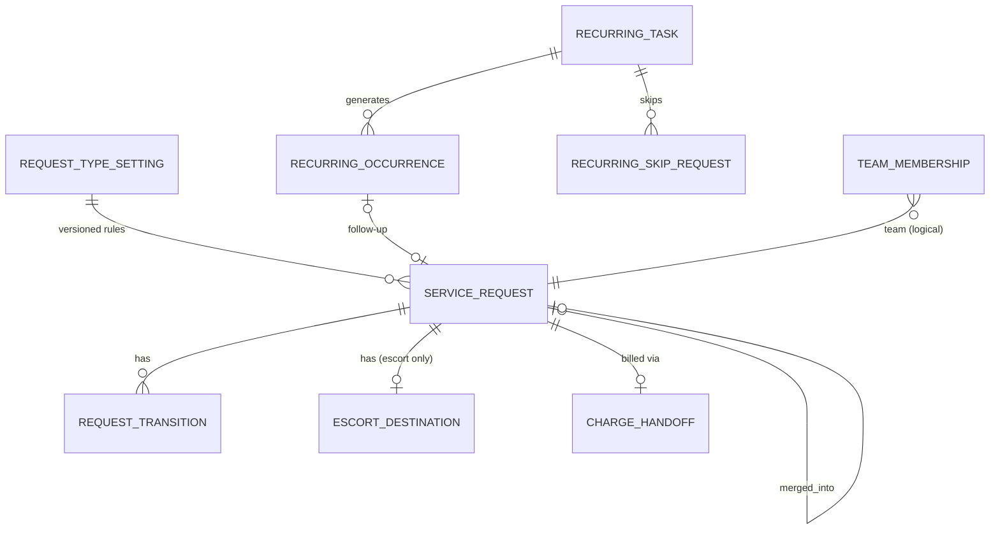

# 기술 설계 — 생활 요청 (life-requests)

상태: 승인(2026-11-04, 사용자 "보류된것 승인해") · 작성: 2026-11-03 · 방법: 스킬을 쓰지 않음(코어 `tech-design.md` 형식을 따름) · 기준: `04-planning/CLAUDE.md` "기술 설계", "코어 + 모듈 구조", 모듈 경계 `CLAUDE.md` "모듈 경계" 1~9번 · 변경: 2026-11-04 전체 리뷰 보완(사용자 재승인 2026-11-04) · 변경: 2026-11-04 쉬운 말·공용 문구 인용 맞춤(사용자 재승인 2026-11-04)
입력: `prd.md`, `service-blueprint.md`, `user-stories.md`(모두 초안), `copy/product-marketing.md`(승인, 용어집), `names.md`(승인, 라벨과 코드), `senior-lab/04-planning/ideas/pms-core-billing/tech-design.md`(승인, 공통 도메인 모델 기준), `senior-lab/04-planning/ideas/senior-ai-assistant/tech-design.md` 2-2·3-2·8절(승인), `senior-lab/04-planning/ideas/family-consent-portal/tech-design.md` 4절·8절(승인), `senior-lab/04-planning/ideas/safety-signal-hub/tech-design.md` 2-2·8절(승인)
> 승인 범위 주의: 코어의 장기 부재(`AbsenceQuery`)와 운영 현황 카드, D의 `LIFE_REQUEST` 허락 항목과 N1 보호자 정책은 각 문서 변경 기록상 **사용자 재승인 2026-11-04**다. 이 문서가 그 부분을 근거로 쓸 때는 [사실: 사용자 재승인 2026-11-04]로 적는다.

> 공통 도메인 모델의 기준은 코어 `tech-design.md` 하나다. 이 문서는 코어 엔티티를 ID로만 참조하고 N1의 확장 엔티티와 이벤트만 정의한다. 코어·B·D·G에 바꿀 것은 직접 고치지 않고 10절과 "확인할 것"에 요청(N1-C·N1-B·N1-D·N1-G·N1-H 번호)으로 적는다.
> 기술 스택은 코어 12절 방향(MVP Next.js, PostgreSQL)을 따르고 새로 정하지 않는다. 표기 규칙은 `strategy.md`와 같다.

## 1. 범위와 경계
```
   Evenstay 홈(회원)      Evenstay 패밀리(보호자, D 허락)      운영(직원·책임자)
          │                        │                                │
          └──────────── app/ 라우트 → requests/web ───────────────────┘
                                   │
   G assistant ──receiveFromAssistant──►  requests (스키마 requests)  ──registerFromRequest──► B safety/api
   (넘김 뒤 호출)                          요청 · 전이 기록 · 정기 작업 · 회차 · 설정 · 아웃박스
                                   │                       │
            core/api: ResidentQuery · SiteQuery · StaffQuery · AbsenceQuery · Authorization · AuditWriter · Clock
                      ServiceFeeQuery · ServiceChargeCommand [N1-C1·C2 요청]        platform: Notifier · 아웃박스
                                   │
                    이벤트 ServiceRequestStatusChanged ──► D(보호자 문자, N1-D3)
   app/ 운영 현황 카드 ──► requests/api ServiceRequestQuery.openCount
```
- N1이 갖는 것: 생활 요청, 전이 기록, 병원 동행 가실 곳(제한 정보), 요청 종류 설정(담당 팀·처리 기한·서비스 코드, 버전), 팀 구성, 정기 작업, 회차, 쉬기 신청, `requests` 아웃박스.
- N1이 갖지 않는 것: 입주자·호실·직원·계약·요금·청구 항목(코어), 장기 부재(코어, 읽기만), 보호자 허락과 보호자 문자(D), 대화와 넘김(G), 안전 신호와 당번(B). 이 데이터의 사본을 두지 않고 매 요청 `api/`로 읽는다(경계 8번).
- import: `core/api`, `safety/api`, `platform`만. `requests/api`는 `core/api`·`platform`만 import한다. G 구현과 D 구현이 `requests/api`를 import한다(경계 2번, 순환 없음).

## 2. 도메인 모델
### 2-1. 용어 (공통 언어)
카피 `product-marketing.md` 용어집을 코드 이름으로 그대로 쓴다. 용어집에 없는 것만 더했다. 아래 "추가" 행의 직원 화면 열은 코드를 설명하는 말이고 화면 라벨이 아니다. 화면에 나와야 하는 것은 copy 10절에 반영됐다(`prd.md` 12절 목록).
| 코드 | 직원 화면 | 회원 화면 | 비고 |
|---|---|---|---|
| ServiceRequest / RequestType / RequestStatus / RequestSource / Assignee / Team / PreferredTime / DueAt / RecurringTask / ResidentConfirmation | 용어집과 같다 | 용어집과 같다 | — |
| RequestTransition | 지나온 일(직원 상세) | 지나온 일 | 추가. 전이 한 번에 한 줄 |
| RecurringOccurrence | 정기 작업 회차 | 정기 청소(그날) | 추가. 상태는 names 4-3 |
| RecurringSkipRequest | 이번 회 쉼(신청) | 이번 주 청소 쉬기 | 추가. 회차가 만들어지기 전의 쉬기 |
| RequestTypeSetting | 요청 종류 설정 | (표시 안 함) | 추가. 사업장별 버전 |
| TeamMembership | 담당 팀 구성 | (표시 안 함) | 추가. 팀 FRONT 프런트, FACILITY 시설, HOUSEKEEPING 청소·세탁, DRIVER 운전, LIFE_SUPPORT 생활 지원 |
| EscortDestination | 가실 곳 | 가실 곳 | 추가. 병원 동행의 제한 정보 |
| ChargeHandoff | 청구 넘김 | (표시 안 함) | 추가. 코어 청구 명령을 부른 기록 |

### 2-2. 엔티티 (핵심 필드)
모든 테이블은 `requests` 스키마이고 `id`(UUID), `operator_id`, `site_id`, `created_at`, `created_by`를 가진다. 코어 엔티티는 ID만 보관하고 외래 키를 두지 않는다(경계 3번). RLS는 코어 ADR-1과 같은 방식으로 `site_id`에 건다.

| 엔티티 | 핵심 필드 | 규칙 |
|---|---|---|
| ServiceRequest 생활 요청 | resident_id, unit_id(접수 때 호실), type(REPAIR, CLEANING, LAUNDRY, TRANSPORT, HOSPITAL_ESCORT, FEEDBACK, OTHER, null = 분류 전), team, status(3-1), source(RESIDENT_APP, GUARDIAN_PORTAL, STAFF_ENTRY, ASSISTANT_HANDOFF), source_ref(G 넘김 ID 또는 정기 회차 ID), confirmation_ref(G 확인 ID), created_by_user_id, created_by_person_id(보호자일 때), heard_via(PHONE, IN_PERSON, 대신 등록일 때), body(자유 글, 병원 동행은 null), details(JSON: entry_permission(ALLOWED_WHEN_ABSENT, ONLY_WHEN_PRESENT), laundry_item(CLOTHES, BEDDING, OTHER), pickup_at, transport_destination(외출 차량 "어디에 가세요?", copy 2-3), return_needed), preferred_at, priority_flag(먼저 처리, 직원만), assignee_user_id, due_at, type_setting_version_id, hold_reason(PARTS, VENDOR, RESIDENT_DATE, RESIDENT_TIME), hold_note(직원만), done_note, done_code(병원 동행의 한 일: ESCORTED_BOTH_WAYS 갈 때·올 때 함께, ESCORTED_ONE_WAY 갈 때만), done_at, reopen_count, decline_reason(OUT_OF_SCOPE, DUPLICATE, RESIDENT_WITHDREW, NOT_OFFERED), merged_into_id, fee_service_code, fee_pricing_version_id(회원에게 안내한 요금표 버전), moved_alert_id(B 알림 ID), closed_at, row_version | type이 null이면 team·due_at도 null이고 시작할 수 없다. **HOSPITAL_ESCORT면 body·done_note·hold_note가 null이고(CHECK), 한 일은 done_code로만 받으며, [아직이에요] 의견(member_note)도 받지 않는다**(ADR-R10). source = ASSISTANT_HANDOFF면 source_ref·confirmation_ref 필수이고 (source, source_ref) 유일(멱등). 금액은 저장하지 않는다. 서비스 코드와 안내한 요금표 버전 ID만 두고, 금액은 화면을 그릴 때 코어에서 읽는다(사본 없음, 경계 8번). 청구 단가도 이 버전으로 정한다(N1-C1·C2) |
| EscortDestination 가실 곳 | request_id(1:1), destination_text, purged_at | 병원 동행만. 별도 테이블이라 열람 권한과 지우기를 따로 건다. 닫힌 뒤 30일에 destination_text를 지우고 purged_at을 남긴다 [가설] |
| RequestTransition 전이 기록 | request_id, action(3-1), from_status, to_status, actor_user_id(SYSTEM이면 null), actor_kind(MEMBER, GUARDIAN, STAFF, SYSTEM), heard_by_user_id·heard_at(직원 대신 확인), reason_code, member_note(아직이에요 의견), assignee_before, assignee_after, occurred_at | 추가만 한다. 회원 "지나온 일"과 직원 상세의 출처 |
| RequestTypeSetting 요청 종류 설정 | site_id, version, valid_from, rows(JSON: [{type, team, due_base(CREATED, PREFERRED, PICKUP, OCCURRENCE_DAY), due_hours, fee: {option → serviceCode}}]) | 바꾸면 새 버전. 요청은 만들 때의 버전 ID를 기록한다 |
| TeamMembership 팀 구성 | user_id(코어 계정 ID), team, valid_from, valid_to | 넣을 때 코어 `StaffQuery.listStaff(siteId, at)`에 그 사람이 SITE_STAFF·SITE_MANAGER로 있어야 한다. 사본이 아니라 N1의 업무 배치다 |
| RecurringTask 정기 작업 | name, type(CLEANING, INSPECTION), target_kind(BUILDING, UNITS, COMMON), target_ids[](동·호실 ID), common_label(공용 시설 이름), rule(JSON: WEEKLY {days[]}, MONTHLY_NTH_WEEKDAY {nth, weekday}, MONTHLY_DAY {day}), team, default_assignee_user_id, starts_on, ends_on, allow_member_skip, skip_cutoff(JSON: {daysBefore: 1, time: "18:00"} [가설]), generated_through(생성한 마지막 날), ended_at, row_version | 바꾸면 다음 회차부터 적용(이미 만든 회차는 그대로) |
| RecurringOccurrence 회차 | task_id, unit_id(공용이면 null), resident_id(그날 사는 입주자, 공용이면 null), date, status(3-2), skip_reason(MEMBER_REQUEST, ABSENCE), missed_reason(NOT_HOME, MEMBER_LATER, STAFF), assignee_user_id, done_at, done_by, follow_up_request_id | (task_id, coalesce(unit_id, 공용), date) 유일 |
| RecurringSkipRequest 쉬기 신청 | task_id, unit_id, resident_id, date, requested_by_user_id, channel(MEMBER_APP, STAFF_ENTRY), cancelled_at | (task_id, unit_id, date) 중 취소되지 않은 것 하나 |
| ChargeHandoff 청구 넘김 | request_id(유일), service_code, occurred_on, status(PENDING, SENT, FAILED), attempts, core_service_usage_id, target_period, last_error | 아웃박스 처리 결과를 직원 화면에 보이기 위한 행 |
| OutboxEvent 아웃박스 | 코어 2-2 OutboxEvent와 같은 열 | `requests` 스키마에 두고 `platform` 구현을 쓴다(코어 HUB-C7) |

### 2-3. ERD 초안

코어 ID(resident_id, unit_id, site_id, user_id, person_id), B ID(moved_alert_id), G ID(source_ref·confirmation_ref), 코어 사용 기록 ID(core_service_usage_id)는 값으로만 보관한다.

## 3. 상태 전이
### 3-1. 생활 요청 (ServiceRequest)
라벨은 카피 `names.md` 3절. 새 상태 두 개(MOVED_TO_SAFETY, PENDING_MEMBER_OK)의 직원 라벨은 반영됨(copy 10-1)다.
```
(create) ──► RECEIVED ──(start)──► IN_PROGRESS ──(complete)──► DONE ──(confirm)──► CONFIRMED
(create, 보호자 + 비용) ──► PENDING_MEMBER_OK ──(member_accept)──► RECEIVED
                                               ├──(member_decline | cancel: 회원·직원)──► CANCELLED
                                               └──(expire: 7일 [가설], SYSTEM)──► CANCELLED
RECEIVED · IN_PROGRESS ──(hold)──► ON_HOLD ──(resume)──► IN_PROGRESS
DONE ──(not_yet)──► IN_PROGRESS (reopen_count + 1, "다시 열림")
DONE ──(auto_close: done_at + 7일)──► AUTO_CLOSED
RECEIVED · IN_PROGRESS · ON_HOLD ──(decline | merge)──► DECLINED
RECEIVED · IN_PROGRESS · ON_HOLD ──(move_to_safety)──► MOVED_TO_SAFETY
RECEIVED ──(cancel: 회원·직원)──► CANCELLED      IN_PROGRESS · ON_HOLD ──(cancel: 직원만)──► CANCELLED
```
| 동작 | 허용 상태 | 조건 | 부수 효과 |
|---|---|---|---|
| create | — | 회원 본인, 대신 등록, D 허락 보호자, G 넘김. 보호자 + 비용 있는 종류면 PENDING_MEMBER_OK | type이 있으면 team·due_at 계산. 회원 화면 문구는 copy 2-5 |
| classify | RECEIVED(type null) | 프런트 팀·책임자 | type·team·due_at 확정 |
| claim / assign / reassign | RECEIVED, IN_PROGRESS, ON_HOLD | claim은 그 팀 직원, assign은 프런트 팀·책임자. 담당이 이미 있으면 claim은 409 | assignee 기록, 이벤트(ASSIGNED) |
| start | RECEIVED | type 있음. 담당 본인, 책임자, 또는 담당이 없을 때 그 팀 직원(맡으며 시작: claim + start를 한 트랜잭션) | IN_PROGRESS |
| hold / resume | 표대로 | hold_reason 필수 | hold_note는 직원만(병원 동행은 받지 않음) |
| complete | IN_PROGRESS | done_note 필수(병원 동행은 done_code 필수) | done_at = now, 문자(P1) |
| confirm | DONE | 회원 본인, 또는 직원 대신 기록(heard_by·heard_at 필수) | CONFIRMED, closed_at, 비용이 있으면 청구 넘김 아웃박스(3-3) |
| not_yet | DONE | 회원 본인 또는 직원 대신 기록 | IN_PROGRESS, reopen_count + 1, member_note, due_at 다시 계산 [가설] |
| auto_close | DONE | done_at + 7일 ≤ now. SYSTEM | AUTO_CLOSED, closed_at, 비용이 있으면 청구 넘김 |
| decline / merge | RECEIVED, IN_PROGRESS, ON_HOLD | decline_reason 4개 중 하나. merge는 같은 입주자의 열린 요청 중 **이 요청보다 먼저 들어온 것**(copy 4-5 "먼저 들어온 요청에 이어 붙입니다"), decline_reason = DUPLICATE | DECLINED, merged_into_id |
| move_to_safety | RECEIVED, IN_PROGRESS, ON_HOLD | 사업장 직원. B 명령 성공 뒤에만 | MOVED_TO_SAFETY, moved_alert_id. B 실패 시 상태 그대로 |
| cancel | 위 그림 | 회원은 RECEIVED·PENDING_MEMBER_OK만, 직원은 프런트 팀 또는 담당. 이유 코드는 받지 않는다(누가 취소했는지만, names 3절 "취소 · 누가") | CANCELLED, actor_kind |
| member_accept / member_decline | PENDING_MEMBER_OK | 회원 본인 또는 직원 대신 기록 | RECEIVED 또는 CANCELLED |
| expire | PENDING_MEMBER_OK | 만든 뒤 7일 [가설]. SYSTEM. 다음 날 09:00부터는 프런트 목록에 보인다(US-20) | CANCELLED. 회원·보호자 문장 반영됨(copy 10-1) |
- 보호자는 자기가 올린 요청을 취소하지 않는다. 회원이 보호자 요청을 취소하는 길은 있다(copy 2-10 "원하지 않으시면 [요청 취소하기]를 누르세요.").
- 닫힌 상태: CONFIRMED, AUTO_CLOSED, CANCELLED, DECLINED, MOVED_TO_SAFETY. 닫힌 요청은 어떤 동작도 받지 않는다(409). "다시 봐 주세요"가 필요하면 새 요청이다.
- 모든 전이는 같은 트랜잭션에서 RequestTransition 1줄 + 코어 `AuditWriter` WRITE 1줄 + (필요하면) 아웃박스 행을 쓴다. 동시 수정은 `row_version`(낙관적 잠금)으로 막는다.

### 3-2. 정기 회차 (RecurringOccurrence)
라벨은 `names.md` 4-3.
```
(생성) ──► SCHEDULED ──(start)──► IN_PROGRESS ──(complete)──► DONE
(생성: 쉬기 신청 있음) ──► SKIPPED(MEMBER_REQUEST)      (생성: 그날 장기 부재) ──► SKIPPED(ABSENCE)
SCHEDULED ──(skip_by_staff: 마감 뒤 프런트 대신)──► SKIPPED(MEMBER_REQUEST)
SCHEDULED · IN_PROGRESS ──(miss: 이유 3개)──► MISSED
DONE ──(follow_up: 회원 [다시 봐 주세요])──► DONE (+ 새 ServiceRequest CLEANING, follow_up_request_id)
```
- 회원 확인은 받지 않는다 [사실: decisions 70행 ④]. follow_up은 그 회차에 열린 후속 요청이 있으면 새로 만들지 않는다.
- 후속 요청은 source = RESIDENT_APP(직원 대신이면 STAFF_ENTRY, 8-1 `/staff/occurrences/{id}/follow-up`), source_ref = 회차 ID, 담당 = 회차 담당이다.
- 못 함 이유 MEMBER_LATER의 직원 라벨은 names 4-3 "회원이 다음에 해 달라고 함"이 직원 화면의 "회원" 금지에 걸린다. 직원 라벨 반영됨(copy 10-4), 회원 화면 문장은 names 그대로.

### 3-3. 청구 넘김 (ChargeHandoff)
```
(confirm·auto_close, fee_service_code 있음) ──► PENDING ──(코어 record 성공)──► SENT
PENDING ──(실패, attempts < 5)──► PENDING(available_at 뒤로) ──(5회 실패 [가설])──► FAILED ──([다시 보내기])──► PENDING
```
- 요청 종료(CONFIRMED·AUTO_CLOSED)와 청구 넘김은 다른 트랜잭션이다. 코어가 실패해도 요청 종료를 되돌리지 않는다(copy 7절 "요청은 입주자 확인으로 닫혔습니다").
- 멱등 키는 요청 ID다. 코어가 (sourceModule, sourceId)로 한 건만 만든다(N1-C1).

### 3-4. 그 밖
- 쉬기 신청: 마감 전에는 회원이 취소(되돌리기)할 수 있다. 마감 뒤에는 프런트가 회차에서 skip_by_staff로 처리한다.
- 정기 작업: 끝내기(ended_at) 뒤에는 회차를 더 만들지 않는다. 이미 만든 회차는 그대로다(copy 5-1).
- 가실 곳: 요청이 닫히고 30일 뒤 지우기 작업이 destination_text를 지운다 [가설].

## 4. 계산
**처리 기한(due_at)**: type이 정해질 때 그 시점의 RequestTypeSetting 행으로 계산한다. CREATED → 접수 시각 + due_hours, PREFERRED → preferred_at + due_hours(0이면 원하는 시각 자체), PICKUP → details.pickup_at + due_hours, OCCURRENCE_DAY → 회차 날 23:59. not_yet이면 그 시각을 기준으로 다시 계산한다 [가설]. ON_HOLD 동안 멈추지 않는다 [가설].

**기한 지남**: `due_at < at` 그리고 status ∈ {RECEIVED, IN_PROGRESS, ON_HOLD}. 저장하지 않고 조회 때 계산한다. 회원·보호자 응답에는 넣지 않는다.

**확인 없이 닫힘**: 작업(AutoCloser)이 `status = DONE and done_at + interval '7 days' ≤ Clock.now()`인 요청을 auto_close한다. 데모 시계를 옮긴 직후와 정해진 주기(5분 [가설])에 돈다. 같은 요청은 상태 검사로 한 번만 닫힌다.

**회차 생성(OccurrenceGenerator)**: 정기 작업마다 `d`를 `generated_through + 1`부터 `Clock.today()`까지(시작일·끝나는 날 안) 돌며 rule에 맞는 날만:
```
for unit in 대상 호실(BUILDING이면 코어 SiteQuery.listUnits에서 그 동의 호실):
  residents = ResidentQuery.residentsInUnit(unit, d)        # 없으면 빈 호실 → 만들지 않음
  r = residents의 첫 사람(2인 호실은 호실 하나에 회차 하나)
  if 취소 안 된 RecurringSkipRequest(task, unit, d) → SKIPPED(MEMBER_REQUEST)
  elif residents 모두 AbsenceQuery.absenceOf(그 사람, d) ≠ null → SKIPPED(ABSENCE)
  else → SCHEDULED, assignee = default_assignee
공용 시설(COMMON) → 입주자 없이 SCHEDULED 하나
generated_through = d
```
- 유일 제약으로 다시 돌아도 회차가 늘지 않는다. 2인 호실은 둘 다 부재일 때만 쉼이다 [가설].
- 코어 장기 부재 이벤트는 구독하지 않는다. 생성 때 읽는다(B ADR-S7과 같은 방식). 생성 뒤에 부재가 시작되면 담당이 miss 또는 skip_by_staff로 고친다.

**이번 주 쉬기 대상 날짜**: 지금 이후의 회차 날짜 중 마감(날짜 − daysBefore일의 time)이 지나지 않은 가장 이른 날. 데모: 11/17(화) 16:30 → 11/20(금), 마감 11/19 18:00.

**운영 현황 숫자**(`openCount`): open = RECEIVED + IN_PROGRESS + ON_HOLD + DONE, unassigned = RECEIVED 중 담당 없음, awaitingConfirmation = DONE, overdue = 위 기한 지남, recurringToday = `at`의 날짜 회차 수와 상태별 수. PENDING_MEMBER_OK는 open에 넣지 않는다.

## 5. 설계 결정 기록 (ADR)
### ADR-R1. 요청 하나는 상태 값 + 추가만 하는 전이 기록
- **맥락**: 면접관용 핵심은 상태 기계다. 회원 "지나온 일"과 감사가 같은 사실을 보여야 한다.
- **선택지**: (A) 상태 값만 + 코어 AuditLog / (B) 상태 값 + N1 전이 기록 / (C) 이벤트 소싱.
- **결정**: **B.** 현재 상태는 행에 두고, 전이마다 RequestTransition을 추가만 한다. 회원 지나온 일은 이 표에서 만든다. 코어 AuditLog에도 WRITE를 남긴다(감사의 기준은 코어 하나, 경계 6번).
- **결과**: 화면용 이력이 코어 AuditLog의 가린 값에 기대지 않는다. 대가는 같은 사실이 두 곳에 있다는 것이고, 테스트로 "전이 1번 = 전이 기록 1줄 = 감사 1줄"을 검사한다.

### ADR-R2. 정기 회차는 요청과 다른 엔티티
- **맥락**: 회차는 회원 확인이 없고 상태가 다르다(예정, 쉼, 못 함). 직원 목록에는 함께 보여야 한다.
- **선택지**: (A) 회차도 ServiceRequest(source RECURRING) / (B) 별도 RecurringOccurrence.
- **결정**: **B.** 상태 기계를 섞지 않는다. 직원 목록 "오늘 정기 작업"과 "전체"는 두 표를 합쳐 보인다. [다시 봐 주세요]는 회차에 연결된 새 ServiceRequest다. 그래서 카피 names 4-1의 들어온 곳 RECURRING("정기 작업")은 요청의 source 값이 아니라 회차 카드의 표시로 쓴다.
- **결과**: 요청 전이표가 작다. 대가는 목록 조회가 두 표를 합친다는 것이다.

### ADR-R3. 입주자 확인으로 닫고, 7일이면 확인 없이 닫는다
- **결정**: 직원의 complete는 DONE(확인 기다림)이다. 회원 confirm 또는 직원 대신 기록이 CONFIRMED를 만들고, 7일 [사실: decisions 70행 ③] 뒤 SYSTEM이 AUTO_CLOSED로 닫는다. not_yet은 새 요청이 아니라 같은 요청을 IN_PROGRESS로 되돌리고 reopen_count를 올린다.
- **결과**: "끝났다"를 직원 혼자 정하지 않는다. 대가는 시계 작업 하나(AutoCloser)다.

### ADR-R4. 유료 요청은 확인 때 코어 명령으로 넘기고, N1은 금액을 정하지 않는다
- **맥락**: 코어 청구 원장은 청구 생성 실행만 DRAFT 청구서에 항목을 만들고, 발행 뒤에는 추가만 한다(코어 ADR-4). 코어는 어떤 모듈도 모른다(코어 ADR-2·3).
- **선택지**: (A) N1이 코어 Charge 테이블에 직접 씀(경계 위반) / (B) 코어 청구 생성이 N1을 조회(코어가 모듈을 알게 됨) / (C) N1이 `core/api` 명령으로 "사용 기록"을 넘기고 코어가 다음 청구 생성 때 항목으로 만든다.
- **결정**: **C** [N1-C1·C2 요청]. N1은 CONFIRMED·AUTO_CLOSED 때 아웃박스로 `ServiceChargeCommand.record`를 부른다. 단가, 넣을 청구 기간, 청구 항목 근거(`plain`)는 코어가 정한다.
- **결과**: 원장 규칙과 멱등이 코어에 그대로 있다. 대가는 코어 변경 요청이고, 그 전까지 F13은 꺼 둔다.

### ADR-R5. 홈 비서 넘김은 일부만 받고, G가 N1 명령을 부른다
- **맥락**: G 넘김 이유는 건강 판단, 금전 판단, 계약 판단, 도구 밖 질문, 직접 요청이고 주제는 청구서·계약·그 밖의 일이다 [사실: G `tech-design.md` 2-1]. 카피 4-10은 어디까지 받을지를 기획에 남겼다.
- **선택지**: (A) 모든 넘김을 N1으로 / (B) 직접 요청(주제가 청구서·계약이 아닌 것)과 도구 밖 질문만 N1으로, 나머지는 G 화면 / (C) G 직원이 하나씩 N1으로 보냄.
- **결정**: **B** [가설]. 건강·금전·계약 판단은 G 화면에 이유별 안내가 있고, 금전 판단은 D 금전 부탁과 이어질 자리(Next, D `MoneyRequestCommand`)가 G에 잡혀 있다. 생활 요청 목록에 건강 판단이 섞이지 않는다. G 라우터는 시설 요청(FACILITY_REQUEST)을 이유 OUT_OF_SCOPE로 넘기므로 [사실: G `tech-design.md` 4-2], 데모의 "목요일에 시장 가야 하는데 차 있어요?"(R19로 "은행"에서 바꿈)는 카드에 "넘긴 이유: 도구 밖 질문"(G `names.md` 넘긴 이유 값)으로 보인다. copy 4-2 카드의 "넘긴 이유: 직접 요청"은 예시 값이다. "은행"은 G가 금전 판단으로 넘길 수 있어 예문에서 뺐다(확인할 것 11). 길: G가 넘김을 저장한 뒤 `requests/api` `ServiceRequestCommand.receiveFromAssistant`를 부르고(넘김 ID로 멱등), 성공하면 넘김의 external_ref에 요청 ID를 남긴다 [N1-G1 요청]. G에는 아웃박스가 없어(G 8-3) 이벤트 대신 명령이다. 호출이 실패하면 넘김은 G 화면에 NEW로 남는다.
- **결과**: 비서는 종류를 고르지 않는다. 요청은 "분류 전"으로 오고 프런트가 정한다(카피 `value-prop.md` "AI가 알아서 분류" 쓰지 않음).

### ADR-R6. 보호자 행동은 "D 동의로 연다"고 선언한다
- **맥락**: 보호자 허락은 D 소관이다. 코어 ADR-2 5번은 다른 모듈이 자기 `api/`에 "D 동의로 연다"고 선언한 행동에 한해 D가 허용 정책을 등록하게 한다.
- **결정**: `requests/api`에 `requests.request.view_as_guardian`, `requests.request.create_as_guardian`을 D 동의 행동으로 선언한다. 이름과 resource 필드(`kind`)는 D가 이미 정책에 넣어 둔 것을 그대로 쓴다 [사실: D `tech-design.md` 4절, 사용자 재승인 2026-11-04]. D가 "생활 요청" 허락 항목 `LIFE_REQUEST`로 ALLOW를 준다. resource.kind = HOSPITAL_ESCORT면 보기는 건강 소식 허락과 건강정보 별도 동의까지 확인하고, 올리기는 D가 ABSTAIN한다(보호자는 병원 동행을 올리지 않음). 보호자 문자는 N1이 보내지 않고 D가 N1 이벤트를 받아 보낸다(N1-D3).
- **결과**: N1은 `family/api`를 import하지 않는다. 대가는 D 변경이 있어야 F15가 켜진다는 것이다.

### ADR-R7. 안심 알림으로 옮기기는 B 명령을 동기로 부른다
- **맥락**: 옮기는 순간 당번에게 즉시 확인 알림이 가야 한다(copy 4-9). B의 전화로 받은 호출(F17, FRONT_CALL)이 같은 일을 한다.
- **선택지**: (A) N1 이벤트를 B가 구독 / (B) N1이 `safety/api` 명령을 부르고 성공하면 요청을 닫음.
- **결정**: **B** [N1-B1 요청]. 이벤트는 지연과 실패를 직원이 보지 못한다. B에는 사업장, 호실, 입주자, 출처(생활 요청), 요청 ID만 넘기고 요청 글은 넘기지 않는다 [가설].
- **결과**: 옮긴 뒤 처리 기록은 B에만 있다. 생활 요청에는 B 알림 ID만 남는다.

### ADR-R8. 담당 팀은 N1 설정, 직원은 코어에서 읽는다
- **맥락**: 코어 StaffDuty는 FRONT·LIFE_SUPPORT·CARE 셋이고 D·C 권한에 쓰인다 [사실: 코어 2-1]. 시설·청소·운전은 없다.
- **결정**: 팀(FRONT, FACILITY, HOUSEKEEPING, DRIVER, LIFE_SUPPORT)은 N1의 TeamMembership으로 둔다. 코어 직무를 늘리지 않는다. 직원 이름과 역할은 매번 `StaffQuery.listStaff`로 읽는다.
- **결과**: 코어 변경 없이 팀을 바꾼다. 대가는 프런트 직무(코어)와 프런트 팀(N1)을 따로 맞춰야 한다는 것이다(시드에서 같게 둔다).

### ADR-R9. 처리 기한은 직원 전용 사업장 설정이고 버전으로 둔다
- **결정**: RequestTypeSetting을 사업장별 버전으로 두고 요청에 버전 ID를 남긴다. due_at은 요청 행에 저장하되 회원·보호자 DTO에 필드 자체가 없다(KR3 테스트).
- **결과**: 기한 값을 바꿔도 지난 요청의 기한 근거가 남는다. 값은 [미정]이라 시드는 자리값이다.

### ADR-R10. 병원 동행은 입력 칸으로 건강 정보를 막는다
- **결정**: HOSPITAL_ESCORT는 body·done_note·hold_note가 null(CHECK)이고 [아직이에요] 의견도 받지 않는다. 한 일은 done_code(갈 때·올 때 함께, 갈 때만)로 고른다. 그래서 자유 입력은 EscortDestination 한 칸뿐이다. 그 칸은 별도 테이블·별도 권한·SENSITIVE_READ·30일 뒤 지우기 [가설]. 이벤트, 문자, 직원 알림, 감사 전후 값에 넣지 않는다. 병원 동행의 한 일 선택지와 [아직이에요] 뒤 문장은 반영됨(copy 10-7).
- 외출 차량의 가실 곳(details.transport_destination)은 일반 개인정보로 범위 안 직원이 본다. 회원이 여기에 병원 이름을 적을 수 있으므로 화면 안내로 "병원은 병원 동행으로"를 보이는 방안을 카피에 묻는다 반영됨(copy 10-7). 시스템이 글을 읽어 막지는 않는다.
- **결과**: "건강 정보를 받지 않는다"를 화면이 아니라 스키마가 지킨다.

## 6. 역할과 권한
### 6-1. 원칙
- N1은 앱 시작 때 `registerPolicy(requestsPolicy)`로 `requests.*` 행동의 허용 정책만 등록한다. 코어 1단계(범위 밖) 거부를 뒤집지 못한다(경계 5번).
- 모든 `requests/api` 메서드와 REST 핸들러는 actor를 받아 안에서 `authorize()`를 부른다. 부른 모듈을 믿고 건너뛰지 않는다(B 8-2와 같은 규칙).
- 보호자 두 행동(`requests.request.view_as_guardian`·`create_as_guardian`)은 D 정책이 연다(ADR-R6). N1 정책은 보호자에게 ALLOW를 주지 않는다.

### 6-2. 역할 × 행동
● 가능 · ◐ 조건부 · — 불가. "팀"은 TeamMembership, "담당"은 assignee.
| 행동 코드 | 회원 | 보호자 | 사업장 직원 | 사업장 책임자 | 본사 운영 매니저 | 본사 관리자 |
|---|---|---|---|---|---|---|
| `requests.request.create` | ◐(본인) | — (아래 guardian) | ●(대신 등록, 본인 아님) | ● | — | — |
| `requests.request.create_from_assistant` | ◐(본인, 확인 ID 필수) | — | — | — | — | — |
| `requests.request.view_as_guardian`·`create_as_guardian` | — | (D 정책) | — | — | — | — |
| `requests.request.view` | ◐(본인 것) | — | ●(의견·불편은 프런트 팀만) | ● | ● | ● |
| `requests.escort_destination.view` | ◐(본인 것) | — | ◐(생활 지원·운전 팀) | ● | — | — |
| `requests.request.classify`·`assign` | — | — | ◐(프런트 팀) | ● | — | — |
| `requests.request.claim` | — | — | ◐(그 종류의 팀) | ● | — | — |
| `requests.request.process`(start, hold, resume, complete, decline, merge) | — | — | ◐(담당) | ● | — | — |
| `requests.request.confirm`(confirm, not_yet, member_accept·decline) | ◐(본인) | — | ●(대신 기록, heard 필수) | ● | — | — |
| `requests.request.cancel` | ◐(본인, RECEIVED·PENDING_MEMBER_OK) | — | ◐(프런트 팀 또는 담당) | ● | — | — |
| `requests.request.move_to_safety` | — | — | ● | ● | — | — |
| `requests.request.flag`(먼저 처리) | — | — | ● | ● | — | — |
| `requests.recurring.manage` | — | — | — | ● | ● | — |
| `requests.recurring.skip`(신청·되돌리기) | ◐(본인, 마감 전) | — | ◐(프런트 팀, 대신) | ● | — | — |
| `requests.occurrence.process` | — | — | ◐(그 작업의 팀) | ● | — | — |
| `requests.settings.manage`(종류 설정, 팀 구성) | — | — | — | ● | — | ● |
| `requests.charge.retry` | — | — | ◐(프런트 팀) | ● | — | — |
| `requests.summary.read`(openCount) | — | — | — | ● | ● | ● |
| `requests.summary.owner_read`(monthlySummary) | — | — | — | — | ● | ● |
- 소유주(OWNER_VIEWER)는 `requests.summary.owner_read` 하나만 ALLOW다. 범위는 코어 1단계가 기준일 소유 사업장으로 거른다(사용자 결정 H5 2026-11-04).
- 대리인은 MVP에서 행동이 없다(`prd.md` 10절). 코어 대리 범위 대응표에 `requests.*`를 더하지 않는다.
- SITE_MANAGER의 ●는 코어 6-2 SITE_MANAGER 규칙처럼 자기 사업장 안에서만이다.

### 6-3. 감사
- 모든 쓰기: 코어 `AuditWriter` WRITE(action = 행동 코드, entity = ServiceRequest·RecurringOccurrence 등). 직원 대신 기록은 heard_by를 after에 남긴다.
- SYSTEM 작업(auto_close, 회차 생성, 가실 곳 지우기, 청구 넘김): actor_user_id = null, actor_role = SYSTEM, action = `requests.auto_close`·`requests.occurrence.generate`·`requests.escort.purge`·`requests.charge.handoff`, request_id = 실행 ID(코어 2-2 배치 규칙).
- SENSITIVE_READ: 병원 동행 가실 곳을 열 때마다. 의견·불편 상세는 READ 기록 없이 범위로만 막는다 [가설].
- 보호자 열람: N1 화면이 READ를 남긴다. D 회원 "본 기록"(AccessLog)에도 넣을지는 N1-D4.
- 감사 전후 값에서 body·member_note·destination_text는 가린다(코어 7절 "before/after 안의 개인정보는 가린다").

## 7. 민감정보 처리
| 등급 | 데이터 | 누가 보나 | 처리 |
|---|---|---|---|
| 저장 안 함 | 진료 과목, 증상, 진료 내용, 병명 | — | 입력 칸 없음(ADR-R10) |
| 제한 | 병원 동행 가실 곳 | 본인, 생활 지원·운전 팀, 책임자 | 별도 테이블, SENSITIVE_READ, 30일 뒤 지움 [가설], 이벤트·문자·알림·감사 전후 값 제외 |
| 개인정보 | 요청 글(body), 외출 차량 가실 곳, 입주자 의견(member_note), 한 일(done_note), 의견·불편의 다른 입주자 이름 | 본인, 범위 안 직원(의견·불편은 프런트 팀·책임자), 허락 보호자(종류 넷의 body·done_note만) | 애플리케이션 로그에는 ID만. 이벤트 payload에 넣지 않음 |
| 직원 전용 | 처리 기한, 기한 지남, 담당 팀, hold_note, 먼저 처리, 담당 바꾼 이유 | 범위 안 직원 | 회원·보호자 DTO에 필드 없음(KR3) |
| 일반 | 정기 작업 일정, 종류 설정 | 범위 안 계정 | — |
- 자유 글의 숫자 가림은 하지 않는다 [가설]. G에서 온 글은 G가 이미 가렸다(G ADR-G9). 대안은 G와 같은 규칙을 N1 자유 글에도 쓰는 것(확인할 것 7).
- 보존 기간: 요청 기록 전체는 [미정](코어 7절과 함께 법무 확인).

## 8. API
### 8-1. 외부 REST (화면용)
모든 쓰기는 `Idempotency-Key`를 받는다. 409는 허용되지 않은 전이와 행 버전 충돌, 403은 권한, 422는 입력(필수 값, 병원 동행 body 등). 오류 본문에 copy 7절 순서의 메시지 코드를 넣는다.
| 메서드·경로 | 설명 | 권한 | 비고 |
|---|---|---|---|
| GET `/me/requests?status=open\|closed`, GET `/me/requests/{id}` | 내 요청 목록·상세(지나온 일 포함) | 회원 본인 | 기한·팀·직원 메모 없음 |
| POST `/me/requests` | 요청 올리기 | `requests.request.create` | 병원 동행은 F14 켜짐에서만 |
| POST `/me/requests/{id}/confirm`, `/not-yet` `{note?}`, `/cancel`, `/accept`, `/decline` | 확인, 아직이에요, 취소, 보호자 비용 요청에 답 | `requests.request.confirm`·`cancel` | |
| GET `/me/recurring`, POST `/me/recurring/{taskId}/skips`, DELETE `/me/recurring/skips/{id}` | 정기 청소 보기, 쉬기, 되돌리기 | `requests.recurring.skip` | 마감 뒤 409 + copy 7절 |
| POST `/me/recurring/occurrences/{id}/follow-up` | 다시 봐 주세요 | `requests.request.create` | 열린 후속 요청이 있으면 그것을 돌려줌 |
| GET `/family/residents/{id}/requests`, GET `…/requests/{rid}` | 보호자 목록·상세 | `requests.request.view_as_guardian`(D) | 종류 넷 + 병원 동행 조건, 가실 곳 없음 |
| POST `/family/residents/{id}/requests` | 보호자 대신 올리기 | `requests.request.create_as_guardian`(D) | 종류 넷만 |
| GET `/staff/sites/{id}/requests?view=mine\|unassigned\|overdue\|recurring_today\|all&team&type` | 직원 목록(회차 합침) | `requests.request.view` | 요약 숫자 포함 |
| GET `/staff/requests/{id}`, GET `/staff/requests/{id}/escort-destination` | 상세, 가실 곳 | `view`, `escort_destination.view` | 가실 곳은 SENSITIVE_READ |
| POST `/staff/sites/{id}/requests` | 대신 등록 | `requests.request.create` | heard_via 필수 |
| POST `/staff/requests/{id}/{classify\|claim\|assign\|start\|hold\|resume\|complete\|decline\|merge\|cancel\|flag}` | 직원 전이 | 6-2 표 | |
| POST `/staff/requests/{id}/proxy-confirm` `{result: CONFIRMED\|NOT_YET\|ACCEPT\|DECLINE, heardAt}` | 입주자 대신 기록 | `requests.request.confirm` | |
| POST `/staff/requests/{id}/move-to-safety` | 안심 알림으로 옮기기 | `move_to_safety` | B 실패 시 502 + 상태 그대로 |
| POST `/staff/requests/{id}/charge/retry` | 청구 넘김 다시 | `requests.charge.retry` | 같은 멱등 키 |
| GET·POST `/staff/sites/{id}/recurring-tasks`, PATCH `/recurring-tasks/{id}`, POST `/recurring-tasks/{id}/end` | 정기 작업 | `requests.recurring.manage` | |
| POST `/staff/occurrences/{id}/{start\|complete\|miss\|skip\|follow-up}` | 회차 처리, 대신 쉬기, 대신 [다시 봐 주세요] | `occurrence.process`, `recurring.skip`, `request.create` | follow-up은 source = STAFF_ENTRY |
| GET·PUT `/staff/sites/{id}/request-settings`, GET·PUT `/staff/sites/{id}/teams` | 종류 설정, 팀 구성 | `requests.settings.manage` | 새 버전 |
| (데모) `/demo/reset {state}`의 requests 단계 | `requests/seed` `reset(state)` | 데모 환경만 | `app/`이 transitions 다음에 부른다 [N1-H1] |

### 8-2. 내부 모듈 API (`requests/api`)
| 인터페이스 | 메서드 | 쓰는 곳 | 규칙 |
|---|---|---|---|
| `ServiceRequestCommand` | `receiveFromAssistant({residentId, handoffId, confirmationId, memberMessage, reason, topic, actor}) → {requestId}` | G | actor = 회원 본인(G 세션). handoffId·confirmationId 비면 거부 + DENIED. (ASSISTANT_HANDOFF, handoffId) 유일: 같은 ID면 처음 요청을 돌려준다. reason·topic이 ADR-R5 범위 밖이면 거부(422). type은 null로 만든다 |
| `ServiceRequestQuery` | `openCount(siteId, at, actor) → {asOf, open, unassigned, awaitingConfirmation, overdue, recurringToday: {total, scheduled, inProgress, done, skipped, missed}}` | `app/`(운영 현황 카드) | **이름 확정**(코어 10절 [가설]을 이 이름으로). `requests.summary.read`를 CHECK로 검사한다(숫자만인 카드는 열람 기록을 남기지 않는다는 코어 10절 규칙. 거부면 DENY를 돌려주고 감사 줄은 코어가 DENIED로만 남긴다). 숫자만, 이름 없음. 저장하지 않고 매번 계산 |
| 선언(D 동의 행동) | `GUARDIAN_CONSENT_ACTIONS = ['requests.request.view_as_guardian', 'requests.request.create_as_guardian']`, resource 형태 `{siteId, residentId, kind?}`(kind = 요청 종류) | D(정책 등록) | 코어 ADR-2 5번의 선언 |
| | `monthlySummary(siteId, period, actor) → {period, created, closed, confirmed, autoClosed, openAtEnd, byType: [{type, created, closed}], recurring: {total, done, skipped, missed}}` | 코어(소유주 월 리포트 CORE-14) | **이름 확정**(H5 2026-11-04). `requests.summary.owner_read`를 CHECK로 검사(숫자 카드는 열람 기록 없음, 코어 10절과 같음). 이름·호실·글 없음. byType은 수리·청소·세탁·외출 차량·의견·불편·그 밖의 일만 나누고 병원 동행은 합계에만 센다 [가설: 사업장 단위라도 병원 동행 건수를 따로 보이지 않음]. period는 YYYY-MM이고 매번 계산한다 |
| | `doneIn(residentId, from, to, actor) → [{requestId, type, closedAt, closedAs(CONFIRMED, AUTO_CLOSED)}]` | D(생활 소식 재료, N1-D6) | **이름 확정**(2026-11-04, D [가설] 요청을 받음). 기간 안에 닫힌 요청 중 보호자에게 보이는 종류 넷(수리, 청소, 세탁, 외출 차량)만, 글·담당·가실 곳 없이. actor는 리포트를 만드는 직원이고 `requests.request.view`를 CHECK로 검사한다. 보호자에게 보일지는 D가 LIFE_REPORT 허락으로 정한다 [가설] |
| 이벤트 타입 | 8-3 | D | |

### 8-3. 도메인 이벤트
payload는 ID와 코드만 담는다. 요청 글, 이름, 가실 곳, 메모를 넣지 않는다. 모든 이벤트에 `event_id`, `occurred_at`, `schema_version`, `site_id`.
| 이벤트 | payload | 구독 |
|---|---|---|
| ServiceRequestStatusChanged | requestId, residentId, change(CREATED, ASSIGNED, STARTED, ON_HOLD, DONE, REOPENED, CONFIRMED, AUTO_CLOSED, CANCELLED, DECLINED, MOVED_TO_SAFETY), requestType(null 가능), source, createdByPersonId(source = GUARDIAN_PORTAL일 때만) | D(P1): 보호자가 올린 요청의 ASSIGNED·DONE에서 그 보호자에게 새 소식 문자(N1-D3) |
- 내부 아웃박스 처리(이벤트가 아닌 작업 행): 청구 넘김(3-3), 회원 문자·직원 알림(`Notifier.send`, sendAfter로 이동 전날 문자).

## 9. 외부 연동 경계
| 연동 | MVP | 어댑터 | 멱등·실패 처리 |
|---|---|---|---|
| 문자·직원 알림 | 화면 로그(코어와 같음) | `platform` `Notifier.send(template, recipientRef, vars, sendAfter?)` | 아웃박스, 재시도 후 실패 표시(코어 9절과 같은 방식) |
| 음성 인식 | 브라우저 기능 [미정] | (화면 쪽) 글자만 서버로 | 실패하면 버튼을 숨기고 글 입력 |
| 사진 | 없음(Next) | 코어 `DocumentStore`(자리만) | — |
| 바깥 업체 | 없음 | 기다림 이유 "바깥 업체"로만 | — |

## 10. 다른 모듈과의 경계
### 10-1. 코어에 기대는 것과 요청
**지금 있는 것으로 쓰는 것**: `ResidentQuery.getResident`·`listResidents`·`residentsInUnit`, `SiteQuery.listUnits`, `StaffQuery.listStaff`, `AbsenceQuery.absenceOf`(회차 생성 때 읽기, 이벤트 구독 없음), `Authorization`(`requests.*` 정책 등록), `AuditWriter`, `Clock`, 아웃박스 구현(`platform`), `Notifier`.

**코어에 요청 (N1-C)**
| 번호 | 요청 | 이유 | 없을 때 |
|---|---|---|---|
| N1-C1 **반영됨(코어 확정 2026-11-04, 사용자 재승인 2026-11-04)** | `ServiceChargeCommand.record({siteId, residentId, sourceModule: 'REQUESTS', sourceId, sourceType: 'ServiceRequest', sourceLabel(직원 화면 청구 항목 이름, 예: "세탁 대행", copy 4-6), serviceCode, pricingVersionId(회원에게 안내한 버전), quantity = 1, occurredOn}) → {serviceUsageId, contractId, targetPeriod, unitPrice, amount}`와 조회 `ServiceChargeQuery.previewTargetPeriod(residentId, occurredOn) → period`·`pendingUsages`(경리 화면의 청구 대기 목록)(확인 화면이 넘김 전에 "12월 청구서"를 말하려면 필요)와 코어 엔티티 "서비스 사용 기록"(청구 전 대기), 청구 항목 type `SERVICE_FEE`. 청구 생성 실행이 대상 기간의 사용 기록을 DRAFT 청구서 항목으로 만든다. 근거 `sources: [{type: "ServiceRequest", module: "requests", ids}]`, `plain: {code: "SERVICE", serviceCode, quantity, unitPrice, amount}`. (sourceModule, sourceId) 유일로 멱등. 넣을 기간 = 사용일에 활성인 계약의 청구 기간 중 ISSUED 청구서가 없는 가장 이른 달(사용일의 달 이상) [가설]. 예: 이은숙이 11/17에 썼다면 승계한 1인 계약의 첫 달인 12월. 통합 데모의 유료 요청은 정옥자 것이라(H1) 11월이 된다(코어 확인 2026-11-04, 11/30 마감 장면의 정옥자 11월 청구서 서비스 항목 한 줄). 단가는 넘긴 pricingVersionId 버전의 값이다 [가설: 회원에게 안내한 금액과 청구 금액을 같게]. 행위자는 모듈 시스템 주체 `SYSTEM:requests`다. N1이 부팅 때 코어 `registerSystemPrincipal('requests')`로 등록하고, 이 주체에 허용된 코어 행동은 `core.service_charge.record` 하나다. 경리 화면에 "다음 청구서에 들어갈 사용 기록" 목록(부록 5) | 코어 원장 규칙(ADR-4)과 "코어는 모듈을 모른다" | F13을 끄고 비용 있음 딱지·안내도 숨긴다. 미리 보기 조회만 없으면 확인 화면은 달 대신 "다음 청구서" 문장 반영됨(copy 10-6) |
| N1-C2 **반영됨** | 요금표 버전 `rules.SERVICE_FEES: {serviceCode: unitPrice}`와 `ServiceFeeQuery.priceOf(siteId, serviceCode, at) → {unitPrice, pricingVersionId} \| null`, 버전으로 읽는 `priceIn(pricingVersionId, serviceCode)`. 안내 때는 계약 고정이 아니라 기준일에 유효한 사업장 버전을 쓴다 [가설: 장기 부재 끼니 설정과 같은 예외] | 회원에게 올리기 전에 금액을 보인다(copy 2-4) | 같음 |
| N1-C3 **반영됨(모든 시드 상태와 데모 계정)** | 코어 시드: 직원 한도윤·오수진·정태영(SITE_STAFF, duties 없음), 윤서연(SITE_STAFF, LIFE_SUPPORT)과 데모 계정. 사업장 1 요금표 `SERVICE_FEES.LAUNDRY_BEDDING = 10000` [가설: 데모 자리값, NEED: 사업장 요금표]. 시드에 사용 기록은 넣지 않는다(골든 금액 불변) | 데모 | N1 시드만으로는 직원 계정을 만들 수 없다 |
| N1-C4 **반영됨(`openCount` 반환은 8-2 형태 그대로 코어 10절, `/demo/reset` 끝에 requests)** | 문서 동기화: 10절 N1 줄(기대는 것, 소유하는 것, 단독 데모 대체)과 카드 표의 `ServiceRequestQuery.openCount` 반환 형태 확정(8-2), 확인할 것 24의 N1 [가설] 해소, 8-1 `/demo/reset` 순서에 requests, 6-2 아래 "`requests.*` 권한은 N1 문서가 정한다" 주석(C 행동 주석과 같은 꼴), ADR-2 5번의 "지금 그렇게 선언한 행동은 없다"를 N1 선언 행동 두 개로 갱신 | 공통 모델 기준 문서 | — |

### 10-2. D에 요청 (N1-D)
| 번호 | 요청 | 이유 |
|---|---|---|
| N1-D1 | **확인**: ConsentItem 5번째 `LIFE_REQUEST`는 D 2-1에 이미 들어가 있다(사용자 재승인 2026-11-04). 보기와 대신 올리기를 함께, 기본값 "안 보여요"인지 확인. 허락 화면 항목 풀이는 copy 3-1 "**생활 요청**: 고장, 청소, 세탁, 외출 차량 요청을 보고, 회원님 대신 요청하실 수도 있어요." | 사용자 결정 [사실: decisions 70행 ①] |
| N1-D2 | **확인**: D 4절 정책의 `requests.request.view_as_guardian`·`create_as_guardian`과 `resource.kind`를 N1이 그대로 쓴다(이름 확정, D 주석의 [가설] 해제). 병원 동행 create ABSTAIN도 N1과 같다(N1은 종류 넷만 받는다). D 8-2·8-3에서 N1을 `canView`·`viewersOf`·`FamilyConsentChanged`의 사용처로 적은 표기는 지워 달라(N1은 `family/api`를 import하지 않고 정책으로만 확인한다, ADR-R6) | 병원 동행 조건 [사실: decisions 70행 ②] |
| N1-D3 **D 확정(2026-11-04)** | D가 `ServiceRequestStatusChanged`를 구독해, source = GUARDIAN_PORTAL이고 change ∈ {ASSIGNED, DONE}이면 createdByPersonId 보호자에게 NoticeQueue(NEW_NEWS)를 만든다. 문자 틀은 copy 8-2, 조용한 시간은 D 규칙. 보낼 때 LIFE_REQUEST 허락을 다시 본다 | 보호자에게 가는 길은 D 하나(evenstay `CLAUDE.md`) |
| N1-D4 | 보호자의 생활 요청 열람을 회원 "본 기록"(AccessLog)에 넣을지 D가 정한다. 넣는다면 `family/api`에 기록 명령을 연다(N1이 부르지 않고 `app/`이 보호자 화면 조립 때 부르는 방식도 가능) [미정] | 회원이 자기 정보를 누가 봤는지 아는 D 원칙 |
| N1-D5 | Evenstay 패밀리 메뉴에 "생활 요청" 자리(허락이 있을 때만). 화면은 N1 REQ-10·11 | 메뉴는 D |
| N1-D6 (P1, 이름 확정 2026-11-04) | 생활 소식의 요청 기록 재료(`ReportSourceAdapter.requests`)를 N1 `ServiceRequestQuery.doneIn`으로 바꾼다(8-2) | D 9절 [미정] "요청 기록의 주인" = N1 |

### 10-3. G에 요청 (N1-G)
| 번호 | 요청 | 이유 |
|---|---|---|
| N1-G1 **G 확정(2026-11-04)** | 넘김을 저장한 뒤 이유가 MEMBER_ASKED(주제 OTHER 또는 없음)·OUT_OF_SCOPE이고 `requests`가 배포돼 있으면 `ServiceRequestCommand.receiveFromAssistant`를 부르고, 성공하면 Handoff.external_ref = 요청 ID(external_ref는 넘긴 이유로 나눠 쓴다: OUT_OF_SCOPE·MEMBER_ASKED는 N1 요청 ID, MONEY는 Next의 D moneyRequestId. 두 이유가 겹치지 않아 한 칸으로 충분하다), 상태를 "생활 요청으로 보냄"(새 상태 값 FORWARDED [가설], G 직원 화면 라벨은 copy 10-8 후보 "생활 요청으로 보냄", 확정은 G 카피)으로 둔다. 실패하거나 미배포면 지금처럼 NEW. 대리인이 만든 넘김(P1)은 N1을 부르지 않는다(N1 `create_from_assistant`는 회원 본인만) | ADR-R5 |
| N1-G2 | N1 직원 카드 [비서 대화 보기]가 여는 G 넘김 상세 경로(`/assistant/admin/handoffs/{id}`)를 그대로 둔다. 권한은 `assistant.handoff.view` | copy 4-10 "대화 보기" |
| N1-G3 | 평가 세트의 "시설 요청" 문항 기대값에 "N1 배포 시 FORWARDED"를 더한다. G 카피 2-5 "시설 요청" 답("고쳐 달라는 요청은 아직 제가 받을 수 없어요. 직원에게 전해 드릴까요?")은 그대로 써도 맞다 [사실: 카피 세션 노트] | 회귀 검사 |
| N1-G4 (Next) | 도구 후보 "내 요청 보기"(N1 조회, READ), "요청 올리기"(WRITE, 확인 토큰) | G 10-2 도구 확장 표 |

### 10-4. B에 요청 (N1-B)과 병원 동행의 관계
| 번호 | 요청 | 이유 |
|---|---|---|
| N1-B1 **B 확정(2026-11-04)** | `safety/api`에 `SafetyFrontCallCommand.registerFromRequest({siteId, unitId, residentId, actor, sourceModule: 'REQUESTS', sourceId}) → {alertId}`. B F17(FRONT_CALL)과 같은 알림·넘김·기록을 쓰고, (sourceModule, sourceId)로 멱등, 권한은 B `alert.handle`. 요청 글은 받지 않는다 | ADR-R7 |
| N1-B2 **B 확정: 출처 라벨 "생활 요청에서 옮김"** | B 카드의 출처에 "생활 요청에서 옮김"을 보일 자리(B copy 2-11 카드 문장 "프런트로 전화해 도움을 청하셨습니다."는 앱으로 올린 요청과 맞지 않는다) | 직원이 출처를 안다 |
| N1-B3 | B F17이 P1이라 N1 F10(P0)은 B 목업으로 먼저 만든다. B가 F17을 만들 때 이 명령을 함께 연다 | 순서 |
| N1-B4 | B 문서에 한 줄: B 병원 동행 기록(F21, 안전 신호 조치 뒤 병원으로 가신 일의 동행 직원과 시각)과 N1 병원 동행 신청(미리 정한 날의 이동 동행)은 서로 연결하지 않고, N1 동행은 B 첫 화면의 "병원에 가신 분"에 세지 않는다 | 두 기록이 섞이지 않게 |

### 10-5. 허브·루트에 요청 (N1-H)
| 번호 | 요청 |
|---|---|
| N1-H1 | evenstay 루트 `CLAUDE.md`: 모듈 표에 `requests/` 행, 경계 1번 스키마 목록에 `requests`, 9번 `/demo/reset` 순서 끝에 requests, 시니어 서비스 원칙에 "생활 요청은 안전 신호가 아니다(옮기는 판단은 직원)" |
| N1-H2 | 코어 카피 `names.md` 모듈 표에 N1 행(생활 요청 / 생활 요청 / 생활 요청)(카피 names 1절이 허브에 남김) |
| N1-H3 | `shared/idea-board.md` N1 단계, `shared/decisions.md`에 이 문서의 ADR-R4·R5·R6·R8 결정 |
| N1-H4 | 루트 `seed/` 상태 목록은 바꾸지 않는다. N1은 세 상태마다 시작점을 정한다(`prd.md` 9절) |

### 10-6. 단독 데모 대체
| 대상 | 대체 |
|---|---|
| 코어 | 시드 JSON(입주자·호실·직원·부재) 고정 조회 목업, 청구 명령 목업(사용 기록 ID만 돌려줌) |
| B | `registerFromRequest` 목업(알림 ID 돌려줌, 화면 로그) |
| D | 보호자 정책 목업(김지민 LIFE_REQUEST 허락, 건강 별도 동의 있음) |
| G | 넘김 목업 버튼(데모 전용 경로가 `receiveFromAssistant`를 부름) |

## 11. 테스트·배포·모니터링 최소 기준
| 종류 | 무엇을 | 기준 |
|---|---|---|
| 상태 전이 | 3-1 모든 (상태, 동작) 조합, 3-2 회차, 3-3 청구 넘김 | 표 기반 테스트로 허용·거부 전부(KR2) |
| 권한 | 6-2 표의 모든 칸, 의견·불편 범위, 가실 곳 열람과 SENSITIVE_READ 1줄, 보호자 D 정책(허락 없음, 병원 동행 조건) | 표에서 테스트 생성 |
| 약속 없음 | 회원·보호자 DTO에 due_at, overdue, team, hold_note, priority_flag 없음. 보호자 응답에 FEEDBACK·OTHER·분류 전·가실 곳 0건 | KR3 |
| 스키마 | HOSPITAL_ESCORT body null CHECK, 진료 칸 없음, 이벤트 payload에 body·이름·가실 곳 없음 | 마이그레이션 테스트 |
| 멱등 | 같은 Idempotency-Key 생성, 같은 handoffId, 같은 날 회차 생성 두 번, 청구 넘김 재시도, B 옮기기 재시도, auto_close 두 번 | 결과 수 불변 |
| 시계 | 데모 시계 11/10 → 11/17 08:40: R-02 확인 없이 닫힘 1건, 기한 지남 3건(R-01, R-04, R-06), 11/17 회차 4건(301호 김정희 쉼 ABSENCE), 쉬기 마감 11/19 18:00 경계, 보호자 비용 요청 7일 뒤 취소 | 전부 통과 |
| 감사 | 전이 1번 = 전이 기록 1줄 = AuditLog WRITE 1줄, SYSTEM 작업의 actor_role | 전부 통과 |
| 경계 | `requests` 구현이 `core/api`·`safety/api`·`platform` 밖을 import하지 않음, `requests/api`가 다른 모듈 `api/`를 import하지 않음, 다른 스키마 접근 없음 | CI 실패로 막음 |
| 금지어 | 화면 문구에 낙상, 쓰러짐, 응급, 위험, 배회, 미납, 연체, 퇴소, 판정, 노인, 직원 화면의 "회원" | CI |
| 운영 현황 | `openCount`가 권한 없으면 DENY, 숫자 필드만 | 전부 통과 |

**배포**: 코어와 같은 이미지(모듈형 모놀리스). 시계 작업(AutoCloser, OccurrenceGenerator, 가실 곳 지우기)은 아웃박스 디스패처와 같은 상주 작업자에서 돈다. **모니터링**: 아웃박스 지연, 청구 넘김 FAILED 수, 회차 생성 실패, 권한 거부 수(구조화 로그, 개인정보 없음).

## 12. 기술 스택 방향 (확정 아님)
코어 12절을 따른다. N1이 더하는 기준: 시계 작업을 데모 멈춘 시계와 함께 돌릴 수 있는가(따라잡기 실행), 유일 제약·CHECK·RLS를 PostgreSQL로 건다.

## 확인할 것
**결정한 것 [가설]** (이 문서의 설계안, 사용자 확인 전)
1. ADR-R2 회차는 별도 엔티티, ADR-R5 홈 비서 넘김은 직접 요청(주제 그 밖)·도구 밖 질문만, ADR-R8 팀은 N1 설정.
2. 7일 닫힘은 장기 부재 중에도 그대로(`prd.md` 확인할 것 6), ON_HOLD 동안 기한 멈추지 않음, not_yet 때 기한 다시 계산.
3. 2인 호실의 정기 회차는 호실당 하나, 둘 다 부재일 때만 쉼(장기 부재).
4. 보호자 비용 요청에 답이 없으면 다음 날 오전 9시 프런트 목록 [가설: copy 2-10 "다음 날 아침"].
5. 청구 넘김 재시도 5회(C 아웃박스와 같은 값. 코어는 최대 횟수를 모듈에 맡긴다).

**남은 것**
6. **[미정] 종류별 처리 기한 값**: 사업장 설정. 시드는 자리값.
7. **[가설] 자유 글 숫자 가림 없음**: 대안은 G ADR-G9 규칙을 N1에도 쓰는 것. 요청 글에 계좌번호가 들어올 일이 드물다고 보았다.
8. **[법률 검토] 가실 곳 보존 30일, 요청 기록 보존 기간**.
9. **[미정] N1-D4 보호자 열람의 AccessLog**: D가 정한다.
10. **N1-C1의 넣을 청구 기간 규칙 [가설]**: 코어가 확정한다. 다른 안은 "사용일이 속한 달의 청구서(이미 발행됐으면 다음 달)". 승계 달에는 두 안의 결과가 다를 수 있다(이은숙 11/17: 옛 2인 계약 11월 vs 새 1인 계약 12월). 카피는 12월로 썼다.
11. **G 민감 낱말 규칙과 "은행" 예문**: 허브 보완 지시(R19)로 데모 예문을 "목요일에 시장 가야 하는데 차 있어요?"로 바꿨다(`prd.md` 9절 L7). 해소.

**다른 모듈에 보낼 요청 목록**: 10-1 N1-C1~C4, 10-2 N1-D1~D6, 10-3 N1-G1~G4, 10-4 N1-B1~B4, 10-5 N1-H1~H4.

## 변경 기록
- 2026-11-03 검토 에이전트(critic) 1회, 결과 "수정 필요" 25건 반영: 병원 동행 자유 글 칸 닫기, 보호자 행동 이름을 D 정책 이름으로 맞춤(보호자 취소 뺌), 청구 달 미리 보기와 안내 요금표 버전, 하지 않음·못 함 문구 `[NEED: 카피]`, 상태별 허용 동작 통일, 2인 호실 부재 규칙, 기한 지남 4건, C 상태 회차 시드, 홈 비서 넘긴 이유(도구 밖 질문), `openCount` CHECK, 사용자 재승인 2026-11-04 표시.
- 2026-11-04 전체 리뷰 보완(허브 보완 지시서 "생활 요청" 1~3, 사용자 재승인 2026-11-04): 9절 데모를 [시드 초기화] 없이 통합 흐름 10단계 뒤 11/17 시계 옮기기 장면(L0~L10)으로, [안심 알림으로 옮기기](F10, US-12)를 P1로, 홈 비서 예문 "은행"을 "시장"으로(`[NEED: 카피]` 16번). 배경 요청 R-07은 빼고 부록 시연 입력으로. 화면표에 통합 데모 열. 4번(코어 직원 4명, D 허락 시작점, G FORWARDED)은 허브 확정값 대기.
- 2026-11-04 보완 지시 4번 확정값 반영(허브 전달, 사용자 재승인 2026-11-04): 코어 청구 API(`sourceType`·`sourceLabel`, `pendingUsages`, `registerSystemPrincipal('requests')`)와 직원 4명 시드 반영됨 표시, 장기 부재 시드를 301호 김정희(11/8~11/19)로 바꿔 L0 쉼 호실 변경, C_AFTER_DISCHARGE의 이은숙 부재 [미정] 닫음(12/4 201호 쉼), D-N1-1(11/17 15:00 직접 허락)로 L6 정리, D 생활 소식 재료 조회 이름 `ServiceRequestQuery.doneIn` 확정, G FORWARDED·B 출처 라벨 확정 표시. 열린 결정 둘(L9 12월 청구서 2,920,000원, CORE-14 N1 월 요약)은 `prd.md` 확인할 것 13·14에 [미정]으로.
- 2026-11-04 사용자 결정 "모두 추천대로" 반영(허브 전달, 사용자 재승인 2026-11-04): H1 유료 세탁 요청을 정옥자(A동 202호) 것으로 옮김(L1·L9, 확인은 직원 대신 기록, 정옥자 11월 청구서 [가설], 이은숙 12월 2,910,000원 그대로), H4 11/17 L7을 회원 앱 외출 차량 요청으로(비서 경로 안 씀), H5 소유주 월 요약 `ServiceRequestQuery.monthlySummary`·행동 `requests.summary.owner_read`(F22, US-25). `prd.md` 확인할 것 13·14 닫음.
- 2026-11-04 H1 보충(허브 전달, 코어 확인): 정옥자 11/17 이불 세탁 10,000원의 청구 달을 11월로 확정 표시([가설] → [사실]).
- 2026-11-04 카피 10절 반영(허브 전달, 사용자 재승인 2026-11-04): 본문의 `[NEED: 카피]`를 "반영됨(copy 10-n)"으로 바꿈. 홈 비서 예문 "시장"은 copy 10-8과 같음.
- 2026-11-04 쉬운 말·공용 문구 인용 맞춤(허브 전달, 사용자 재승인 2026-11-04): `03-copywriting/ideas/life-requests/plain-read-review-2026-11-04.md`와 `shared/decisions.md` 2026-11-04 공용 문구에 맞춰 회원·보호자 화면 문구 인용 1줄을 고침. 기능, 범위, 정책, 수치는 바꾸지 않음.
