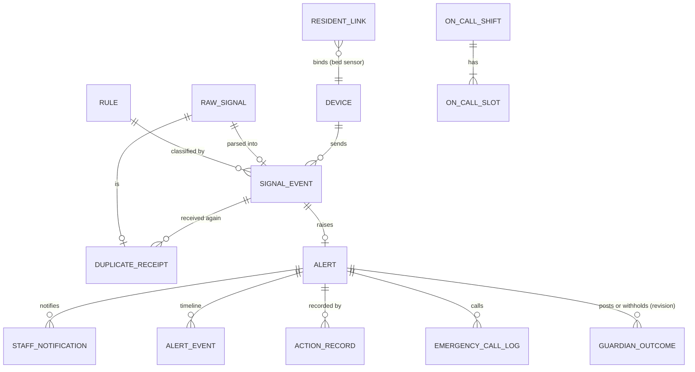

# 기술 설계 — 안심 알림 (safety-signal-hub)

상태: 승인(2026-11-03) · 작성: 2026-11-03 · 고침: 2026-11-03(B·D 결정, D 공개 API, 코어 v1.1, 데모 주인공 이은숙 반영, 마무리: 확인할 것 정리) · 방법: 스킬을 쓰지 않음(코어 `tech-design.md` 형식을 따름) · 기준: `04-planning/CLAUDE.md` "기술 설계", "코어 + 모듈 구조", 형식은 `senior-lab/04-planning/ideas/pms-core-billing/tech-design.md`(승인 2026-11-03)
변경 메모(2026-11-03): 직원 화면 모듈 이름을 한글로 바꿨다(Evenstay Safety → 안심 알림, 사용자 결정 2026-11-03). 승인 상태는 그대로 둔다.
변경: 2026-11-03 브랜드 뒷말 한글 표기·카피 검수 반영(사용자 재승인 2026-11-03)
변경: 2026-11-03 기획 문서 한국어 검수(korean-skills, 사용자 재승인 2026-11-03)
변경: 2026-11-03 안전 서비스 보완(사용자 재승인 2026-11-04)
변경: 2026-11-04 전체 리뷰 보완(사용자 재승인 2026-11-04)
변경: 2026-11-04 데모 장면 시드 맞춤(사용자 재승인 2026-11-04)
변경: 2026-11-04 시니어 하우징 조사 반영(사용자 재승인 2026-11-04)
변경: 2026-11-04 프로토타입 확인 보완(사용자 재승인 2026-11-04)
입력: `prd.md`, `service-blueprint.md`, `user-stories.md`(모두 초안), `copy/product-marketing.md`(승인, 용어집)·`names.md`(승인, 라벨)

> **공통 도메인 모델의 기준은 코어 `tech-design.md`다. 이 문서는 코어를 바꾸지 않는다.** 코어 엔티티(운영사, 사업장, 동, 호실, 입주자, 보호자 관계, 비상 연락처, 계약, 역할)는 ID로만 참조하고, B의 확장 엔티티와 이벤트만 정의한다. B가 요청한 코어 보강은 코어 v1.1(2026-11-03 재승인)에 반영됐다(확인할 것 1~5, 7-1). API 이름은 코어 `tech-design.md` 8-2·10절과 같다.
> D와 주고받는 인터페이스(10절)는 D `senior-lab/04-planning/ideas/family-consent-portal/tech-design.md` 8-2절 공개 API를 기준으로 맞췄다(2026-11-03 허브 지시). B가 D에 낸 요청은 모두 D에 반영됐다(확인할 것 6).
> 기술 방향은 코어와 같다: 프로토타입 HTML·JS, MVP Next.js, PostgreSQL(`safety` 스키마). 나머지 스택은 [미정](12절). 표기 규칙은 `strategy.md`와 같다. 표기 없는 문장은 이 문서의 설계안(초안)이다.

## 1. 범위와 경계
```
  기기 시뮬레이터(데모) / 수신 어댑터(웹훅·조회·접점·직렬, Later)
        │  어댑터가 서명해 올린 요청
        ▼
┌──────────────────────────── safety (스키마 safety) ─────────────────────────────┐
│ 수신(원본 보관) → 어댑터(정규화) → 중복 확인 → 입주자 찾기 → 규칙 → 알림           │
│                                         넘김 타이머(작업자) ─► 직원 알림 어댑터(목업) │
│ 확인 → 조치 기록 → 보호자용 결과 ──► 아웃박스 ──► family/api HealthFeedCommand.post·withhold │
│                    ▲ FamilyConsentQuery.viewersOf      ◄── HealthEventWithheld 이벤트(D)   │
└──────────┬───────────────────────────────────────────────────────────────────────┘
           │ core/api: ResidentQuery, SiteQuery, StaffQuery, GuardianQuery, EmergencyContactQuery(actor), Authorization, AuditWriter · platform: Clock.now, Notifier
           ▼                      + 코어 이벤트(ContractActivated, ContractTerminationRequested, P1)
         core
```
- B가 갖는 것: 기기, 입주자 연결(장치 동의 포함), 신호 원본, 신호, 중복 수신, 규칙, 당번표, 알림, 직원 알림 발송 기록, 알림 기록, 조치 기록, 비상 연락처 통화 결과, 보호자용 결과.
- B가 갖지 않는 것: 입주자·호실·직원 신원(코어), 비상 연락처 전화번호(코어, 볼 때만 읽음), 보호자 동의와 건강 소식 화면·문자(D), 진단·투약 같은 건강정보(어디에도 없음), 상태 판단(사람).

## 2. 도메인 모델
### 2-1. 용어 (공통 언어)
B `product-marketing.md` 용어집을 코드 이름으로 그대로 쓴다. 용어집에 없는 것만 더했다.
| 코드 | 직원 화면 | 회원 화면 | 비고 |
|---|---|---|---|
| SignalEvent / Alert / Severity / AlertStatus / Rule / OnCallRoster / ActionRecord / GuardianNotice / Device | 용어집과 같다 | 용어집과 같다 | — |
| DuplicateEvent → 저장 형태 DuplicateReceipt | 중복 수신 | (표시 안 함) | 용어집의 DuplicateEvent를 "다시 받은 기록 한 줄"로 저장한다 |
| RawSignal | 신호 원본 | (표시 안 함) | 추가. 형식이 틀려도 먼저 보관 |
| ResidentLink | 기기 연결 | 내 방 장치 | 추가. 기기·출입 카드·안부 전화 가입을 입주자와 잇고 장치 동의를 담는다 |
| OnCallShift / OnCallSlot | 근무 / 당번 자리(1차·2차·3차) | — | 추가. 용어집 OnCallRoster를 근무와 자리로 나눈다 |
| EscalationLevel | 2차 호출 / 3차 호출 / 모두 호출 | 다른 직원에게도 알렸어요 | 추가. "모두 호출"은 `copy.md` 2-5·`names.md`에 반영됨 |
| AlertEvent | 알림 기록 한 줄 | — | 추가. 알림 타임라인(추가만) |
| StaffNotification | 직원 알림 | — | 추가. 직원 휴대폰 알림 발송과 전달 결과 |
| EmergencyCallLog | 비상 연락처 통화 기록 | — | 추가. 순위·시각·결과만, 전화번호 없음 |
| GuardianOutcome | 보호자 알림(보낼 내용과 결정) | — | 용어집 GuardianNotice의 저장 형태. 보호자 화면에서는 D의 "건강 소식" |
| VisitPlan / VisitRecord | 안부 방문 계획 / 안부 방문 기록 | 안부 방문 반영됨(`copy.md` 2-15, `names.md` 4절) | 추가(P1). 정기 순회. 놓친 방문은 출처 "안부 방문"(VISIT)의 신호 |
| HospitalEscort | 병원 동행 | — | 추가(P1). 동행 직원과 시각만 |
| IncidentReport | 사고·학대 보고(반영됨(`copy.md` 2-19)) | — | 추가(P1, F27). 사람이 쓴 경위·통보·신고만, 판정 없음 |
| EvacuationRoll / EvacuationCheck / EvacuationAssist | 비상 때 재실 명단 / 대피 확인 / 도움 필요(반영됨(`copy.md` 2-20, 2-12)) | 비상 때 도움(반영됨(`copy.md` 4-1)) | 추가(P1, F28). 출입 신호로 재실을 추정하지 않음. 대피 확인 정정(EvacuationCheckCorrection)의 화면 문구는 [NEED: 카피] |
| ResidentAbsence(코어) | 부재 중 | — | 코어 엔티티(코어 2-2). B는 저장하지 않고 `AbsenceQuery`로 읽는다(ADR-S7) |

### 2-2. 엔티티 (핵심 필드)
모든 테이블은 `safety` 스키마에 있고 `id`(UUID 후보), `operator_id`, `site_id`, `created_at`, `created_by`를 가진다(코어 ADR-1과 같은 규칙, RLS 적용). 코어 엔티티는 ID만 보관하고 외래 키를 두지 않는다(ADR-2).

| 엔티티 | 핵심 필드 | 규칙 |
|---|---|---|
| Device 기기 | unit_id(코어 ID, 공용 기기는 null), source(BED_SENSOR, CALL_BELL, ACCESS_LOG, CHECK_IN_CALL. 기기가 아닌 출처 FRONT_CALL, VISIT, REQUEST(생활 요청에서 옮김)는 Device 없이 SignalEvent만), vendor, vendor_device_id, label, last_seen_at, status(ACTIVE, RETIRED) | (vendor, vendor_device_id) 유일. 신호 끊김은 상태값이 아니라 `last_seen_at`으로 계산(P1). 끊김 기준은 기기 종류별 시드 값이다(`prd.md` F13 표, [가설]) |
| ResidentLink 기기 연결 | source, external_ref(침대 센서 기기 ID, 출입 카드 참조값의 해시, 안부 전화 가입 번호), resident_id(코어 ID), valid_from, valid_to, consent_at, consent_recorded_by, consent_channel(SELF, REPRESENTATIVE) | 호출벨 외 출처는 consent_at 필수(P1 화면, MVP 시드에 포함). 같은 external_ref의 기간은 겹치지 않는다. 출입 카드 번호 원문은 저장하지 않는다 |
| RawSignal 신호 원본 | source, received_at, signature_ok, body(JSONB), parse_status(PENDING, PARSED, FAILED, DUPLICATE), error_code | 서명이 맞으면 형식과 상관없이 먼저 저장. 추가만 한다. 보존 기간 [미정] |
| SignalEvent 신호 | source, vendor_event_id, raw_signal_id, device_id, unit_id, resident_id(null 가능), kind(BED_EXIT_NO_RETURN, BED_EXIT, CALL_BELL_PRESSED, DOOR_OPENED, CHECK_IN_MISSED, FRONT_CALL, VISIT_MISSED(P1), REQUEST_MOVED(P1)), value(JSONB: duration_min, door 등), occurred_at, received_at, duplicate_count, rule_id, rule_version, severity | **(source, vendor_event_id) 유일**(ADR-S1). source는 어댑터(업체) 단위 코드다. 업체가 이벤트 번호를 주지 않으면 어댑터가 (기기, 신호 종류, 생긴 시각)으로 만든다 |
| DuplicateReceipt 중복 수신 | signal_event_id, raw_signal_id, received_at | 배지와 상세("02:40:03 수신 · 02:40:08 다시 수신")의 근거 |
| Rule 규칙 | rule_key, version, name, source, condition(JSONB), active_window(예: 22:00~06:00, 생긴 시각 기준), severity, escalation_interval_min, guardian_template, valid_from | (site_id, rule_key, version) 유일. 사업장마다 활성 rule_key 5개 이내. 바꾸면 새 버전 |
| OnCallShift 근무 | starts_at, ends_at | 같은 사업장 근무 기간은 겹치지 않는다(EXCLUDE 제약 후보) |
| OnCallSlot 당번 자리 | shift_id, position(1, 2, 3), user_id(코어 계정 ID) | (shift_id, position) 유일. 빈 자리 허용 |
| Alert 알림 | signal_event_id, unit_id, resident_id, severity, rule_id, rule_version, status(OPEN, ESCALATED, ACKNOWLEDGED, RESOLVED), escalation_level(1~4, 4 = 모두 호출), escalation_due_at, acknowledged_by, acknowledged_at, searching(bool), resolved_at, row_version | signal_event_id 유일(신호 1건 = 알림 최대 1건). 기록만 등급은 알림을 만들지 않는다 |
| StaffNotification 직원 알림 | alert_id, user_id, escalation_level, channel(PUSH_MOCK), outbox_event_id, sent_at, delivery_status(PENDING, DELIVERED, FAILED) | 같은 (alert_id, user_id, escalation_level, 반복 회차)는 한 번만 |
| AlertEvent 알림 기록 | alert_id, at, type(RECEIVED, NOTIFIED, DELIVERY_FAILED, ESCALATED, ACKNOWLEDGED, NOT_MET, MET, RESOLVED, HEALTH_EVENT_POSTED, GUARDIAN_NOTICE_SCHEDULED, HEALTH_EVENT_WITHHELD, EMERGENCY_CONTACT_VIEWED, EMERGENCY_CALL), actor_user_id(시스템이면 null), data(JSONB, 개인정보 없음) | 추가만 한다. 기록 화면 타임라인의 근거. 사람의 쓰기는 코어 AuditLog에도 남긴다 |
| ActionRecord 조치 기록 | alert_id, met(MET, NOT_MET), met_at, actions[](CONFIRMED_OK, ASSISTED, CALLED_NURSE, CALLED_119, WENT_TO_HOSPITAL, CALLED_EMERGENCY_CONTACT, DEVICE_CHECK_REQUESTED), memo(암호화), recorded_by, recorded_at, idempotency_key, corrects_id | 추가만 한다. 정정은 corrects_id를 가진 새 행(P1). 진단·투약 필드 없음 |
| EmergencyCallLog 비상 연락처 통화 | alert_id, contact_priority, called_at, result(REACHED, NO_ANSWER), sms_sent_at(P1), recorded_by | 전화번호·이름 저장 안 함. 순위만 |
| GuardianOutcome 보호자용 결과 | alert_id, revision(1부터), resident_id, kind(SAFETY_SIGNAL, HOSPITAL_TRANSFER), event_occurred_at, summary_line, body(암호화: 문장 배열), decision(POST, WITHHOLD), withhold_reason(MEMBER_REQUEST, NOT_A_HEALTH_EVENT), withhold_sub_reason(OTHER_RESIDENT, DUPLICATE, DEVICE_TEST), heard_by_user_id, heard_at, requested_by_kind(SELF, REPRESENTATIVE), note, decided_by, decided_at, family_health_event_id, visible_to_count, posted_at, withheld_via(SAFETY, FAMILY_ADMIN) | (alert_id, revision) 유일. 코드는 D `HealthEventWithhold`와 같다. HOSPITAL_TRANSFER는 한 일에 "병원으로 가심"이 있을 때만("119에 신고함"만 있으면 SAFETY_SIGNAL). 119·병원 기록 건은 WITHHOLD면 MEMBER_REQUEST만. MEMBER_REQUEST는 heard_by·heard_at·requested_by_kind 필수. POST 뒤 문장은 고치지 않고, 정정은 새 revision(P1) |
| VisitPlan 안부 방문 계획 (P1) | resident_id, frequency(DAILY [가설]), window_start, window_end, consent_at, consent_recorded_by, consent_channel(SELF, REPRESENTATIVE), valid_from, valid_to | 회원이 받기로 한 경우만(consent_at 필수). 같은 입주자의 기간은 겹치지 않는다 |
| VisitRecord 안부 방문 기록 (P1) | plan_id, resident_id, due_date, result(VISITED, NOT_IN_ROOM, DECLINED), recorded_by, recorded_at | (plan_id, due_date) 유일. 상태 판단 필드 없음. 시간대가 끝날 때까지 없으면 작업자가 SignalEvent(source VISIT, kind VISIT_MISSED, vendor_event_id = plan_id:due_date)를 만든다 |
| HospitalEscort 병원 동행 (P1) | alert_id, action_record_id, escort_user_id(null = 동행 없음), departed_at, returned_at(null 가능, 덧붙임으로 기록), recorded_by | 병원 이름·진료 내용 필드 없음. returned_at이 null인 행이 첫 화면의 "병원에 가신 분" |
| IncidentReport 사고·학대 보고 (P1) | alert_id, resident_id, account(암호화: 본 것과 한 일), guardian_notified(YES, NO), guardian_notified_at, guardian_contact_priority, reported(REPORTED, NOT_REPORTED), report_agency(ELDER_PROTECTION_AGENCY, POLICE, LOCAL_GOVERNMENT, OTHER [가설: 목록은 확인할 것 23]), reported_at, recorded_by, recorded_at, corrects_id | 추가만 한다. 판정·원인·책임 필드 없음. 정정은 corrects_id를 가진 새 행. 열 때 SENSITIVE_READ |
| EvacuationAssist 도움 필요 (P1) | resident_id, needs_help(bool), source(SELF, STAFF_ON_BEHALF), heard_from(SELF, GUARDIAN, REPRESENTATIVE, null), set_by, set_at | 이유 필드 없음. 추가만 하고 가장 최근 행이 현재 값 |
| EvacuationRoll 비상 명단 (P1) | started_by, started_at, ended_by, ended_at | 사업장마다 열린 명단 하나 |
| EvacuationCheck 대피 확인 (P1) | roll_id, resident_id, confirmed_by, confirmed_at | 추가만 한다. 같은 (roll_id, resident_id)에 정정되지 않은 확인은 하나. 명단 대상은 그 순간 코어 입주자·호실과 `AbsenceQuery`로 계산하고 저장하지 않는다 |
| EvacuationCheckCorrection 대피 확인 정정 (P1) | check_id, corrected_by, corrected_at | check_id 유일. 추가만 한다. 원 EvacuationCheck는 고치지 않는다. 정정된 분은 확인 전으로 보이고, 다시 확인하면 새 EvacuationCheck가 생긴다 |

### 2-3. ERD 초안

코어 참조(ID만): `unit_id`, `resident_id`(코어 Resident), `user_id`·`acknowledged_by`·`decided_by`(코어 UserAccount), `site_id`, `operator_id`. 비상 연락처는 ID조차 보관하지 않고 순위만 남긴다.

## 3. 상태 전이
### 3-1. 알림 (Alert)
```
(신호, 등급 ≠ 기록만) ──► OPEN(level 1)
OPEN ──(넘김 기한 지남 | 전달 실패)──► ESCALATED(level 2) ──► ESCALATED(level 3) ──► ESCALATED(level 4 모두 호출, 기한마다 다시 알림)
OPEN | ESCALATED ──(acknowledge)──► ACKNOWLEDGED
ACKNOWLEDGED ──(not_met)──► ACKNOWLEDGED(searching = true) + 3차 자리에 알림[가설]
ACKNOWLEDGED ──(resolve: MET + 한 일 ≥ 1 + 보호자 알림 결정)──► RESOLVED
```
| 전이 | 조건 | 부수 효과 | 이벤트 |
|---|---|---|---|
| raise | 규칙 등급이 즉시 확인 또는 확인 필요 | level 1 자리에게 직원 알림(아웃박스), escalation_due_at = 받은 시각 + 간격 | SafetyAlertRaised |
| escalate | status ∈ {OPEN, ESCALATED}, level = 기대값, due ≤ 지금(또는 현재 단계 전달 실패) | level + 1(최대 4), 다음 자리 알림. 빈 자리는 건너뛴다. level 4는 근무의 모든 자리에 알리고 간격마다 반복 | SafetyAlertEscalated |
| acknowledge | status ∈ {OPEN, ESCALATED}, 행동자가 사업장 범위의 직원 | acknowledged_by/at 기록, 타이머 멈춤(escalation_due_at = null) | SafetyAlertAcknowledged |
| not_met | ACKNOWLEDGED, 맡은 사람 | searching = true, 3차 자리에 알림[가설] | — |
| resolve | ACKNOWLEDGED, ActionRecord(MET, actions ≥ 1), GuardianOutcome.decision 있음 | resolved_at | SafetyAlertResolved |
- 허용되지 않은 전이는 409. 모든 전이는 `UPDATE … WHERE id = ? AND status = ? AND row_version = ?` 조건부 갱신이라 동시 확인·중복 실행에서 한 번만 성공한다(ADR-S2).
- RESOLVED에서 다시 열지 않는다. 같은 입주자의 새 신호는 새 알림이다.

### 3-2. 보호자용 결과 (GuardianOutcome)
```
(조치 기록 저장) ──► 미리보기(저장 안 함, D viewersOf로 볼 보호자 수)
  ├─ [보내기] ──► POST (조치 완료와 한 트랜잭션) → 아웃박스 → D post 성공 → family_health_event_id, visible_to_count, posted_at
  │     (볼 보호자가 0명이어도 POST. D는 저장하고 문자를 보내지 않는다)
  └─ [올리지 않기] ──► WITHHOLD(MEMBER_REQUEST | NOT_A_HEALTH_EVENT) → 아웃박스 → D withhold
(D에서 낮에 회원 요청으로 뺌) ──► HealthEventWithheld 수신 → withheld_via = FAMILY_ADMIN, 알림 기록에 표시
```
- 직원 재량의 "보내지 않기"는 없다(2026-11-03 허브·사용자 확정). 확인은 운영 매니저가 D 주간 목록에서 매주 한다. B에는 검토 상태를 두지 않는다.

### 3-3. 신호 원본 (RawSignal)
`PENDING → PARSED | FAILED | DUPLICATE`. FAILED는 어댑터를 고친 뒤 재처리 작업으로 다시 PENDING에 넣을 수 있다(같은 vendor_event_id라 다시 처리해도 한 건).

## 4. 규칙·넘김 계산
**규칙 조건 (`Rule.condition`) 예시 — 사업장 1 시드**
```json
[
  { "rule_key": "NIGHT_BED_EXIT_30", "source": "BED_SENSOR", "kind": "BED_EXIT_NO_RETURN",
    "where": { "duration_min_gte": 30 }, "active_window": "22:00-06:00", "severity": "IMMEDIATE",
    "escalation_interval_min": 5,
    "guardian_template": "{date} {daypart} {time}에 침대에서 일어나신 뒤 {duration}분 동안 돌아오지 않으셔서, 직원이 방에 다녀왔어요." },
  { "rule_key": "CALL_BELL", "source": "CALL_BELL", "kind": "CALL_BELL_PRESSED", "severity": "IMMEDIATE", "escalation_interval_min": 5,
    "guardian_template": null },
  { "rule_key": "NIGHT_DOOR", "source": "ACCESS_LOG", "kind": "DOOR_OPENED",
    "where": { "door": "MAIN_1F", "by": "RESIDENT_CARD" }, "active_window": "23:00-06:00", "severity": "CHECK",
    "escalation_interval_min": 15,
    "guardian_template": null }
]
```
- 부재 중 멈춤(P1, F23): 규칙을 평가할 때 신호에 입주자가 있고 규칙 출처가 BED_SENSOR, ACCESS_LOG, VISIT면 코어 `AbsenceQuery.absenceOf(residentId, at)`를 생긴 시각으로 부른다(ADR-S7). 조회 결과에 부재가 있으면 규칙을 적용하지 않고 LOG_ONLY로 남기며 기록에 부재 중 표시를 붙인다. CALL_BELL, FRONT_CALL은 그대로 적용한다. CHECK_IN_CALL은 [미정].
- 안부 방문 놓침(P1, F22): 상주 작업자가 시간대가 끝난 VisitPlan마다 같은 날 VisitRecord가 없고 코어 `AbsenceQuery.absenceOf`가 그날 부재를 돌려주지 않으면 SignalEvent(VISIT, VISIT_MISSED)를 만든다. vendor_event_id = `plan_id:due_date`라 다시 돌아도 한 건이다(ADR-S1과 같은 멱등). 시드 규칙 `VISIT_MISSED` → 확인 필요, 넘김 15분 [가설].
- SAF-11 규칙 표는 이 절의 규칙이 기준이다: 위 시드 3개와 안부 방문 놓침(P1). 낮 침대 떠남은 규칙이 아니다. 맞는 규칙이 없어 기록만이 된다(`prd.md` 6절). 안부 전화 2회 미응답은 `prd.md` 6절에 P1 규칙으로 있지만 이 절에는 없다(확인할 것 29).
- 평가: 신호의 (source, kind)가 맞는 활성 규칙 중 첫 번째. 시간대는 **생긴 시각**(사업장 시간대)으로 판단한다. 맞는 규칙이 없으면 LOG_ONLY.
- 조건 연산자는 `eq`, `gte`, 시간대, "같은 날 n회째"(P1 안부 전화)만 둔다(규칙 엔진을 일반화하지 않음).
- 보호자 문장 틀은 관찰 사실만 담고, 저장할 때 금지어 검사(KR3)를 통과해야 한다. 호출벨·정문 출입 규칙의 틀은 카피가 없어 `null`로 둔다(허브에 카피 요청, 확인할 것 14). 틀이 `null`이면 미리보기의 첫 문장을 비워 두고 직원이 쓴다.

**넘김 기한**
- `escalation_due_at = 기준 시각 + escalation_interval_min`. 기준 시각은 알림이 생긴 시각(받은 시각), 넘긴 뒤에는 넘긴 시각.
- 즉시 확인 5분 [가설], 확인 필요 15분 [가설](`prd.md` 확인할 것 5). 둘 다 `Rule.escalation_interval_min`으로 정하는 사업장 설정값이고 시드는 데모 값이다. 5분은 운영 품질 목표이고, 열어 본 법령 본문에서 응답 시간 규정을 찾지 못했다(`senior-lab/01-research/outputs/senior-housing-architecture.md` 9절. 미러 기준이고 소방·건축 쪽과 원본은 대조하지 못했다 [미확인]).
- 전달 실패 콜백이 오면 기한을 기다리지 않고 escalate를 부른다.
- level 4(모두 호출) 뒤에는 기한마다 같은 사람들에게 다시 알리고 반복 회차를 올린다[가설]. 시스템은 외부 신고를 하지 않는다.

**같은 입주자 묶음 (화면 계산)**: 같은 resident_id의 RESOLVED가 아닌 알림 중 occurred_at 차이가 30분 이내[가설]인 것끼리 묶는다. 저장하지 않고 조회 때 계산한다(ADR-S5).

## 5. 설계 결정 기록 (ADR)
코어 ADR-1~5를 그대로 따른다. 아래는 B 고유의 결정이다(번호 앞에 S).

### ADR-S1. 원본 먼저 보관 + (출처, 업체 이벤트 번호) 멱등 키
- **맥락**: 업체 신호는 다시 오고, 형식이 바뀌고, 순서가 바뀐다 [추정, B `product-marketing.md` Tech Lead 페르소나]. 국내 벤더가 서명된 웹훅을 준다는 근거는 찾지 못했다. 출구는 조회, 접점, 직렬일 수 있다 [추정, `senior-lab/01-research/outputs/senior-housing-architecture.md` 6.4~6.6절]. 그래서 수신 어댑터가 어떤 방식으로든 신호를 받아 서명해서 클라우드로 올리고, 서명의 주체는 벤더가 아니라 어댑터로 둔다 [가설]. 같은 신호로 알림이 두 번 울리면 안 되고, 형식이 틀렸다고 신호를 잃어도 안 된다.
- **선택지**: (A) 파싱 성공한 것만 저장 / (B) 원본을 먼저 저장한 뒤 정규화, 신호는 (source, vendor_event_id) 유일 제약 / (C) 메시지 큐에 넣고 소비자가 처리.
- **결정**: **B.** 트랜잭션 1: 서명 검증 → RawSignal 저장 → 2xx. 트랜잭션 2(같은 요청 안, 실패해도 원본은 남음): 정규화 → `INSERT … ON CONFLICT (source, vendor_event_id) DO NOTHING` → 충돌이면 DuplicateReceipt만 추가 → 아니면 입주자 찾기·규칙·알림·아웃박스를 한 트랜잭션에.
- **결과**: 같은 신호는 DB가 한 번만 받는다. 처리 실패한 원본은 재처리로 살린다. 업체 이벤트 번호가 없는 방식(접점 등)은 수신 어댑터가 (기기, 신호 종류, 생긴 시각)으로 번호를 만들어 채우므로 유일 제약은 그대로 쓴다 [가설]. 대가는 원본 저장 공간과 보존 기간 관리 [미정]. C(큐)는 1인 MVP에 운영 부담이 커서 뺐다. 처리량이 커지면 수신과 처리를 큐로 나눈다(Later).

### ADR-S2. 넘김 타이머는 DB 기한 + 작업자, 전이는 조건부 갱신
- **맥락**: 알림마다 5분 타이머가 필요하고, 작업자가 재시작되거나 둘이 동시에 돌아도 단계가 두 번 오르면 안 된다. 데모에서는 시계를 앞당겨야 한다.
- **선택지**: (A) 메모리 타이머(setTimeout) / (B) `escalation_due_at` 컬럼 + 주기 작업자(예: 10초)가 기한 지난 알림을 조건부 갱신 / (C) 외부 지연 큐(작업 예약 서비스).
- **결정**: **B.** 작업자는 `SELECT … WHERE status IN (OPEN, ESCALATED) AND escalation_due_at <= :now FOR UPDATE SKIP LOCKED`로 고르고, `UPDATE … WHERE level = :expected`로 올린 뒤 같은 트랜잭션에서 직원 알림을 아웃박스에 넣는다. `:now`는 `platform`의 `Clock.now()`(초 단위, 데모의 멈춘 시계 포함, 코어 v1.1). 데모 시계를 바꾸는 요청은 끝에 작업자 한 번(`tick`)을 바로 부른다.
- **단절 뒤 늦은 호출 (2026-11-05, 사용자 반영 지시) [가설]**: 수신 지연만으로 호출이 끝났다고 판단하지 않는다. 현장 설비의 상태를 종료·확인됨, 진행 중, 미확인으로 대사한다. 종료나 확인이 증명된 건은 기록만 하고, 진행 중 또는 미확인 건은 현장 상태를 확인하도록 직원에게 넘긴다. 설비가 상태를 제공하지 않으면 미확인 목록에서 직원이 확인한다. 기존 호출을 새 호출처럼 무조건 재발송하지 않는다. 종료 상태 조회 가능 여부와 벤더별 대사 방법은 [미확인]이다.
- **결과**: 재시작에도 기한이 DB에 남는다. 확인(acknowledge)은 due를 null로 만들어 타이머가 저절로 멈춘다. 대가는 최대 10초의 지연과, **작업자가 죽으면 넘김이 멈춘다는 위험**이다. 작업자 생존 신호를 감시하고 끊기면 직원 화면 위에 경고를 띄운다(11절). 작업자를 어디서 돌릴지는 코어 아웃박스 디스패처와 함께 정한다(확인할 것 8). **건물 인터넷이 끊기면 신호가 클라우드로 오지 않아 2차 알림이 멈춘다.** 이때 호출 접수와 표시는 건물 안 설비가 계속 맡는다고 본다 [추정]. 직원이 대신할 세부 절차와 벤더별 상태 대사 방법은 [미정]이다(확인할 것 27).

### ADR-S3. 보호자용 문장은 B가 쓰고 D에 스냅샷으로 올린다 (D 안 채택)
- **맥락**: 보호자용 결과는 건강정보다. 이벤트 payload에는 개인정보를 넣지 않는다(코어 8-3절). 회원이 동의를 거두면 이미 올라간 소식도 보이지 않아야 한다(D 원칙). B 초안은 "문장은 B만 보관, D는 볼 때 B에 묻는다"였고, D 안은 "`post`에 본문을 담아 D가 스냅샷으로 저장"이다(D ADR-F4).
- **선택지**: (A) B만 보관, D가 볼 때 `safety/api`로 조회(B 초안) / (B) B가 D `HealthFeedCommand.post`에 요약·본문을 담아 보내고 D가 보인 그대로 저장(D 안) / (C) B가 D 테이블에 직접 쓰기(ADR-2 위반).
- **결정**: **B(D 안).** B는 직원이 쓴 결과를 자기 기록(GuardianOutcome)에 남기고, 아웃박스 디스패처가 그 행을 읽어 `post`를 부른다. 아웃박스에는 outcome ID만 두고 본문은 넣지 않는다.
- **이유**: (1) 의존이 B → `family/api` 한 방향이라 D가 B를 몰라도 되고, C가 붙어도 D를 고치지 않는다. B ↔ D 양방향 API 의존과 그 순환 규칙이 필요 없어진다. (2) 보호자에게 "무엇을 보였는지"를 D가 증명할 수 있다(정정은 버전 번호로). (3) 동의 철회는 D가 볼 때마다 검사하므로 A와 똑같이 바로 적용된다.
- **결과**: 같은 문장이 `safety`와 `family` 두 스키마에 있다(둘 다 암호화 후보). 보존 기간은 두 모듈이 같게 맞춘다 [미정]. B가 문장을 고치면 새 revision으로 다시 `post`한다(P1). B에는 보호자가 부르는 API가 없다.

### ADR-S4. 비상 연락처는 B에 복사하지 않는다
- **맥락**: 코어는 `EmergencyContactsChanged` 이벤트에 B의 "캐시 갱신"을 예상해 두었다 [사실, 코어 8-3절]. 그러나 전화번호 사본이 B에 생기면 갱신 누락 때 옛 번호로 전화하게 되고 개인정보가 두 곳에 생긴다.
- **결정**: 캐시하지 않는다. 직원이 [비상 연락처 보기]를 누를 때마다 `EmergencyContactQuery`를 부른다. 통화 기록에는 순위만 남긴다.
- **결과**: 번호는 늘 최신이고 조회가 코어 감사에 한 번씩 남는다. 같은 백엔드 안 호출이라 코어가 응답하지 않으면 B도 응답하지 않는다(별도 장애 경로 없음). B는 `EmergencyContactsChanged`를 구독하지 않는다.

### ADR-S5. 같은 입주자 신호는 화면에서만 묶는다 [가설]
- **맥락**: 같은 분의 신호가 몇 분 사이에 여러 개 오면 직원이 따로 움직이게 된다. 그러나 합치면 뒤에 온 즉시 확인 신호가 앞 알림의 등급·타이머에 묻힐 수 있다.
- **결정**: 알림·타이머는 신호마다 따로 두고, 조회할 때 30분 창으로 묶어 보인다. 묶음 카드의 등급은 가장 급한 것, 모두 맡기 버튼은 묶인 알림을 한 트랜잭션에서 각각 acknowledge한다.
- **결과**: 넘김 규칙이 단순하게 남는다. 대가는 직원 휴대폰에 같은 분의 알림이 여러 번 갈 수 있다는 것이다(알림 수는 H3 시뮬레이션으로 본다).

### ADR-S6. 여러 사업장·자산 유형으로 넓히는 방식
- **맥락**: 운영사 하나가 소유주가 다른 여러 사업장과 자산 유형(시니어 레지던스, 임대주택)을 운영한다 [사실, 코어 ADR-1 맥락]. 야간 인원, 기기, 규칙은 사업장마다 다르다 [추정].
- **선택지**: (A) 운영사 공통 규칙·당번표 / (B) 사업장마다 규칙(5개 이내)·당번표·기기, 자산 유형은 쓰는 신호 종류와 규칙 조합만 다름 / (C) 자산 유형마다 다른 모듈.
- **결정**: **B.** 모든 B 테이블은 `site_id`를 갖고 코어 ADR-1의 RLS를 그대로 쓴다. 새 사업장 = 당번표 + 규칙 + 기기 등록. 새 자산 유형(임대주택) = 출입·설비 신호와 그 규칙만(Later). 새 기기 업체 = 어댑터 1개.
- **결과**: 사업장을 늘려도 코드가 아니라 설정이 늘어난다. 대가는 사업장마다 규칙이 달라 같은 신호가 사업장마다 다른 등급이 될 수 있다는 것이고, 알림에 규칙 버전을 남겨 설명한다. 여러 사업장 공용 3차(본사 당직)는 Later(`roadmap.md`).

### ADR-S7. 장기 부재는 B에 복사하지 않는다 (P1)
- **맥락**: 코어가 장기 부재(`ResidentAbsence`)와 시작·끝 이벤트, `AbsenceQuery`를 정했다. B는 부재 동안 침대 센서·밤 정문 출입·안부 방문 규칙을 멈춰야 한다. 모듈 경계 8번은 다른 모듈 데이터를 복사해 두지 않고 매 요청 `api/`로 읽게 한다.
- **선택지**: (A) 이벤트를 받아 B에 부재 기간 사본을 둔다 / (B) 신호를 평가할 때마다 `AbsenceQuery.absenceOf(residentId, 생긴 시각)`을 부른다.
- **결정**: **B.** 이벤트는 구독하지 않는다.
- **이유**: 예정 복귀일 변경은 이벤트가 없고, 등록 취소와 승계·정산 때의 자동 종료도 모두 코어가 정한다. 사본을 두면 이 경우마다 어긋날 수 있다. 늦게 온 신호도 생긴 시각으로 물으면 그때의 부재를 따른다. 같은 프로세스 안 조회라 신호마다 한 번 부르는 비용은 작다 [추정]. 비상 연락처를 복사하지 않은 ADR-S4와 같은 판단이다.
- **결과**: 코어 조회가 실패하면 규칙을 멈추지 않고 그대로 적용한다(알림이 더 가는 쪽이 안전하다). 이유·종류는 코어에도 없으므로 B 화면에도 없다.

## 6. 역할과 권한
### 6-1. 원칙
- 권한 검사는 코어 `authorize(actor, action, resource, at)` 하나다. B의 행동은 `safety.*` 이름으로 확장 정책을 등록해 허용을 더한다. 코어 1단계(사업장 범위 밖 거부)는 뒤집지 못한다(코어 ADR-2 5번).
- **사업장 책임자는 코어 SITE_MANAGER(SITE 범위, 코어 v1.1)**다. 본사 매니저(HQ_MANAGER)는 본사 관리자와 같은 열로 본다.
- B는 `registerPolicy`로 자기 이름공간(`safety.*`) 행동만 등록한다(코어 ADR-2 5번, v1.1). B는 "D 동의로 연다"고 선언한 행동이 없다(보호자는 B API를 부르지 않는다, ADR-S3).
- 당번표 자리는 역할이 아니라 B 데이터다. 1·2·3차 누구든 같은 SITE_STAFF 권한을 쓴다.

### 6-2. 역할 × 행동
● 가능 · ◐ 조건부(괄호) · — 불가
| 행동 (`safety.*`) | 본사 관리자·매니저 | 사업장 책임자(SITE_MANAGER) | 경리 | 사업장 직원 | 소유주 | 회원 | 보호자 | 대리인 |
|---|---|---|---|---|---|---|---|---|
| 알림 목록·상세 보기 `alert.view` | ● | ● | — | ● | — | — | — | — |
| 맡기·조치 기록·보호자 알림 결정 `alert.handle` | — | ● | — | ● | — | — | — | — |
| 비상 연락처 보기 `emergency_contact.view` | — | ◐(맡은 알림) | — | ◐(맡은 알림) | — | — | — | — |
| 알림 기록 보기 `log.view` | ● | ● | — | ◐(최근 7일 [가설]) | — | — | — | — |
| 규칙·당번표 설정 `config.edit` (P1) | ● | ● | — | — | — | — | — | — |
| 기기 연결·장치 동의 기록 `link.edit` (P1) | ● | ● | — | ● | — | — | — | — |
| 처리 실패 원본 보기·재처리 `raw.admin` | ● | — | — | — | — | — | — | — |
| 안부 방문 기록 `visit.record` (P1) | — | ● | — | ● | — | — | — | — |
| 안부 방문 계획·동의 기록 `visit.plan` (P1) | ● | ● | — | ◐(동의 기록만) | — | — | — | — |
| 병원 동행 기록 `alert.handle`에 포함 (P1) | — | ● | — | ● | — | — | — | — |
| 소유주 월 요약 보기 `owner_report.view` (P1, 2026-11-04) | ● | ● | — | — | ◐(자기 소유 사업장, 코어 범위 검사) | — | — | — |
| 사고·학대 보고 쓰기 `incident.record` (P1) | — | ● | — | ◐(맡은 알림) | — | — | — | — |
| 사고·학대 보고 보기 `incident.view` (P1) | ● | ● | — | ◐(자기가 쓴 것) | — | — | — | — |
| 비상 명단 열기·대피 확인·정정 `evacuation.run` (P1) | — | ● | — | ● | — | — | — | — |
| 도움 필요 정하기 `evacuation.assist.set` (P1) | — | ● | — | ●(대행) | — | ◐(본인) | — | — |
| 내 호출 상태 보기 `me.status` (P1) | — | — | — | — | — | ◐(본인) | — | — |
- 비상 연락처 자체의 보기 권한은 코어 6-2 표가 정한다(사업장 직원 ●). B는 그보다 좁게, 맡은 알림 화면에서만 버튼을 연다.
- 신호 수신은 사람이 아니라 수신 어댑터의 서명으로 인증한다(권한 표 밖).
- `SafetyBoardQuery`(8-2절)는 `log.view`로 검사한다. 대시보드(`app/` D1)는 로그인한 사람의 권한으로 부른다.

## 7. 민감정보 처리
| 등급 | 데이터 | 누가 보나 | 처리 |
|---|---|---|---|
| 저장 안 함 | 진단명·병명·투약, 영상·소리, 비상 연락처 전화번호·이름, 출입 카드 번호 원문 | — | 입력 필드가 없다. 비상 연락처는 코어에서 볼 때만 읽는다. 카드 번호는 해시 |
| 건강정보로 다룸 [법률 검토] | 조치 메모, 보호자용 결과 문장, 한 일 중 "119에 신고함"·"병원으로 가심" | 범위 안 직원·책임자. 문장은 D에 스냅샷으로 올라가 D 정책을 통과한 보호자만 본다 | 컬럼 암호화(후보). 상세 열람마다 코어 AuditLog SENSITIVE_READ. 이벤트·애플리케이션 로그에 넣지 않는다 |
| 행동 정보 [법률 검토: 민감정보 해당 여부] | 침대 떠남, 출입 시각, 호출 기록 | 범위 안 직원 | 장치 동의가 있는 기기만 입주자와 연결(F16). 목록 조회는 기록하지 않고 상세만 기록 [가설: 로그 양과 균형] |
| 개인정보 | 직원 휴대폰 알림의 호실·이름·관찰 사실 | 당번표의 직원 | 업무용 기기 전제 [가설]. 알림 본문에 메모는 넣지 않는다 |
| 일반 | 기기, 규칙, 당번표 | 범위 안 계정 | — |
- **동의**: 기기 연결의 장치 동의는 B(ResidentLink)가, 보호자에게 보여 줄지는 D가, 비상 연락처 등록 동의는 코어가 갖는다. 세 동의는 서로 대신하지 않는다.
- **사고·학대 보고(F27)**: 경위는 건강정보에 준해 암호화 후보로 둔다. 책임자·본사·작성자만 보고 열 때 SENSITIVE_READ. 이벤트·보호자·D·G·대시보드로 나가지 않는다. 신고의무 근거는 `prd.md` 12절([미확인]).
- **도움 필요(F28)**: 이유 없는 한 칸이지만 몸 상태를 짐작하게 할 수 있어 민감정보 해당 여부 [법률 검토]. 비상 명단 화면과 설정 화면에만 보인다.
- **감사**: 사람의 모든 쓰기(맡기, 조치 기록, 보호자 알림 결정, 설정 변경)와 민감 조회는 코어 `AuditWriter`로, 시스템 동작(넘김, 전달 실패)은 B `AlertEvent`로 남긴다. 비상 연락처 조회는 B가 조회한 직원을 `actor`로 넘기고, 코어가 권한 검사 후 SENSITIVE_READ를 남긴다(코어 v1.1).
- **가림(마스킹)**: 기록 화면의 목록과 내보내기에는 메모를 보이지 않고 상세에서만 연다. 본사 관리자의 처리 실패 원본 화면은 출입 카드 참조값·이름 필드를 가린다. 애플리케이션 로그, 지표, 이벤트에는 ID만 남긴다. 소유주에게는 그달 사업장 단위 숫자(`SafetyBoardQuery.monthOf`)만 주고, 입주자 이름·호실·입주자 ID·직원·메모와 종류별 수(119 신고, 병원 이송, 사고·학대 보고)는 주지 않는다(H5, 2026-11-04 사용자 결정).
- **보존 기간·파기**: [법률 검토](확인할 것 12). 원본은 짧게(예: 90일 [가설]), 알림·조치 기록은 법무 확인 [미확인].

## 8. API
### 8-1. 외부 REST
모든 사람의 쓰기는 `Idempotency-Key`를 받는다. 오류 본문에는 B `copy.md` 5절 순서(무엇이 → 왜 → 무엇을 하면)의 메시지 코드를 넣는다.
| 메서드·경로 | 설명 | 권한 | 비고 |
|---|---|---|---|
| POST `/safety/webhooks/{source}` | 수신 어댑터가 올린 신호 수신 | 어댑터 서명(HMAC) | 원본 먼저 저장 후 2xx. (source, vendor_event_id) 멱등 |
| GET `/safety/sites/{id}/board` | 지금 처리할 신호(SAF-01). 응답 `{asOf, dutyLine{unacknowledgedCount, disconnectedDeviceCount(F13 전에는 null이고 화면은 끊김 칸을 숨긴다), onDuty{shiftStartsAt, shiftEndsAt, slots[{position, userId, displayName}]}}, p1Lines{hospitalOutCount(F21), absentCount(F23, 코어 `openAbsences` 수), linkNeededCount(F16 할 일)}(기능이 꺼져 있으면 그 필드 없음), cards[], groups[], logOnlyCount}` | `alert.view` | 생긴 시각 순서. 매 요청 계산, 부재는 코어에서 읽음 |
| GET `/safety/sites/{id}/hospital-escorts?open=true` | 병원에 가신 분 목록(SAF-13, P1). `[{escortId, alertId, unitId, residentId, departedAt, escortUserId(null 가능), absent(코어 `absenceOf`)}]`, 이름은 그 요청에서 코어로 채움 | `alert.view` | N1 병원 동행 신청은 들어가지 않는다 |
| GET `/safety/sites/{id}/absences` | 부재 중인 입주자(SAF-14, P1). 코어 `AbsenceQuery.openAbsences(siteId, at, actor)` 결과를 그대로 전달 | `alert.view` | 복사하지 않음(ADR-S7) |
| GET `/safety/sites/{id}/units-overview` | 호실 현황판(SAF-15, F26, P1) | `alert.view` | 매 요청 계산. 위치·영상·활동량 없음 |
| POST `/safety/alerts/{id}/incident-reports`, GET `/safety/incident-reports/{id}` | 사고·학대 보고(SAF-16, F27, P1) | `incident.record`, `incident.view` | 추가만, 열 때 SENSITIVE_READ |
| PUT `/safety/residents/{id}/evacuation-assist`, POST `/safety/sites/{id}/evacuation-rolls`, POST `/safety/evacuation-rolls/{id}/checks`, POST `/safety/evacuation-checks/{id}/corrections` | 도움 필요, 비상 명단 열기, 대피 확인, 대피 확인 정정(SAF-17, F28, P1) | `evacuation.assist.set`, `evacuation.run` | 정정되지 않은 확인은 (명단, 입주자)마다 하나. 정정은 확인 한 건에 한 번이고, 정정한 사람과 시각을 추가로 남긴다 |
| GET `/safety/alerts/{id}` | 알림 상세(중복 수신, 넘김 기록, 남은 시간) | `alert.view` | 메모 포함 시 SENSITIVE_READ |
| POST `/safety/alerts/{id}/acknowledge`, POST `/safety/alert-groups/acknowledge` | 맡기, 묶음 모두 맡기 | `alert.handle` | 409: 이미 맡음(누가, 언제) |
| POST `/safety/alerts/{id}/action-records` | 조치 기록(만남, 한 일, 메모) | `alert.handle`, 맡은 사람 | NOT_MET면 찾는 중 |
| GET `/safety/alerts/{id}/guardian-preview` | 보호자 알림 미리보기(D 조회 결과 + 문장 틀) | `alert.handle` | D 장애 시 503 + 안내 코드 |
| POST `/safety/alerts/{id}/guardian-decision` `{decision: POST, summaryLine, body}` 또는 `{decision: WITHHOLD, reason, subReason?, heardAt?, requestedByKind?, note?}` | 건강 소식 올리기 / 정해진 이유로 올리지 않기 | `alert.handle` | 성공하면 resolve까지 한 트랜잭션. 119·병원 기록 건의 NOT_A_HEALTH_EVENT는 422. MEMBER_REQUEST의 heard_by는 로그인한 직원 |
| GET `/safety/alerts/{id}/emergency-contacts` | 비상 연락처(코어 조회 전달) | `emergency_contact.view` | `actor` 전달, 코어가 SENSITIVE_READ. 응답 캐시 금지 헤더 |
| POST `/safety/alerts/{id}/emergency-calls` | 통화 결과 기록 | `alert.handle` | 순위·결과만 |
| GET `/safety/sites/{id}/logs?from&to&filter` | 알림 기록 | `log.view` | 넘김, 건강 소식에 올리지 않음, 비상 연락처 없음 필터 |
| GET/PUT `/safety/sites/{id}/rules`, `/safety/sites/{id}/shifts` | 규칙·당번표 (P1) | `config.edit` | 새 버전 |
| GET `/safety/sites/{id}/logs`의 각 줄 `minutesToAcknowledge`, `minutesToMeet` | 걸린 시간 표시(F20, P0) | `log.view` | AlertEvent 시각으로 계산, 저장 안 함 |
| GET/PUT `/safety/sites/{id}/visit-plans`, POST `/safety/visit-records` | 안부 방문 계획과 기록 (P1) | `visit.plan`, `visit.record` | 동의 없으면 422. (plan_id, due_date) 유일 |
| POST `/safety/alerts/{id}/hospital-escort`, POST `/safety/hospital-escorts/{id}/return` | 병원 동행 출발, 돌아오심 덧붙임 (P1) | `alert.handle` | 돌아오심은 한 번만 |
| GET `/safety/sites/{id}/devices` | 기기 상태·신호 끊김 (P1) | `alert.view` | |
| POST `/safety/resident-links` | 기기 연결·장치 동의 (P1) | `link.edit` | 동의 없으면 422 |
| POST `/safety/sites/{id}/front-calls` | 전화로 받은 호출 (P1) | `alert.handle` | 출처 FRONT_CALL. 생활 요청에서 옮긴 호출은 REST가 아니라 8-2 `SafetyFrontCallCommand.registerFromRequest` |
| GET `/safety/me/calls` | 회원 호출 상태·기록 (P1) | `me.status` | 등급·메모 없음 |
| POST `/safety/raw-signals/{id}/reprocess` | 처리 실패 재처리 | `raw.admin` | |
| POST `/demo/safety/simulate`, GET `/demo/safety/phones` | 시뮬레이터, 직원 휴대폰 패널 | 데모 환경에서만 | 시뮬레이터는 수신 어댑터 자리에서 실제 수신 경로로 서명해 보낸다 |

### 8-2. 내부 모듈 API (`safety/api`)
| 인터페이스 | 메서드 | 쓰는 모듈 |
|---|---|---|
| `SafetyFrontCallCommand` (P1, 2026-11-04 확정) | registerFromRequest({siteId, unitId, residentId, actor, sourceModule: 'REQUESTS', sourceId}) → {alertId}. SignalEvent(source REQUEST, kind REQUEST_MOVED, vendor_event_id = sourceModule:sourceId)를 만들고 즉시 확인 알림으로 F17과 같은 넘김·기록을 탄다. 권한 `alert.handle`. 요청 글·종류·메모는 받지 않는다 | N1 생활 요청([안심 알림으로 옮기기], P1) |
| `SafetyStatusQuery` (Next) | callStatusOf(residentId, actor, at), todayVisitsOf(residentId, actor, at) — 읽기만 | G(비서 도구) |
| `SafetySummaryQuery` (Later) | periodSummary(residentId, from, to, actor) — 건수·종류만, 판정 없음 | C |
| `SafetyBoardQuery` (P1) | boardOf(siteId, at, actor) → {asOf, openCount(접수·넘김·확인 중), unacknowledgedCount(접수·넘김), ackTimesLast24h{count, medianMinutes, longestMinutes}(at 이전 24시간에 맡은 알림, 알림을 보낸 시각 → 맡은 시각), disconnectedDeviceCount(F13 전에는 null), onDutyToday{shiftStartsAt, shiftEndsAt, slots[{position(1·2·3), userId, displayName}]}} — 읽기만. 매 요청 계산하고 저장하지 않는다. 직원 이름은 그 요청에서 코어 `StaffQuery`로 채운다. 입주자 이름·메모·직원별 수치 없음 | `app/` 대시보드 D1(코어 10절 운영 현황 카드의 "열린 안전 신호와 맡지 않은 것", "지난 24시간 확인까지 걸린 시간", "끊긴 기기", "오늘 당번" 네 카드를 이 하나로) |
| `SafetyBoardQuery.monthOf` (P1, 2026-11-04) | monthOf(siteId, period(YYYY-MM), actor) → {period, asOf, complete, signalCount, alertCount, logOnlyCount, ackTimes{count, medianMinutes, longestMinutes}, escalatedCount, resolvedCount}. 그달은 사업장 시간대의 달력 달이고 생긴 시각 기준이다. 이번 달이면 at까지 계산하고 complete = false. signalCount = 그달 신호(중복 수신은 세지 않음, 기록만 포함), alertCount = 알림이 된 신호(즉시 확인·확인 필요), logOnlyCount = 기록만, ackTimes = 그달 알림 중 맡은 것의 보낸 시각 → 맡은 시각, escalatedCount = 2차 이상으로 넘어간 알림, resolvedCount = 조치 완료. 매 요청 계산하고 저장하지 않는다. 이름·호실·입주자 ID·직원·메모와 종류별 수(119, 병원 이송, 사고·학대 보고)는 없다. 권한 `safety.owner_report.view` | `app/` 소유주 월 리포트(코어 CORE-14, `OwnerReportQuery`와 함께 조립) |
- 모든 메서드는 `actor`를 받아 안에서 코어 `authorize()`를 부른다. 호출한 모듈을 믿고 건너뛰지 않는다.

### 8-3. 도메인 이벤트
payload는 ID와 꼭 필요한 값만. 이름, 연락처, 메모, 문장은 넣지 않는다. 모든 이벤트에 `event_id`, `occurred_at`, `schema_version`, `site_id`.
| 이벤트 | payload | 구독(예상) |
|---|---|---|
| SafetyAlertRaised | alertId, unitId, residentId?, severity | (내부: 직원 알림 발송), G(Next) |
| SafetyAlertEscalated | alertId, level | (내부) |
| SafetyAlertAcknowledged | alertId, residentId? | G(Next, "직원이 가고 있어요") |
| SafetyAlertResolved | alertId, residentId? | G(Next), C(Later) |

**구독하는 코어 이벤트**
| 이벤트 | B가 하는 일 | 시기 |
|---|---|---|
| ContractActivated | 활성 기기 연결이 없는 입주자에게만 기기 연결이 필요하다는 할 일(이미 연결된 입주자에게 중복 할 일을 만들지 않는다) | P1 |
| ContractSucceeded | payload의 residentIds(옛 계약 당사자 전원) − remainingResidentId, 곧 사별한 분의 ResidentLink를 승계일로 끝낸다. 그 뒤 그 침대 센서 신호는 입주자와 연결하지 않고 기록만 | P0(데모 시드가 이 상태를 전제) |
| ContractTerminationRequested | payload의 residentIds(코어 v1.1)로 퇴거일에 그 입주자의 ResidentLink 종료 | P1 |
| EmergencyContactsChanged | 구독하지 않음(ADR-S4) | — |

**구독하는 D 이벤트**
| 이벤트 | B가 하는 일 | 시기 |
|---|---|---|
| HealthEventWithheld (D 8-3) | sourceModule = SAFETY면 그 GuardianOutcome에 withheld_via = FAMILY_ADMIN과 이유 코드를 붙이고 알림 기록에 회원 요청으로 뺐다는 표시. 이벤트 ID로 멱등 | P0 |
| FamilyConsentChanged (D 8-3) | 구독하지 않음. 미리보기는 열 때마다 `viewersOf`를 부른다 | — |

**코어 장기 부재 이벤트 (코어 8-3, 2026-11-03 확정)**
| 이벤트 | B가 하는 일 | 시기 |
|---|---|---|
| ResidentAbsenceStarted(absenceId, residentId, unitId, startedOn, expectedReturnOn), ResidentAbsenceEnded(absenceId, residentId, unitId, endedOn, expectedReturnOn) | 구독하지 않음(ADR-S7). 규칙 평가와 "부재 중" 표시는 매번 `AbsenceQuery`로 읽는다 | — |

## 9. 외부 연동 경계
| 연동 | MVP | 어댑터 인터페이스 | 멱등·실패 처리 |
|---|---|---|---|
| 침대 센서·호출벨·출입통제·안부 전화 업체 | 시뮬레이터가 수신 어댑터 자리에서 서명한 요청을 보낸다. 데모 웹훅은 형식 시뮬레이션이고 실제 벤더 연동은 [미확인] | 수신 어댑터(웹훅, 조회, 접점, 직렬) → `SignalAdapter.parse(raw) → SignalEvent 초안 | ParseError` (출처마다 하나) | 서명은 어댑터가 클라우드로 올리는 구간에서 검증. 원본 먼저 보관. (source, vendor_event_id) 유일. 늦은 도착은 생긴 시각으로 정렬. 업체 재전송에 맡기지 않고 우리 쪽 재처리 작업으로 살린다 |
| 직원 휴대폰 알림 | 목업(휴대폰 패널에 기록) | `StaffPager.send(userId, alertRef, text, dedupKey) → DELIVERED | FAILED` | 아웃박스로 보낸다. dedupKey = (alertId, userId, level, 회차). FAILED면 즉시 넘김 |
| 비상 연락처 닿지 않음 문자 (P1) | 화면 로그 | `platform`의 `Notifier.send(template, recipientRef, vars)`(코어 v1.1, B·D 공용) | (alertId, 순위) 한 번 |
| 보호자 새 소식 문자 | B는 보내지 않는다 | D가 보낸다 | D 몫 |
| 기기 생존 신호 (P1) | 시뮬레이터 하트비트 | 같은 수신 경로, kind = HEARTBEAT(알림 없음, last_seen_at만 갱신) | 신호 끊김 계산 |
| AI Agent(G) | 없음(Next) | `SafetyStatusQuery` 읽기만 | 호출을 만드는 도구는 두지 않는다([가설], `roadmap.md` 확인할 것 2) |

## 10. 다른 모듈과의 경계
### 10-1. 코어에 기대는 것
| 코어 API | B가 쓰는 곳 | 코어 없이 단독 데모할 때 대체 |
|---|---|---|
| `ResidentQuery.residentsInUnit`, `getResident` | 호출벨처럼 호실 단위 신호의 입주자, 카드 이름 | 시드 JSON 고정 조회 |
| `SiteQuery.listUnits` | 기기 → 호실 표시 | 시드 JSON |
| `StaffQuery.listStaff(siteId, at)` | 당번표 자리, 모두 호출, 직원 표시 이름 | 시드 JSON(직원 표시 이름 포함) |
| `GuardianQuery.guardiansOf(residentId, at)` | 미리보기의 보호자 이름(D `viewersOf`는 이름을 주지 않음) | 시드 JSON |
| `EmergencyContactQuery.emergencyContactsOf(residentId, at, actor)` (소비자는 B뿐) | 맡은 알림의 비상 연락처 보기. 감사는 코어가 | 시드 JSON(가상 번호) |
| `Authorization.authorize`, `registerPolicy` | 모든 화면·API, `safety.*` 정책 등록 | 역할 고정 목업 |
| `AuditWriter` | 사람의 쓰기, 알림 상세(메모) 열람 | 콘솔 로그 |
| `platform` `Clock.now()`, `Notifier` | 넘김 기한, 규칙 시간대, 데모 시계 / 비상 연락처 닿지 않음 문자(P1) | 고정 시계, 화면 로그 |
| `AbsenceQuery.absenceOf(residentId, at)`, `openAbsences(siteId, at, actor)` (코어 8-2, 2026-11-03) | 부재 중 규칙 멈춤, 첫 화면·카드·안부 방문 목록의 "부재 중" 표시(P1) | 시드 JSON(부재 기간) 고정 조회 |
| 이벤트 `ContractActivated`, `ContractTerminationRequested`(residentIds) | 기기 연결 할 일, 연결 종료(P1) | 없음(시드에 연결 포함) |

### 10-2. D와 주고받는 인터페이스 (D `tech-design.md` 8-2·8-3절 기준)
| 방향 | D 공개 API·이벤트 | B가 쓰는 곳 | 메모 |
|---|---|---|---|
| B → D 조회 | `FamilyConsentQuery.viewersOf(residentId, HEALTH_EVENT, at) → [{guardianLinkId, relationDetail}]` | 미리보기의 보호자 수·관계, 0명 안내 | 이름은 주지 않으므로 코어 `GuardianQuery.guardiansOf`로 채운다 |
| B → D 명령 | `HealthFeedCommand.post({sourceModule: SAFETY, sourceId: alertId, revision, residentId, kind, occurredAt, summaryLine, body, recordedByUserId, involvesEmergencyCall}) → {healthEventId, visibleToCount, noticeSendAt}` | [보내기] 뒤 아웃박스 디스패처. `noticeSendAt`으로 기록 "보호자 알림 예약" | (sourceModule, sourceId, revision) 멱등. 금지 필드(진단명, 진료 결과, 처방)는 보내지 않는다. 볼 보호자 0명이어도 저장 |
| B → D 명령 | `HealthFeedCommand.withhold({sourceModule: SAFETY, sourceId, residentId, kind, occurredAt, reasonCode, subReason?, heardByUserId?, heardAt?, requestedByKind?, involvesEmergencyCall, note?})` | [올리지 않기] 뒤 아웃박스 디스패처 | 이유 코드 2가지만, 119·병원이면 MEMBER_REQUEST만(D도 검사). heardByUserId·heardAt은 MEMBER_REQUEST일 때 필수. B는 `post` 없이 `withhold`만 부르므로 residentId·kind·occurredAt을 함께 보낸다(D 반영됨) |
| B → D 조회 | `FamilyNoticeQuery.nextSendAt(siteId, at) → datetime` (2026-11-03 허브 결정, D 반영됨) | 미리보기 "새 소식 문자는 08:00에 보냅니다" | 조용한 시간 규칙만 계산. B는 규칙을 복제하지 않는다 |
| D → B 이벤트 | `HealthEventWithheld {residentId, sourceModule, sourceId, reasonCode}` | 낮에 D에서 뺀 일을 B 기록에 표시 | 8-3절 구독 표 |
| 공통 | 종류 코드 `SAFETY_SIGNAL`, `HOSPITAL_TRANSFER` | GuardianOutcome.kind | HOSPITAL_TRANSFER는 "병원으로 가심"이 기록된 일만 |
| 공통 | `involvesEmergencyCall` | `post`·`withhold` 인자 | 한 일에 "119에 신고함" 또는 "병원으로 가심"이 있으면 참. 종류(HOSPITAL_TRANSFER)와 기준이 다르다 |
| 공통 | 문자 시각: D 알림 대기의 조용한 시간 22~08시 | 미리보기 안내, 기록의 "보호자 알림 예약" | 계산은 D. B는 같은 규칙을 복제하지 않는다 |
- 의존 방향: `safety` → `family/api` 한 방향. D는 `safety`를 import하지 않는다(코어 ADR-2 2번, v1.1 반영됨).
- B 초안의 제안 중 D 안과 달랐던 것(B만 문장 보관과 D의 B 조회, B 쪽 보호자 권한 정책, `SafetyOutcomeShared`, `HealthNewsNoticeScheduled`)은 모두 D 안으로 바꿨다(ADR-S3).
- **D 없이 데모할 때**: `family/api` 목업이 고정 동의 JSON(이은숙 → 딸 김지민)으로 `viewersOf`에 답하고, `post`를 받아 B `copy.md` 3절 문구로 건강 소식 목업 화면을 그린다. D에도 B 대신 건강 소식을 넣는 데모 경로가 있다(D `/demo/family/seed-health-event`).


## 11. 테스트·배포·모니터링 최소 기준
**테스트**
| 종류 | 무엇을 | 기준 |
|---|---|---|
| 어댑터 골든 | 업체 샘플 원본 → 공통 신호(출처별 3종 + 형식 오류) | 전부 통과 |
| 멱등 | 같은 신호 2번, 동시 10번 → 신호 1, 알림 1, 직원 알림 1. RawSignal은 요청 수만큼 | 결과 수 불변 |
| 순서·시간대 | 늦은 도착, 밤 경계(05:58 생김·06:03 도착), 날짜 넘김 | 표 기반 |
| 단절 뒤 늦은 호출 [가설] | 늦게 도착한 종료 확인 건·진행 중 건·현장 상태를 알 수 없는 건, 종료 신호가 먼저 도착한 경우 | 종료 확인 건만 기록, 나머지는 현장 확인 대상으로 누락 없이 남김 |
| 넘김 타이머 | (상태, level, due, 지금, 전달 결과) → 다음 상태 표 전부. 작업자 2개 동시 실행, 재시작 후 재개, 빈 자리 건너뜀, level 4 반복 | 단계가 한 번만 오른다 |
| 상태 전이 | 알림·보호자용 결과의 모든 (상태, 동작) 조합 | 허용·거부(409) 전부 |
| 동시 확인 | 두 직원 동시 acknowledge | 한 명만 성공 |
| 권한 | 6-2 표의 모든 칸, 경리 403, 소유주는 `owner_report.view`만 허용하고 나머지 403 | 표에서 테스트 생성 |
| 금지어 | 화면 문자열 파일, 규칙 문장 틀, 시드 | CI(KR3) |
| 개인정보 | 이벤트 payload·애플리케이션 로그에 전화번호·이름·메모 패턴 없음 | CI |
| 경계 | `safety`가 `core/api`·`family/api`·`platform` 밖을 import하지 않음, safety DB 역할로 다른 스키마 쓰기 실패 | CI(코어 ADR-2 7번 도구) |
| D 연동(계약 테스트) | `post` 재시도 2번 → D 1건, `post` 본문에 금지 필드 없음, 119·병원 기록 건의 NOT_A_HEALTH_EVENT 422, MEMBER_REQUEST 필수 필드, `HealthEventWithheld` 두 번 받아도 표시 1번. D 목업과 D 실구현 양쪽에서 같은 테스트 | 통과 |

**배포**: 코어와 같은 컨테이너 이미지·같은 DB(`safety` 스키마, 모듈별 DB 역할). 넘김 작업자는 아웃박스 디스패처와 같은 상주 프로세스에서 돈다([가설], 확인할 것 8). 마이그레이션은 앞으로만. 데모 환경만 시뮬레이터 경로를 켠다.
**모니터링**: 지표 — 신호 수신·서명 거부·처리 실패·중복 수, 수신 → 알림 생성 지연, **넘김 작업자 생존과 기한 초과 처리 지연**, 직원 알림 전달 실패 수, 접수·호출 상태로 남은 알림 수, 신호 끊김 기기 수(P1). 경보 조건: 넘김 작업자가 1분 넘게 생존 신호 없음(직원 화면 경고와 함께), 처리 실패 원본 발생, 직원 알림 전달 실패 연속 [미정: 임계값, 확인할 것 15]. 로그에는 ID만.
**외부 감시**: 직원 화면 경고는 앱이 살아 있을 때만 보인다. 앱 전체가 멈추는 경우를 잡으려고, 앱 밖의 감시가 주기적으로 수신 경로와 작업자 상태를 확인하고 응답이 없으면 앱 밖 경로로 사업장 책임자에게 알린다 [가설]. 주기, 도구, 받는 사람은 [미정]이다(확인할 것 27).

## 12. 기술 스택 방향 (확정 아님)

> **현재 기술 기준(2026-11-05)**: MVP는 만들지 않는다. 화면은 Next.js, A안 코어는 Java·Spring 계열의 설계 기준이다. A·B·C 구성안의 최종 선택과 ORM 등 세부는 미정이며 아키텍처 설계안 3·9절을 따른다. 아래 2026-11-03 표현은 당시 기록이다.

코어 12절을 그대로 따른다. B에서 더 볼 기준:
1. 상주 작업자(넘김 타이머, 아웃박스)를 Next.js 앱과 같은 이미지에서 돌릴 수 있는가. 서버리스 함수만 되는 배포처는 맞지 않는다(분 단위 크론은 5분 넘김에 너무 거칠다 [추정]).
2. 웹훅 원본 본문을 서명 검증 전에 바이트 그대로 읽을 수 있는가(Next.js route handler에서 `request.text()` 후 검증).
3. 직원 화면 실시간 갱신: MVP는 짧은 주기 폴링(5초)으로 단순하게, 다음 버전에서 SSE 후보 [가설](확인할 것 11).
4. PostgreSQL: `ON CONFLICT`, `FOR UPDATE SKIP LOCKED`, EXCLUDE(근무 기간), RLS, 컬럼 암호화(pgcrypto 또는 애플리케이션 암호화 [미정]).

## 확인할 것
**결정됨 (코어 v1.1 반영, D 반영, 허브·사용자 확정)**
1. **코어 역할·정책 (반영됨)**: SITE_MANAGER 역할. `registerPolicy`는 자기 이름공간(`safety.*`)만 등록한다. "D 동의로 연다"고 선언한 행동의 예외는 B에 해당 없다. 코어가 요청을 바꿔 받아들인 점: B의 "모듈이 자기 행동을 등록" 요청에 보호자 동의 예외가 붙었다.
2. **모듈 간 `api/` 의존 (반영됨)**: 코어 ADR-2 2번. B → `family/api` 한 방향.
3. **코어 API (반영됨)**: `StaffQuery.listStaff`, `GuardianQuery.guardiansOf`, `EmergencyContactQuery.emergencyContactsOf(…, actor)`(소비자는 B뿐, 감사는 코어), `platform`의 `Notifier`와 `Clock.now()`·멈춘 데모 시계, `EmergencyContactsChanged` 구독자에서 B 제외.
4. **이벤트 payload (반영됨)**: `ContractTerminationRequested`·`ContractSucceeded`에 residentIds.
5. **코어 시드 (반영됨)**: 직원 계정 김하진·박서준·최영미(SITE_MANAGER), 호실 배치, 이은숙의 보호자 관계 딸 김지민(비상 연락처 1순위), 대리인 아들 김태호(위임장, 청구서 확인·결제만, 비상 연락처 2순위), 승계 후 상태. 김말순의 한정후견인은 새 가상 인물 김도현이다.
6. **D 인터페이스 (반영됨)**: `post` 결과 `noticeSendAt`, `FamilyNoticeQuery.nextSendAt`, `withhold`의 residentId·kind·occurredAt·heardAt(10-2절). `noticeSendAt`이 비어 있으면(볼 보호자 0명) B 기록에는 건강 소식을 올렸지만 볼 보호자가 없어 문자가 가지 않았다는 줄을 남긴다(문구는 반영됨(`copy.md` 2-7)).
7. **회원 요청으로 뺀 일의 회원 화면 표시**(2026-11-03 사용자 확정): D 회원 화면(D `copy.md` 2-9)이 기준이고, B 안심 알림 기록(P1)에는 그 일의 줄에 같은 문장을 붙인다.
7-1. **코어 B·D 동기화 (반영됨)**: `ContractSucceeded` 구독자에 B(사별한 분의 침대 센서 연결 종료)가 더해졌고, ADR-2 5번의 `view_as_guardian` 예시가 지워졌다(코어 `tech-design.md` 8-3절·ADR-2·확인할 것 15). 코어 머리말의 "B·D 동기화"는 사용자 재승인(2026-11-03)이다.
7-2. **카피 세션이 남긴 기획 확인 2건 (확인함, 2026-11-03)**: `copy.md` 교정 기록의 "기획 확인 필요"를 기획과 대조했다. ① 2-11 카드에 규칙 대신 "등록: ○○○ 님"을 둔다: 기획과 맞다. 전화로 받은 호출은 직원 입력이고(`prd.md` F17), 등급은 즉시 확인으로 정해져 있으며 등록한 직원이 남는다(`user-stories.md` US-19 1·2). 후보: 2절 Alert 표의 `rule_id`·`rule_version`을 프런트 전화 알림에서는 비울 수 있다고 적을지는 아직 쓰지 않았다. ② 연결 화면에 연결 끝내기 버튼이 없다: 기획과 맞다. 기기 연결은 코어 퇴거·승계 이벤트로만 끝난다(US-18 4·5, 8-3절).

**결정됨 [가설]** (2026-11-03 사용자 결정: 문서의 제안값으로 확정하고 [가설]로 표시)
8. **상주 작업자 위치** [가설]: 넘김 타이머와 코어 아웃박스 디스패처·일일 배치를 같은 상주 프로세스(같은 이미지, 다른 시작 명령)에서 돌린다. 버린 대안: DB 스케줄러(pg_cron)가 1분마다 `tick`(넘김이 최대 1분 늦다). 코어 배포처 선정 때 함께 확인한다.
9. **직원의 알림 기록 열람 범위** [가설]: 사업장 직원은 최근 7일, 사업장 책임자는 자기 사업장 전체. 버린 대안: 오늘 근무 중 알림만(인계하기에 부족).
10. **넘김·묶음·만나지 못함** [가설]: 확인 필요 15분, 같은 입주자 묶음 30분(화면에서만, ADR-S5), 3차는 당직 책임자 → 모두 호출, "아직 만나지 못했습니다"면 책임자에게 바로 알림(`prd.md` 확인할 것 5~8).
11. **직원 화면 갱신** [가설]: MVP는 짧은 주기 폴링(5초), 다음 버전에서 SSE를 검토한다(12절).

**남은 것**
12. **[법률 검토] 보존 기간**: 신호 원본 90일 후 본문 삭제는 법무 확인 전 임시값이다. 알림·조치 기록과, `safety`·`family` 두 곳에 있는 보호자용 문장의 보존 기간도 함께 정한다(7절, ADR-S3).
13. **[미정] 기술 스택 세부**: 컬럼 암호화 방식(pgcrypto / 애플리케이션 암호화), 나머지 스택은 코어와 함께 `evenstay` 착수 때 정한다(12절).
14. **카피 반영 대기** (2026-11-03 `copy.md`와 대조)
    - 반영됨: 비상 연락처 버튼·목록·없음 안내(`copy.md` 2-9), 직원 휴대폰 패널(2-10), "모두 호출" 라벨(2-5), 당번표 빈 경우(2-1), D 장애 시 미리보기 안내(2-8), 건강 소식을 올리지 못했을 때의 책임자 안내(2-8), 호출벨·정문 출입 규칙의 보호자 문장 틀(3-2, 4절 시드의 `null`은 이 틀로 채운다. 정문 출입을 건강 소식에 넣을지는 [미정: D 확인]), 예시 호실과 주인공(머리 설명, 2·3·5절), 기기 수를 시드 기준으로(2-1).
    - 반영됨(2차 대조): 기기 연결·장치 동의 설정 화면(`copy.md` 2-12), 규칙·당번표 설정 화면(2-13), 묶음 카드의 모두 맡기 버튼(2-6), 전화로 받은 호출 등록 버튼(2-11)과 출처 라벨 프런트 전화(2-11, `names.md` 4절), 알림 기록 필터 이름 3개(2-7), 처리 실패 표시(2-14), 기기 연결 없음 표시(2-12), 기기 연결이 필요한 입주자 할 일(2-12), 볼 보호자 없이 올린 기록 줄(2-7).
    - 대기: 맡은 뒤 오래 머문 알림 안내(Next).
15. **[미정] 경보 임계값**: 직원 알림 전달 실패가 몇 번 이어지면 경보할지, 아웃박스·넘김 작업자 지연의 경보 기준(11절 모니터링). 제안이 없어 남긴다. 코어 모니터링 임계값([미정])과 함께 정한다.
16. **[미정] 당번표를 바꿀 때 진행 중 알림**: 이미 넘김이 시작된 알림이 바꾸기 전 당번표와 바꾼 뒤 당번표 중 어느 쪽을 따르는지 정하지 않았다(`copy.md` 2-13 교정 기록의 "기획 확인 필요" 3번째). 규칙은 바꾸기 전 버전을 따르지만(Rule 버전), 당번표에는 같은 규칙이 없다.
17. **코어 장기 부재 (반영됨, 2026-11-03 코어 확정)**: 이벤트와 `AbsenceQuery`가 코어 2-2·3-4·8절에 들어갔다. B는 이벤트를 구독하지 않고 `AbsenceQuery`로 읽는다(ADR-S7). 허브에 요청: 코어 8-3의 구독 열과 10절 B 줄의 "B(그 기간 침대·출입 규칙 멈춤)"를 "B는 `AbsenceQuery`로 읽음(구독 안 함)"으로 맞춰 주기. 코어 10절 운영 현황 카드의 B 조회 자리표시 네 개는 `SafetyBoardQuery.boardOf` 하나로 바꿔 주기(8-2절 반환 형태).
18. **부재 처리 세부**: 예정 복귀일이 지나도 코어에서 열려 있으면 규칙은 계속 멈추고, 직원에게는 코어 `TodoQuery`의 "예정 복귀일 지남"이 보인다 [가설]. 시작일·복귀일 당일을 부재로 볼지는 코어 `absenceOf`의 정의를 따른다(B 기대: 시작일 포함, 복귀일 당일부터 다시 적용 [가설], 허브 확인). 안부 전화 규칙도 멈출지는 [미정]. 부재가 시작될 때 이미 열린 알림은 그대로 둔다 [가설].
19. **[미정] 안부 방문·병원 동행 세부**: 방문 주기·시간대 기본값(하루 1회, 10:00~18:00 [가설]), "방에 계시지 않았습니다"를 알림으로 올릴지, 돌아오심을 건강 소식에 덧붙일지.
20. **`registerFromRequest` 이름 (결정, 2026-11-04)**: N1이 제안한 `SafetyFrontCallCommand.registerFromRequest`를 그대로 쓴다(N1-B1). 규칙 없이 직원 입력으로 즉시 확인 알림을 만드는 점은 F17과 같다. 프런트 전화·생활 요청 알림의 Alert `rule_id`·`rule_version`은 비어 있다(7-2 후보를 이것으로 닫는다).
21. **[미확인] 사고·학대 보고의 신고 의무**: 근거와 대상 사업장 직원이 신고의무자인지(`prd.md` 12절). 화면은 [미확인]을 그대로 보인다.
22. **[미확인] 비상 때 재실 명단의 법 전제**: 사업장의 대피 관련 의무와 명단 보존 기간.
23. **[미정] 신고 기관 목록**: 노인보호전문기관, 경찰, 시·군·구, 그 밖 [가설]. 실제 목록은 [법률 검토]와 함께 정한다.
24. **[미정] 놓친 방문 알림의 조치 완료**: 안부 방문 기록으로 알림을 닫을지, 다른 알림처럼 조치 기록과 보호자 알림 결정을 거칠지. 지금 데모 장면 B-2는 기록까지만 보인다.
25. **[가설] 통합 데모 새 장면의 시각과 계정**: `prd.md` 9절 B-1~B-3의 시각, 낮 근무 당번표, 안부 방문 대상 3명(그중 김정희는 11/12에 장기 부재라 "부재 중"으로만 보임, 놓친 방문은 박영순). 허브가 코어(장기 부재 등록 시각, 직원 윤서연), D(부재 소식), C(12/7 18:00 시작점)와 맞춘다.
26. **소유주 월 요약 (결정, 2026-11-04 H5)**: 소유주(`OWNER_VIEWER`)에게 `safety.owner_report.view`를 열고 `SafetyBoardQuery.monthOf`만 허용한다. 작은 사업장에서 종류별 수가 개인을 짐작하게 할 수 있어 119·병원 이송·사고 보고 수는 빼고 처리 숫자만 둔다 [가설]. 코어 확인할 것 30에 B 이름을 알린다(허브).
27. **[미정] 건물 인터넷 끊김과 앱 전체 중단**: 늦은 호출은 ADR-S2의 현장 상태 대사를 기본안으로 둔다 [가설]. 끊긴 동안 직원이 대신할 세부 절차, 벤더의 현재 상태 조회 가능 여부·대사 방법과 외부 감시의 주기·도구·받는 사람은 [미정]이다. 배포 쪽 외부 감시는 코어와 함께 정한다.
28. **[미확인] 실제 벤더의 신호 수신 방식**: 벤더 문의 전이다. 수신 어댑터를 건물 안에 둘지는 이 답을 보고 정한다(ADR-S1, 9절).
29. **[미정] 안부 전화 2회 미응답 규칙**: `prd.md` 6절과 F15에는 P1 규칙으로 있는데 4절 시드에는 없고, 빠진 까닭이 문서에 없다. 4절에 넣을지 정한다. 넣으면 활성 규칙이 5개로 한도에 찬다. 프로토타입 SAF-11은 이 규칙 대신 전화 호출(FRONT_CALL)을 다섯째 규칙으로 보이지만, 전화 호출은 규칙 없이 직원 입력으로 알림을 만든다(확인할 것 20).
30. **[미정] 대피 확인 정정 세부**: 명단이 닫힌 뒤에도 정정할 수 있는지. 화면 문구는 [NEED: 카피].

## 변경 기록

- 2026-11-05 아키텍처 v0.1.1 보완(사용자 반영 지시): 단절 뒤 늦은 호출의 종료·진행·미확인 대사와 현장 확인 시험을 더했다. 변경분의 별도 재승인은 표시하지 않았다.
- 2026-11-03 기획 문서 한국어 검수(허브 요청, 사용자 지정 korean-skills, 사용자 재승인 2026-11-03). 호출한 스킬: `grammar-checker`, `style-guide`, `humanizer`(Skill 도구). 코드·ID·태그·숫자·화면 문구 인용은 고치지 않았다.
  - 고친 곳 5곳: 맞춤법 2, 문장 2, 용어 1. 맞춤법(구두점)은 독립 항목을 나열할 때 가운뎃점을 쉼표로 바꾼 것이다.
  - [용어] 소유주 화면에는 Safety 데이터를 주지 않는다 → 소유주 화면에는 안심 알림 데이터를 주지 않는다
  - [맞춤법(구두점)] 애플리케이션 로그·지표·이벤트에는 ID만 남긴다 → 애플리케이션 로그, 지표, 이벤트에는 ID만 남긴다
  - [맞춤법(구두점)] 이름·연락처·메모·문장은 넣지 않는다 → 이름, 연락처, 메모, 문장은 넣지 않는다
  - [문장] 사용자 재승인 2026-11-03다 → 사용자 재승인(2026-11-03)이다
  - [문장] (인계에 부족) → (인계하기에 부족)
- 2026-11-03 화면 문구 인용 맞춤(허브 요청, 사용자 "인용 맞추기", 사용자 재승인 2026-11-03). 따옴표 인용은 `copy.md`와 글자까지 같게 했고, `copy.md`에 없는 문구는 따옴표를 빼고 설명하거나 요약이라고 밝혔다. 2곳:
  - ADR-S5 결정 [설명 문장(copy에 없음)]: [모두 맡기]는 묶인 알림을 → 모두 맡기 버튼은 묶인 알림을
  - 1절 용어 표 EscalationLevel [원문 일치(낡은 대기 표시 정리)]: "모두 호출"은 [가설] 라벨 [카피 반영 대기] | → "모두 호출"은 `copy.md` 2-5·`names.md`에 반영됨 |
  - (같은 작업, 전수 대조로 더 찾은 3곳)
  - 8-3절 ContractActivated [설명 문장(copy에 없음)]: "기기 연결 필요" 할 일 → 기기 연결이 필요하다는 할 일
  - 8-3절 HealthEventWithheld [설명 문장(copy에 없음)]: 알림 기록에 "건강 소식에서 뺌" 표시. → 알림 기록에 회원 요청으로 뺐다는 표시.
  - 확인할 것 6 [설명 문장(copy에 없음)]: B 기록에는 "건강 소식 올림(볼 보호자 없음, 문자 없음)"을 남긴다. → B 기록에는 건강 소식을 올렸지만 볼 보호자가 없어 문자가 가지 않았다는 줄을 남긴다(문구는 [카피 반영 대기]).
- 2026-11-03 카피 반영 대기 목록 정리(허브 요청, 사용자 "정리해", 사용자 재승인 2026-11-03): `copy.md`에 이미 들어간 항목은 지우지 않고 "반영됨(`copy.md` 절 번호)"으로 표시했고, 들어가지 않은 항목만 대기로 남겼다.
- 2026-11-03 카피 반영 대기 표시 정리 2(허브 요청, 사용자 "맡겨", 사용자 재승인 2026-11-03): B 카피 세션이 `copy.md` 2-11~2-14 절과 2-6·2-7 표에 넣은 문구, `names.md` 4절 출처 "프런트 전화"와 대조해, 들어간 항목을 "반영됨(`copy.md` 절 번호)"으로 바꿨다. 아직 없는 것은 맡은 뒤 오래 머문 알림 안내(Next)뿐이다.
- 2026-11-03 카피 세션의 "기획 확인 필요" 3건 옮김: ①② 확인함(확인할 것 7-2), ③ [미정](확인할 것 16).
- 2026-11-03 안전 서비스 보완(허브 요청, 사용자 선택 "넓게(N1 포함)", 사용자 재승인 2026-11-04). 방법: 스킬을 쓰지 않음(코어 형식). 2-1 용어 3줄, 2-2 엔티티 VisitPlan·VisitRecord·HospitalEscort·AbsencePeriod(P1), SignalEvent kind VISIT_MISSED, 4절 부재 중 멈춤과 안부 방문 놓침, 6-2 권한 3줄, 8-1 REST 3줄, 8-2 `SafetyBoardQuery`(P1), 8-3 코어 부재 이벤트 구독 [가설], 10-1 코어에 기대는 것, 확인할 것 17~19. "판 번호"는 "버전 번호"로.
- 2026-11-03 코어 장기 부재 확정 맞춤(허브 요청, 사용자 재승인 2026-11-04): 코어가 `ResidentAbsenceStarted`/`ResidentAbsenceEnded`(absenceId, residentId, unitId, startedOn/endedOn, expectedReturnOn)와 `AbsenceQuery`를 확정했다(코어 `tech-design.md` 2-2·3-4·8절). 모듈 경계 8번(다른 모듈 데이터를 복사해 두지 않고 매 요청 `api/`로 읽는다)에 따라 B는 부재를 저장하지 않고 신호를 평가할 때마다 `AbsenceQuery.absenceOf`로 읽는다(`tech-design.md` ADR-S7). 이벤트는 구독하지 않는다. `SafetyBoardQuery.boardOf` 반환 형태를 코어 운영 현황 카드에 맞췄다(가장 긴 시간, 당번 이름).
- 2026-11-03 안전 서비스 보완 카피 반영(허브 요청, 사용자 재승인 2026-11-04): B 카피 세션이 `copy.md` 2-15 안부 방문, 2-16 병원 동행, 2-17 부재 중과 기존 표(2-1, 2-4, 2-7, 2-12, 2-13, 4-2)에 줄을 넣고 `names.md` 4절에 출처 "안부 방문"을 넣었다. 해당 [NEED: 카피]를 "반영됨(`copy.md` 절 번호)"으로 바꿨고, 안부 방문 결과 선택지는 카피대로 "입주자가 방문을 원하지 않으셨습니다"(직원 화면 호칭 규칙)로 맞췄다.
- 2026-11-04 전체 리뷰 보완(허브 지시서 `00-hub/reviews/supplement-orders-2026-11-04.md` 안심 알림 1~4, 사용자 "추천대로 시작", 사용자 재승인 2026-11-04). 목표는 모든 화면이 흐름대로 움직이는 클릭형 프로토타입(MVP 구현 없음).
  - tech-design: SignalEvent 출처 REQUEST/kind REQUEST_MOVED, 2-1 용어 2줄, 2-2 IncidentReport·EvacuationAssist·EvacuationRoll·EvacuationCheck, 6-2 행동 4줄, 7절 2줄, 8-1 board 응답 필드와 목록·현황판·보고·명단 REST(R17), 8-2 `SafetyFrontCallCommand.registerFromRequest`(R7), 확인할 것 20~25. 방법: 스킬을 쓰지 않음(코어 형식).
- 2026-11-04 소유주 월 리포트 숫자 열기(허브 전달, 사용자 결정 H5 "모두 추천대로", 사용자 재승인 2026-11-04): 코어 CORE-14에 안심 알림 그달 숫자를 연다. 조회 `SafetyBoardQuery.monthOf(siteId, period, actor)`, 행동 `safety.owner_report.view`(소유주는 자기 소유 사업장만). 이름·호실·입주자 ID·직원·메모와 119·병원 이송 수는 주지 않는다.
- 2026-11-04 전체 리뷰 보완 카피 반영(허브 요청, 사용자 재승인 2026-11-04): B 카피 세션이 `copy.md` 2-18 호실 현황, 2-19 사고·학대 보고, 2-20 비상 때 재실 명단, 2-21 소유주 월 리포트의 안심 알림 묶음과 기존 표(2-1, 2-11, 2-12, 2-16, 4-1)에 줄을 넣고 `names.md` 4절에 출처 "생활 요청에서 옮김"을 넣었다. 해당 [NEED: 카피]를 "반영됨(`copy.md` 절 번호)"으로 바꿨다.
- 2026-11-04 데모 장면 시드 맞춤(허브 요청, 화면 정의서 검토 지적, 사용자 재승인 2026-11-04): 코어 시드에서 A동 301호 김정희가 11/8~11/19 장기 부재라 11/12 안부 방문 장면(B-2)에서 놓친 방문 대상으로 쓸 수 없었다. 김정희는 방문 목록에 "부재 중 · 오늘은 들르지 않습니다"(`copy.md` 2-15)로만 보이고 놓친 방문 신호가 생기지 않게 했다. 놓친 방문은 B동 402호 최순덕(부재 12/1부터라 11/12에는 해당 없음)으로 바꿨다. B-3은 코어 장면 시각(12/2 11:10 부재 시작, 12/7 16:40 복귀)과 최순덕 부재(12/1부터)를 반영해 "부재 중인 입주자 2명"으로 고쳤다.
- 2026-11-04 시니어 하우징 조사 반영(허브 지시 `00-hub/reviews/research-reflection-2026-11-04.md` R1~R5, 사용자 "검토 후 반영", 근거 `senior-lab/01-research/outputs/senior-housing-architecture.md` 6·9절, 사용자 재승인 2026-11-04): 1절 그림, 2-2 Device, 4절 5분 근거(R2, 값과 구조 그대로), ADR-S1 수신 어댑터와 대체 번호(R1), ADR-S2 건물 인터넷 끊김(R4), 6-1·8-1·9·11절의 수신 표현(R1), 11절 외부 감시(R4), 확인할 것 27·28.
- 2026-11-04 프로토타입 확인 보완(허브 지시, 사용자 "추천대로", 근거 `evenstay/design/prototype/REPORT.md` 2·4·10번, 사용자 재승인 2026-11-04): 2-1·2-2 대피 확인 정정(EvacuationCheckCorrection), 4절 SAF-11 규칙 표 기준, 6-2·8-1 정정 행동과 API, 확인할 것 25(대상 3명, 놓친 방문 박영순), 29·30 추가.
