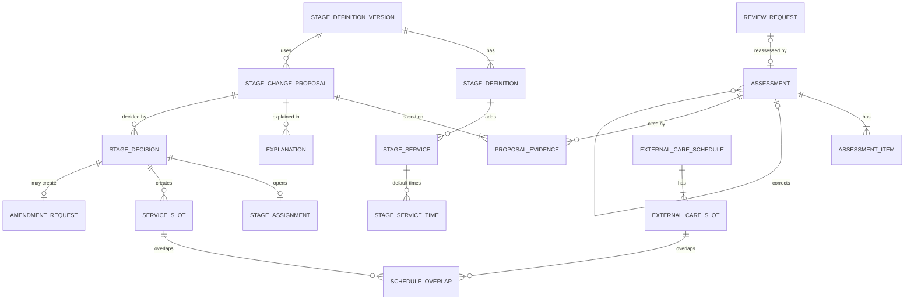

# 기술 설계 — 생활 지원 단계 (care-stage-transition)

상태: 승인(2026-11-03) · 작성: 2026-11-03 · 고침: 2026-11-03(검토 에이전트 지적 반영, 확인할 것 정리, 2차·3차 검토 반영) · 방법: 스킬을 쓰지 않음(코어 `tech-design.md` 형식을 따름) · 기준: `04-planning/CLAUDE.md` "기술 설계", "코어 + 모듈 구조", 형식은 `senior-lab/04-planning/ideas/pms-core-billing/tech-design.md`(승인 2026-11-03), `senior-lab/04-planning/ideas/safety-signal-hub/tech-design.md`·`senior-lab/04-planning/ideas/family-consent-portal/tech-design.md`(승인) · 변경: 2026-11-03 직원 화면 모듈 이름 Evenstay Transitions → 생활 지원 단계(사용자 결정, 사용자 재승인 2026-11-03) · 변경: 2026-11-03 브랜드 뒷말 한글 표기·카피 검수 반영(사용자 재승인 2026-11-03) · 변경: 2026-11-03 기획 문서 한국어 검수(korean-skills, 사용자 재승인 2026-11-03) · 변경: 2026-11-04 전체 리뷰 보완(사용자 재승인 2026-11-04) · 변경: 2026-11-04 화면 문구 "그대로인 것" 풀어 쓰기(사용자 결정, 사용자 재승인 2026-11-04) · 변경: 2026-11-04 쉬운 말 재검수 문구 반영(사용자 결정, 사용자 재승인 2026-11-04)
입력: `prd.md`, `service-blueprint.md`, `user-stories.md`(모두 초안), `copy/product-marketing.md`(승인, 용어집), `names.md`(승인, 라벨과 코드)

> 공통 도메인 모델의 기준은 코어 `tech-design.md`다. 이 문서는 C의 확장 엔티티, 정책, 이벤트만 정의하고, 코어 엔티티(사업장, 입주자, 계약, 역할 등)는 ID로만 가리킨다. 코어를 바꿔야 할 것은 "확인할 것"의 허브 요청 표(HUB-n)에 둔다.
> 기술 스택은 확정하지 않는다(12절). 표기 규칙은 `strategy.md`와 같다. 표기 없는 문장은 이 문서의 설계안(초안)이다.

## 1. 범위와 경계
```
  직원 화면(생활 지원 단계) · 회원 화면(Evenstay 홈 "생활 지원 단계") · app/의 "확인할 일" 조립
        │
┌──────────────────────────── transitions (스키마 transitions) ────────────────────────────┐
│ 단계 정의(버전) → 평가 기록 → 단계 변경 제안 → 입주자 설명·의견 → 결정─┬─► 단계 구간·서비스 시간 │
│                                                                    ├─► 계약 변경 요청(경리 확인할 일) │
│                                                                    └─► 아웃박스 ─► family/api HealthFeedCommand.post·withhold │
│ 외부 돌봄 일정 ─► 겹침 계산 ─► 겹침 처리                    ▲ FamilyConsentQuery.viewersOf(결과 표시) │
│ 다시 검토 요청(P1)                                                                        │
└──────────┬────────────────────────────────────────────────────────────────────────────────┘
           │ core/api: ResidentQuery, ContractQuery(activeContractOf, keyDates), StaffQuery, GuardianQuery,
           │           RepresentationQuery(activeScopes, representativesOf), Authorization(registerPolicy: transitions.*), AuditWriter
           │ platform: Clock.now·today, 아웃박스·디스패처
           ▼   (Next) ContractCommand.requestAmendment
         core
```
- **C가 갖는 것**: 단계 정의 버전, 평가 기록, 단계 변경 제안, 입주자 설명·의견, 결정, 단계 구간, 입주자 서비스 시간, 계약 변경 요청, 외부 돌봄 일정, 시간 겹침과 처리, 다시 검토 요청(P1), 건강 소식 보낸 기록(아웃박스).
- **C가 갖지 않는 것**: 입주자·호실·직원·가족·대리인 신원(코어), 계약·요금표·청구(코어), 보호자 동의·건강 소식 화면·문자(D), 진단·처방·진료 결과·점수(어디에도 없음), 장기요양 급여 청구(하지 않음), 단계 판정(사람).
- **C는 `transitions` 스키마에만 쓴다.** 코어는 `core/api`, D는 `family/api`로만 부르고, 공통 기술은 `platform`(Clock, 아웃박스)을 쓴다. B·G는 import하지 않는다. C의 `api/`는 `core/api`와 `platform`만 import한다(코어 ADR-2 2번, v1.1).
- **C MVP는 코어 이벤트를 구독하지 않는다.** 기록이 없는 입주자의 단계는 코어 입주일에서 계산한다(ADR-T5). 코어 8-3의 `ContractTerminationRequested` 구독자에서 C는 빠졌다(HUB-C5 반영됨, 코어 사용자 재승인 2026-11-03).

## 2. 도메인 모델
### 2-1. 용어 (공통 언어)
C `product-marketing.md` 용어집을 코드 이름으로 쓴다. 용어집에 없는 것만 "추가"로 적었다.
| 코드 | 직원 화면 | 회원 화면 | 비고 |
|---|---|---|---|
| StageDefinitionVersion | 단계 정의 버전 | (표시 안 함) | 추가. 사업장 단계 4개를 묶은 버전(코어 PricingVersion과 같은 방식) |
| CareStage (`BASIC`, `LIVING_SUPPORT`, `WITH_EXTERNAL_CARE`, `PLACE_CONSULT`) | 기본 서비스 / 생활 지원 추가 / 외부 돌봄 병행 / 거처 상담 | 기본 서비스 / 생활 지원 더하기 / 다른 기관 돌봄 함께 / 지낼 곳 함께 의논 | 코드는 순서와 정렬에만. 화면에 번호 없음 |
| StageService | 추가 서비스 | 새로 받으시는 도움 | 추가. 서비스 코드(BATH_HELP, MEDICATION_HELP, ROOM_VISIT 등), 기본 요일·시간 줄(여러 개) |
| ServiceMode (`OWN`, `KEEP_CURRENT`) | 자기 서비스 목록 / 지금 서비스 그대로 | (표시 안 함) | 이어받기는 서비스와 요금 묶음을 함께 정한다(copy 2-1의 두 칸 중 하나만 이어받기로 고를 수 없음). 추가 [가설]. 외부 돌봄 병행과 거처 상담은 KEEP_CURRENT("레지던스에서 받으시는 도움은 그대로예요") |
| FeeGroup | 요금 묶음 | (표시 안 함) | 추가 [가설]. OWN 단계마다 코드(시드 BASE, LIVING_SUPPORT). Next에서 코어 요금 플랜에 대응 |
| FeeImpact (`NO_FEE_CHANGE`, `AMENDMENT_NEEDED`) | 요금 변화 없음 / 계약 변경 필요 | 내실 돈은 그대로예요 / 내실 돈이 바뀔 수 있어요(기본 서비스로 돌아간 경우는 copy 3-1 "내실 돈은 입주 계약을 바꾼 뒤에 달라져요") | `names.md` 4절. 단계마다 고정값이 아니라 결정 전후 요금 묶음을 비교해 계산한다(4절) |
| Assessment | 평가 기록 | (표시 안 함. "직원이 살펴본 날"만) | |
| StageChangeProposal | 단계 변경 제안 | 직원이 드린 제안 | |
| Explanation (= ResidentOpinion 기록) | 입주자 설명과 의견 | 회원님 생각 | 용어집 ResidentOpinion을 설명 기록 한 줄로 담는다 |
| StageDecision | 결정 | 정해진 내용 | |
| StageAssignment | 단계(구간) | 지금 단계 / 지난 단계 기록 | 추가. 용어집 StageHistory의 단계 부분 |
| ServiceSlot | 서비스 시간 | 새로 받으시는 도움의 때 | 추가 |
| AmendmentRequest | 계약 변경 요청 | "입주 계약을 바꿀지 직원이 따로 여쭤봐요" | MVP는 C 안의 기록(ADR-T3) |
| ExternalCareSchedule | 외부 돌봄 일정 | 다른 기관 돌봄 | |
| ScheduleOverlap | 시간 겹침 | (표시 안 함) | |
| ReviewRequest | 다시 검토 요청 | 다시 봐 주세요 | P1 |

### 2-2. 엔티티 (핵심 필드)
모든 테이블은 `id`(UUID 후보), `operator_id`, `site_id`, `created_at`, `created_by`를 가진다(코어 ADR-1, RLS). 코어 엔티티는 `resident_id`, `contract_id`, `user_id`, `person_id`처럼 ID만 둔다(스키마 간 FK 없음). **어떤 테이블에도 점수, 진단명, 진료 결과, 처방, 추천 단계 칸이 없다**(KR3 스키마 테스트).

| 엔티티 | 핵심 필드 | 규칙 |
|---|---|---|
| StageDefinitionVersion 단계 정의 버전 | version, valid_from, created_by | (site_id, version) 유일. 버전은 지우지 않는다. 기준일의 버전 = valid_from ≤ 기준일인 가장 큰 버전 |
| StageDefinition 단계 | version_id, code, sort_order, staff_label, member_label, member_description, unchanged_items[](회원 문장), change_conditions[](회원 문장), service_mode(OWN, KEEP_CURRENT), fee_group(OWN일 때 필수), is_place_consult | (version_id, code) 유일. 코드 4개 고정, 라벨은 버전마다 [가설]. 시드: BASIC OWN·BASE(서비스 없음), LIVING_SUPPORT OWN·LIVING_SUPPORT, WITH_EXTERNAL_CARE·PLACE_CONSULT KEEP_CURRENT |
| StageService 추가 서비스 | stage_definition_id, service_code, staff_label, member_label, frequency_note | OWN 단계만 |
| StageServiceTime 기본 시간 | stage_service_id, weekdays[], start_time, end_time | 서비스당 여러 줄(약 챙기기 08:00~08:15, 19:00~19:15). 줄이 없는 서비스(방 방문 안부 등)는 겹침 계산에서 빠진다 |
| Assessment 평가 기록 | resident_id, assessed_on, assessor_user_ids[], assessor_duties[], external_assessor_name, external_assessor_org, trigger(SCHEDULED, AFTER_DISCHARGE, AFTER_INCIDENT, RESIDENT_REQUEST, FAMILY_REQUEST, STAFF_OBSERVATION, EXTERNAL_CARE_CHANGE, REVIEW_REQUEST), resident_present, absent_reason, cognitive_observation, screening_guided(NOT_GUIDED, GUIDED_DEMENTIA_CENTER, RESIDENT_DECLINED), ltc_status(NONE, APPLIED, GRANTED), ltc_grade(1~5, COGNITIVE_SUPPORT, GRANTED일 때만), ltc_valid_until, ltc_evidence_received_on, discharge_note_received, discharge_note_received_on, external_opinion_received_on, external_opinion_source, resident_wish, banned_word_warning_ignored(bool), corrects_assessment_id, correction_reason, review_request_id | **추가만 한다**(DB 권한으로 UPDATE·DELETE 금지). 정정은 새 행 + corrects_assessment_id + 사유. 외부 전문가 의견 원문과 퇴원 서류 내용은 저장하지 않는다 |
| AssessmentItem 일상생활 항목 | assessment_id, item(MEAL, MOBILITY, BATHING, DRESSING, TOILETING, MEDICATION, GOING_OUT), level(INDEPENDENT, SOMETIMES_HELPED, ALWAYS_HELPED, NOT_OBSERVED), observed_note | (assessment_id, item) 유일, 7행 모두 필수(US-02) |
| StageChangeProposal 단계 변경 제안 | resident_id, from_stage, to_stage, definition_version_id, reason_for_member, proposed_by, proposed_at, status, withdrawn_reason, reassess_round, row_version | from ≠ to. **입주자당 열린 제안 1건**: 부분 유일 색인 (resident_id) WHERE status IN (DRAFT, AWAITING_EXPLANATION, AWAITING_DECISION) |
| ProposalEvidence 근거 평가 | proposal_id, assessment_id, round | 제안 제출 때 1건 이상, 평가일이 제출일 기준 30일 안 [가설] |
| Explanation 입주자 설명·의견 | proposal_id, explained_on, explained_by, companion_kind(REPRESENTATIVE, CHOSEN_FAMILY, NONE), companion_person_id, companion_via(IN_PERSON, PHONE), opinion(AGREES, WANTS_TIME, DISAGREES, COULD_NOT_HEAR), could_not_hear_reason, resident_words, do_not_share_with_family(bool), do_not_share_heard_at, round | 추가만 한다. 의견은 같은 round의 마지막 행이 유효. do_not_share는 같은 round에 한 행이라도 참이면 유효(좁히는 쪽 우선) |
| StageDecision 결정 | proposal_id, decision(CHANGE, KEEP, REASSESS), reason, decided_by, decided_at, effective_from, proposed_by, fee_group_from, fee_group_to, fee_impact | 추가만 한다. **복합 FK (proposal_id, proposed_by) → StageChangeProposal(id, proposed_by)**(같은 스키마 안)와 **CHECK (decided_by ≠ proposed_by)**를 함께 둬서 직접 INSERT로도 다른 proposed_by를 넣을 수 없다. CHANGE·KEEP은 제안당 1건(부분 유일) |
| StageAssignment 단계 구간 | resident_id, stage_code, definition_version_id, fee_group(KEEP_CURRENT면 결정 때의 `currentStage().feeGroup`을 이어받음. 기록이 없을 때의 기본값 포함), valid_from, valid_to(없으면 지금), decision_id | **EXCLUDE (resident_id, daterange) 겹침 금지**. 행이 없으면 코어 입주일부터 BASIC·BASE(ADR-T5). 닫기는 valid_to 설정만 허용 |
| ServiceSlot 입주자 서비스 시간 | resident_id, service_code, weekday, start_time, end_time, valid_from, valid_to, source(DECISION, MOVED_FOR_OVERLAP, STAFF_EDIT), decision_id, moved_from_slot_id | **EXCLUDE (resident_id, service_code, weekday, 시간 구간 &&, 기간 &&)**: 같은 입주자·서비스·요일에서 시간과 기간이 모두 겹칠 때만 금지(하루 두 번 약 챙기기는 허용). 옮기기 = 지금 시간의 마지막 날로 닫고 새 시간의 첫날부터 새로 엶. 결정으로 OWN 단계가 될 때: 목록에 있고 이미 열린 서비스(valid_to가 없는 칸. 시작일이 미래인 옮긴 칸 포함)는 그대로, 열린 칸이 없는 서비스만 기본 시간으로 엶, 목록에 없는 열린 칸은 결정일 전날로 닫음 |
| AmendmentRequest 계약 변경 요청 | resident_id, decision_id, contract_id(코어 activeContractOf), to_stage, status(OPEN, ACKNOWLEDGED), requested_by(= 결정자), requested_at, acknowledged_by, acknowledged_at, note, core_amendment_ref(Next) | decision_id 유일. 결정 트랜잭션 안에서 생긴다 |
| ExternalCareSchedule 외부 돌봄 일정 | resident_id, provider_name, service_type(HOME_CARE 방문요양, HOME_NURSING 방문간호, HOME_BATHING 방문목욕, DAY_NIGHT_CARE 주야간보호, OTHER), start_date, end_date, info_source(RESIDENT, FAMILY_OR_REPRESENTATIVE, PROVIDER), provider_contact(암호화 후보), do_not_share_with_family, do_not_share_heard_by, do_not_share_heard_at, root_id(정정 사슬의 첫 일정 ID), revision(사슬 안 버전 번호), supersedes_id, cancelled_at | 수정은 새 버전(supersedes_id, 같은 root_id, revision + 1). end_date ≥ start_date |
| ExternalCareSlot 외부 돌봄 시간 | schedule_id, weekday, start_time, end_time | 일정당 여러 줄 |
| ScheduleOverlap 시간 겹침 | resident_id, external_slot_id, service_slot_id, first_date, status(OPEN, RESOLVED, OBSOLETE), resolution(MOVE_RESIDENCE_SERVICE, ASK_PROVIDER, KEEP_BOTH), resolution_note, resolved_by, resolved_at, member_told(bool) | (external_slot_id, service_slot_id) 유일. 한쪽 버전이 바뀌면 OBSOLETE 후 다시 계산 |
| ReviewRequest 다시 검토 요청 (P1) | resident_id, requested_by_kind(SELF, REPRESENTATIVE, STAFF_ON_BEHALF), requester_person_id, representative_id, channel(APP, FRONT_DESK, PHONE), message, status(OPEN, REASSESSED), assessment_id | |
| OutboxEvent 아웃박스 | event_type, aggregate_id, payload, available_at, published_at, attempts, last_error | platform 아웃박스 구현, 행은 `transitions` 스키마(코어 2-2와 같은 열, HUB-C7). 5회 실패하면 FEED_FAILED. 상태 변경과 같은 트랜잭션 |

### 2-3. ERD 초안

- 코어 엔티티(Resident, Contract, UserAccount, Person, Representative)는 ID 칸으로만 가리키고 선을 긋지 않았다(스키마 간 FK 없음, 코어 ADR-2 3번).
- **코어와 확장의 구분**: 위 전체가 C 확장이다. 코어 요금 규칙과 계약은 바꾸지 않는다.

## 3. 상태 전이
### 3-1. 단계 변경 제안 (StageChangeProposal)
상태 이름은 `names.md` 3-1과 같다.
```
DRAFT 작성 중 ──(submit: 근거 평가 ≥1, 30일 안)──► AWAITING_EXPLANATION 설명 전
AWAITING_EXPLANATION ──(첫 Explanation 기록)──► AWAITING_DECISION 결정 대기
AWAITING_DECISION ──(decide CHANGE)──► DECIDED_CHANGE 변경 결정
AWAITING_DECISION ──(decide KEEP)──► DECIDED_KEEP 유지 결정
AWAITING_DECISION ──(decide REASSESS)──► DRAFT (reassess_round + 1. 새 평가와 새 설명이 필요)
AWAITING_DECISION ──(Explanation 추가)──► AWAITING_DECISION (마지막 의견 갱신)
DRAFT | AWAITING_EXPLANATION | AWAITING_DECISION ──(withdraw, 사유)──► WITHDRAWN 제안 취소
```
| 전이 | 조건 | 부수 효과 | 이벤트 |
|---|---|---|---|
| submit | 행위자 = 제안자, round의 근거 평가 ≥ 1, 모든 근거 평가일 ≥ 제출일 − 30일 [가설], to ≠ 지금 단계 | — | — |
| explain | 상태 ∈ {AWAITING_EXPLANATION, AWAITING_DECISION}, COULD_NOT_HEAR면 사유 필수 | Explanation 추가 | — |
| decide | 상태 = AWAITING_DECISION, 행위자 ≠ 제안자(정책 → 애플리케이션 → DB 순, 6-2), 결정한 까닭 필수, 제안의 from = 지금 단계(아니면 409), **결정 규칙 표(아래)** | CHANGE: 결정 행, 단계 구간 닫기·열기, (새 단계가 OWN이면) 서비스 시간 맞추기(2-2 ServiceSlot 규칙: 열린 것은 두고 없는 것만 열고 목록 밖은 닫음), (fee_impact = AMENDMENT_NEEDED면) AmendmentRequest, 아웃박스(건강 소식 post 또는 withhold), 감사 WRITE — **한 트랜잭션** | CareStageChanged(CHANGE일 때) |
| withdraw | 행위자 = 제안자 또는 SITE_MANAGER, 사유 필수 | — | — |

**결정 규칙 표** (마지막 의견 = 이번 round의 마지막 Explanation)
| 제안 단계 | 마지막 의견 | CHANGE | KEEP | REASSESS |
|---|---|---|---|---|
| 거처 상담 이외 | 동의하심 | ● | ● | ● |
| 거처 상담 이외 | 동의하지 않으심 | ● (화면에 의견을 먼저 보임) | ● | ● |
| 거처 상담 이외 | 더 생각하고 싶어 하심 | — [가설] | ● | ● |
| 거처 상담 이외 | 의견을 듣지 못함 | ● | ● | ● |
| 거처 상담 | 동의하심 | ● | ● | ● |
| 거처 상담 | 동의하지 않으심 | — [가설] | ● | ● |
| 거처 상담 | 더 생각하고 싶어 하심 | — [가설] | ● | ● |
| 거처 상담 | 의견을 듣지 못함 | — | — | — (결정 자체 불가, 승인 카피 5절) |
- 근거 평가의 일상생활 7항목이 모두 NOT_OBSERVED이고 기억·판단 칸만 있으면 결정 화면에 안내를 띄운다(막지 않음) [가설].

### 3-2. 계약 변경 요청 (AmendmentRequest)
```
(결정 CHANGE + AMENDMENT_NEEDED) ──► OPEN ──(경리 확인함, 메모)──► ACKNOWLEDGED
(Next) OPEN ──(코어 requestAmendment 성공)──► SENT_TO_CORE ──(코어 계약 변경 서명 이벤트)──► COMPLETED
```
- MVP는 OPEN → ACKNOWLEDGED뿐이다. OPEN이 7일을 넘으면 사업장 책임자 확인할 일에도 나온다 [가설].

### 3-3. 시간 겹침 (ScheduleOverlap)
```
(계산) ──► OPEN ──(처리 3종 중 하나)──► RESOLVED
OPEN | RESOLVED ──(외부 일정 새 버전·취소, 서비스 시간 옮김으로 더는 겹치지 않음)──► OBSOLETE
```
### 3-4. 그 밖
- 다시 검토 요청(P1): OPEN → REASSESSED(계기 REVIEW_REQUEST 평가 저장 시 자동 연결).
- 건강 소식 아웃박스: 미발송 → 발송(published_at) / 실패(attempts + 1, 다시 시도). 5회 실패하면 사업장 책임자 확인할 일 [가설].

## 4. 계산
**지금 단계 (ADR-T5)**
```
currentStage(residentId, at):
  a = StageAssignment where resident_id = residentId and valid_from ≤ at and (valid_to is null or valid_to ≥ at)
  if a: return a
  moveIn = core ContractQuery.keyDates(residentId, at).moveInDate     # 승계 사슬의 첫 계약 입주일(HUB-C1)
  if moveIn is null or moveIn > at: return null                       # 입주 전·거주 중 계약 없음
  v = 기준일 버전
  return {stage: BASIC, since: moveIn, definitionVersion: v, feeGroup: v.BASIC.fee_group, decisionId: null}
```
- 회원 화면 "지난 단계 기록"의 첫 줄 "입주하신 날부터 · 기본 서비스"는 이 기본값에서 나온다.

**시간 겹침**
- 두 시간 칸은 요일이 같고 `[start, end)` 구간이 겹치며(10:40 끝과 10:40 시작은 겹치지 않음), 기간(외부 일정 시작일~종료일, 서비스 시간 valid_from~valid_to)이 그 요일을 한 번 이상 함께 포함할 때 겹친다. first_date = 처음 함께 포함하는 그 요일의 날짜.
- 데모: 방문요양 화 09:30~12:30(2027-01-12~) × 목욕 도움 화 10:00~10:40(2026-12-10~) → 겹침, first_date 2027-01-12. 처리 "레지던스 서비스 시간 옮김"으로 화 구간을 2027-01-11에 닫고(마지막 화요일 목욕 2027-01-05) 목 10:00 구간을 2027-01-14에 연다. 다시 계산하면 두 기간이 화요일을 함께 포함하지 않아 겹침이 없으므로 RESOLVED가 된다. 지금 시간의 마지막 날이 first_date 이후면 겹침이 남으므로 저장 전에 경고하고, 남은 겹침이 있으면 RESOLVED로 바꾸지 않는다.
- 계산 시점: 외부 일정 저장, 서비스 시간 생성·옮김. 식사 시간 같은 기본 서비스 일정은 MVP에서 계산하지 않는다 [가설].

**요금 영향 [가설]**
```
cur           = currentStage(residentId, 결정 시각)            # 기록이 없으면 BASIC·BASE 기본값
feeGroupAfter = to 정의.service_mode = OWN ? to 정의.fee_group : cur.feeGroup
fee_impact    = (feeGroupAfter ≠ cur.feeGroup) ? AMENDMENT_NEEDED : NO_FEE_CHANGE
```
- 어느 방향이든 같다. 생활 지원 추가 → 기본 서비스도 LIVING_SUPPORT → BASE라 계약 변경 요청이 생긴다(요금을 되돌리는 계약 변경을 경리가 챙김).
- 외부 돌봄 병행과 거처 상담은 KEEP_CURRENT라 요청이 생기지 않는다(거처 상담이 계약 절차로 읽히지 않게).
- C는 금액을 계산하지 않는다(ADR-T3). 제안 미리보기와 결정 확인 창은 같은 계산을 쓴다.

## 5. 설계 결정 기록 (ADR)
### ADR-T1. 판정 엔진을 두지 않는다 — 평가·제안·설명·결정을 다른 기록으로 나눈다
- **맥락**: 숏리스트 C의 가장 위험한 가정은 "단계 판정이 낙인이나 퇴거 근거로 오용되지 않는다"이다. 점수로 정하면 근거를 설명하기 어렵고 책임이 흐려진다(C product-marketing Objections).
- **선택지**: (A) 평가 점수 → 규칙 엔진이 단계 판정 / (B) 점수 + 추천 단계, 사람이 승인 / (C) 점수 없는 관찰 기록, 사람이 제안하고 다른 사람이 결정.
- **결정**: **C.** 데이터 모델에 점수·추천 칸이 없다. 평가는 "실제로 도움을 드렸는지"를 고른다.
- **결과**: 시스템이 단계를 정하지 않는다는 주장을 스키마 테스트로 증명한다. 대가는 결정이 느리고 사람마다 다를 수 있다는 것이다. 근거 묶음과 결정한 까닭 필수로 보완한다.

### ADR-T2. 제안자 ≠ 결정자를 세 겹으로 강제한다
- **맥락**: "한 사람이 혼자 정하지 않는다"가 회원 화면 약속이다(copy 3-2). 코어도 대리인 승인과 정산 확정에서 "입력자 ≠ 승인자"를 쓴다(코어 6-2).
- **선택지**: (A) 화면에서만 / (B) 정책(`transitions.decision.decide`)에서 / (C) 정책 + 애플리케이션 + DB CHECK.
- **결정**: **C.** 검사 순서는 정책(코어 `authorize`, 역할 + 자기 제안 아님) → 애플리케이션(결정 규칙 표) → DB다. 정책 거부는 코어가 DENIED로 남기고, 화면에는 copy 5절 문구를 보인다. DB는 결정 행의 proposed_by를 복합 FK `(proposal_id, proposed_by)`로 제안 행과 묶고 CHECK `decided_by ≠ proposed_by`로 막는다.
- **결과**: 새 API나 직접 INSERT로도 제안자가 결정한 행을 만들 수 없다(같은 스키마의 DB 권한을 가진 사람이 제약 자체를 지우는 것은 막지 못한다. 마이그레이션 검토로 지킨다). 대가는 책임자가 1명인 사업장에서 그가 제안하면 본사 운영 매니저가 결정해야 한다는 것이다 [가설, strategy H3].

### ADR-T3. 단계 변경과 계약 변경을 나눈다 — MVP는 C 안의 계약 변경 요청
- **맥락**: 코어 요금표는 체결 때 고정되고 일할 계산이 없다. 계약 변경 API는 코어 Next다. 코어 ADR-5는 "당사자는 같고 조건만 바뀌면 계약 변경"이라고 정했다 [사실, 코어 문서].
- **선택지**: (A) C가 코어 요금과 청구를 직접 바꿈(ADR-2 위반) / (B) MVP에서 코어에 공용 "확인할 일" API를 새로 둠 / (C) C가 `transitions.amendment_request`를 남기고, 경리 확인할 일은 `app/`이 `transitions/api`를 붙여 조립. Next에서 C가 코어 `requestAmendment`를 부름.
- **결정**: **C** [가설, prd 확인할 것 3]. 코어는 C를 모르는 채로 남는다(코어 ADR-3 "core는 어떤 모듈도 모른다").
- **결과**: MVP에서 단계가 바뀌어도 청구는 그대로다(12월 청구서 2,910,000원). 결정과 계약 변경 요청이 한 트랜잭션이라 계약 변경 요청을 남기지 못하는 경우는 MVP에서 생기지 않는다(copy 5절 "계약 변경 요청 실패"는 Next용). 단계별 서비스 요금은 Next에서 코어 요금 플랜으로 다룬다(HUB-C4).

### ADR-T4. 단계 정의는 버전으로 두고 결정은 그 버전을 기록한다
- **맥락**: 개정안이 바뀌면 단계 설명과 서비스를 고쳐야 한다(strategy H5). 이미 정한 입주자의 단계가 함께 바뀌면 안 된다(copy 2-1 "저장 확인").
- **선택지**: (A) 정의를 덮어쓰기 / (B) 버전 + 결정·구간에 버전 ID 기록(코어 PricingVersion과 같음).
- **결정**: **B.** 코드 4개는 고정하고 라벨, 서비스 방식, 서비스, 요금 묶음만 버전마다 바꾼다 [가설].
- **결과**: 회원 화면은 그 입주자 구간의 버전으로 그린다. 대가는 버전 사이 비교 화면이 필요할 수 있다는 것이다(P1 이후).

### ADR-T5. 지금 단계는 구간 행에서 계산하고, 기록이 없으면 입주일부터 기본 서비스
- **맥락**: 모든 입주자는 기본 서비스에서 시작한다. 입주 때 C가 행을 만들려면 코어 `ContractActivated`를 구독해야 하고, 시드나 승계 때 놓치면 틀어진다.
- **선택지**: (A) `ContractActivated` 구독으로 BASIC 행 생성 / (B) 행이 없으면 코어 `keyDates.moveInDate`부터 BASIC으로 계산.
- **결정**: **B.** C MVP는 코어 이벤트를 구독하지 않는다.
- **결과**: 승계(새 계약)에도 단계가 이어진다(단계는 입주자 기준). 단, 코어 `moveInDate`가 승계 사슬의 첫 입주일이어야 한다(HUB-C1). 사별한 분은 C 기록이 없어서 할 일이 없고, 기록이 있었다면 코어 거주 상태로 목록에서 빠진다.

### ADR-T6. 보호자 출구는 D, 결정된 변경만 C가 본문을 써서 올린다
- **맥락**: 건강 소식이 보호자에게 가는 길은 D 하나다. D ADR-F4가 "출처 모듈이 `HealthFeedCommand.post`에 본문 스냅샷을 담아 올린다"를 정했고 B도 같다(B ADR-S3).
- **선택지**: (A) C가 D 이벤트를 발행하고 D가 구독(D가 C 타입을 import) / (B) C가 `family/api`의 `post`·`withhold`를 아웃박스로 부름.
- **결정**: **B.** `sourceModule = TRANSITIONS`, `involvesEmergencyCall = false`. D 확인할 것 22의 요청(sourceId는 정정 사슬의 첫 ID, 정정은 같은 sourceId의 새 버전)을 받아들인다. 단계 변경: `sourceId = 결정 ID`, 처음은 `revision = 1`. 결정 자체는 고치지 않는다(잘못된 결정은 새 제안·결정으로 바꾸고, 그것은 새 sourceId다). 이미 올린 본문에 틀린 사실(예: 단계 정의 버전의 서비스가 잘못 들어감)이 있으면 사업장 책임자가 [건강 소식 문장 정정]으로 같은 결정 ID에 `revision + 1`을 올린다(P1, 정정 사유 필수). 외부 돌봄 시작: `sourceId = 일정의 root_id`, `revision = 일정 판 번호`. 시작일 전에 일정이 바뀌면 아직 보내지 않은 아웃박스 행을 새 버전과 새 시각으로 바꾸고, 이미 보낸 뒤 바뀌면 새 버전을 다시 `post`한다. 본문은 copy 4절 틀로 C가 만들고, 평가 내용, 기억·판단 기록, 회원 의견, 결정한 까닭, 금액을 넣지 않는다. 회원이 알리지 말라고 했으면 `withhold(MEMBER_REQUEST)`. C는 `NOT_A_HEALTH_EVENT`를 쓰지 않는다(D에서 이 이유는 다른 회원 기록, 중복, 기기 시험용이다).
- **결과**: 의존은 C → `family/api` 한 방향. 동의 검사·문자·열람 기록은 D가 한다. 대가는 종류 코드를 D에 더해야 한다는 것이다(HUB-D1).

### ADR-T7. 외부 돌봄 겹침은 저장 때 계산해 행으로 남기고, 경고만 한다
- **맥락**: 외부 일정은 시설이 정할 수 없다(copy names 6절). 겹침 처리 이력이 필요하다(누가 어느 쪽을 옮겼나).
- **선택지**: (A) 화면을 그릴 때마다 계산 / (B) 저장 때 계산해 ScheduleOverlap 행 + 처리 기록.
- **결정**: **B.** 저장을 막지 않는다.
- **결과**: 처리 기록이 이력에 남는다. 대가는 일정·서비스 시간이 바뀔 때 OBSOLETE 처리와 재계산을 해야 한다는 것이다(테스트로 지킨다).

### ADR-T8. 여러 사업장·자산 유형
- **맥락**: 코어는 공유 스키마 + `site_id` + RLS다(코어 ADR-1). 임대주택은 C가 필요 없다 [가설].
- **결정**: 단계 정의는 사업장마다 버전으로 둔다. 자산 유형이 RENTAL_HOUSING인 사업장은 정의가 없고 메뉴가 꺼진다. 모든 C 테이블에 `site_id`를 두고 코어 RLS를 같은 방식으로 켠다.
- **결과**: 사업장 추가 = 정의 버전 추가. 다른 운영사의 단계 체계(A15)를 넣으려면 코드 고정을 풀어야 한다(Later).

## 6. 역할과 권한
### 6-1. 원칙
- 권한 검사는 코어 `authorize(actor, action, resource, at)` 하나다. C는 `registerPolicy`로 `transitions.*` 행동의 허용만 등록한다. 코어 1단계(사업장 범위 밖 거부)는 뒤집지 못한다(코어 ADR-2 5번, v1.1).
- C는 새 역할을 만들지 않는다. 결정자는 코어 SITE_MANAGER(범위 SITE), 대체 결정자는 HQ_MANAGER(범위 안). 평가·제안 직무는 코어 `RoleAssignment.duties`의 CARE·LIFE_SUPPORT를 쓴다.
- C는 "D 동의로 연다"고 선언하는 행동이 없다. 보호자는 C API를 부르지 않는다.
- 대리인 행동(`transitions.member.view`, `transitions.review_request.create`)의 대리 범위는 SIGN_CONTRACT다 [가설]. 코어 6-3 대응표에 반영됐다(HUB-C3, 코어 사용자 재승인 2026-11-03). 김태호(VIEW_INVOICE·PAY)는 거부된다.

### 6-2. 역할 × 행동
● 가능 · ◐ 조건부(괄호) · — 불가. 사업장 직원 열은 직무로 나눴다.
| 행동 (`transitions.*`) | 본사 관리자 | 본사 운영 매니저 | 사업장 책임자 | 경리 | 직원(간호·생활지원) | 직원(프런트) | 소유주 | 회원 | 보호자 | 대리인 |
|---|---|---|---|---|---|---|---|---|---|---|
| 단계 정의 보기 `definition.view` | ● | ● | ● | ● | ● | ● | — | — | — | — |
| 단계 정의 새 버전 `definition.edit` (P1) | ● | — | ● | — | — | — | — | — | — | — |
| 지금 단계 이름 보기 `stage.view_summary` | ● | ● | ● | ● | ● | ● | — | — | — | — |
| 평가 기록·정정 `assessment.write` | — | — | ● | — | ● | — | — | — | — | — |
| 평가·설명 보기 `assessment.view` (SENSITIVE_READ) | — | ● | ● | — | ● | — | — | — | — | — |
| 제안·거두기 `proposal.write` | — | — | ● | — | ● | — | — | — | — | — |
| 설명·의견 기록 `explanation.write` | — | — | ● | — | ● | — | — | — | — | — |
| 결정 `decision.decide` | — | ◐(자기 제안 제외) | ◐(자기 제안 제외) | — | — | — | — | — | — | — |
| 단계 변경 이력 보기 `history.view` (SENSITIVE_READ) | — | ● | ● | — | ● | — | — | — | — | — |
| 계약 변경 요청 보기·확인함 `amendment_request.handle` | — | ● | ● | ● | — | — | — | — | — | — |
| 외부 돌봄 일정·겹침 처리 `external_care.write` | — | — | ● | — | ● | — | — | — | — | — |
| 외부 돌봄 보기 `external_care.view` | — | ● | ● | — | ● | ◐(회원 화면 범위) | — | — | — | — |
| 회원 화면 보기 `member.view` | — | — | ● | — | ● | ●(읽어 드림, SENSITIVE_READ) | — | ◐(본인) | — | ◐(SIGN_CONTRACT, P1) |
| 다시 검토 요청 `review_request.create` (P1) | — | — | ● | — | ● | ●(대신 등록) | — | ◐(본인) | — | ◐(SIGN_CONTRACT) |
- 모든 ● ◐는 범위 안에서만이다. 본사 관리자는 설정 역할이라 입주자 평가를 보지 않는다 [가설].
- 결정의 "자기 제안 제외"는 먼저 정책이 검사한다(코어가 DENIED를 남김). 코어 `authorize`는 거부 이유를 주지 않으므로, 애플리케이션은 거부가 오면 제안의 proposedBy와 행위자를 직접 비교해 문구를 고른다: 같으면 copy 5절 "이 제안을 만든 직원은…", 다르면 "직무 권한 없음" 문구. 그다음 상태(설명 전)와 결정 규칙 표를 검사한다. DB 제약은 마지막 겹이다(ADR-T2).
- 회원 본인은 D와 같이 정책 안에서 본인 판정을 한다(코어 6-3 3단계는 코어 6-2 표의 ◐(본인) 행동만 보므로).

```
registerPolicy('transitions', (actor, action, resource, at) => {
  careStaff = actor.role = SITE_STAFF and actor.duties ∩ {CARE, LIFE_SUPPORT} ≠ ∅
  front     = actor.role = SITE_STAFF and FRONT ∈ actor.duties
  mgr       = actor.role = SITE_MANAGER
  hqm       = actor.role = HQ_MANAGER
  self      = actor.role = MEMBER and actor.personId = resource.resident.personId and 세션 종류 MEMBER   # D tech-design 4절과 같은 판정
  switch action:
    case transitions.definition.view, transitions.stage.view_summary: actor.role ∈ {HQ_ADMIN, HQ_MANAGER, SITE_MANAGER, SITE_ACCOUNTANT, SITE_STAFF} → ALLOW
    case transitions.definition.edit:            actor.role = HQ_ADMIN or mgr     → ALLOW
    case transitions.assessment.write, .proposal.write, .explanation.write, .external_care.write: careStaff or mgr → ALLOW
    case transitions.assessment.view, .history.view: careStaff or mgr or hqm     → ALLOW
    case transitions.decision.decide:            (mgr or hqm) and resource.proposedBy ≠ actor.userId → ALLOW
    case transitions.amendment_request.handle:   actor.role = SITE_ACCOUNTANT or mgr or hqm → ALLOW
    case transitions.external_care.view:         careStaff or mgr or hqm or front → ALLOW   # 프런트는 회원 화면 범위만(애플리케이션이 거름)
    case transitions.member.view:                self or careStaff or mgr or front → ALLOW  # 대리인은 코어 4단계(HUB-C3)
    case transitions.review_request.create:      self or careStaff or mgr or front → ALLOW
    otherwise                                                                     → ABSTAIN
})
```

### 6-3. 감사
| 행동 | 범주 (코어 7절) |
|---|---|
| 모든 쓰기(평가, 정정, 제안, 설명, 결정, 서비스 시간 옮김, 외부 일정, 겹침 처리, 계약 변경 요청 확인함) | WRITE |
| 평가·설명·이력·외부 돌봄 상세 보기 | SENSITIVE_READ |
| 직원(프런트 등)이나 대리인이 회원 화면 보기 | SENSITIVE_READ(새로 받으시는 도움, 다른 기관 돌봄, 의견 요약이 건강 관련이라서) |
| 회원 본인이 자기 화면 보기 | 기록 없음(코어 7절: READ는 보호자·대리인 열람) |
| 거부 | DENIED(코어가 남김) |
| 건강 소식 올리지 않기(MEMBER_REQUEST) | D가 남김(WRITE + reason). C는 설명 기록에 근거가 있다 |

## 7. 민감정보 처리
| 등급 | 데이터 | 누가 보나 | 처리 |
|---|---|---|---|
| 저장 안 함 | 진단명, 진료 결과, 처방, 점수, 추천 단계, 외부 전문가 의견 원문, 퇴원 서류 내용 | — | 칸 자체가 없다. 본 일 칸 낱말 경고 |
| 건강 관련 [추정, 법률 검토] | 일상생활 도움 정도와 본 일, 기억·판단 관련 본 일, 검사 안내, 장기요양 인정 상태·등급·유효기간, 외부 돌봄 일정(종류·시간), 입주자 의견·하신 말 | 간호·생활지원, 사업장 책임자, 본사 운영 매니저. 프런트와 대리인은 회원 화면에 나오는 범위(외부 돌봄 종류·시간, 의견 요약)만 | 볼 때마다 SENSITIVE_READ. 이벤트 payload·로그에 넣지 않는다. 본문 칸 암호화 후보(D와 같은 방식 [미정]) |
| 제한 | 기관 연락처(제3자), 함께한 가족이나 대리인 | 위와 같음 | 기관 연락처는 회원·보호자 화면에 없다. 암호화 후보 |
| 일반 | 단계 이름, 단계 구간 | 범위 안 직원 전체(경리와 프런트 포함), 본인 | 경리는 단계 이름과 결정 날짜, 계약 변경 요청만 |
| 보호자에게 가는 것 | 결정된 단계 변경(이전·새 단계 회원 라벨, 날, 사람 이름, 새로 받으시는 도움, 바뀌지 않는 것, 문의처), 외부 돌봄 시작(종류, 요일, 오전/오후, P1) | D가 건강 소식 별도 동의를 검사 | 평가, 의견, 결정한 까닭, 금액, 기관 이름 없음 |
- **수집 근거·보관 기간**: [법률 검토]. 개인정보 보호법 제23조(민감정보는 별도 동의 또는 법령 근거가 있을 때만 처리) [사실, 국가법령정보센터 https://www.law.go.kr/법령/개인정보보호법 현행 조문, 확인할 시행일 [미확인]. 리서치 출처 G14는 위키 요약]에 평가 기록이 해당하는지, 입주 계약 때 받는 동의로 충분한지 확인한다. 장기요양 등급을 옮겨 적는 근거와 보관 기간은 [NEED: 운영사 개인정보 처리방침].
- **로그**: 애플리케이션 로그에는 ID와 상태 코드만. 본 일, 하신 말 같은 글은 로그에 남기지 않는다.

## 8. API
### 8-1. 외부 REST (화면용)
모든 쓰기는 `Idempotency-Key`를 받는다. 오류 본문에는 copy 5절 메시지 코드를 넣는다.
| 메서드·경로 | 설명 | 권한 | 비고 |
|---|---|---|---|
| GET `/transitions/sites/{siteId}/definitions?at` | 기준일 버전의 단계 4개 | `definition.view` | |
| POST `/transitions/sites/{siteId}/definitions` | 새 버전 | `definition.edit` | P1 |
| GET `/transitions/residents/{id}/summary` | 지금 단계, 열린 제안, 외부 돌봄, 열린 겹침, 확인할 일 | `stage.view_summary`(평가 관련 칸은 `assessment.view`) | |
| POST `/transitions/residents/{id}/assessments`, POST `/transitions/assessments/{id}/corrections`, GET `/transitions/assessments/{id}` | 평가 기록, 정정, 보기 | `assessment.*` | 보기는 SENSITIVE_READ |
| POST `/transitions/residents/{id}/proposals`, POST `/transitions/proposals/{id}/submit`, `/withdraw` | 제안 | `proposal.write` | 409: 열린 제안 있음, 오래된 평가 |
| POST `/transitions/proposals/{id}/explanations` | 설명·의견 | `explanation.write` | |
| GET `/transitions/sites/{siteId}/proposals?status=AWAITING_DECISION` | 결정 대기 목록 | `decision.decide` | |
| GET `/transitions/proposals/{id}` | 제안 화면(입주자 단계 요약 copy 2-7의 "열린 제안" 줄에서 열림. 결정자에게는 결정 버튼이 보이고, 설명 전이면 누를 때 422) | `assessment.view` 또는 `decision.decide` | SENSITIVE_READ |
| POST `/transitions/proposals/{id}/decision` `{decision, reason, rowVersion}` | 결정 | `decision.decide` | 403: 정책 거부(앱이 proposedBy를 비교해 "제안자" 또는 "직무 권한 없음" 문구), 422: `EXPLANATION_MISSING`(설명 전) · `PLACE_CONSULT_NO_OPINION` · `WANTS_TIME` · `PLACE_CONSULT_DISAGREES`(copy 5절 각 문구), 409: 지금 단계 다름·같은 날 두 번째 CHANGE. 응답에 계약 변경 요청 여부, 건강 소식 보낼 보호자(D `viewersOf` + 코어 `guardiansOf`) |
| GET `/transitions/residents/{id}/history` | 단계 변경 이력 | `history.view` | SENSITIVE_READ |
| PATCH `/transitions/service-slots/{id}/move` | 서비스 시간 옮기기 | `external_care.write` | 닫고 새로 엶 |
| POST `/transitions/residents/{id}/external-care`, POST `/transitions/external-care/{id}/revisions`, `/cancel` | 외부 돌봄 일정 | `external_care.write` | 응답에 새 겹침 |
| POST `/transitions/overlaps/{id}/resolve` | 겹침 처리 | `external_care.write` | |
| GET `/transitions/sites/{siteId}/amendment-requests?status=OPEN`, POST `/transitions/amendment-requests/{id}/acknowledge` | 계약 변경 요청 | `amendment_request.handle` | |
| GET `/me/care-stage`, GET `/me/care-stage/history` | 회원 화면 | `member.view` | 평가 내용 없음 |
| GET `/transitions/residents/{id}/member-view` | 프런트가 읽어 드리는 회원 화면 | `member.view` | SENSITIVE_READ |
| POST `/me/care-stage/review-requests`, POST `/transitions/residents/{id}/review-requests` | 다시 봐 주세요 / 대신 등록 | `review_request.create` | P1 |

### 8-2. 내부 모듈 API (`transitions/api`)
| 인터페이스 | 메서드 | 쓰는 곳 |
|---|---|---|
| `TransitionsInboxQuery` | itemsFor(actor, siteId, at) → [{kind: DECISION_PENDING \| AMENDMENT_REQUEST \| REVIEW_REQUEST \| FEED_FAILED \| OVERLAP_OPEN, residentId, refId, since}] — 행위자 권한에 맞는 것만 | `app/`이 코어 `TodoQuery.itemsOf(siteId, at, actor)`와 붙여 대시보드 "확인할 일"을 조립(HUB-C6 반영됨, 코어 사용자 재승인 2026-11-03) |
| `CareStageQuery` | currentStage(residentId, at, actor) → {stageCode, staffLabel, memberLabel, since} | (내부, app) |
| `CareStageQuery` (Next) | memberView(residentId, actor, at) — 회원 화면과 같은 내용(평가 내용 없음) | G(비서 도구 후보) |
- 모든 메서드는 `actor`를 받아 안에서 코어 `authorize()`를 부른다. 호출한 모듈을 믿고 건너뛰지 않는다(B·D와 같다).

### 8-3. 도메인 이벤트
payload는 ID와 꼭 필요한 값만. 이름, 본 일, 의견, 건강 관련 값은 넣지 않는다. 모든 이벤트에 `event_id`, `occurred_at`, `schema_version`, `site_id`.
| 이벤트 | payload | 구독(예상) |
|---|---|---|
| CareStageChanged | decisionId, residentId, fromStage, toStage, effectiveFrom, feeImpact | G(Next, 비서 답 갱신). 코어는 구독하지 않는다(코어는 모듈을 모른다) |

**C가 부르는 다른 모듈 API (아웃박스 → 디스패처)**
| 호출 | 언제 | 멱등 |
|---|---|---|
| D `HealthFeedCommand.post({sourceModule: TRANSITIONS, sourceId: decisionId, revision: 1, residentId, kind: CARE_STAGE_CHANGE, occurredAt: decidedAt, summaryLine, body, recordedByUserId: decidedBy, involvesEmergencyCall: false})` | CHANGE 결정 커밋 뒤 | D가 (source, id, revision)로 |
| D `HealthFeedCommand.withhold({sourceModule: TRANSITIONS, sourceId: decisionId, residentId, kind, occurredAt, reasonCode: MEMBER_REQUEST, heardByUserId, heardAt, requestedByKind: SELF, involvesEmergencyCall: false, summaryLine, body})` | CHANGE 결정이고 이번 round 설명 중 하나라도 "가족에게 알리지 말아 달라고 하심"(heardBy·heardAt은 그 설명 행) | 같음 |
| D `post(kind: EXTERNAL_CARE_START, sourceId: 일정 root_id, revision: 일정 판 번호, …)` 또는 `withhold(MEMBER_REQUEST)` (P1) | 외부 일정 시작일 09:00(아웃박스 `available_at`). 일정의 do_not_share가 참이면 withhold. 보낸 뒤 일정이 바뀌면 새 버전으로 다시 | 같음 |
| D `post(kind: CARE_STAGE_CHANGE, sourceId: decisionId, revision: n + 1, …)` (P1) | 사업장 책임자가 이미 올린 본문을 정정할 때 | 같음 |

**구독하는 이벤트**
| 이벤트 | C가 하는 일 | 시기 |
|---|---|---|
| 코어 이벤트 | 구독하지 않음(ADR-T5) | — |
| D `HealthEventWithheld`(via = FAMILY_ADMIN, sourceModule = TRANSITIONS) | 결정 이력에 입주자 요청으로 건강 소식에서 뺐다는 표시. 이벤트 ID로 멱등 | P1 |

## 9. 외부 연동 경계
| 연동 | MVP | 어댑터·경계 | 멱등·실패 처리 |
|---|---|---|---|
| D 건강 소식 | `family/api` 목업 먼저, Next에 실구현 | `HealthFeedCommand` | 아웃박스 + 다시 시도. 5회 실패하면 책임자 확인할 일(FEED_FAILED) [가설] |
| 코어 계약 변경 | 없음(C 안의 기록) | Next: `ContractCommand.requestAmendment(contractId, ratePlan, effectiveDate, reasonRef)`. effectiveDate는 매월 1일만(코어가 거부), 고정 요금표 버전에 플랜이 없을 때는 코어 [미정](코어 확인할 것 19) | Next: reasonRef = decisionId로 멱등. 실패는 copy 5절 "계약 변경 요청은 남기지 못했습니다. [다시 요청]" |
| 외부 돌봄 기관과 통합돌봄 | 없음(직원 입력) | — | — |
| 문자와 알림 | 없음(보호자 문자는 D) | — | — |
| AI(G) | 없음 | Next: `CareStageQuery.memberView` 읽기만 | — |

## 10. 다른 모듈과의 경계
### 10-1. 코어에 기대는 것
| 코어 API | 쓰는 곳 | 코어 없이 단독 데모할 때 대체 |
|---|---|---|
| `ResidentQuery.getResident·listResidents` | 입주자 목록, 이름, 호실 | 시드 JSON |
| `ContractQuery.keyDates(…).moveInDate`, `activeContractOf` | 기본 단계 시작일, 계약 변경 요청의 계약 ID | 시드 JSON(입주일 2026-10-01) |
| `StaffQuery.listStaff` | 살펴본 사람·제안자·결정자 이름과 직무 | 시드 JSON |
| `GuardianQuery.guardiansOf`, `RepresentationQuery.activeScopes` | 설명 자리 함께한 가족 고르기, 결정 결과의 보호자 이름, 대리인 범위 확인 | 시드 JSON |
| `RepresentationQuery.representativesOf(residentId, at)` → [{representativeId, personId, scopes, validUntil}] | 설명 자리의 "대리인" 고르기(HUB-C9 반영됨, 코어 사용자 재승인 2026-11-03) | 시드 JSON |
| `Authorization.authorize·registerPolicy` | 모든 행동 | 고정 허용표 |
| `AuditWriter.write` | 감사 | 콘솔 로그 |
| `Clock.now·today`(platform) | 기준일, 30일 계산, 외부 돌봄 시작 소식 | 고정 시계 |
| (Next) `ContractCommand.requestAmendment` | 결정 → 계약 변경 | 없음(MVP 기록만) |

### 10-2. D와 주고받는 인터페이스 (D `tech-design.md` 8-2·8-3 기준)
| D API | C가 쓰는 곳 | 요청 |
|---|---|---|
| `HealthFeedCommand.post` | CHANGE 결정, 외부 돌봄 시작(P1) | `kind`에 CARE_STAGE_CHANGE, EXTERNAL_CARE_START 추가(HUB-D1) |
| `HealthFeedCommand.withhold(MEMBER_REQUEST)` | 회원이 알리지 말라고 한 결정 | 변경 없음. heardAt = 설명 기록의 들은 시각(결정보다 앞섬) |
| `FamilyConsentQuery.viewersOf(residentId, HEALTH_EVENT, at)` | 결정 확인 창과 결과에 건강 소식을 볼 보호자 표시 | 변경 없음 |
| `HealthEventWithheld` | P1 표시 | 변경 없음 |

### 10-3. G와의 경계
- MVP 없음. Next 후보: G가 `transitions/api CareStageQuery.memberView`를 읽기 도구로 쓴다. "다음 단계로 가야 하나요?" 같은 판단 질문은 직원에게 넘긴다. 건강 관련이라 고영향 AI 해당 여부를 G가 다시 본다(G `roadmap.md`).

### 10-4. B와의 경계
- MVP 없음. Later: 평가 화면에서 B `SafetySummaryQuery.periodSummary`(건수와 종류만)를 참고로 보인다(B `tech-design.md` 8-2). 평가 계기 `AFTER_INCIDENT`는 B 기록 ID를 적을 수 있다 [가설, P1].

## 11. 테스트·배포·모니터링 최소 기준
**테스트**
| 종류 | 무엇을 | 기준 |
|---|---|---|
| 상태 전이 | 제안의 모든 (상태, 동작) 조합, 결정 규칙 표 8줄 × 결정 3종, 계약 변경 요청·겹침 전이 | 표 기반 테스트로 허용·거부 전부(KR2) |
| 제안자 ≠ 결정자 | 정책 거부, 애플리케이션 거부(copy 5절 코드), DB CHECK 직접 INSERT 거부 | 세 겹 모두 |
| 권한 | 6-2 표의 모든 칸 + 다른 사업장 입주자 | 표에서 테스트 생성 |
| 불변 | Assessment·AssessmentItem·Explanation·StageDecision의 UPDATE·DELETE, StageAssignment·ServiceSlot의 valid_to 외 UPDATE, 다른 proposed_by를 넣은 StageDecision 직접 INSERT(복합 FK) | 거부 |
| 서비스 시간 | 하루 두 번 약 챙기기(같은 서비스·요일, 다른 시간) 생성 성공, 같은 시간·기간 중복 거부, 생활 지원 추가 → 외부 돌봄 병행에서 구간 유지, → 기본 서비스에서 구간 닫힘, 외부 돌봄 병행 → 생활 지원 추가에서 열린 칸(목요일로 옮긴 목욕, 약 챙기기 두 칸) 유지, 중복 생성 없음 | 통합 |
| 요금 영향 | 기본 → 생활 지원 추가, 생활 지원 추가 → 기본(둘 다 요청 생김), 생활 지원 추가 → 외부 돌봄 병행과 거처 상담(요청 없음), 외부 돌봄 병행(LIVING_SUPPORT 이어받음) → 생활 지원 추가(요청 없음), 기록 없음(기본값) → 거처 상담 → 기본 서비스(요청 없음), 생활 지원 추가 → 거처 상담 → 기본 서비스(요청 생김) | 단위 |
| 금지 칸 | `transitions` 스키마 컬럼 이름에 score, diagnosis, recommend, prescription 같은 낱말 없음, D 호출 본문에 평가·의견 필드 없음 | CI(KR3) |
| 금지어 | 화면 문구에 C product-marketing Words to avoid와 단계 번호 | CI(KR3) |
| 겹침 계산 | 경계(10:40 끝/10:40 시작), 기간 시작 전·종료 후, 요일 다름, 옮긴 뒤 재계산(지금 시간의 마지막 날 1/11이면 해결, 1/13이면 1/12 겹침이 남아 미해결), 외부 일정 새 버전 → OBSOLETE | 단위 테스트 |
| 결정 트랜잭션 | CHANGE 하나로 결정, 구간, 서비스 시간, 계약 변경 요청, 아웃박스가 모두 생기거나 모두 없음(중간 실패 주입) | 통합 테스트(실제 PostgreSQL) |
| 멱등 | 같은 결정 두 번 디스패치 → D 1건, 같은 Idempotency-Key 결정 재요청 → 결과 1건, 외부 돌봄 일정을 시작 전에 고치면 D 0건 + 시작일에 새 버전 1건, 시작 뒤에 고치면 같은 sourceId(root_id) revision 2 | 통합 |
| 청구 불변 | `C_AFTER_DISCHARGE`에서 C 데모 1~4단계 → 12/24 사전 결식 3끼 넣기(`G_START`와 같은 값) → 코어 12월 청구 생성 = 2,910,000원(입원 기간 결식 없음) | 코어 골든 테스트에 시나리오 추가(KR4) |
| 권한 본인 | 회원 본인 `/me/care-stage` 허용, 다른 회원 거부 | 표 기반 |
| 경계 | `transitions` 구현이 `core/api`, `family/api`, `platform` 밖을 import하지 않음, `transitions/api`가 다른 모듈 `api/`를 import하지 않음, 다른 스키마 쓰기 없음 | CI |
| D 계약 | 목업과 실구현에서 같은 `post`와 `withhold` 계약 테스트 | CI |

**배포**: 코어와 같은 이미지·DB(모듈형 모놀리스). 마이그레이션은 `transitions` 스키마만, 앞으로만. C 시드 `transitions/seed`의 `reset(state)`: `AFTER_SUCCESSION` → C 기록 없음, `C_AFTER_DISCHARGE` → 퇴원 후(C 기록 없음), `G_START` → 결정 후(12/10 결정까지), 그 밖의 목록 상태 → `AFTER_SUCCESSION`과 같음, 목록에 없는 이름 → 400. `app/` 데모 라우트가 core → safety → family → assistant → transitions 순서로 부른다(HUB-C8 반영됨, 코어 사용자 재승인 2026-11-03).
**모니터링**: 구조화 로그(request_id, actor_role, site_id, 상태 코드. 본 일과 의견 없음), 지표(결정 수와 거부 수(이유별), 아웃박스 지연·실패 수, 열린 겹침 수, OPEN 계약 변경 요청 나이), 알림 조건: 아웃박스 실패 연속 [미정: 임계값].

## 12. 기술 스택 방향 (확정 아님)
- 코어 12절을 따른다: 프로토타입 HTML·JS, MVP Next.js(`app/`·`ui/`에만), PostgreSQL. 언어 설정, ORM, 배포처, 64비트 정수 처리는 [미정].
- C가 PostgreSQL에서 쓰는 것: `daterange` + `EXCLUDE`(단계 구간·서비스 시간 겹침 금지, `btree_gist` 필요), 부분 유일 색인(열린 제안 1건), CHECK(결정자 ≠ 제안자), DB 권한(추가만 하는 테이블), RLS(`site_id`).
- 시간 값: 요일 + 지역 시각(`time`)과 날짜 구간으로 둔다. 시간대는 KST 하나 [가설](코어·D와 같음).
- `domain`과 `application`은 Next.js를 import하지 않는다. 겹침 계산·결정 규칙은 순수 함수로 두고 단위 테스트한다.

## 확인할 것
**결정됨 [가설]** (2026-11-03 사용자 결정과 허브 지시: `prd.md` 확인할 것 1~12와 이 문서의 아래 3건을 제안값으로 확정)
1. **본사 관리자는 평가를 보지 않는다**(6-2): 설정 역할이라 입주자의 건강 관련 기록에서 뺀다. 버린 대안: 본사 매니저와 같게.
2. **건강 소식 다시 보내기 실패 기준**: 5회 실패하면 사업장 책임자 확인할 일(FEED_FAILED). 버린 대안: 1시간 동안 다시 시도한 뒤 표시.
3. **외부 돌봄 시작 소식 시각**: 시작일 09:00(P1). `transitions` 스키마의 아웃박스 행 `available_at`을 쓴다(platform 구현, HUB-C7 반영됨).

**허브 요청 표** (C가 직접 고치지 않는 문서. 상태는 2026-11-03 각 문서를 직접 확인한 결과. 허브 전달은 "S1·S2 처리됨, 나머지 반영 대기"였으나, 코어·D·G 문서에는 이미 들어가 있어 "반영됨(사용자 재승인 2026-11-03)"로 적었다)
| ID | 대상 | 요청 | 이유 | C 문서 위치 | 상태 |
|---|---|---|---|---|---|
| HUB-C1 | 코어 | (반영 확인) `keyDates.moveInDate` = 승계 사슬의 첫 계약 입주일(이은숙 2026-10-01)은 코어 4절·8-2에 이미 들어갔다(G HUB-4, 코어 사용자 재승인 2026-11-03). C가 이 값을 쓴다는 것만 10절 C 줄에 적어 달라 | 단계 기본값이 승계일로 바뀌지 않게 | 4절, ADR-T5 | 반영됨(사용자 재승인 2026-11-03) |
| HUB-C2 | 코어 | 시드는 그대로: 12월 결식은 12/24 사전 신청 3끼뿐, 입원 기간(12/2~12/7) 끼니는 결식으로 넣지 않는다. 15절(가정과 열린 질문)에 "입원 기간 식비 처리(입원 연락을 사전 신청으로 볼지, 조정 전표로 빼 줄지)는 운영 규칙 [미정], [NEED: 입주 계약서 식비 조항]" 한 줄 | C 데모의 입원과 12월 청구서 2,910,000원(G 장면)을 함께 맞춤 | prd 확인할 것 5, 9절 | 반영됨(사용자 재승인 2026-11-03) |
| HUB-C3 | 코어 | 6-3 "행동 → 필요한 대리 범위" 표에 `transitions.member.view`, `transitions.review_request.create` → SIGN_CONTRACT | 대리인 회원 화면(P1) | 6-1, prd 확인할 것 9 | 반영됨(사용자 재승인 2026-11-03) |
| HUB-C4 | 코어 | 8-2 `ContractCommand.requestAmendment`(Next): reasonRef = C 결정 ID, effectiveDate = 매월 1일(일할 없음). 단계 서비스 요금은 `RECURRING_FEE.plans`의 요금 플랜(예: SINGLE_LIVING_SUPPORT)으로 [가설]. 계약의 고정 요금표 버전에 그 플랜이 없을 때의 처리 [미정] | 단계별 서비스 요금이 지금 3개 규칙에 없음 | ADR-T3, prd 확인할 것 4 | 반영됨(사용자 재승인 2026-11-03) |
| HUB-C5 | 코어 | 10절 transitions 줄을 "ResidentQuery, ContractQuery(activeContractOf·keyDates), StaffQuery, GuardianQuery, RepresentationQuery, Authorization(`transitions.*`), AuditWriter, Clock / C 소유: 단계 정의·평가·제안·결정·외부 돌봄 / 단독 데모: 시드 JSON"으로. 8-3 `ContractTerminationRequested` 구독(예상)에서 C 빼기. 8-2 "쓰는 모듈" 칸의 `GuardianQuery`·`StaffQuery`·`RepresentationQuery`에 C 더하기 | C MVP는 코어 이벤트를 구독하지 않음, 코어 조회는 씀 | 1절, 10-1 | 반영됨(사용자 재승인 2026-11-03) |
| HUB-C6 | 코어 | 대시보드 "확인할 일"은 `app/`이 모듈 `api/`(C `TransitionsInboxQuery`)를 붙여 조립한다는 원칙 확인(코어 변경 없음). evenstay 공통 `CLAUDE.md`에 한 줄 | 경리 확인할 일 한 줄(계약 변경 요청) | ADR-T3, 8-2 | 반영됨(사용자 재승인 2026-11-03) |
| HUB-C7 | 코어(platform) | 아웃박스 행의 `available_at`(이 시각 전에는 보내지 않음) 지원. 없으면 C 작업자로 대신 | 외부 돌봄 시작 소식(P1) | 8-3 | 반영됨(사용자 재승인 2026-11-03) |
| HUB-C8 | 코어 | `/demo/reset`(8-1)의 `AFTER_SUCCESSION`·`G_START`를 부를 때 C 시드 스크립트가 함께 도는 방식. C 시작점: `AFTER_SUCCESSION` → C 기록 없음, `G_START` → C "결정 후"(12/10 결정까지), C 전용 "퇴원 후"(12/7 저녁) | 통합 데모 순서(… → C 1~5 → G → C 6)에서 G 초기화 뒤에도 C 6단계가 이어지게 | prd 9절 | 반영됨(사용자 재승인 2026-11-03) |
| HUB-C9 | 코어 | `RepresentationQuery.representativesOf(residentId, at)` → [{representativeId, personId, scopes, validUntil}] 추가. 지금은 `activeScopes(residentId, personId, at)`뿐이라 한 입주자의 대리인 목록을 뽑을 수 없다 | 설명 자리 "대리인" 고르기(US-05) | 10-1 | 반영됨(사용자 재승인 2026-11-03) |
| HUB-D1 | D | `HealthEvent.kind`에 `CARE_STAGE_CHANGE`(생활 지원 단계가 바뀐 일), `EXTERNAL_CARE_START`(다른 기관 돌봄이 시작된 일) 추가, `EXTERNAL_CARE_END`는 Next. D `names.md` 1-1 라벨 두 줄. 대안은 `CARE_NOTE` | C 카피 허브 요청 1 | ADR-T6, prd 확인할 것 1 | 반영됨(사용자 재승인 2026-11-03) |
| HUB-D2 | D | 데모 시드 확인: 김지민 건강 별도 동의(2026-11-11)가 12/10까지 유지되고, 11/23 5단계 철회는 김태호의 생활 소식만이다 | C 12/10 건강 소식이 김지민에게 보여야 함 | prd 9절 | 반영됨(사용자 재승인 2026-11-03) |
| HUB-D3 | D | D 8-2 "쓰는 모듈"에 C를 `viewersOf`·`withhold`까지 더하고, 8-3 `HealthEventWithheld` 구독자에 C(P1) 더하기 | 문서 동기화 | 10-2 | 반영됨(사용자 재승인 2026-11-03) |
| HUB-G2 | G | Next 도구 후보 "내 생활 지원 단계 설명" = `transitions/api CareStageQuery.memberView`(읽기만). 고영향 AI 재검토. G `roadmap.md` 28행 "다음 단계 조건 설명"은 단계에 위아래가 있는 것처럼 읽히므로 "단계가 바뀌는 때 설명"으로 | C 카피 허브 요청 4, C 원칙(번호·사다리 없음) | 10-3, roadmap Next | 반영됨(사용자 재승인 2026-11-03) |
| HUB-K1 | C 카피 | 새 문구: 평가 정정 표시, "더 생각하고 싶어 하심"·거처 상담 반대 막힘 오류, 겹침이 남는 옮김 경고, 다시 살펴본 뒤 결정 뒤 회원 화면, 경리 [확인함]·처리 메모, "가족에게 알리지 말아 달라고 하심" 체크(설명 기록, 외부 돌봄 일정), 대리인 화면 표시, 입주자 단계 요약 화면, 외부 돌봄 시작 건강 소식 상세. 이어받는 단계("받고 계신 도움은 그대로예요")와 되돌아간 경우(카피에서 "○월 ○일부터 받지 않으시는 도움"으로 정함)의 회원 화면 줄과 건강 소식 상세 줄. 고칠 문구: copy 2-2 입력 예(약 챙기기) 날짜를 12월 8일 저녁에서 12월 7일 저녁으로(15:30 기록과 맞춤), copy 5절 결정 요청 대상을 "다른 결정자(사업장 책임자나 본사 운영 매니저)에게"로 | 화면에 문구 없음, 시드 책임자 1명 | user-stories 확인할 것 3 | 반영됨(사용자 재승인 2026-11-03). copy 2-2 약 챙기기 날짜(12월 8일 → 7일 저녁)도 고침 |
| HUB-K2 | C 카피 | 이름 자리를 시드로: 박○○(간호) = 박서준, 한○○(생활지원) = 김하진, 정○○(사업장 책임자) = 최영미(회원·보호자 화면은 "간호 담당 박서준 직원", "최영미 책임자") | 코어 시드 직원과 맞춤 | prd 9절 | 반영됨(사용자 재승인 2026-11-03) |
| HUB-K3 | C 카피 | `names.md` 7절 `EXTERNAL_CARE_START`의 옛 라벨 "시작된 일 / 끝난 일"을 시작만으로, 끝은 `EXTERNAL_CARE_END`(Next). `names.md` 3-2 거처 상담 + 의견을 듣지 못함 [가설] → 확정 표시. 1절 [미정] 이름 변경 → 코드 고정, 라벨 변경 가능(P1). copy 5절 오래된 평가 90일 → 30일 [가설]. copy 2-1 단계 정의 입력의 "요금 영향" 선택지 → "요금 묶음"과 "지금 서비스 그대로 이어받기"(외부 돌봄 병행과 거처 상담), 요금 영향은 화면이 계산해 보임 | 기획 결정 반영 | prd 확인할 것 1·4·8·10 | 반영됨(사용자 재승인 2026-11-03) |
| HUB-K4 | C 카피 | copy 데모 표의 옛 문구 "김태호 님(생활 소식만)" → "김태호 님(건강 소식 동의 없음)". D 데모 5단계(11/23)에서 생활 소식이 철회되므로 12/10에는 생활 소식도 없다 | D 데모와 맞춤 | prd 9절 | 반영됨(사용자 재승인 2026-11-03) |
| HUB-K5 | C 카피 | 개정안 입법예고 종료(2026-11-23) 뒤 확정본으로 copy 3-3·4절 법률 문구 재확인 | 남은 것 | prd 확인할 것 14 | 남은 것(2026-11-23 뒤) |
| HUB-S1 | shared | `decisions.md`: C 기획 결정(위 prd 확인할 것 1~12)을 사용자 확정 뒤 기록. 45행 "[카피 초안, 사용자 미승인]" C 단계 이름은 47행에서 승인됐으므로 표시 정리 | 기록 | — | 처리됨(허브) |
| HUB-S2 | shared | `idea-board.md` C 다음 행동 갱신(허브 반영: "1~6 제안값 확정, 허브 요청 반영 중") | 상태판 | handoff | 처리됨(허브) |
| HUB-A1 | 코어, 안심 알림, 보호자 포털·동의 | 12/2~12/7 장면(병원 동행 → 장기 부재 시작 → 부재 소식 → 12/7 복귀)의 시각과 계정, `C_AFTER_DISCHARGE`에 이 기록이 들어가는지, 장기 부재가 결식을 만들지 않는지(12월 청구서 2,910,000원 유지) | 허브 보완 지시서 2026-11-04 "생활 지원 단계" 절. C 데모 앞 장면 | prd 9절 | 반영됨(허브 전달 2026-11-04: 12/2 10:20~11:10, 12/7 16:20~16:40, C 시작점 12/7 18:00). `C_AFTER_DISCHARGE`에 앞 장면 기록이 들어가는지는 코어가 정함 |
| (D→C) | C | D `tech-design.md` 확인할 것 22: sourceId는 정정 사슬의 첫 ID, 잘못 올린 C 소식은 같은 sourceId의 새 버전으로 정정 | 일정을 고칠 때 다른 소식이 되는 것을 막고 정정 경로를 둠 | ADR-T6, 2-2, 8-3 | 반영됨(이 문서) |

**선행 조건 (사용자가 할 일)**: C 설계는 코어(HUB-C1~C9, 코어 `prd.md` 확인할 것 10), D(HUB-D1~D3), G(HUB-G2), C 카피(HUB-K1~K4)의 "사용자 재승인 2026-11-03" 버전을 전제로 한다. 이 재승인이 C 승인보다 먼저다.

**남은 것** (법률 검토, [미정] 판단)
4. **[법률 검토]** 7절 수집 근거·보관 기간, 기관 연락처, 단계 변경 건강 소식이 D 별도 동의로 충분한지.
5. **[미정] 기술 스택 세부**: 본문 암호화 방식, 아웃박스 지연 경보 임계값.

## 변경 기록

### 2026-11-03 기획 문서 한국어 검수 (허브 요청, 사용자 지정 korean-skills)
방법: `grammar-checker`(맞춤법·문법·구두점) → `style-guide`(용어 일관성, 기준: 코어 `product-marketing.md` Glossary, `names.md` v4, 직원 화면 모듈 이름, 브랜드) → `humanizer`(번역투·피동·명사 나열). 백틱 안, ID, 날짜, 숫자, 태그, 화면 문구 인용은 그대로 두었다. 뜻은 바꾸지 않았다.
- 맞춤법 38: 단순 나열·대안의 가운뎃점을 쉼표, "와/과", "나"로(입력 줄, 1·2·4·5·6·7·8·9·10·11절, HUB 표). "외부 돌봄 병행·거처 상담" 4곳 → "외부 돌봄 병행과 거처 상담". 공통 성분 축약("기억·판단", "평가·제안 직무" 등)과 코드 이름 사이 가운뎃점은 그대로.

### 2026-11-03 화면 문구 인용 맞춤 (허브 요청, 사용자 "인용 맞추기")
따옴표로 인용한 화면 문구를 C `copy.md`와 대조했다. "…"로 앞뒤를 줄인 인용은 남은 조각이 copy.md와 글자까지 같고 순서도 같아 그대로 두었다. 라벨, 원칙 문장, 상태 값처럼 화면 문구가 아닌 따옴표는 대상이 아니다.
- 2절 AmendmentRequest 회원 화면 칸: "입주 계약을 바꿀지 따로 여쭤봐요" → "입주 계약을 바꿀지 직원이 따로 여쭤봐요"(copy 3-1). 원문 일치.
- 8-3 Next 계약 변경 실패: "계약 변경 요청을 남기지 못했습니다 [다시 요청]" → "계약 변경 요청은 남기지 못했습니다. [다시 요청]"(copy 5절). 원문 일치.
- ADR-T3 결과의 "요청을 남기지 못함", 8-3의 "건강 소식에서 뺌(입주자 요청)", "건강 소식을 볼 보호자"는 copy에 없는 말이라 따옴표를 빼고 설명 문장으로.
- HUB-K1 행: 옛 카피 문구 인용을 설명으로 바꾸고, copy 2-2 날짜도 고쳐졌다고 상태를 정리했다. "남은 것" 머리의 카피 한 줄 메모를 뺐다.
- HUB-K3·K4 행: 지금 copy에 없는 따옴표 문구는 바꾸기 전 문구라서 "옛 라벨", "옛 문구"라고 밝혔다.

### 2026-11-04 전체 리뷰 보완 (허브 보완 지시서 2026-11-04, 사용자 "추천대로 시작")
- 확인할 것 HUB 표에 HUB-A1(코어, 안심 알림, 보호자 포털·동의: 앞 장면 시각과 계정, `C_AFTER_DISCHARGE` 포함 여부, 장기 부재와 결식)을 더했다.
- 공통 규칙: 버전을 뜻하는 "판"을 "버전"으로 바꿨다(37곳). 백틱 안 코드, 따옴표 안 화면 문구 인용, 변경 기록은 그대로다.
- HUB-A1 확정값(허브 전달 2026-11-04)으로 앞 장면 [미정]을 닫았다: 12/2 10:20 전화 호출 → 10:50 병원 동행 → 11:10 전후 장기 부재 시작, 12/7 16:30 [돌아오셨습니다] → 16:40 전후 복귀 기록, C 시작점 12/7 18:00. `C_AFTER_DISCHARGE`의 앞 장면 기록 포함 여부와 장기 부재·결식 관계는 코어 몫으로 남겼다.

### 2026-11-04 화면 문구 "그대로인 것" 풀어 쓰기 (허브 요청, 사용자 결정)
- C 카피를 따라 화면 문구와 화면 항목 이름을 맞췄다(7곳): 회원·보호자 화면 제목 "그대로예요" → "이번에 바뀌지 않아요", 항목 이름 "그대로인 것" → "바뀌지 않는 것", "더해진 도움" → "새로 받으시는 도움", 직원 화면 "더하는 서비스" → "추가 서비스", 건강 소식 한 줄 "목욕 도움이 더해졌어요" → "목욕 도움을 새로 받으시게 됐어요" 중 이 문서에 있는 것.
- 뜻이 같은 개념 설명("그대로인 방·계약", "더해진 서비스 시간"), 문장으로 쓴 "입주 계약은 그대로예요", 확정 단계 이름 "생활 지원 더하기", 이 기록 안의 옛 말은 그대로 두었다.

### 2026-11-04 쉬운 말 재검수 문구 반영 (허브 요청, 사용자 "추천대로")
- 근거: C 카피 `plain-read-review-2026-11-04.md`, `shared/decisions.md` 2026-11-04 공용 문구 행.
- ServiceMode 줄의 "레지던스 서비스는 그대로예요" → "레지던스에서 받으시는 도움은 그대로예요"(`names.md`, copy 3-3과 맞춤).
